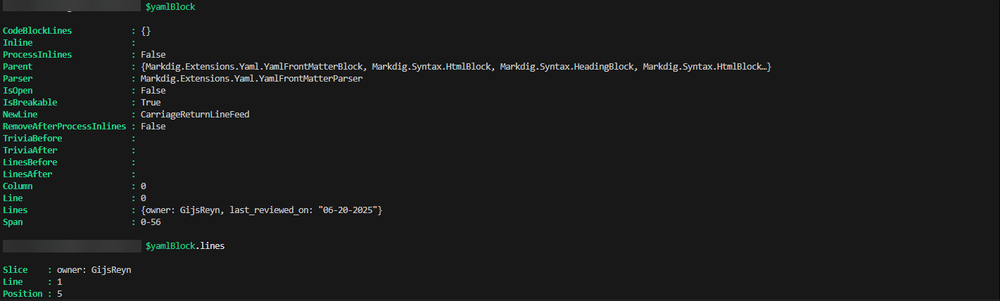
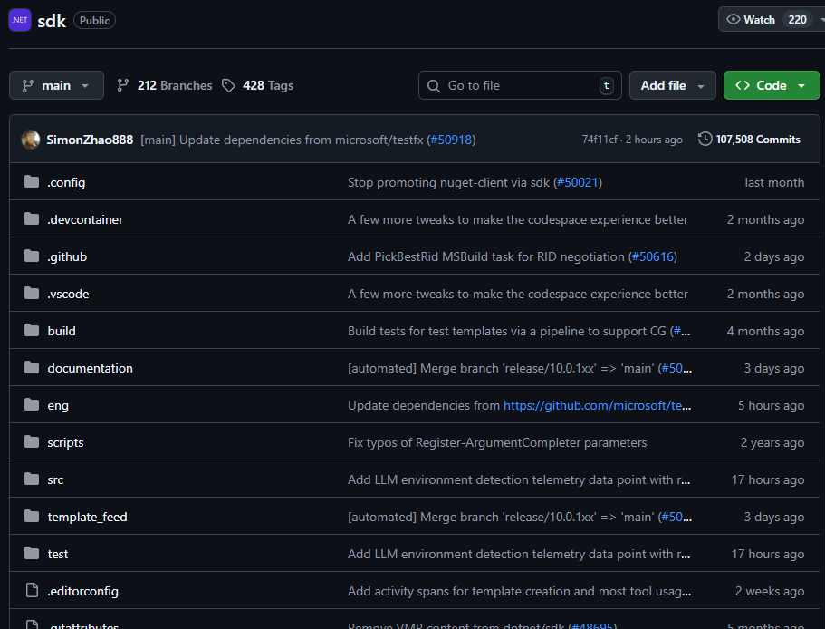
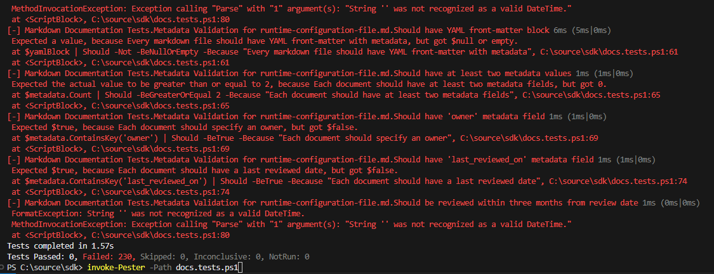
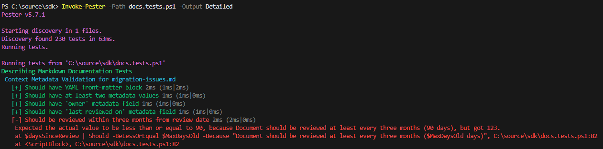

Let's face it. Every piece of documentation you write, whether it is a how-to, tutorial, or a long written guide, will be outdated at some point. Period.

AWS and Microsoft are large companies that follow a <em>docs-as-code</em> model. Each Markdown file committed to version control undergoes a content management policy to identify inactive content. If the content remains unmodified for an extended period, an alert is sent to the owners.

Most of those policies read the Frontmatter data for this information. That's why it's crucial to set boundaries and requirements for what <em>is</em> required in a Markdown file. This raises the question:

<em>How can you do the same?</em>

In this tutorial, you will learn:

<ul>
<li>Why it's helpful to add Frontmatter data in your Markdown files.</li>
<li>How to read the Frontmatter data.</li>
<li>Perform testing using Pester to validate if a file hasn't been checked.</li>
</ul>

At the end of this tutorial, you know what key-value pairs you can add to your document to perform freshness checks for your precious documents.

<h2 id="prerequisites">Prerequisites</h2>

Before you begin this tutorial, you'll need the following:

<ul>
<li>PowerShell 7+.</li>
<li>Pester v5.7.1 or above.</li>
</ul>

Let's dive into it.

<h2 id="adding-frontmatter-data-in-markdown">Adding Frontmatter data in Markdown</h2>

Frontmatter data deserves its place in the world of documentation. It's mainly used for static site generators. Documentation engines also rely on it to hide pages. For example, some engines like MkDocs will read the following data and not publish it on your website:

<pre><code class="language-markdown">---
draft: true
---&#10;
&lt;!-- Rest of your file content --&gt;
</code></pre>

Whenever you publish your document, it will be marked as a draft and not published instantly. This allows you to write your content upfront and possibly preview it on your website as well.

<em>But what about the content itself?</em>

You've spent countless hours writing something, and in three months, it'll be outdated. Can Frontmatter data be added and have a particular value? Certainly! Imagine the following data added at the top of your document:

<pre><code class="language-markdown">---
owner: Gijs Reijn
last_reviewed_on: "06-20-2025"
---
&lt;!-- my-super-hard-working-article.md --&gt;
</code></pre>

Two clearly defined key-value pairs stating the obvious. The document's owner is me, and it was last reviewed nearly three months ago. With this information specified in your document, you can create your content management policy and inform the document owner that it needs to be reviewed every 90 days.

You can recognize that defining such a policy entails a particular responsibility and overhead that the owner cannot escape. There's always a balance you need to seek and ask the relevant questions, like:

<ul>
<li>Will we lose trust and credibility if the documentation doesn't 
match the current product we've released?</li>
<li>Are outdated docs making it harder for new customers to adopt and onboard?</li>
<li>How much time are internal teams wasting verifying or rewriting outdated documentation?</li>
<li>How is stale documentation affecting our brand reputation?</li>
</ul>

But think about it.

A new customer comes in and wants to use your software. All the documentation was written years ago. Do you think the customer will be happy if they read the documentation, try an operation, and it fails instantly? The obvious:

<em>A big fat no no</em>.

<h2 id="reading-frontmatter-data">Reading Frontmatter data</h2>

Now that you've learned how you can define valid Frontmatter data for a content management policy, it's time to look at how you can read it so you can later do <em>something</em> with it.

There have been folks already doing this in the .NET ecosystem for years. One of the most commonly used libraries is the <a href="https://www.nuget.org/packages/Markdig">Markdig library</a>. Markdig allows you to parse raw Markdown and create objects that you can read. Imagine you've the following Markdown document:

<pre><code class="language-markdown">---
owner: Gijs Reijn
last_reviewed_on: "06-20-2025"
---&#10;
&lt;!-- how-to-read-markdown-data-using-markdig.md --&gt;&#10;
# Introduction&#10;
&lt;!-- Introduction text --&gt;&#10;
## Using the library&#10;
&lt;!-- Using the Markdig library --&gt;&#10;
## Parse in PowerShell&#10;
&lt;!-- Use PowerShell to parse --&gt;
</code></pre>

To install the Markdig library from NuGet.org, you can use the <code>Install-Package</code> 
command:

<ol>
<li>Open an elevated PowerShell session.</li>
<li>Run <code>Install-Package Markdig -RequiredVersion 0.42.0</code>.</li>
</ol>

The package will be installed in your <code>$env:ProgramFiles\NuGet\Packages\</code> directory. You can load the library by using the <code>Add-Type</code> command:

<pre><code class="language-powershell">Add-Type -Path "$env:ProgramFiles\PackageManagement\NuGet\Packages\Markdig.0.42.0\lib\netstandard2.0\Markdig.dll"
</code></pre>

This exposes different types that you can use, allowing you to parse the Markdown:

<pre><code class="language-powershell"># 1 create builder and call the extension as a static method
$builder = [Markdig.MarkdownPipelineBuilder]::new()
# call the extension method on the static helper class and reassign
$builder = [Markdig.MarkdownExtensions]::UseYamlFrontMatter($builder)
$pipeline = $builder.Build()&#10;
# 2 parse a file
$md = Get-Content 'how-to-read-markdown-data-using-markdig.md' -Raw
$doc = [Markdig.Markdown]::Parse($md, $pipeline)&#10;
# 3 find the YAML front-matter block
$yamlBlock = $null
foreach ($block in $doc) {
    if ($block -is [Markdig.Extensions.Yaml.YamlFrontMatterBlock]) {
        $yamlBlock = $block
        break
    }
}
</code></pre>

You can clearly see the objects being created, and both key-value pairs are returned in two separate objects. Now, why is it helpful to read this data? Let's use this data and perform testing on it using Pester.

<h2 id="perform-documentation-testing-using-pester">Perform documentation testing using Pester</h2>

With the data stored in variables, you can perform testing and fail whenever a condition is not met. In this case, the condition we've been discussing earlier is that you want to be notified when the <code>last_reviewed_on</code> field needs a review.

Most open-source projects store documentation files in the <code>docs</code> or <code>documentation</code> directory. Take the .NET SDK repository for example:

For illustration purposes, you can use this repository and test if it's adhering to any rules:

<ol>
<li>

Open a PowerShell terminal.

</li>
<li>

Clone the repository to your local machine:

<pre><code class="language-powershell">git clone https://github.com/dotnet/sdk.git
</code></pre>
</li>
<li>

In the root of the project, create a new file named <code>docs.tests.ps1</code> with the following content:

<pre><code class="language-powershell">[CmdletBinding()]
param (
    [System.String]
    $Path = "documentation",&#10;
    [System.Int32]
    $MaxDaysOld = 90
)&#10;
BeforeDiscovery {
    # Load Markdig library
    Add-Type -Path "$env:ProgramFiles\PackageManagement\NuGet\Packages\Markdig.0.42.0\lib\netstandard2.0\Markdig.dll"&#10;    
    # Find all markdown files in the specified path
    $MarkdownFiles = Get-ChildItem -Path $Path -Filter "*.md" -Recurse | ForEach-Object {
        @{
            Name = $_.Name
            FullName = $_.FullName
            RelativePath = $_.FullName.Replace((Get-Location).Path, "").TrimStart("\")
        }
    }
}&#10;
Describe "Markdown Documentation Tests" {
    Context "Metadata Validation for &lt;Name&gt;" -ForEach $MarkdownFiles {
        BeforeAll {
            # Create Markdig pipeline with YAML front-matter support
            $builder = [Markdig.MarkdownPipelineBuilder]::new()
            $builder = [Markdig.MarkdownExtensions]::UseYamlFrontMatter($builder)
            $pipeline = $builder.Build()&#10;            
            # Parse the markdown file
            $md = Get-Content $FullName -Raw
            $doc = [Markdig.Markdown]::Parse($md, $pipeline)&#10;            
            # Find the YAML front-matter block
            $yamlBlock = $null
            foreach ($block in $doc) {
                if ($block -is [Markdig.Extensions.Yaml.YamlFrontMatterBlock]) {
                    $yamlBlock = $block
                    break
                }
            }&#10;            
            # Parse YAML metadata if found
            $metadata = @{}
            if ($yamlBlock) {
                $yamlLines = $yamlBlock.Lines
                foreach ($line in $yamlLines) {
                    $lineText = $line.ToString()
                    if ($lineText -match '^([^:]+):\s*"?([^"]*)"?$') {
                        $key = $matches[1].Trim()
                        $value = $matches[2].Trim()
                        $metadata[$key] = $value
                    }
                }
            }
        }&#10;        
        It "Should have YAML front-matter block" {
            $yamlBlock | Should -Not -BeNullOrEmpty -Because "Every markdown file should have YAML front-matter with metadata"
        }&#10;        
        It "Should have at least two metadata values" {
            $metadata.Count | Should -BeGreaterOrEqual 2 -Because "Each document should have at least two metadata fields"
        }&#10;        
        It "Should have 'owner' metadata field" {
            $metadata.ContainsKey('owner') | Should -BeTrue -Because "Each document should specify an owner"
            $metadata['owner'] | Should -Not -BeNullOrEmpty -Because "Owner field should not be empty"
        }&#10;        
        It "Should have 'last_reviewed_on' metadata field" {
            $metadata.ContainsKey('last_reviewed_on') | Should -BeTrue -Because "Each document should have a last reviewed date"
            $metadata['last_reviewed_on'] | Should -Not -BeNullOrEmpty -Because "Last reviewed date should not be empty"
        }&#10;        
        It "Should be reviewed within three months from review date" {
            $dateString = $metadata['last_reviewed_on']
            $lastReviewedDate = [datetime]::Parse($dateString)
            $daysSinceReview = ((Get-Date) - $lastReviewedDate).Days
            $daysSinceReview | Should -BeLessOrEqual $MaxDaysOld -Because "Document should be reviewed at least every three months ($MaxDaysOld days)"
        }
    }
}
</code></pre>
</li>
<li>

Execute <code>Invoke-Pester -Path docs.tests.ps1</code> in your PowerShell terminal.

The project clearly lacks any content management policies in place. Let's do something about it and modify a file to see if the tests actually work.

</li>
<li>

Open the <code>migration-issues.md</code> file in your editor.

</li>
<li>

At the top of the file, add the following Frontmatter data:

<pre><code class="language-markdown">---
owner: "Me"
last_reviewed_on: "05-19-2025"
---
</code></pre>
</li>
<li>

Rerun the tests with the <code>-Output Detailed</code> added.

</li>
</ol>

Note that four tests have passed, but the document still requires review. A clear indication that the written Pester tests are working successfully. You have now successfully tested a content freshness policy.

<h2 id="summary">Summary</h2>

In this tutorial, you added meaningful Frontmatter (<code>owner</code>, <code>last_reviewed_on</code>) to a Markdown file. The Markdig library allowed you to parse the Frontmatter data easily and enforced a lightweight content freshness policy using Pester.

The tests validate that each document has metadata, an owner, and a last review date. The last test makes sure the review date doesn't exceed a specific window, in this case, 90 days.

This approach provides an auditable and automatable mechanism to identify stale documentation early on. It can be easily integrated into a CI/CD system. When a test fails, you can hit up the <code>owner</code> of the document and ask for a review.

