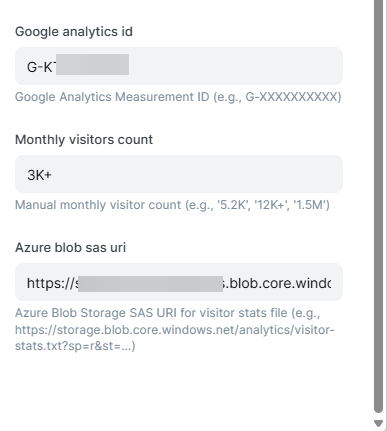

You likely searched the internet for how you can display the number of page visitors in your Ghost theme, only to get disappointed.

I encountered the same issue, and as stubborn as I was, I wanted to give it a shot. Because I developed my own Ghost theme, I quickly found myself in a rabbit hole. But for each hole you dig, you eventually emerge from it.

In this blog post, I'll teach you how you can integrate Google Analytics to display the number of visitors every month using Azure Services. I'm assuming you already have a Ghost theme development setup, have an active Azure subscription, and have enabled the basic <a href="https://ghost.org/integrations/google/">Google Analytics integration</a>.

<h2 id="create-a-google-service-account">Create a Google Service Account</h2>

Integrating with Google Analytics and sending data is easy. Retrieving it is not so much. Google's Analytics Data API didn't allow for any API key (anymore). That's where I needed a new method to fetch data: <em>using a Google Service Account</em>.

This method allows you to limit the privileges only to return the data you need.

The following steps guided me to create a Google Service Account:

<ol>
<li>Navigate to <a href="https://console.cloud.google.com/">https://console.cloud.google.com/</a>.</li>
<li>Sign in with your Google account.</li>
<li>Create a "New project" or select an existing one.
<ul>
<li>Click "Select a project" dropdown at the top.</li>
<li>Click "New project".</li>
<li>Name: <code>ghost-theme-analytics</code>.</li>
<li>Click "Create".</li>
</ul>
</li>
</ol>

With the project created, it was time to enable the Google Analytics Data API:

<ol>
<li>In the Google Console main page, click the "APIs &amp; Services" in the Quick access menu.</li>
<li>In the left corner, click "Library" and search for Google Analytics Data API.</li>
<li>Click "Enable".</li>
</ol>

The Google Analytics Data API is now enabled, allowing access to report data from Google Analytics. It was time to create the account:

<ol>
<li>Under the same page (APIs &amp; Services), click the "Credentials" tab.</li>
<li>Click the "Manage service accounts", bringing you to IAM &amp; Admin -&gt; Service accounts.</li>
<li>Click the "Create service account" button.
<ul>
<li>Give the Service account a name.</li>
<li>Optionally, give it a description.</li>
</ul>
</li>
<li>Click "Finish" to create the account.</li>
</ol>

Before jumping to the next section, I already wanted to populate the key details:

<ol>
<li>Click on the just-created Google Service Account.</li>
<li>Click the "Keys" tab.</li>
<li>Add key -&gt; Create new key.</li>
<li>Select "JSON" and click "Create".</li>
</ol>

When the JSON was created, a JSON file got downloaded to my desktop which is needed for later.

<h2 id="configure-google-analytics-access">Configure Google Analytics access</h2>

With a successful Google Service Account created, it can now be added with limited privileges to Google Analytics:

<ol>
<li>

Open the downloaded JSON file.

</li>
<li>

Find the <code>client_email</code> field. It should look like:

<pre><code class="language-text">"client_email": "ghost-analytics-reader@your-project.iam.gserviceaccount.com"
</code></pre>
</li>
<li>

Copy the e-mail address.

</li>
<li>

Go to <a href="https://analytics.google.com/">https://analytics.google.com/</a>.

</li>
<li>

Sign in with your account if not already.

</li>
<li>

Click the "Admin" wheel in the left corner.

</li>
<li>

Collapse the property settings and select "Property user management".

</li>
<li>

Click the "+" button in the right corner and click Add user.

</li>
<li>

Paste the e-mail address and select the Viewer role.

</li>
<li>

Uncheck "Notify new users by email".

</li>
</ol>

The Google Service Account now has access to read report data. I already got the <code>PROPERTY-ID</code> from the Property details blade (it's a number like <code>123456789</code>) that is needed for the next step.

<h2 id="setup-azure-resources-to-store-page-visitors">Setup Azure resources to store page visitors</h2>

If you've tried integrating Google Analytics data already, you know that exposing the private key stored in the JSON is a bad thing, especially at the client-side. This was my initial approach, and after reconsidering and following the advice shared on Ghost's forum, I wanted a minimal setup that could daily fetch the number of visitors on a backbone.

That backbone is Azure. There are many resources you can use, but the option I chose was an Azure Storage Account and an Automation Account. The Automation Account supports scheduling jobs, which run a small piece of logic to query the data from Google Analytics. With the account details present, I was able to inject those details into my script safely. Let's see it in more detail.

<ol>
<li>

Create a new file named <code>main.bicep</code>.

</li>
<li>

Start with the bare minimum to deploy a Azure Resource Group:

<pre><code class="language-bicep">targetScope = 'subscription'&#10;
// Parameters
@description('Name of the resource group')
param resourceGroupName string = '&lt;resourceGroupName&gt;'&#10;
@description('Azure region for all resources')
param location string = 'westeurope'&#10;
@description('Azure automation account name')
param automationAccountName string = '&lt;automationAccountName&gt;'&#10;
@description('Storage account name')
param storageAccountName string = '&lt;storageAccountName&gt;'&#10;
module rg 'br/public:avm/res/resources/resource-group:0.4.1' = {
    params: {
        name: resourceGroupName
        location: location
    }
}
</code></pre>
</li>
<li>

Add the Automation Account module after the <code>rg</code> module:

<pre><code class="language-bicep">module aa 'br/public:avm/res/automation/automation-account:0.16.1' = {
scope: resourceGroup(resourceGroupName)
params: {
    name: automationAccountName
    skuName: 'Free'
    location: location
    managedIdentities: { systemAssigned: true }
    runbooks: [
        {
            description: 'Runbook to fetch Google Analytics data'
            name: 'Set-GoogleAnalyticsDataVisitorStats'
            type: 'PowerShell72'
            version: '1.0.0.0'
            uri: 'https://raw.githubusercontent.com/Gijsreyn/random-tools-gijs/refs/heads/main/powershell/scripts/Ghost/Set-GoogleAnalyticsDataVisitorStats.ps1'
        }
    ]
    variables: [
        {
            name: 'GA4PropertyId'
            value: '' // Replace with your actual GA4 Property ID copied earlier
            isEncrypted: false
        }
        {
            name: 'GoogleAccessJson'
            isEncrypted: true
            value: loadTextContent('GoogleAccess.json')
        }
    ]
    jobSchedules: [
        {
            runbookName: 'Set-GoogleAnalyticsDataVisitorStats'
            scheduleName: 'DailySchedule'
        }
    ]
    schedules: [
            {
                advancedSchedule: {}
                expiryTime: '9999-12-31T13:00'
                frequency: 'Day'
                interval: 1
                name: 'DailySchedule'
                startTime: ''
                timeZone: 'Europe/Berlin'
            }
        ]
    }
}
</code></pre>
</li>
<li>

Store the saved JSON file (looks like <code>snappy-run-&lt;identifier&lt;.json&gt;</code>) and re-named it to <code>GoogleAccess.json</code> in the root where <code>main.bicep</code> is located.

</li>
<li>

Create an Azure Storage Account and assign the Reader role to the Managed Identity from the Automation Account:

<pre><code class="language-bicep">module st 'br/public:avm/res/storage/storage-account:0.26.2' = {
scope: resourceGroup(resourceGroupName)
params: {
    name: storageAccountName
    location: location
    skuName: 'Standard_LRS'
    kind: 'StorageV2'
    allowBlobPublicAccess: true
    publicNetworkAccess: 'Enabled'
    networkAcls: {}
    blobServices: {
    containers: [
        {
        name: 'analytics'
        publicAccess: 'None'
        roleAssignments: [
                {
                    principalId: aa.outputs.?systemAssignedMIPrincipalId
                    roleDefinitionIdOrName: 'Storage Blob Data Contributor'
                    principalType: 'ServicePrincipal'
                }
            ]
        }
    ]
    corsRules: [
            {
                allowedOrigins: [
                    'https://&lt;domainName&gt;'
                ]
                allowedMethods: [
                    'GET'
                    'OPTIONS'
                ]
                maxAgeInSeconds: 3600
                allowedHeaders: [
                    '*'
                ]
                exposedHeaders: [
                    '*'
                ]
            }
        ]
    }
    roleAssignments: [
    {
        principalId: aa.outputs.?systemAssignedMIPrincipalId!
        roleDefinitionIdOrName: 'Storage Account Key Operator Service Role'
        principalType: 'ServicePrincipal'
    }
    ]
}
}&#10;
module readAssign 'br/public:avm/res/authorization/role-assignment/rg-scope:0.1.0' = {
    scope: resourceGroup(resourceGroupName)
    name: 'read-assign-deployment'
    params: {
        roleDefinitionIdOrName: 'Reader'
        principalId: aa.outputs.?systemAssignedMIPrincipalId!
        principalType: 'ServicePrincipal'
    }
    dependsOn: [
        rg
    ]
}
</code></pre>
<blockquote>

The <code>&lt;domainName&gt;</code> is the site named.

</blockquote>
</li>
</ol>

The Bicep template can be deployed using <code>New-AzDeployment</code> or <code>az deployment sub</code> commands. The <code>Set-GoogleAnalyticsDataVisitorStats.ps1</code> script is responsible for authenticating using the <code>GoogleAccess.json</code> file and leverages the following query to get the last month's data:

<pre><code class="language-powershell">$body = @{
    dateRanges = @(
        @{
            startDate = $StartDate
            endDate   = $EndDate
        }
    )
    metrics = @(
        @{
            name = "activeUsers"
        }
    )
} | ConvertTo-Json -Depth 10
</code></pre>

Each day, the script will run to gather the data and store a file called <code>activeUsers.txt</code> in the Azure Storage container using the System-Assigned Managed Identity. Inside the script, this identity is authenticated and can push the file to Blob Storage.

<h2 id="understanding-the-javascript-integration">Understanding the JavaScript integration</h2>

The Ghost theme that you're developing requires JavaScript code. This piece of JavaScript automatically fetches the visit statistics from Azure Blob Storage and displays the information on your website. Here is how it works:

<ol>
<li>First, the Azure Automation Account triggers the PowerShell script.</li>
<li>The script retrieves data from Google Analytics using the Google Service Account.</li>
<li>Data is sent to Azure Blob Storage (<code>activeUsers.txt</code>) in a container called <code>analytics</code>.</li>
<li>Website runs JavaScript code based on a SAS Blob URI property defined in the <code>package.json</code>.</li>
</ol>

The following is required to be set in the <code>package.json</code> file:

<pre><code class="language-jsonc">"config": {
    // other config settings
    "monthly_visitors_count": {
    "type": "text",
    "default": "5K+",
    "description": "Manual monthly visitor count (e.g., '5.2K', '12K+', '1.5M')"
    },
    "azure_blob_sas_uri": {
    "type": "text",
    "default": "",
    "description": "Azure Blob Storage SAS URI for visitor stats file (e.g., https://storage.blob.core.windows.net/analytics/visitor-stats.txt?sp=r&amp;st=...)"
    }
}
</code></pre>

Now the magic part. In my assets folder, I already created the famously known <code>js</code> directory with a file named <code>theme.js</code>. Here, the following code can be added to fetch the visitor data from the blob based on a configuration value:

<pre><code class="language-javascript">// Fetch visitor statistics from Azure Blob Storage
async function fetchVisitorDataFromBlob() {
    // Get SAS URI from HTML data attribute
    const sasUri = document.body.getAttribute('data-azure-blob-sas');&#10;    
    if (!sasUri || !sasUri.trim()) {
        return null; // No SAS URI configured
    }&#10;
    try {
        // Fetch data from blob storage
        const response = await fetch(sasUri, {
            method: 'GET',
            mode: 'cors',
            headers: {
                'Cache-Control': 'no-cache'
            }
        });&#10;
        if (!response.ok) {
            throw new Error(`HTTP error! status: ${response.status}`);
        }&#10;
        const text = await response.text();
        const visitorCount = text.trim();&#10;        
        // Validate response is a valid number
        if (visitorCount &amp;&amp; !isNaN(visitorCount) &amp;&amp; parseInt(visitorCount) &gt; 0) {
            return visitorCount;
        } else {
            return null;
        }
    } catch (error) {
        // Handle CORS and other errors
        if (error.message.includes('CORS') || error.name === 'TypeError') {
            console.warn('CORS error: Please configure CORS on your Azure Storage Account for localhost:2368');
        } else {
            console.warn('Failed to fetch visitor data from Azure Blob Storage:', error.message);
        }&#10;        
        return null;
    }
}&#10;
async function initGoogleAnalyticsStats() {
    const statsElement = document.getElementById('monthly-visitors');
    if (!statsElement) return;&#10;
    // Try Azure Blob Storage first
    const blobVisitorCount = await fetchVisitorDataFromBlob();
    if (blobVisitorCount) {
        statsElement.textContent = blobVisitorCount;
        return;
    }&#10;
    // Fallback to manual count from theme settings
    const manualCount = document.body.getAttribute('data-monthly-visitors');
    if (manualCount &amp;&amp; manualCount.trim() &amp;&amp; manualCount !== '') {
        statsElement.textContent = manualCount;
        return;
    }&#10;
    // Final fallback
    statsElement.textContent = '5K+';
}
</code></pre>

The JavaScript looks for an HTML element with <code>id="monthly-visitors"</code> to display the count. In my theme home page, I simply added the following:

<pre><code class="language-html">&lt;div class="stat-item"&gt;
    &lt;span class="stat-number" id="monthly-visitors"&gt;Loading...&lt;/span&gt;
    &lt;span class="stat-label"&gt;Monthly visitors&lt;/span&gt;
&lt;/div&gt;
</code></pre>

From my <code>default.hbs</code> file, I load in the configuration settings as follows:

<pre><code class="language-html">&lt;body class="data-monthly-visitors="{{@custom.monthly_visitors_count}}" data-azure-blob-sas="{{@custom.azure_blob_sas_uri}}"&gt;
</code></pre>

Looking a little deeper at the JavaScript code, it follows a strict priority system:

<ol>
<li>Azure Blob Storage.</li>
<li>Static value from Ghost theme setting.</li>
<li>Fallback to default value (5K+)</li>
</ol>

This approach allowed me to generate a SAS URI string with limited read access to the file. The endpoints are publicly available, but so is the data being displayed on the site. People can't write any data to the Azure Storage Account container. In the Ghost admin panel under "Design &amp; branding", the setting will be visible to add the SAS URI.

<h2 id="summary">Summary</h2>

In this blog post, you have learned how you can use a Google Service Account for authentication instead of API keys. This account can safely retrieve data through an Azure Automation Account and send it to Azure Blob Storage. The website can access this data using a SAS URI string and display it on your website.

It's debatable if this method is cost-efficient, even though I have chosen tiers that are either free or with minimal settings.

