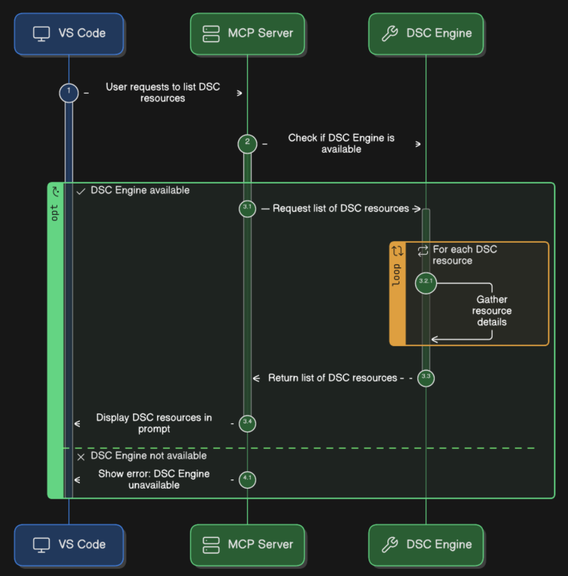
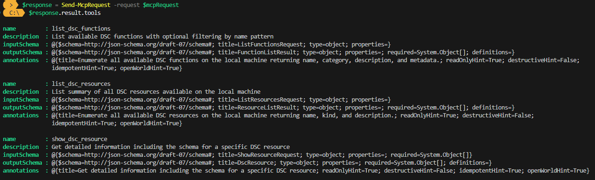
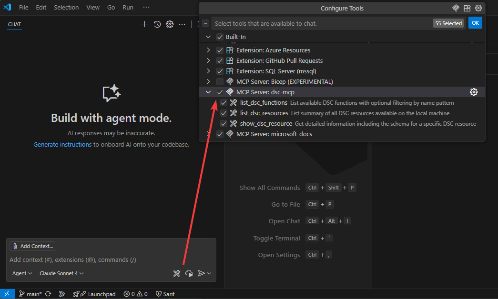
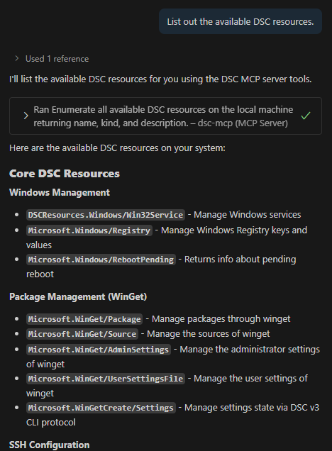
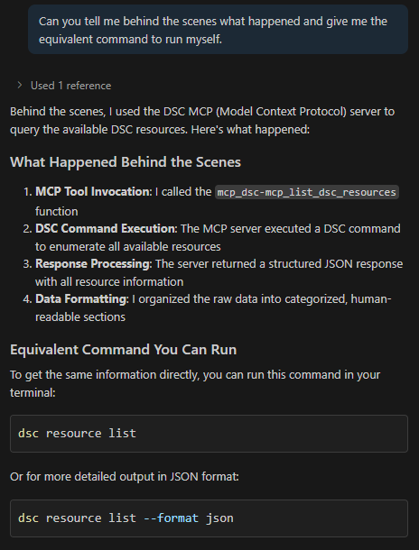
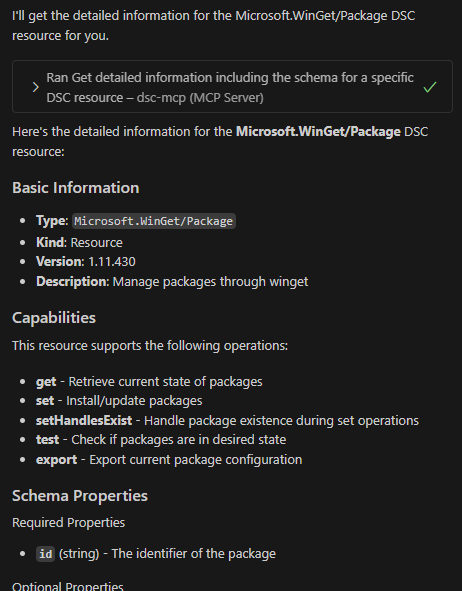

Have you struggled getting started with Microsoft DSC v3? You're used to executing PowerShell commands, and now you suddenly need to switch to using a CLI utility.

Learning new concepts always takes time. But with the latest Model Context Protocol (MCP) server implementation in DSC's engine, it has become remarkably easy. You heard it right, DSC now supports the MCP protocol, allowing you to easily use GitHub Copilot, for example, to learn about Microsoft DSC.

In this short tutorial, you will learn how to set up the MCP server in Visual Studio Code (VS Code). You're going to use GitHub Copilot by asking a bunch of questions and seeing the result.

<h2 id="prerequisites">Prerequisites</h2>

I already mentioned it in the introduction, but if you want to follow along, you're going to need:

<ul>
<li>VS Code v1.102 or higher installed.</li>
<li>GitHub Copilot license.</li>
<li>DSC v3.2.0-preview.5 or higher installed.</li>
</ul>
<h2 id="how-dsc-mpc-integration-works-in-vs-code">How DSC MPC integration works in VS Code</h2>

MCP integration allows VS Code to communicate with Microsoft DSC v3 as an external tool provider. To illustrate an example, here's a diagram of how it works behind the scenes:

VS Code starts the MCP integration by running:

<pre><code class="language-bash">dsc --trace-format plaintext mcp
</code></pre>

The DSC MCP server initializes with the following:

<ul>
<li>It registers with the <em>available tools</em> like <code>list_dsc_resources</code>, <code>list_dsc_functions</code>, and more.</li>
<li>Tells VS Code what operations are supported.</li>
<li>Establishes JSON-RPC over stdin/stdout.</li>
</ul>

Imagine using the diagram above to request the available DSC resources to be discovered. Low-level, VS Code sends a <code>tool/list</code> request in JSON:

<pre><code class="language-json">{
  "jsonrpc": "2.0",
  "id": 1,
  "method": "tools/list",
  "params": {}
}
</code></pre>

To even take it a step further, you can do it outside VS Code by simply using a short PowerShell script and sending an MCP request:

<pre><code class="language-powershell"># Start the MCP server
$processStartInfo = [System.Diagnostics.ProcessStartInfo]::new()
$processStartInfo.FileName = "dsc"
$processStartInfo.Arguments = "--trace-format plaintext mcp"
$processStartInfo.RedirectStandardError = $true
$processStartInfo.RedirectStandardOutput = $true
$processStartInfo.RedirectStandardInput = $true
$mcp = [System.Diagnostics.Process]::Start($processStartInfo)&#10;
function Send-McpRequest($request, [switch]$notify) {
    $request = $request | ConvertTo-Json -Compress -Depth 10
    $mcp.StandardInput.WriteLine($request)
    $mcp.StandardInput.Flush()
    if (!$notify) {
        while ($mcp.StandardOutput.Peek() -eq -1) {
            Start-Sleep -Milliseconds 100
        }
        $stdout = $mcp.StandardOutput.ReadLine()
        return ($stdout | ConvertFrom-Json -Depth 30)
    }
}&#10;
# Initialize
$mcpRequest = @{
    jsonrpc = "2.0"
    id = 1
    method = "initialize"
    params = @{
        protocolVersion = "2024-11-05"
        capabilities = @{
            tools = @{}
        }
        clientInfo = @{
            name = "Test Client"
            version = "1.0.0"
        }
    }
}&#10;
$response = Send-McpRequest -request $mcpRequest
$notifyInitialized = @{
    jsonrpc = "2.0"
    method = "notifications/initialized"
}&#10;
Send-McpRequest -request $notifyInitialized -notify&#10;
# List out the operation
$mcpRequest = @{
    jsonrpc = "2.0"
    id = 2
    method = "tools/list"
    params = @{}
}&#10;
$tools = @{
    'list_dsc_resources' = $false
    'show_dsc_resource' = $false
}&#10;
$response = Send-McpRequest -request $mcpRequest
</code></pre>

In the above image, you can see the available tools returned by the MCP server.

<h2 id="enable-dsc-mcp-server-in-vs-code">Enable DSC MCP server in VS Code</h2>

You just had a glimpse of how things happen in the background. But sending and requesting data through PowerShell is cumbersome. VS Code abstracts this away, and you can use a file named <code>mcp.json</code> to do this for you.

To add the DSC MCP server to VS Code, follow the steps below:

<ol>
<li>In your VS Code workspace, bring up the Command Pallete (CTRL+Shift+P for Windows).</li>
<li>Search for "MCP: Add Server..."</li>
<li>Select "Command (stdio)" to run a local command.</li>
<li>In the "Command to run", type in <code>dsc mcp</code>.</li>
<li>Give it a useful name.</li>
<li>Add it to the local workspace.</li>
</ol>

This will create a new folder (<code>.vscode</code>) if not already present, and inside it a file named <code>mcp.json</code> with the following content:

<pre><code class="language-json">{
	"servers": {
		"dsc-mcp": {
			"type": "stdio",
			"command": "dsc",
			"args": [
				"mcp"
			]
		}
	},
	"inputs": []
}
</code></pre>

The DSC MCP server is now enabled for VS Code to use. If you now press the toolbox icon in the CoPilot chat, you can see it has been added to the toolbox:

<h2 id="asking-questions-to-dsc-mcp-server">Asking questions to DSC MCP server</h2>

With the MCP integration enabled, you can ask questions to see what happens. Let's see what the actual result is when we want to list out the available DSC resources on our system. I have asked the following question: <em>List out the available DSC resources</em>. The result:

It perfectly summarizes the data into chunks for me to look at, but it didn't return the command you might want to run yourself. Let's ask the question <em>Can you tell me behind the scenes what happened and give me the equivalent command to run myself</em>

You can see the thinking process of the LLM, and the command is revealed. You can pick this up and run it in a command prompt or terminal. Let's run one more question to see the details about a specific resource: <em>Can you show me detailed information on a DSC resource named Microsoft.WinGet/Package</em>

The image is limited above, but all optional properties had been revealed. It nearly produces a valid configuration document also:

<pre><code class="language-yaml"># The thing missing is the $schema element
# Example DSC configuration for installing a package
resources:
  - name: Install Visual Studio Code
    type: Microsoft.WinGet/Package
    properties:
      id: Microsoft.VisualStudioCode
      useLatest: true
      installMode: silent
      acceptAgreements: true
</code></pre>
<h2 id="limitations">Limitations</h2>

DSC MCP server just launched in preview. Here's the available list of tools in v3.2.0-preview.5:

<ul>
<li><strong>List DSC resources:</strong> List a summary of all DSC resources available on the local machine.</li>
<li><strong>Show DSC resource:</strong> Get detailed information including the schema for a specific DSC resource.</li>
</ul>

In one of the above pictures, you already saw the <code>list_dsc_functions</code>, which I developed locally to test it out. While writing this article, the PR is still open for review. For a complete list of tools to be created, follow the issue on GitHub at <a href="https://github.com/PowerShell/DSC/issues/1093">this link</a>.

<h2 id="summary">Summary</h2>

Microsoft DSC v3 now exposes an MCP server so tools like VS Code + GitHub Copilot can query DSC directly via JSON-RPC over stdin/stdout. This MCP integration is a helpful companion for learning and experimenting with Microsoft DSC v3 faster.

