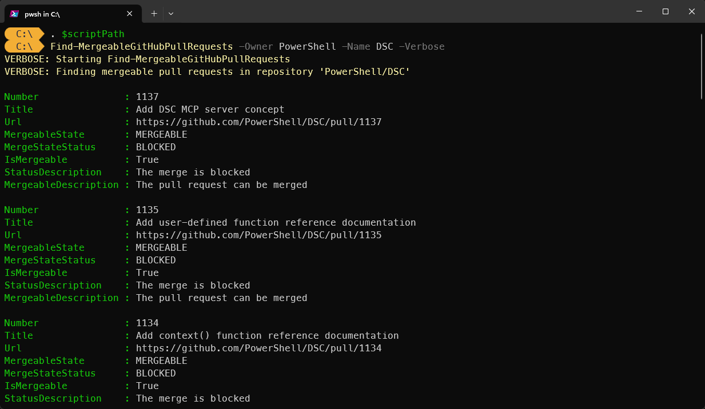

You've probably been there before: you open your favorite GitHub repository, select the open pull request, and filter on your name, trying to figure out which ones are still up-to-date and which ones are just… hanging around to be picked up.

Perhaps your fellow contributors have opened a PR, and it gets merged instantly. But your branches are left behind and you've to press that button again to get the latest changes from main.

As an active contributor, I wanted to solve this by running a simple command. Instead of wasting time manually opening the browser, I built a simple solution using the GitHub CLI, incorporating a touch of PowerShell. And the best part? It's a script you can adapt to your own workflow.

In this short blog post, you'll learn how you can use the GitHub CLI and PowerShell to create rich objects that can be used later.

<h2 id="prerequisites">Prerequisites</h2>

If you want to test out the script yourself, you're going to need:

<ul>
<li>GitHub CLI v2.80 or above.</li>
</ul>
<h2 id="why-github-cli-with-powershell">Why GitHub CLI with PowerShell</h2>

You could argue already: isn't GitHub's UI sufficient? Sort of, but it's not efficient if you have multiple pull requests open (like I do). The GitHub CLI gives you structured data in JSON format. Pair that with PowerShell, and you get the best of both worlds. This scriptable toolchain can:

<ul>
<li>Fetch all open pull requests from a repository.</li>
<li>Query whether the branch behind each PR is mergeable.</li>
<li>Present the results in a clear, customizable format.</li>
</ul>

PowerShell is good with JSON. It can filter the data you need and even export the results to various formats, such as CSV or Markdown.

In other words, instead of wasting time through the UI, you can run one command in seconds.

<h2 id="background">Background</h2>

The heart of the solution is to query using the GitHub CLI (<code>gh</code>) to check each PR's mergeability. GitHub documented each status (<code>MergeStateStatus</code> and <code>MergeableState</code>) based on a set of enums, so you know what will always be returned by the API. Here's the detailed status information for the <code>MergeStateStatus</code> field returned by the CLI:

<table>
<thead>
<tr>
<th>Status</th>
<th>Description</th>
</tr>
</thead>
<tbody>
<tr>
<td><code>BEHIND</code></td>
<td>The head ref is out of date</td>
</tr>
<tr>
<td><code>BLOCKED</code></td>
<td>The merge is blocked</td>
</tr>
<tr>
<td><code>CLEAN</code></td>
<td>Mergeable and passing commit status</td>
</tr>
<tr>
<td><code>DIRTY</code></td>
<td>The merge commit cannot be cleanly created</td>
</tr>
<tr>
<td><code>DRAFT</code></td>
<td>The merge is blocked due to the pull request being a draft</td>
</tr>
<tr>
<td><code>HAS_HOOKS</code></td>
<td>Mergeable with passing commit status and pre-receive hooks</td>
</tr>
<tr>
<td><code>UNKNOWN</code></td>
<td>The state cannot currently be determined</td>
</tr>
<tr>
<td><code>UNSTABLE</code></td>
<td>Mergeable with non-passing commit status</td>
</tr>
</tbody>
</table>

For the <code>MergeableState</code>, it only returns 3 values that can be checked:

<table>
<thead>
<tr>
<th>State</th>
<th>Description</th>
</tr>
</thead>
<tbody>
<tr>
<td><code>CONFLICTING</code></td>
<td>The pull request cannot be merged due to merge conflicts</td>
</tr>
<tr>
<td><code>MERGEABLE</code></td>
<td>The pull request can be merged</td>
</tr>
<tr>
<td><code>UNKNOWN</code></td>
<td>The mergeability of the pull request is still being calculated</td>
</tr>
</tbody>
</table>

Combine this with a strongly-typed PowerShell class and you get the best of both worlds. Let's see what this looks like.

<h2 id="the-script-in-action">The script in action</h2>

To make the output both reliable and easy to work with, I started defining a <strong>PowerShell class</strong>. This class models the properties I care about for each pull request:

<ul>
<li>The pull request number</li>
<li>Title</li>
<li>Merge state</li>
<li>The mergeability status</li>
</ul>

With this approach, you don't have to work with raw JSON, but instead, get back objects you can filter or sort on.

Here's the class definition:

<pre><code class="language-powershell"># Find-MergeableGitHubPullRequests
class GitHubPullRequest
{
    [int]$Number
    [string]$Title
    [string]$Url
    [string]$MergeableState
    [string]$MergeStateStatus
    [bool]$IsMergeable
    [string]$StatusDescription
    [string]$MergeableDescription&#10;
    GitHubPullRequest([int]$number, [string]$title, [string]$url, [string]$mergeableState, [string]$mergeStateStatus)
    {
        $this.Number = $number
        $this.Title = $title
        $this.Url = $url
        $this.MergeableState = $mergeableState
        $this.MergeStateStatus = $mergeStateStatus
        $this.IsMergeable = ($mergeableState -eq 'MERGEABLE')
        $this.StatusDescription = switch ($mergeStateStatus)
        {
            'BEHIND' { 'The head ref is out of date' }
            'BLOCKED' { 'The merge is blocked' }
            'CLEAN' { 'Mergeable and passing commit status' }
            'DIRTY' { 'The merge commit cannot be cleanly created' }
            'DRAFT' { 'The merge is blocked due to the pull request being a draft' }
            'HAS_HOOKS' { 'Mergeable with passing commit status and pre-receive hooks' }
            'UNKNOWN' { 'The state cannot currently be determined' }
            'UNSTABLE' { 'Mergeable with non-passing commit status' }
            default { 'Unknown status' }
        }
        $this.MergeableDescription = switch ($mergeableState)
        {
            'CONFLICTING' { 'The pull request cannot be merged due to merge conflicts' }
            'MERGEABLE' { 'The pull request can be merged' }
            'UNKNOWN' { 'The mergeability of the pull request is still being calculated' }
            default { 'Unknown mergeable state' }
        }
    }
}
</code></pre>

With this class in place, the next step is a small <strong>helper function</strong> to take the raw JSON returned by the GitHub CLI and turn it into an instance of <code>GitHubPullRequest</code>:

<pre><code class="language-powershell">function New-PullRequest
{
    param (
        [int]$number,
        [string]$title,
        [string]$url,
        [string]$mergeableState,
        [string]$mergeStateStatus
    )
    return [GitHubPullRequest]::new($number, $title, $url, $mergeableState, $mergeStateStatus)
}
</code></pre>

Finally, the <strong>main function</strong> ties everything together. It calls <code>gh pr list</code> with the right fields to return. Then, it leverages the <strong>helper function</strong> to convert the output to PowerShell objects:

<pre><code class="language-powershell">function Find-MergeableGitHubPullRequests
{
    [CmdletBinding()]
    param (
        [Parameter(Mandatory = $true, Position = 0)]
        [string]$Owner,&#10;
        [Parameter(Mandatory = $true, Position = 1)]
        [string]$Name
    )&#10;
    begin
    { 
        Write-Verbose -Message "Starting $($MyInvocation.MyCommand.Name)"
        $repo = "$Owner/$Name"&#10;
        # the fields we want to retrieve from GitHub
        $jsonProps = "url,title,mergeStateStatus,mergeable,number"
    }&#10;
    process
    {
        Write-Verbose -Message "Finding mergeable pull requests in repository '$repo'"
        $pullRequests = gh pr list --repo $repo --author "@me" --state open --json $jsonProps | ConvertFrom-Json
        if (-not $pullRequests -or $pullRequests.Count -eq 0) { return }&#10;
        foreach ($pr in $pullRequests)
        {
            [GitHubPullRequest]::new($pr.number, 
                $pr.title, 
                $pr.url, 
                $pr.mergeable, 
                $pr.mergeStateStatus
            )
        }
    }&#10;
    end 
    {
        Write-Verbose -Message "Ending $($MyInvocation.MyCommand.Name)"
    }
}
</code></pre>

To see the script in action, make sure you first use the <code>gh auth login</code> and then execute the command seen in image below:

This way, you can instantly spot which pull request can be rebased, only with a merge commit, or isn't even mergeable without clicking through the GitHub UI.

<h2 id="summary">Summary</h2>

By combining the GitHub CLI and PowerShell, you don't have to rely on the GitHub UI. You get a fast, scriptable way to surface exactly what you need.

The approach of using a strongly typed PowerShell class ensures reliable output. Can you take it a step further and schedule it as a recurring task to receive notifications? Give it a try!

I've published the whole script in my <a href="https://github.com/Gijsreyn/random-tools-gijs/blob/main/powershell/scripts/GitHub/Find-MergeableGitHubPullRequests.ps1">GitHub repository</a> so you can adapt it to your own needs.

