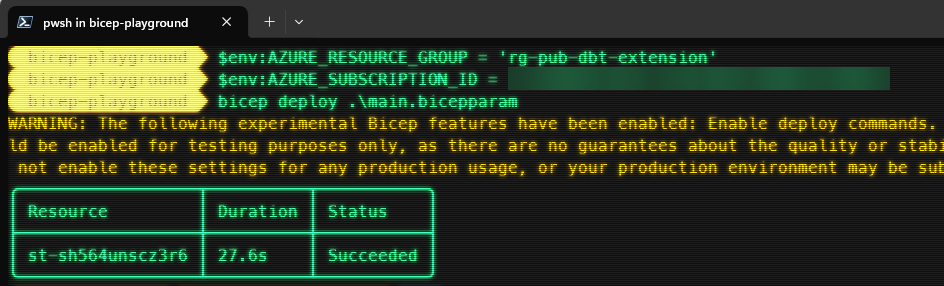
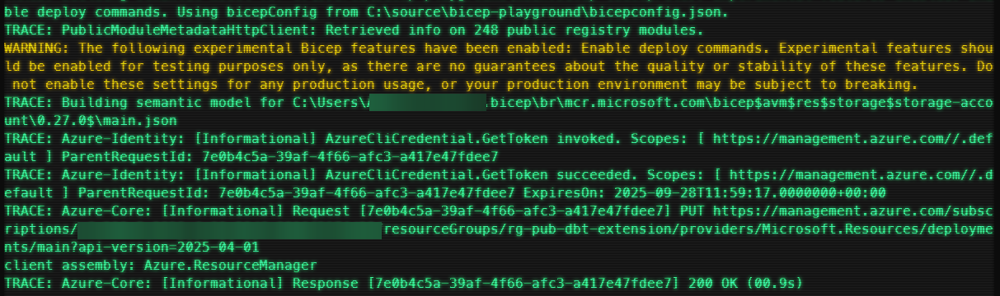

Say goodbye to the Azure CLI or Azure PowerShell for Bicep deployment. There's a new sheriff in town.

A couple of weeks ago, Anthony Martin, the Engineering Manager for Bicep deployments, created a new issue on <a href="https://github.com/Azure/bicep/issues/17949">GitHub</a>. The issue describes that the Bicep CLI doesn't natively support deployment capabilities using Bicep's CLI.

Fast forward and a couple of pull requests further, a new subcommand has been added to the CLI: <code>bicep deploy</code>.

Not released, not final — but you can pull the main branch and see it in action now. In this blog post, we will dive into what's already available to us.

💡

Please be aware that what’s shown here is subject to changes. Refer to the official documentation when the feature becomes available.

<h2 id="what-is-bicep-deploy">What is Bicep deploy</h2>
As Anthony described in the issue, the Bicep CLI tightly integrates with Azure CLI and Azure PowerShell. Think of the commands you'll typically use to deploy Bicep files:
<ul><li><strong>Azure CLI:</strong><ul><li><code>az deployment sub create</code></li><li><code>az deployment group create</code></li><li><code>az deployment mg create</code></li><li><code>az deployment tenant create</code></li></ul></li><li><strong>Azure PowerShell:</strong><ul><li><code>New-AzResourceGroupDeployment</code></li><li><code>New-AzSubscriptionDeployment</code></li><li><code>New-AzManagementGroupDeployment</code></li><li><code>New-AzTenantDeployment</code></li></ul></li></ul>
But with this tight integration, you always had to install one of the two to deploy Bicep files to Azure. Now, Bicep has grown. It supports features like <code>externalInputs</code>, variable expressions, and more. With that maturity, the team decided to put their energy into a native CLI experience.

So the <code>bicep deploy</code> command was born. With this new subcommand added, you can now natively use the Bicep CLI to deploy Bicep files. Based on the <code>scope</code> defined in the <code>.bicepparam</code> file, you can target where you want the <code>.bicep</code> to deploy towards. Here's an example snippet:
<pre><code class="language-Bicep">// main.bicepparam
using 'main.bicep' with {
  mode: 'deployment'
  scope: '/subscriptions/&lt;subscriptionId&gt;/resourceGroups/&lt;resourceGroupName&gt;'
}
</code></pre><h2 id="how-to-try-it-out-today">How to try it out today</h2>
The experimental feature has not been officially released, as mentioned from the beginning. But don't worry, the Bicep team has you covered already.

To grab one of the latest nightly builds for the Bicep CLI, you can run the following commands:
<pre><code class="language-bash"># Install on MacOS/Linux
bash &lt;(curl -Ls https://aka.ms/bicep/nightly-cli.sh)</code></pre>
Or use PowerShell:
<pre><code class="language-PowerShell"># Installl on Windows
iex "&amp; { $(irm https://aka.ms/bicep/nightly-cli.ps1) }"</code></pre>
When the CLI is installed, you need to set the experimental feature flag in the known <code>bicepconfig.json</code> file:
<pre><code class="language-JSON">{
  "experimentalFeaturesEnabled": {
    "deployCommands": true
  }
}</code></pre>
Now that's set up, let's take a closer look by deploying an actual resource to a Resource Group:
<pre><code class="language-Bicep">// main.bicep
param storageAccountName string&#10;
module st 'br/public:avm/res/storage/storage-account:0.27.0' = {
  params: {
    name: storageAccountName
  }
}&#10;
// main.bicepparam
var subscriptionId = readEnvVar('AZURE_SUBSCRIPTION_ID')
var resourceGroupName = readEnvVar('AZURE_RESOURCE_GROUP')&#10;
using 'main.bicep' with {
  mode: 'deployment'
  scope: '/subscriptions/${subscriptionId}/resourceGroups/${resourceGroupName}'
}&#10;
param storageAccountName = 'afakeststorageaccount123'
</code></pre>
The <code>readEnvVar</code> is a new function to read environment variables for the <code>bicep deploy</code> command. If these values are not set while deploying, the CLI will throw an error. Let's test it out by running the command.
<figure class="kg-card kg-image-card"></figure>
When the command was executed, the duration was incrementally displayed, showing how long it took. This experience was made possible by using the <a href="https://spectreconsole.net/">Spectre</a> console.
<h2 id="capabilities-and-constraints">Capabilities and constraints</h2>
<code>bicep deploy</code> is brand new. You can already see useful commands landing. It supports <code>what-if</code> to preview changes. The <code>teardown</code> for stack clean-up, and the <code>--format</code> option to output JSON for easier parsing. It also works with completions, making the authoring experience smoother.

That said, the feature isn't without limits. At this stage, it still appears to rely on the Azure CLI or Azure PowerShell to fetch an authentication token.
<figure class="kg-card kg-image-card"></figure>
In my tests, the <code>resourceGroup()</code> function failed, showing that scope handling isn't completed. I expected constraints already, but it's already clear that the team is laying the foundation for <code>bicep-deploy</code>.
<h2 id="the-road-ahead">The road ahead</h2>
The vision for <code>bicep deploy</code> goes well beyond a new subcommand. The Bicep team is exploring various syntax changes for <code>.bicepparam</code> files. The new CLI groups (<code>deploy</code>, <code>what-if</code>, <code>destroy</code>), and functions like <code>readEnvVar()</code> and <code>readCliArg()</code> bring in runtime values straight into deployments. Together, these aim to simplify the authoring and configuration experience.

Bicep's community is always active, and feedback highlighted where this could sparkle even further:
<ul><li>Better CI/CD integration with Azure DevOps and GitHub Actions.</li><li>Parity with Azure PowerShell's rich output.</li><li>Improved visualization across pipelines.</li><li>Multiple version support and stronger handling of context/scopes.</li><li>Friendly diagnostics with links to Azure Portal.</li></ul>
If these ideas take hold, the Bicep CLI could provide a single, self-contained tool for authoring, validating, deploying, and troubleshooting your Azure infrastructure.

