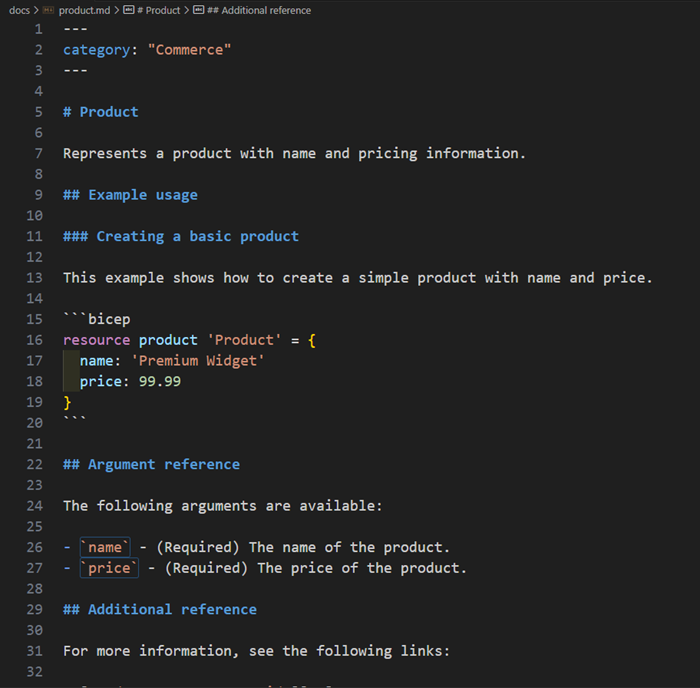

Bicep's <code>local-deploy</code> resources are rapidly growing, but the models developed often lag behind in documentation.

Keeping documentation in sync with code is always a struggle. As a developer, you typically start by writing the code. You create the <code>baseHandler</code>, define the models, and lastly, implement the <code>handler</code> for what you want to expose to your end-user. Only after things work, you still need to create a <code>README.md</code> file explaining how users can leverage the functionality.

What if your code could describe itself? And what if the documentation was generated directly from the annotations you already wrote while defining the models?

That's precisely why I wrote the <code>Bicep.LocalDeploy</code> library and <code>bicep-local-docgen</code> CLI utility. In this blog post, you will learn:
<ul><li>Why <code>Bicep.LocalDeploy</code> was developed.</li><li>How it works.</li><li>How to get started.</li></ul><h2 id="why-biceplocaldeploy">Why Bicep.LocalDeploy</h2>
Despite its name, <code>Bicep.LocalDeploy</code> doesn't come out of the kitchen from the Bicep team, but it's a library and a tool for producing better documentation for your developed resources.

See, typing out documentation for Infrastructure as Code (IaC) has always been a challenging task. In the context of <code>local-deploy</code> resources, developers wire up the models, handlers, and outputs, and then move on.  The problem? Documentation is an afterthought, often writing manually <code>README.md</code> files. 

This creates <em>friction</em>. Every code change you make has the risk of drifting away from what's written in the docs.

In the C# ecosystem, this is often tackled with annotation-driven approaches. For example, attributes or decorators allow developers to enrich code with metadata that can be consumed for auto-generated documentation. 

If you've written a <code>local-deploy</code> model before, you probably recognized that you already have defined some of this metadata:
<pre><code class="language-Bicep">[ResourceType("Product")]
public class Product
{
    /// &lt;summary&gt;
    /// Gets or sets the name of the product.
    /// &lt;/summary&gt;
    /// &lt;value&gt;The product name. Cannot be null or empty.&lt;/value&gt;
    [TypeProperty("The name of the product.", ObjectTypePropertyFlags.Required)]
    public string Name { get; set; } = string.Empty;&#10;
    /// &lt;summary&gt;
    /// Gets or sets the price of the product in decimal format.
    /// &lt;/summary&gt;
    /// &lt;value&gt;The product price. Must be greater than or equal to zero.&lt;/value&gt;
    [TypeProperty("The price of the product.", ObjectTypePropertyFlags.Required)]
    public decimal Price { get; set; }
}</code></pre>
Here's where you already have defined two key pieces that are useful for your end-users to read:
<ul><li>The properties have attributes defined with a <em>description</em>.</li><li>The properties <code>ObjectTypePropertyFlag</code> states whether properties are <em>mandatory or not</em>.</li></ul>
What if you could extend this while coding out your model?

That's the goal of the <code>Bicep.LocalDeploy</code> library: let developers annotate their Bicep properties directly in the code. From there on, the companion tool <code>bicep-local-docgen</code> can automatically generate consistent up-to-date documentation. The result is less time spent maintaining <code>README.md</code> (or any other name) files.
<h2 id="how-it-works">How it works</h2>
At its core, <code>Bicep.LocalDeploy</code> introduces individual annotations that can be attached directly to your model code. These annotations can describe:
<ul><li>Frontmatter data, such as the category to which the model belongs.</li><li>The first heading data.</li><li>Provide examples.</li><li>Custom sections.</li></ul>
Once those annotations are in place, the <code>bicep-local-docgen</code> takes over. This CLI utility scans the <code>*.cs</code> files, reads the annotations, and generates Markdown files. That means you don't have to write out any Markdown files yourselves. No more manual edits required.

Here's the revisited example from earlier with annotations from <code>Bicep.LocalDeploy</code>:
<pre><code class="language-Bicep">using Bicep.LocalDeploy;
using Bicep.Local.Extension.Types.Attributes;
using Azure.Bicep.Types.Concrete;
using System.Text.Json.Serialization;&#10;
namespace MyCommerce.Models.Product;&#10;
[BicepFrontMatter("category", "Commerce")]
[BicepDocHeading("Product", "Represents a product with name and pricing information.")]
[BicepDocExample(
    "Creating a basic product",
    "This example shows how to create a simple product with name and price.",
    @"
resource product 'Product' = {
  name: 'Premium Widget'
  price: 99.99
}
"
)]
[BicepDocCustom("Additional reference", @"For more information, see the following links:&#10;
- [Product Management Guide][00]&#10;
&lt;!-- Link reference definitions --&gt;
[00]: https://example.com/docs/products")]
[ResourceType("Product")]
public class Product
{
    /// &lt;summary&gt;
    /// Gets or sets the name of the product.
    /// &lt;/summary&gt;
    /// &lt;value&gt;The product name. Cannot be null or empty.&lt;/value&gt;
    [TypeProperty("The name of the product.", ObjectTypePropertyFlags.Required)]
    public string Name { get; set; } = string.Empty;&#10;
    /// &lt;summary&gt;
    /// Gets or sets the price of the product in decimal format.
    /// &lt;/summary&gt;
    /// &lt;value&gt;The product price. Must be greater than or equal to zero.&lt;/value&gt;
    [TypeProperty("The price of the product.", ObjectTypePropertyFlags.Required)]
    public decimal Price { get; set; }
}</code></pre><!--members-only--><h2 id="getting-started">Getting started</h2>
Now that you've seen the concept in action, let's walk through how to set it up yourself. Getting started is simple: add the <code>Bicep.LocalDeploy</code> package to your project, add annotations to your code, and run the <code>bicep-local-docgen</code> tool to generate the docs.

Let's do it step-by-step. I'm assuming you have the .NET SDK 9.0 or above installed:
<ol><li>Create a new project file named <code>MyCommerce.csproj</code> with the following content:</li></ol><pre><code class="language-xml">&lt;Project Sdk="Microsoft.NET.Sdk"&gt;
  &lt;PropertyGroup&gt;
    &lt;OutputType&gt;Exe&lt;/OutputType&gt;
    &lt;RootNamespace&gt;MyCommerce&lt;/RootNamespace&gt;
    &lt;AssemblyName&gt;my-commerce&lt;/AssemblyName&gt;
    &lt;IncludeNativeLibrariesForSelfExtract&gt;true&lt;/IncludeNativeLibrariesForSelfExtract&gt;
    &lt;PublishSingleFile&gt;true&lt;/PublishSingleFile&gt;
    &lt;SelfContained&gt;true&lt;/SelfContained&gt;
    &lt;InvariantGlobalization&gt;true&lt;/InvariantGlobalization&gt;
    &lt;TargetFramework&gt;net9.0&lt;/TargetFramework&gt;
    &lt;Nullable&gt;enable&lt;/Nullable&gt;
    &lt;ImplicitUsings&gt;enable&lt;/ImplicitUsings&gt;
    &lt;AppendTargetFrameworkToOutputPath&gt;false&lt;/AppendTargetFrameworkToOutputPath&gt;
    &lt;AppendRuntimeIdentifierToOutputPath&gt;false&lt;/AppendRuntimeIdentifierToOutputPath&gt;
  &lt;/PropertyGroup&gt;&#10;
  &lt;ItemGroup&gt;
    &lt;PackageReference Include="Azure.Bicep.Local.Extension" Version="0.37.4" /&gt;
    &lt;PackageReference Include="Azure.Identity" Version="1.14.2" /&gt;
  &lt;/ItemGroup&gt;
&lt;/Project&gt;</code></pre><ol start="2"><li>From the project directory run: <code>dotnet add package Bicep.LocalDeploy</code>.</li></ol>
This will add the library providing annotation attributes.
<ol start="3"><li>Create a folder <code>Models</code> and add a new file named <code>Product.cs</code>.</li><li>Copy the content from the earlier section into this file.</li><li>Install the <code>bicep-local-docgen</code> by running: <code>dotnet tool install --global bicep-local-docgen</code>.</li><li>Execute <code>bicep-local-docgen generate --source Models -v</code> in your terminal to produce documentation.</li></ol><figure class="kg-card kg-image-card"></figure>
By default, the CLI utility produces files in the <code>docs</code> directory. You can always add the <code>--output</code> option to store the generated docs in a different directory. If you open the file in your favorite editor, you notice the generated docs.
<figure class="kg-card kg-image-card"></figure>
With the docs now generated, you're ready to publish them into your repository.
<h2 id="key-takeaways">Key takeaways</h2>
Using the <code>Bicep.LocalDeploy</code> and <code>bicep-local-docgen</code> tool demonstrated how much easier it is to create documentation. By annotating your models and generating docs automatically, you eliminate the manual work. It also keeps your code aligned with your docs. At least, if you keep the annotations up to date, as well.

Here are the main benefits you'll notice when adopting this approach:
<ul><li><strong>Annotations simplify documentation: </strong>Adding metadata directly to your models ensures docs are always up to date.</li><li><strong>Automated generation: </strong>The <code>bicep-local-docgen</code> was designed on top of the library to produce Markdown documentation.</li><li><strong>Easy setup: </strong>Simply add the NuGet package to your project and run the CLI tool.</li><li><strong>Flexible output: </strong>Add the annotations you want, and the tool grabs it up.</li></ul><h2 id="summary"><strong>Summary</strong></h2>
The <code>Bicep.LocalDeploy</code> library provides simple annotations that you can add directly next to your source code. This way, the CLI utility can read the annotations and keep your documentation up to date without requiring manual updates.

In this way, documentation also becomes standardized if you follow the same style in each model. If you wanna learn more, check out the official <a href="https://github.com/Gijsreyn/bicep-local-docgen/tree/main/docs">GitHub</a> repository.

There are already a couple of repositories making use of this library:
<ul><li><a href="https://github.com/Gijsreyn/bicep-ext-databricks/tree/main" rel="noreferrer">Bicep Databricks extension</a></li><li><a href="https://github.com/johnlokerse/azure-devops-bicep-local-deploy/tree/main" rel="noreferrer">Azure DevOps Bicep Local Extension</a></li><li><a href="https://github.com/riosengineer/cloudflare-bicep-deploy" rel="noreferrer">CloudFlare Bicep Extension</a></li></ul>
