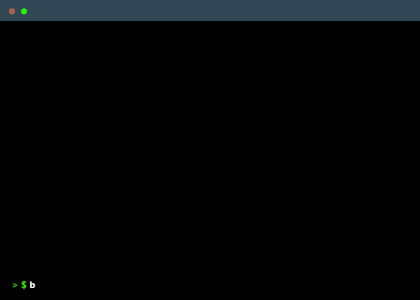

The Bicep team aims for (and usually hits) a monthly release cadence. This month, two releases were made in two days: v0.38.3, followed by a minor update, v0.38.5. The theme of both releases:
<ul><li>General availability (GA) on <code>onlyIfNotExists</code> decorator.</li><li>Three experimental features were added.</li><li>New function <code>loadDirectoryFileInfo</code>.</li><li>Library to interact with Bicep's CLI.</li><li>Other updates.</li></ul>
In this blog post, we'll break down each feature or change and explain what it enables you to do differently today.
<h2 id="ga-onlyifnotexists-decorator">GA <code>@onlyIfNotExists</code> decorator</h2>
If you manage shared platform resources, such as Azure Key Vault, Log Analytics, or Azure Container Instances, you face existence checks and struggle with splitting templates.

With the <code>@onlyIfNotExists</code> decorator now being GA, it allows you to declare: "Create once, then leave it alone". The result:
<ul><li>Fewer noisy diffs in CIs.</li><li>Reduced failed redeploy chatter.</li><li>Safer shared infrastructure rollout.</li></ul>
So, why does this matter? Before this, you had to guard the creations with parameters. You split "seed" vs "update" templates, or even risk overwriting rotated secrets and placeholders. The <code>@onlyIfNotExists</code> guarantees decorator encodes the real intent. It guarantees existence once, allowing operations to own the value rotation while the platform code remains stable.

<strong><em>Why it matters</em></strong>: before this, you guarded creations with parameters, split “seed” vs “update” templates, or risked overwriting rotated secrets and placeholders. <code>@onlyIfNotExists</code> encodes the real intent—guarantee existence once, so operations can own value rotation while platform code stays stable and quiet. Here's a real-world use case reported by a community member, including Bicep code:
<pre><code class="language-bicep">@description('Key Vault module to create a Key Vault')
module keyvault 'br/public:avm/res/key-vault/vault:0.13.0' = {
  params: {
    name: 'keyvaultName'               // Target vault name
  }
}&#10;
@description('Reference the existing KeyVault as a resource to be parent')
resource keyvaultExisting 'Microsoft.KeyVault/vaults@2024-11-01' existing = {
  name: 'keyVaultName'                 // Same physical vault the module creates (module ensures existence)
}&#10;
@secure()
@description('Generate a new GUID for the first deployment - not reused after rotation')
param secretValue string = newGuid()&#10;
@description('The Key Vault secret name to be created')
param secretName string = 'myKeyVaultSecret'&#10;
@onlyIfNotExists()
@description('Create the secret only if it does not already exist')
resource secret 'Microsoft.KeyVault/vaults/secrets@2024-11-01' = {
  parent: keyvaultExisting
  name: secretName
  dependsOn: [
    keyvault                          // Ensure vault provisioning completes before initial seed
  ]
  properties: {
    value: secretValue                // Used ONLY on first creation. Ignored on subsequent deployments.
  }
}</code></pre>
The operation flow that happens when you deploy:
<ol><li>First deployment: a secret is created with a generated GUID.</li><li>Operations rotates the value directly in Key Vault as needed.</li><li>Subsequent template deployments: decorator suppresses mutation.</li></ol>

💡

Use caution with this decorator if the resource's properties should always match the correct intent.

<h2 id="interactive-repl-and-deploy-commands"><strong>Interactive REPL and <code>deploy</code> commands</strong></h2>
In a <a href="/native-bicep-deployments-using-biceps-cli/">previous post</a>, I touched upon the <code>deploy</code>them commands already. But now, the commands are directly available in the release, rather than requiring installation from a nightly build. You still have to enable a feature flag in the <code>bicepconfig.json</code>:
<pre><code class="language-json">{
  "experimentalFeaturesEnabled": {
    "deployCommands": true
  }
}</code></pre>
The Bicep team created the following documentation links:
<ul><li><a href="https://github.com/Azure/bicep/blob/main/docs/experimental/deploy-commands.md">Using the deploy commands</a>.</li><li><a href="https://github.com/Azure/bicep/tree/main/docs/experimental/deploy-commands-samples">Deploy command samples</a>.</li></ul>
To use the new <code>bicep console</code> command to test Bicep functions and expressions live, open up your terminal, poke out a bunch of expressions or functions, and learn fast. The example below illustrates the point.
<figure class="kg-card kg-image-card"></figure><h2 id="the-validate-decorator">The <code>@validate()</code> decorator</h2>
Bicep decorators are simple to use. You could check the length. You could check allowed values being passed in on parameters, and that was it.

But real Azure resources demand more.

Take the <code>adminPassword</code> property on a VM (reported by Jordan Ellis Coppard). Azure requires:
<ul><li>Three of four complexity rules: lowercase, uppercase, digit, and a special character.</li><li>Specific weak values are banned, like <code>"P@ssw0rd"</code>.</li></ul>
In Bicep, all you could write was this:
<pre><code class="language-bicep">@minLength(12)
@maxLength(123)
param adminPassword string</code></pre>
That isn't enough. You find out the password fails only after deployment. With the <code>@validate()</code> decorator, it runs checks before you actually deploy. It can enforce logic, not just length or lists. Now we can express the rule set:
<pre><code class="language-bicep">@minLength(12)
@maxLength(123)
@validate(
  x =&gt; toLower(x) != x &amp;&amp; toUpper(x) != x &amp;&amp; !contains(['abc@123', 'P@$$w0rd', 'P@ssw0rd', 'P@ssword123', 'Pa$$word', 'pass@word1', 'Password!', 'Password1', 'Password22', 'iloveyou!'], x),
  'Password must contain both uppercase and lowercase letters and not be a common password'
)
param adminPassword string
</code></pre>
This catches weak or invalid passwords before deployment, saving you time and effort. 

💡

Requires the <code spellcheck="false" style="white-space: pre-wrap;">userDefinedConstraints</code> experimental feature flag.

<h2 id="using-loaddirectoryfileinfo-in-bicep">Using <code>loadDirectoryFileInfo</code> in Bicep</h2>
This change came from the community. Gabriel created the pull request.

Before, you could only load a single file with functions like <code>loadFileAsBase64</code> or <code>loadJsonContent</code>. If you had a folder of files, you had to reference each one manually.

Now, with this function, it's no longer needed. The new <code>loadDirectoryFileInfo</code> function returns an array of objects for every file in a directory. And guess what, it also supports wildcards.

Say you have a folder full of PowerShell scripts. You want them published as runbooks in an Azure Automation Account. With <code>loadDirectoryFileInfo</code>, you can do something like this:
<pre><code class="language-bicep">@description('Name of the Automation Account')
param automationAccountName string&#10;
@description('Location of the Automation Account')
param location string = resourceGroup().location&#10;
// Load all PowerShell scripts from the Runbooks folder
var runbookFiles = loadDirectoryFileInfo('./Runbooks', '*.ps1')&#10;
resource automationAccount 'Microsoft.Automation/automationAccounts@2020-01-13-preview' = {
  name: automationAccountName
  location: location
  properties: {}
}&#10;
module runbooks 'Automation/automationRunbook.bicep' = [for file in runbookFiles: {
  name: '${automationAccountName}-${file.baseName}'
  scope: resourceGroup()
  params: {
    automationAccountName: automationAccount.name
    runbookName: file.baseName
    runbookFilePath: file.fullName
    runbookType: 'PowerShell'
  }
}]</code></pre>
Here, every <code>.ps1</code> file in the <code>Runbooks</code> folder becomes a runbook. Add a file, and it gets deployed. Remove it, and it will be removed from the Automation Account.
<h2 id="interact-with-bicep-cli-via-jsonrpc">Interact with Bicep CLI via JSONRPC</h2>
In version 0.38.5, a new library has been introduced: a JSON-RPC client for the Bicep CLI. It lets you call the Bicep CLI command programmatically. Compile, decompile, publish, etc – via a stable JSON-RPC interface. 

This is an interesting addition, as it:
<ul><li>Increased performance and reusability</li><li>The client supports downloading or pinning specific Bicep versions</li><li>All existing JSONRPC methods exposed by the Bicep CLI are now accessible</li><li>Hooks into existing tools and APIs.</li></ul>
In short, this is a more robust and programmatic alternative to repeat <code>bicep &lt;subCommand&gt;</code> invocations. Here's a small example snippet on how to use the new client for .NET developers:
<pre><code class="language-csharp">var clientFactory = new BicepClientFactory(new HttpClient());&#10;
using var client = await clientFactory.DownloadAndInitialize(new() {
    BicepVersion = "0.38.5"
}, cancellationToken);&#10;
// Compile a Bicep file
var result = await client.Compile(new("/path/to/main.bicep"));
if (!result.Success)
{
    Console.WriteLine("Errors:");
    foreach (var diag in result.Diagnostics)
    {
        Console.WriteLine(diag);
    }
}
else
{
    Console.WriteLine("Compiled JSON:");
    Console.WriteLine(result.Compiled.Text);
}</code></pre><h2 id="other-notable-improvements">Other notable improvements</h2>
The following list contains other notable updates or improvements added to v0.38.3 and v0.38.5:
<ul><li>You can now use the <code>any</code> syntax when a type <code>any</code> is expected.</li><li>The <code>moduleIdentity</code> is no longer experimental.</li><li>A new linting rule <code>experimentalFeatureWarning</code> has been added.</li><li>Bicep to DSC decompile fixes (by myself).</li><li>The Bicep MCP server now includes the "List AVM MCP tool".</li></ul><h2 id="conclusion">Conclusion</h2>
Both v0.38.3 and v0.38.5 releases introduced a lot of stable and experimental features. The <code>onlyIfNotExists</code> removes a long-standing pain point in managing shared resources. The experimental and stable additions, such as <code>@validate()</code> and <code>loadDirectoryFileInfo</code> shows the Bicep team is bringing in more stability for a v1.0.0 release. 

With the new JSONRPC client, Bicep is no longer just a CLI tool. It's a service you can wire directly into your own tooling and automation

If you haven't upgraded your Bicep versions across your ecosystem, now's the time!
<figure class="kg-card kg-image-card"></figure>
For the complete list of features and bug fixes, visit the&nbsp;<a href="https://github.com/Azure/bicep/releases/tag/v0.38.3">v0.38.3</a> and <a href="https://github.com/Azure/bicep/releases/tag/v0.38.5">v0.38.5</a>&nbsp;sections on GitHub.com.

