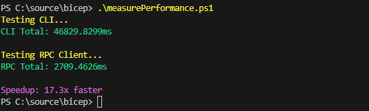
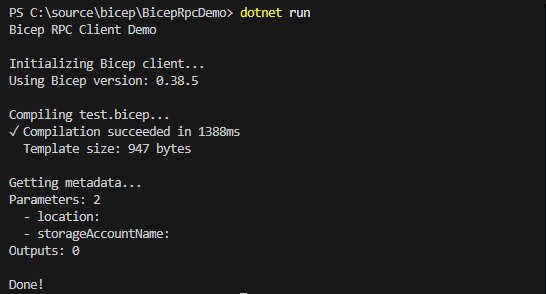

The Bicep team shipped a new library to NuGet. It's called <code>Azure.Bicep.RpcClient</code>. 

This library allows you to interact with Bicep without needing to use the command line. You write .NET code, and the library handles the rest. It's fast, clean, and it works.

But why does this library matter? Because the spawning processes are slow. Parsing console output is fragile, unless you use the <code>--stdout</code> or <code>--outfile</code> options. 

This library changes that. You get direct access to Bicep's compiler through JSON-RPC. One connection, multiple operations, meaning less overhead. 

Let me demonstrate its functionality in this blog post.
<h2 id="what-is-json-rpc">What is JSON-RPC?</h2>
JSON-RPC is a protocol. It sends messages between programs. And as you can already recognize, these messages are JSON. The protocol is quite simple. You send a request like:
<pre><code class="language-json">{
  "jsonrpc": "2.0",
  "method": "compile",
  "params": { "path": "main.bicep" },
  "id": 1
}</code></pre>
And you get back a response:
<pre><code class="language-json">{
  "jsonrpc": "2.0",
  "result": { "success": true, "contents": "..." },
  "id": 1
}</code></pre>
That's it. No complexity, no parsing. Just structured data going back and forth. The Bicep CLI supported JSON-RPC since version 0.29 and above, as seen in the source code: 
<pre><code class="language-csharp">/// &lt;summary&gt;
/// The definition for the Bicep CLI JSONRPC interface.
/// &lt;/summary&gt;
/// &lt;remarks&gt;
/// As of Bicep 0.29, this interface is no longer "experimental". Please consider carefully whether you are making a change that may break backwards compatibility.
/// &lt;/remarks&gt;</code></pre>
You can use it with <code>bicep jsonrpc --stdio</code>. The RPC client wraps this for you, so you don't see the protocol. You just call the methods.
<h2 id="why-should-i-not-use-biceps-cli-directly">Why should I not use Bicep's CLI directly?</h2>
Good question. Let's look at what it takes to use the CLI from code. Imagine you're running Bicep's CLI from PowerShell:
<pre><code class="language-powershell"># Compile a Bicep file using CLI
$out = &amp; bicep build main.bicep --stdout</code></pre>
This works, but behind the scenes, what happens is the following:
<ol><li><strong>PowerShell</strong> spawns a new process.</li><li>The process starts up (<strong>cold start</strong> penalty).</li><li>Bicep loads <strong>assemblies</strong> and <strong>initializes</strong>.</li><li>The <strong>operation</strong> runs.</li><li>Output goes to <strong>stdout</strong> as text.</li><li>You parse the text to <strong>get results</strong>.</li><li>Process <strong>exit</strong>.</li></ol>
<em>Every. Single. Time.</em>

Want to compile five files? That's five process spawns. Five cold starts. Five text parsers. It adds up.
<h3 id="the-json-rpc-way">The JSON-RPC way</h3>
Now let's compare that using JSON-RPC. The RPC Client establishes one connection to Bicep. That connection stays open. You send multiple requests through it. No process spawning. No repeated initialization. No text parsing.

Here's the same scenario with three files:
<pre><code class="language-csharp">using var client = await clientFactory.DownloadAndInitialize(config, cancellationToken);&#10;
var result1 = await client.Compile(new CompileRequest("main.bicep"));
var result2 = await client.Compile(new CompileRequest("storage.bicep"));
var result3 = await client.Compile(new CompileRequest("network.bicep"));</code></pre>
One process, one initialization, and three operations with structured results. No need to parse it further. The difference is real. Let's prove it.
<h2 id="performance-comparison">Performance comparison</h2>
I ran the tests myself using the same machine and files, and here's what I found.

Using a single operation test to compile one file:
<pre><code class="language-powershell">Measure-Command {
    $result = &amp; bicep build main.bicep --stdout
}</code></pre>
Result:
<pre><code class="language-plaintext">Days              : 0
Hours             : 0
Minutes           : 0
Seconds           : 2
Milliseconds      : 87
Ticks             : 20870652
TotalDays         : 2.41558472222222E-05
TotalHours        : 0.000579740333333333
TotalMinutes      : 0.03478442
TotalSeconds      : 2.0870652
TotalMilliseconds : 2087.0652</code></pre>
Now, for one file, 2 seconds is not much. But adding more files to the mix gradually increases it. Let's examine how the performance compares to JSON-RPC. I have created the following small program:
<pre><code class="language-csharp">using Bicep.RpcClient;
using Bicep.RpcClient.Models;
using System.Diagnostics;&#10;
// Parse command-line arguments
if (args.Length &lt; 1)
{
    Console.WriteLine("Usage: BicepRpcDemo &lt;bicep-file&gt; [iterations]");
    Console.WriteLine("Example: BicepRpcDemo main.bicep 10");
    return 1;
}&#10;
var bicepFile = args[0];
var iterations = args.Length &gt; 1 ? int.Parse(args[1]) : 1;&#10;
if (!File.Exists(bicepFile))
{
    Console.WriteLine($"Error: File not found: {bicepFile}");
    return 1;
}&#10;
try
{
    // Create the factory
    var clientFactory = new BicepClientFactory(new HttpClient());&#10;
    // Initialize the client (downloads Bicep if needed)
    Console.WriteLine($"Initializing Bicep RPC client...");
    var initStopwatch = Stopwatch.StartNew();&#10;    
    using var client = await clientFactory.DownloadAndInitialize(
        new BicepClientConfiguration(), 
        CancellationToken.None);&#10;    
    initStopwatch.Stop();
    Console.WriteLine($"Initialization completed in {initStopwatch.ElapsedMilliseconds}ms\n");&#10;
    // Get Bicep version
    var version = await client.GetVersion();
    Console.WriteLine($"Using Bicep version: {version}");
    Console.WriteLine($"File: {bicepFile}");
    Console.WriteLine($"Iterations: {iterations}\n");&#10;
    // Compile the file multiple times
    var times = new List&lt;long&gt;();
    var totalStopwatch = Stopwatch.StartNew();&#10;
    for (int i = 1; i &lt;= iterations; i++)
    {
        var iterationStopwatch = Stopwatch.StartNew();
        var result = await client.Compile(new CompileRequest(bicepFile));
        iterationStopwatch.Stop();&#10;
        times.Add(iterationStopwatch.ElapsedMilliseconds);&#10;        
        if (result.Success)
        {
            Console.WriteLine($"  Iteration {i}: {iterationStopwatch.ElapsedMilliseconds}ms (Template size: {result.Contents.Length} bytes)");
        }
        else
        {
            Console.WriteLine($"  Iteration {i}: {iterationStopwatch.ElapsedMilliseconds}ms (FAILED)");
            foreach (var diagnostic in result.Diagnostics.Take(3))
            {
                Console.WriteLine($"    [{diagnostic.Level}] {diagnostic.Message}");
            }
        }
    }&#10;
    totalStopwatch.Stop();&#10;
    // Calculate statistics
    var avgTime = times.Average();
    var minTime = times.Min();
    var maxTime = times.Max();&#10;
    Console.WriteLine($"\nStatistics:");
    Console.WriteLine($"  Total time: {totalStopwatch.ElapsedMilliseconds}ms");
    Console.WriteLine($"  Average: {Math.Round(avgTime, 0)}ms");
    Console.WriteLine($"  Min: {minTime}ms");
    Console.WriteLine($"  Max: {maxTime}ms");
    Console.WriteLine($"  First iteration: {times[0]}ms (includes warmup)");&#10;    
    if (iterations &gt; 1)
    {
        var subsequentAvg = times.Skip(1).Average();
        Console.WriteLine($"  Subsequent iterations average: {Math.Round(subsequentAvg, 0)}ms");
    }&#10;
    return 0;
}
catch (Exception ex)
{
    Console.WriteLine($"Error: {ex.Message}");
    Console.WriteLine($"Stack trace: {ex.StackTrace}");
    return 1;
}
</code></pre>
I have created a small sample script to measure the performance, targeting the same <code>main.bicep</code> file, but this time, looping over it ten times:
<pre><code class="language-powershell"># CLI approach
Write-Host "Testing CLI..." -ForegroundColor Yellow
$cliTime = Measure-Command {
    1..10 | ForEach-Object { $null = &amp; bicep build main.bicep --stdout 2&gt;&amp;1 }
}
Write-Host "CLI Total: $($cliTime.TotalMilliseconds)ms" -ForegroundColor Green&#10;
# RPC approach
Write-Host "`nTesting RPC Client..." -ForegroundColor Yellow
$rpcTime = Measure-Command {
    .\BicepRpcDemo\bin\Release\net9.0\BicepRpcDemo.exe main.bicep 10 | Out-Null
}
Write-Host "RPC Total: $($rpcTime.TotalMilliseconds)ms" -ForegroundColor Green&#10;
# Calculate speedup
$speedup = $cliTime.TotalMilliseconds / $rpcTime.TotalMilliseconds
Write-Host "`nSpeedup: $([math]::Round($speedup, 1))x faster" -ForegroundColor Magenta</code></pre>
The result is shown in the image below.
<figure class="kg-card kg-image-card"></figure>
The JSON-RPC client wins because there's no process spawn overhead as the connection already exists. Are you <em>convinced</em> already?
<h2 id="getting-started">Getting started</h2>
Ready to try it out yourself? Assuming you have the <a href="https://dotnet.microsoft.com/en-us/download/dotnet/9.0">.NET 9.0 SDK</a> installed, you can execute the following steps:
<ol><li>Open a PowerShell terminal session.</li><li>Run the following command to create a new console project and add the <code>Azure.Bicep.RpcClient</code> library to the project:</li></ol><pre><code class="language-powershell"># Create a new console application
dotnet new console -n BicepRpcDemo&#10;
# Change the directory
cd BicepRpcDemo&#10;
# Add the package
dotnet add package Azure.Bicep.RpcClient --version 0.38.5</code></pre><ol start="3"><li>Replace the <code>Program.cs</code> with this:</li></ol><pre><code class="language-csharp">using Bicep.RpcClient;
using Bicep.RpcClient.Models;
using System.Diagnostics;&#10;
Console.WriteLine("Bicep RPC Client Demo\n");&#10;
// Create the factory
var clientFactory = new BicepClientFactory(new HttpClient());&#10;
// Initialize the client (downloads Bicep if needed)
Console.WriteLine("Initializing Bicep client...");
using var client = await clientFactory.DownloadAndInitialize(
    new BicepClientConfiguration(), 
    CancellationToken.None);&#10;
// Get Bicep version
var version = await client.GetVersion();
Console.WriteLine($"Using Bicep version: {version}\n");&#10;
// Create a test Bicep file
var testBicep = @"
param location string = 'eastus'
param storageAccountName string&#10;
resource storageAccount 'Microsoft.Storage/storageAccounts@2023-01-01' = {
  name: storageAccountName
  location: location
  sku: {
    name: 'Standard_LRS'
  }
  kind: 'StorageV2'
}&#10;
output storageAccountId string = storageAccount.id
";&#10;
File.WriteAllText("test.bicep", testBicep);&#10;
// Compile the file
Console.WriteLine("Compiling test.bicep...");
var stopwatch = Stopwatch.StartNew();&#10;
var result = await client.Compile(new CompileRequest("test.bicep"));&#10;
stopwatch.Stop();&#10;
if (result.Success)
{
    Console.WriteLine($"✓ Compilation succeeded in {stopwatch.ElapsedMilliseconds}ms");
    Console.WriteLine($"  Template size: {result.Contents?.Length ?? 0} bytes\n");
}
else
{
    Console.WriteLine($"✗ Compilation failed in {stopwatch.ElapsedMilliseconds}ms");
    foreach (var diagnostic in result.Diagnostics)
    {
        Console.WriteLine($"  [{diagnostic.Level}] {diagnostic.Message}");
    }
}&#10;
// Get metadata
Console.WriteLine("Getting metadata...");
var metadata = await client.GetMetadata(new GetMetadataRequest("test.bicep"));&#10;
Console.WriteLine($"Parameters: {metadata.Parameters.Count()}");
foreach (var param in metadata.Parameters)
{
    Console.WriteLine($"  - {param.Name}: {param.Description}");
}&#10;
Console.WriteLine($"Outputs: {metadata.Exports.Count()}");
foreach (var output in metadata.Exports)
{
    Console.WriteLine($"  - {output.Name}: {output.Description}");
}&#10;
// Clean up
File.Delete("test.bicep");&#10;
Console.WriteLine("\nDone!");</code></pre><ol start="4"><li>Run the application by executing <code>dotnet run</code>.</li></ol>
The result: 
<figure class="kg-card kg-image-card"></figure>
You have now successfully created your own Bicep JSON-RPC .NET project.
<h2 id="when-to-use-the-json-rpc-client">When to use the JSON-RPC client</h2>
You've seen the numbers and seen the code. Now the question is: when should you actually use this?

The answer depends on your workload. The JSON-RPC client excels in specific scenarios compared to the CLI. Here's how to choose.

The JSON-RPC client is the right choice when you:
<ul><li><strong>Compile multiple files</strong> in a single execution.</li><li><strong>Need structured results</strong> instead of parsing text output (even though most Bicep commands have a <code>--stdout</code> option).</li><li><strong>Build tools</strong> that integrate with Bicep's functionality.</li><li><strong>Process files concurrently</strong> for improved throughput (as evidenced by the numbers).</li></ul>
Stick with Bicep's CLI when you:
<ul><li><strong>Run one-off commands</strong> interactively.</li><li><strong>Use shell scripts</strong> that already work.</li><li><strong>Don't need programmatic integration</strong>.</li><li><strong>Can't (or want) to use .NET</strong> in your environment.</li></ul><h2 id="whats-next">What's next?</h2>
The JSON-RPC client has just been released to NuGet. Keep in mind that the NuGet description also indicates that the library is not a supported package by the team. The team can make changes on the fly, and the team has reserved the right to push breaking changes.

As the Bicep team continues to add features, new JSON-RPC methods (hopefully) arrive with each Bicep release. The client should automatically support them. 

But the core is solid and works today.
<h2 id="final-thoughts">Final thoughts</h2>
The Bicep JSON-RPC client changes how you integrate Bicep into .NET applications. It is a fun experience to work with and perfectly illustrates how fast it is compared to shelling out to the CLI. 

If you're building tools that use Bicep, this library is your go-to goat. The performance gains alone justify it. Try it out, measure it, and see the difference yourself.

The library is at <a href="https://www.nuget.org/packages/Azure.Bicep.RpcClient">NuGet.org</a>. I went on myself to create docs around it (but is still open in a <a href="https://github.com/Azure/bicep/pull/18173">pull request</a>).

