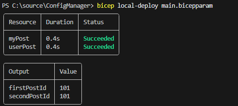
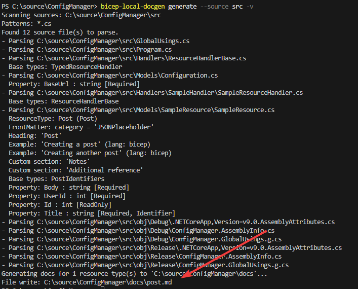

<p>Bicep v0.37.4 simplified the Local Deploy authoring experience. With this release, developers started building extensions, including myself.</p><p>Fast-forwarding a month, other community members started to create <a href="https://github.com/maikvandergaag/bicep-extensions">lists</a>. Each extension in the list followed the same pattern:</p><ul><li>Have a <code>src</code> directory storing your application extension code.</li><li>Create a base class.</li><li>Create handlers and models.</li><li>Add documentation attributes.</li><li>Add a build automation script to publish the extension locally.</li></ul><p>I noticed the pattern. Every new extension needed the same scaffolding. People were copying files from these extension repositories and stripping away the domain logic.</p><p>That's why I created <code>Bicep.LocalDeploy.Templates</code>. It captured this structure and best practices. You install it, run one command, and get a working project with everything in the right place. In this blog post, I'll guide you through getting started with these templates.</p><h2 id="prerequisites">Prerequisites</h2><p>To follow along with this guide, you need:</p><ul><li><strong>.NET SDK 9.0</strong>: Download from <a href="https://dotnet.microsoft.com/download">dotnet.microsoft.com</a> or install via WinGet:</li></ul><pre><code class="language-bash">winget install Microsoft.DotNet.SDK.9</code></pre><ul><li><strong>Bicep CLI v0.37.4 or higher</strong>: Install or upgrade:</li></ul><pre><code class="language-bash">winget install Microsoft.Bicep</code></pre><ul><li><strong>PowerShell 7+</strong>: For running the build script</li><li><strong>Code editor</strong>: Visual Studio Code with the Bicep extension (recommended)</li></ul><p>Got everything installed? Let's install the templates.</p><h2 id="installing-the-templates"><strong>Installing the templates</strong></h2><p>Before templates, you had two options for starting a Bicep Local Deploy project:</p><ol><li>Clone an existing example repository and strip out the domain logic.</li><li>Create everything from scratch following the documentation.</li></ol><p>Both options waste time. Cloning means deleting code you don't need. Starting from scratch means setting up build scripts, project files, and folder structures by hand.</p><p>The <code>Bicep.LocalDeploy.Templates</code> package fixes this. You get a clean slate with the right structure. Just scaffold it and start building your extension from the sample resources already there. To leverage these templates, you first need to install the package:</p><pre><code class="language-bash">dotnet new install Bicep.LocalDeploy.Templates</code></pre><p>This downloads the templates to your machine. To list out the available templates, you can check what's available with the following command:</p><pre><code class="language-bash">dotnet new list --tag Bicep</code></pre><p>Output:</p><pre><code class="language-text">Template Name                   Short Name      Language  Tags
------------------------------  --------------  --------  ------------
Bicep LocalDeploy Extension     bicep-ld-tpl    [C#]      Bicep/Web</code></pre><p>The <code>bicep-ld-tpl</code> template is your starting point.</p><h2 id="creating-your-first-extension">Creating your first extension</h2><p>Let's build a simple extension. We'll start by creating the project structure using the <code>bicep-ld-tpl</code> template.</p><h3 id="step-1-%E2%80%93-generate-the-project">Step 1 –  Generate the project</h3><pre><code class="language-powershell">dotnet new bicep-ld-tpl -n ConfigManager</code></pre><p>This creates a new directory called <code>ConfigManager</code>. Navigate to it:</p><pre><code class="language-powershell">cd ConfigManager</code></pre><h3 id="step-2-%E2%80%93-understand-the-structure">Step 2 – Understand the structure</h3><p>The template gives you the following files:</p><pre><code class="language-plaintext">ConfigManager/
├── build.ps1                       # Build and publish script
├── global.json                     # .NET SDK version lock
├── .gitignore                      # Git ignore rules
├── .biceplocalgenignore           # Documentation generator ignore
├── README.md                       # Project documentation
└── src/
    ├── ConfigManager.csproj        # Project file
    ├── Program.cs                  # Application entry point
    ├── GlobalUsings.cs             # Global using directives
    ├── Models/
    │   ├── Configuration.cs        # Extension configuration
    │   └── SampleResource/
    │       └── SampleResource.cs   # Example resource model
    └── Handlers/
        ├── ResourceHandlerBase.cs  # Base handler with helpers
        └── SampleHandler/
            └── SampleResourceHandler.cs</code></pre><p>Every file has a purpose and nothing extra. The <code>SampleResource.cs</code> and <code>SampleResourceHandler.cs</code> files illustrate an example and don't actually work. </p><h3 id="step-3-%E2%80%93-examine-programcs">Step 3 – Examine <code>program.cs</code></h3><p>Open <code>src/program.cs</code> in your editor:</p><pre><code class="language-csharp">using Bicep.Local.Extension.Host.Extensions;
using Microsoft.AspNetCore.Builder;
using Microsoft.Extensions.DependencyInjection;
using ConfigManager.Handlers.SampleHandler;
using ConfigManager.Models;&#10;
var builder = WebApplication.CreateBuilder();&#10;
builder.AddBicepExtensionHost(args);
builder
    .Services.AddBicepExtension(
        name: "ConfigManager",
        version: "0.0.1",
        isSingleton: true,
        typeAssembly: typeof(Program).Assembly,
        configurationType: typeof(Configuration)
    )
    .WithResourceHandler&lt;SampleResourceHandler&gt;();&#10;
var app = builder.Build();
app.MapBicepExtension();
await app.RunAsync();
</code></pre><p>This is your extension's entry point. The template is already configured with your extension name (namespace). Key parts:</p><ul><li><code>AddBicepExtensionHost</code>: Registers core extension infrastructure.</li><li><code>AddBicepExtension</code>: Registers your extension with metadata.</li><li><code>WithResourceHandler</code>: Registers resource handlers.</li><li><code>MapBicepExtension</code>: Maps HTTP endpoints.</li></ul><h3 id="step-4-%E2%80%93-look-at-the-sample-handler">Step 4 – Look at the sample handler</h3><p>Open <code>src/Handlers/SampleHandler/SampleResourceHandler.cs</code>:</p><pre><code class="language-csharp">using Microsoft.Extensions.Logging;
using ConfigManager.Models;
using ConfigManager.Models.SampleResource;&#10;
namespace ConfigManager.Handlers.SampleHandler;&#10;
public class SampleResourceHandler : ResourceHandlerBase&lt;SampleResource, SampleResourceIdentifiers&gt;
{
    private const string ResourcesApiEndpoint = "api/v1/resources";&#10;
    public SampleResourceHandler(ILogger&lt;SampleResourceHandler&gt; logger)
        : base(logger) { }&#10;
    protected override async Task&lt;ResourceResponse&gt; Preview(
        ResourceRequest request,
        CancellationToken cancellationToken
    )
    {
        var existing = await GetResourceAsync(
            request.Config,
            request.Properties,
            cancellationToken
        );
        if (existing is not null)
        {
            // Populate output properties from existing resource
            request.Properties.ResourceId = existing.ResourceId;
            request.Properties.CreatedAt = existing.CreatedAt;
            request.Properties.UpdatedAt = existing.UpdatedAt;
        }
        return GetResponse(request);
    }&#10;
    protected override async Task&lt;ResourceResponse&gt; CreateOrUpdate(
        ResourceRequest request,
        CancellationToken cancellationToken
    )
    {
        var props = request.Properties;&#10;
        _logger.LogInformation("Ensuring sample resource: {Name}", props.Name);&#10;
        var existing = await GetResourceAsync(request.Config, props, cancellationToken);&#10;
        if (existing is null)
        {
            _logger.LogInformation("Creating new sample resource: {Name}", props.Name);
            await CreateResourceAsync(request.Config, props, cancellationToken);
            existing =
                await GetResourceAsync(request.Config, props, cancellationToken)
                ?? throw new InvalidOperationException(
                    "Resource creation did not return resource."
                );
        }
        else
        {
            _logger.LogInformation(
                "Updating existing sample resource: {ResourceId}",
                existing.ResourceId
            );
            await UpdateResourceAsync(request.Config, props, existing, cancellationToken);
            existing =
                await GetResourceAsync(request.Config, props, cancellationToken)
                ?? throw new InvalidOperationException("Resource update did not return resource.");
        }&#10;
        // Populate output properties
        props.ResourceId = existing.ResourceId;
        props.CreatedAt = existing.CreatedAt;
        props.UpdatedAt = existing.UpdatedAt;&#10;
        return GetResponse(request);
    }&#10;    
    protected override SampleResourceIdentifiers GetIdentifiers(SampleResource properties) =&gt;
        new() { Name = properties.Name };&#10;
    private async Task&lt;SampleResource?&gt; GetResourceAsync(
        Configuration configuration,
        SampleResource props,
        CancellationToken ct
    )
    {
        try
        {
            var response = await CallApiForResponse&lt;SampleResource&gt;(
                configuration,
                HttpMethod.Get,
                $"{ResourcesApiEndpoint}/{Uri.EscapeDataString(props.Name)}",
                ct
            );&#10;
            return response;
        }
        catch
        {
            // Resource not found
            return null;
        }
    }&#10;
    private async Task CreateResourceAsync(
        Configuration configuration,
        SampleResource props,
        CancellationToken ct
    )
    {
        var createPayload = new
        {
            name = props.Name,
            description = props.Description,
            isEnabled = props.IsEnabled,
            status = props.Status?.ToString(),
            maxRetries = props.MaxRetries,
            timeoutSeconds = props.TimeoutSeconds,
            metadata = props.Metadata,
        };&#10;
        var response = await CallApiForResponse&lt;SampleResource&gt;(
            configuration,
            HttpMethod.Post,
            ResourcesApiEndpoint,
            ct,
            createPayload
        );&#10;
        if (response == null)
        {
            throw new InvalidOperationException(
                $"Failed to create sample resource '{props.Name}'."
            );
        }
    }&#10;
    private async Task UpdateResourceAsync(
        Configuration configuration,
        SampleResource props,
        SampleResource existing,
        CancellationToken ct
    )
    {
        var updatePayload = new
        {
            description = props.Description,
            isEnabled = props.IsEnabled,
            status = props.Status?.ToString(),
            maxRetries = props.MaxRetries,
            timeoutSeconds = props.TimeoutSeconds,
            metadata = props.Metadata,
        };&#10;
        var response = await CallApiForResponse&lt;SampleResource&gt;(
            configuration,
            HttpMethod.Put,
            $"{ResourcesApiEndpoint}/{Uri.EscapeDataString(existing.Name)}",
            ct,
            updatePayload
        );&#10;
        if (response == null)
        {
            throw new InvalidOperationException(
                $"Failed to update sample resource '{props.Name}'."
            );
        }
    }
}</code></pre><p>This handler implements two operations:</p><ul><li><code>CreateOrUpdate</code>: Create or update a resource.</li><li><code>Preview</code>: Checks if the resource exists.</li></ul><h3 id="step-5-%E2%80%93-build-the-extension">Step 5 – Build the extension</h3><p>With the scaffolding of <code>dotnet new</code>, a build script is added at the root of the project. Modify the <code>global.json</code> version number with your actual .NET SDK version and run the build script:</p><pre><code class="language-powershell">.\build.ps1</code></pre><p>This does several things:</p><ol><li>Restores NuGet packages.</li><li>Builds the project by default in <code>Release</code> mode.</li><li>Publish extensions for cross-platform.</li><li>Creates the actual extension using <code>bicep publish-extension</code> locally.</li></ol><p>The output appears in the <code>output</code> directory.</p><h3 id="step-6-%E2%80%93-test-it">Step 6 – Test it</h3><p>To test the extension, you can create a <code>bicepconfig.json</code>:</p><pre><code class="language-json">{
  "experimentalFeaturesEnabled": {
    "localDeploy": true,
    "extensibility": true
  },
  "extensions": {
    "myExtension": "output/my-extension"
  },
  "implicitExtensions": []
}</code></pre><p>Then, create a <code>main.bicep</code> file with a <code>main.bicepparam</code> file:</p><pre><code class="language-bicep">// main.bicep
targetScope = 'local'&#10;
extension myExtension with {
    baseUrl: 'https://my-extension-url'
}&#10;
resource SampleResource 'SampleResource' = {
    name: 'sampleResource'
}&#10;
// main.bicepparam
using 'main.bicep'
</code></pre><p>Deploy it:</p><pre><code class="language-powershell">bicep local-deploy main.bicepparam</code></pre><p>Obviously, the deployment will fail, as it hasn't actually implemented a real REST API call. Let's customize the extension.</p><h2 id="customizing-your-extension">Customizing your extension</h2><p>The template gives you a starting point. Now you can customize it with an actual implementation. We'll be using the famous <a href="https://jsonplaceholder.typicode.com/">JSONPlaceholder</a> API endpoints for testing.</p><h3 id="step-1-%E2%80%93-modifying-the-model">Step 1 – Modifying the model</h3><p>In the <code>src/Models/SampleResource/SampleResource.cs</code>, modify the code with:</p><pre><code class="language-csharp">using System.Text.Json.Serialization;
using Bicep.Local.Extension.Types.Attributes;&#10;
namespace ConfigManager.Models.SampleResource;&#10;
[BicepFrontMatter("category", "JSONPlaceholder")]
[BicepDocHeading(
    "Post",
    "Represents a post in the JSONPlaceholder API."
)]
[BicepDocExample(
    "Creating a post",
    "This example shows how to create a post with all required properties.",
    @"resource myPost 'Post' = {
  title: 'My First Post'
  body: 'This is the content of my first post.'
  userId: 1
}
"
)]
[BicepDocExample(
    "Creating another post",
    "This example demonstrates creating a post for a different user.",
    @"resource userPost 'Post' = {
  title: 'User Post Example'
  body: 'This post belongs to user 5 and contains useful information.'
  userId: 5
}
"
)]
[BicepDocCustom(
    "Notes",
    @"When working with the `Post` resource, ensure you have the extension imported in your Bicep file:&#10;
```bicep
// main.bicep
targetScope = 'local'
param baseUrl string
extension myExtension with {
  baseUrl: baseUrl
}&#10;
resource myPost 'Post' = {
  title: 'Sample Post'
  body: 'This is a sample post'
  userId: 1
}&#10;
// main.bicepparam
using 'main.bicep'
param baseUrl = 'https://jsonplaceholder.typicode.com'
```&#10;
All properties (title, body, userId) are required for creating a post."
)]
[BicepDocCustom(
    "Additional reference",
    @"For more information, see the following links:&#10;
- [JSONPlaceholder API Documentation][00]&#10;
&lt;!-- Link reference definitions --&gt;
[00]: https://jsonplaceholder.typicode.com/"
)]
[ResourceType("Post")]
public class Post : PostIdentifiers
{
    // Required writable properties
    [TypeProperty("The body content of the post.", ObjectTypePropertyFlags.Required)]
    public string Body { get; set; } = string.Empty;&#10;
    [TypeProperty("The ID of the user who created the post.", ObjectTypePropertyFlags.Required)]
    public int UserId { get; set; }&#10;
    // Read-only output property - the ID assigned by the API
    [TypeProperty(
        "The unique identifier assigned to the post by the API.",
        ObjectTypePropertyFlags.ReadOnly
    )]
    public int Id { get; set; }
}&#10;
public class PostIdentifiers
{
    // Using title as the identifier for the resource
    [TypeProperty(
        "The title of the post, used as the unique identifier.",
        ObjectTypePropertyFlags.Identifier | ObjectTypePropertyFlags.Required
    )]
    public string Title { get; set; } = string.Empty;
}
</code></pre><h3 id="step-2-%E2%80%93-change-the-handler">Step 2 – Change the handler</h3><p>Open the <code>ResourceSampleHandler.cs</code> and modify the code with:</p><pre><code class="language-csharp">using Microsoft.Extensions.Logging;
using ConfigManager.Models;
using ConfigManager.Models.SampleResource;&#10;
namespace ConfigManager.Handlers.SampleHandler;&#10;
/// &lt;summary&gt;
/// Handler for Post operations using the JSONPlaceholder API.
/// Implements Preview and CreateOrUpdate operations.
/// &lt;/summary&gt;
public class PostHandler : ResourceHandlerBase&lt;Post, PostIdentifiers&gt;
{
    private const string PostsApiEndpoint = "posts";&#10;
    public PostHandler(ILogger&lt;PostHandler&gt; logger)
        : base(logger) { }&#10;
    protected override async Task&lt;ResourceResponse&gt; Preview(
        ResourceRequest request,
        CancellationToken cancellationToken
    )
    {
        // JSONPlaceholder doesn't support querying by title, so we can't check for existing posts
        // We'll always create a new post in CreateOrUpdate
        await Task.CompletedTask;
        return GetResponse(request);
    }&#10;
    protected override async Task&lt;ResourceResponse&gt; CreateOrUpdate(
        ResourceRequest request,
        CancellationToken cancellationToken
    )
    {
        var props = request.Properties;&#10;
        _logger.LogInformation("Creating post with title: {Title}", props.Title);&#10;
        // Validate that all required properties are set
        if (string.IsNullOrWhiteSpace(props.Title))
        {
            throw new InvalidOperationException("Title is required.");
        }
        if (string.IsNullOrWhiteSpace(props.Body))
        {
            throw new InvalidOperationException("Body is required.");
        }
        if (props.UserId &lt;= 0)
        {
            throw new InvalidOperationException("UserId must be greater than 0.");
        }&#10;
        // Create the post
        var createdPost = await CreatePostAsync(request.Config, props, cancellationToken);&#10;
        // Populate output properties from the API response
        props.Id = createdPost.Id;&#10;
        _logger.LogInformation("Successfully created post with ID: {Id}", createdPost.Id);&#10;
        return GetResponse(request);
    }&#10;
    protected override PostIdentifiers GetIdentifiers(Post properties) =&gt;
        new() { Title = properties.Title };&#10;
    private async Task&lt;PostResponse&gt; CreatePostAsync(
        Configuration configuration,
        Post props,
        CancellationToken ct
    )
    {
        var createPayload = new
        {
            title = props.Title,
            body = props.Body,
            userId = props.UserId
        };&#10;
        _logger.LogInformation(
            "Calling JSONPlaceholder API to create post: Title={Title}, Body={Body}, UserId={UserId}",
            props.Title,
            props.Body,
            props.UserId
        );&#10;
        var response = await CallApiForResponse&lt;PostResponse&gt;(
            configuration,
            HttpMethod.Post,
            PostsApiEndpoint,
            ct,
            createPayload
        );&#10;
        if (response == null)
        {
            throw new InvalidOperationException(
                $"Failed to create post with title '{props.Title}'."
            );
        }&#10;
        return response;
    }&#10;
    private class PostResponse
    {
        public int Id { get; set; }
        public string Title { get; set; } = string.Empty;
        public string Body { get; set; } = string.Empty;
        public int UserId { get; set; }
    }
}
</code></pre><h3 id="step-3-%E2%80%93-update-the-handler-in-program">Step 3 – Update the handler in program</h3><p>Lastly, change the <code>ResourceHandler</code> in the <code>Program.cs</code> with:</p><pre><code class="language-csharp">// truncated&#10;
var builder = WebApplication.CreateBuilder();&#10;
builder.AddBicepExtensionHost(args);
builder
    .Services.AddBicepExtension(
        name: "ConfigManager",
        version: "0.0.1",
        isSingleton: true,
        typeAssembly: typeof(Program).Assembly,
        configurationType: typeof(Configuration)
    )
    .WithResourceHandler&lt;PostHandler&gt;();&#10;
var app = builder.Build();
app.MapBicepExtension();
await app.RunAsync();</code></pre><h3 id="step-4-%E2%80%93-rebuild">Step 4 – Rebuild</h3><p>Run the build script again:</p><pre><code class="language-powershell">.\build.ps1</code></pre><p>Your extension now has a new resource type.</p><p>To use the new resource type, update the <code>main.bicep</code> file with:</p><pre><code class="language-bicep">targetScope = 'local'&#10;
param baseUrl string = 'https://jsonplaceholder.typicode.com'&#10;
extension myExtension with {
  baseUrl: baseUrl
}&#10;
// Create a post using the JSONPlaceholder API
resource myPost 'Post' = {
  title: 'My First Post'
  body: 'This is the content of my first post created via Bicep!'
  userId: 1
}&#10;
// Create another post for a different user
resource userPost 'Post' = {
  title: 'Welcome to JSONPlaceholder'
  body: 'This is an example post demonstrating the Post resource handler.'
  userId: 5
}&#10;
// Output the IDs assigned by the API
output firstPostId int = myPost.id
output secondPostId int = userPost.id
</code></pre><p>The <code>main.bicepparam</code> can be left untouched, as we've hardcoded the <code>baseUrl</code> in the <code>main.bicep</code> file. When you run the <code>bicep local-deploy</code> command, you can actually see a <strong><em>real</em></strong> result.</p><figure class="kg-card kg-image-card"></figure><h2 id="documentation">Documentation</h2><p>So, you have developed your first extension. What about documentation?</p><p>You've probably noticed these custom attributes. If you open up the <code>ConfigManager.csproj</code> file, notice the package reference added:</p><pre><code class="language-xml">  &lt;ItemGroup&gt;
    &lt;PackageReference Include="Azure.Bicep.Local.Extension" Version="0.38.5" /&gt;
    &lt;PackageReference Include="Bicep.LocalDeploy" Version="1.0.1" /&gt;
  &lt;/ItemGroup&gt;</code></pre><p>The <code>Bicep.LocalDeploy</code> package contains these custom attributes. These attributes can be read and transformed to produce Markdown files using the <code>bicep-local-docgen</code> CLI utility. Let's take a look. </p><p>Follow the steps below to generate documentation:</p><ol><li>Open your terminal</li><li>Install the CLI utility by running <code>dotnet tool install -g bicep-local-docgen</code>.</li><li>Run <code>bicep-local-docgen --source src -v</code>.</li></ol><figure class="kg-card kg-image-card"></figure><p>As you can see, the <code>post.md</code> is created in the <code>docs</code> directory. Take a look at the result in your editor.</p><h2 id="review">Review</h2><p>In this blog post, you learned:</p><ol><li>How to scaffold your first extension using <code>Bicep.LocalDeploy.Templates</code>.</li><li>Customized the extension with a real-world example.</li><li>Produced documentation with ease using <code>bicep-local-docgen</code>.</li></ol><p>For more references, check out the following links:</p><ul><li><strong>Template package:</strong> <a href="https://www.nuget.org/packages/Bicep.LocalDeploy.Templates">Bicep.LocalDeploy.Templates</a>.</li><li><strong>Core library:</strong> Bicep.LocalDeploy on <a href="https://www.nuget.org/packages/Bicep.LocalDeploy">NuGet</a>.</li><li><strong>Example extension: </strong><a href="https://github.com/Gijsreyn/bicep-ext-databricks/tree/main">Bicep Databricks extension</a>.</li><li><strong>Documentation:</strong> Create <a href="https://github.com/Gijsreyn/bicep-local-docgen/blob/main/docs/configuration.md">documentation</a> using <code>bicep-local-docgen</code>.</li></ul><h2 id="final-thoughts">Final thoughts</h2><p>The <code>Bicep.LocalDeploy.Templates</code> removes that first friction when you start with your first Bicep extension development. You don't have to waste time on project structure or copying and pasting from examples. You generate a clean template and can start building using the <code>build.ps1</code> automation script.</p><p>From here on, you can expand further, rebuild it, and ship the extension. </p>
