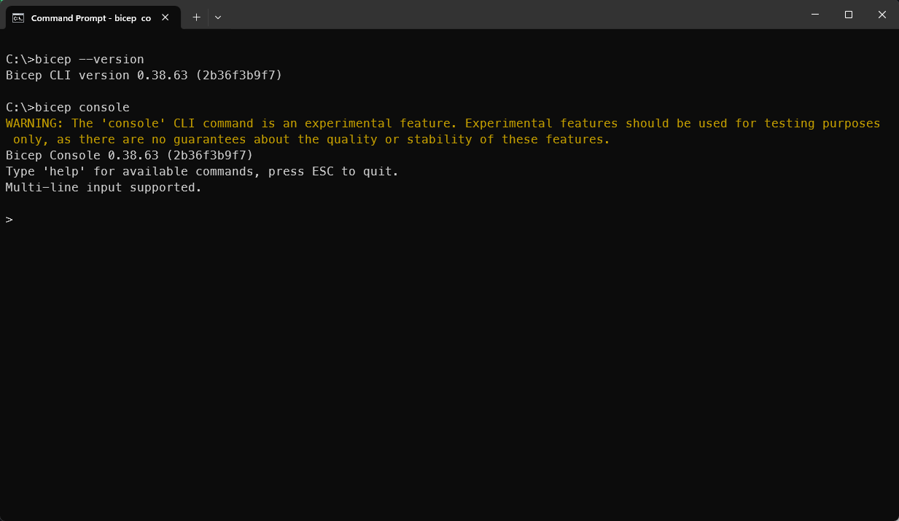
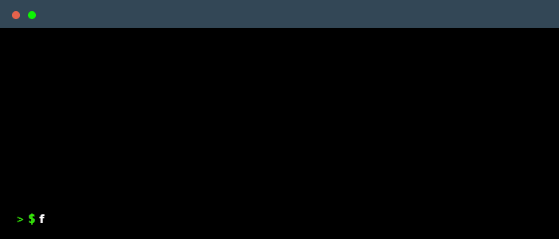

How do you <em>really</em> understand a language? You play with it.

Bicep has a rich set of functions that are automatically available in your Bicep files. But you can also define your own <strong>user-defined functions</strong> and <strong>types</strong>. Since the launch of the new <code>bicep console</code> command, this possibility even got better.

You can now test and explore Bicep functions and types in real time without deploying anything to Azure. You don't have to guess what a function returns or how a type will behave, thanks to the latest update from Anthony Martin.

In my <a href="/azure-bicep-updates-november-2025-edition/">previous post</a>, I already shed some light on it. In this blog post, you will learn how to safely test this new functionality and validate the behavior without leaving your terminal.
<h2 id="prerequisites">Prerequisites</h2>
Assuming you want to follow along, you're going to need:
<ul><li>Bicep v0.38.63 or higher</li></ul>

💡

You can install nightly Bicep builds easily by visiting the following <a href="https://github.com/Azure/bicep/blob/3bef85bd8f00e8514b22bc9eace26350329d758c/docs/installing-nightly.md#installing-the-nightly-build-of-bicep-cli-and-vs-code-extension">article</a>.

<h2 id="getting-started-with-the-bicep-console">Getting started with the Bicep console</h2>
Before you start testing functions or types, you'll need to know how to launch the console. Once you've the prerequisite in place, open your terminal and type:
<pre><code class="language-bash">bicep console</code></pre>
This command will simply start an interactive shell where you can write and evaluate Bicep expressions on the spot. Think of it as your safe playground for your infrastructure code.

When you first run the console, you'll see a prompt like this:
<figure class="kg-card kg-image-card"></figure>
From here, you can start typing any valid Bicep expression. Try something basic first:
<pre><code class="language-bash">1 + 2</code></pre>
The console immediately returns the evaluated result:
<pre><code class="language-bash">3</code></pre>
As you can see, no deployment to a resource group or subscription. Just instant feedback returned.

This quick feedback loop makes it easier to explore how Bicep handles expressions and logic. Once you get used to it, you'll jump into the console to validate syntax or experiment with ideas before you actually use it in a real Bicep file.
<h2 id="testing-user-defined-functions-and-types">Testing (User-Defined) Functions and Types</h2>
One of the most powerful new additions to the Bicep console is the ability to test how your own <strong>functions </strong>and <strong>types </strong>behave. This is especially handy when you're not sure how a particular function handles input or what type it's going to return.

Let's start with a simple example. Suppose you're building a deployment that needs to format a string dynamically. In the console, you can use the built-in <code>format()</code> function before using it in your template:
<figure class="kg-card kg-image-card"></figure>
If the output isn't what you desired, you can tweak it and test it with multiple inputs till you get it right—no need to deploy anything.

Now, what if you want to know, for instance, what the length of an array is, or if it contains a particular region? You can also play around using both <code>length()</code> and <code>contains()</code> functions:
<figure class="kg-card kg-image-card"></figure>
This quick test illustrates how easy it is to use the <code>bicep console</code> command to verify the behavior, again, without actually deploying it.

Once you're comfortable, it's time to explore <strong>user-defined functions</strong>. These let you encapsulate logic that you can reuse across your Bicep files, which is especially useful for things like <strong>naming conventions</strong> or <strong>tag generation</strong>.

For example, imagine you want to standardize storage account names according to Azure rules: 
<ul><li>The name should be in<strong> lowercase</strong>.</li><li>Maximum of <strong>24 characters</strong>.</li><li><strong>Prefixed</strong> with <code>st</code>.</li></ul>
Instead of repeating this logic in every template, you can make it easy by defining a small function in the console and testing it:
<figure class="kg-card kg-image-card"></figure>
Another real-world scenario is <strong>validating tags or metadata objects</strong>. Suppose you want a function that merges a base set of tags with environment-specific tags and adds a standard <code>managedBy</code> tag:
<figure class="kg-card kg-image-card"></figure>
This allows you to confirm that your function behaves as expected, catching errors early and saving time. You can even take it one step further and define a type, so you're certain when you're adding it as a parameter, it will work as expected:
<figure class="kg-card kg-image-card"></figure>
By explicitly declaring the return type, the console will immediately flag any attempt to return a value that isn't an object.
<h2 id="conclusion">Conclusion</h2>
The Bicep console gives you the confidence to test your <strong>user-defined functions</strong> and <strong>declared types</strong>. You can experiment freely and ensure everything behaves exactly as you expected. 

Whether you're working on naming conventions, tag policies, or complex transformations, now you don't have to leave your terminal or deploy anything. 

In short: the <code>bicep console</code> is your friendly console to faster and safely test your Bicep code before you actually use it in a template.

