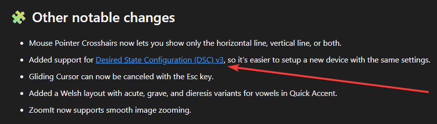
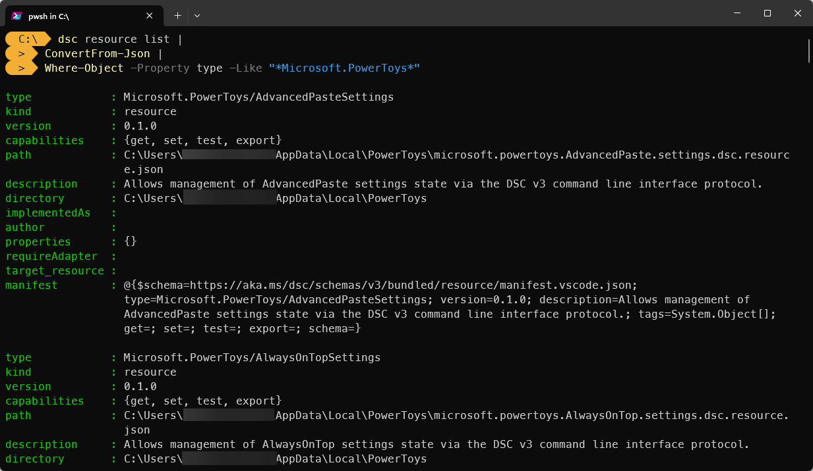
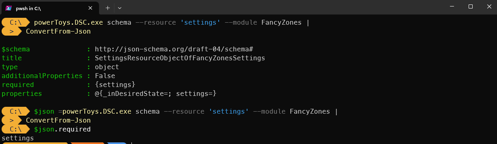

Last week, I had the time to play with the new PowerToys v0.95.0 release. I had to set up PowerToys on three different machines: my own computer, my work laptop, and then, when I reached the office, my colleague wanted the same thing I had.

By the time I made it to my work laptop, I was questioning all my life choices. You probably can recognize the same. PowerToys contains more than a hundred settings across its toolchain. 

Going through the release notes blog of v0.95.0, I noticed a new <em>addition</em>:
<figure class="kg-card kg-image-card"></figure>
Now, if you know me, you know that I love <strong>Microsoft DSC</strong>. 

You don't see it right out of the bat, but that added support shipped a tiny executable. It promised me something I needed desperately: the ability to define my PowerToys configuration once and deploy it everywhere.

No more clicking through dozens of settings panels and no more trying to remember which toggle I switched on. If you've ever felt the same frustration, this guide is for you. 

Let me show you how I went from manually configuring PowerToys every time to completely controlling the settings using the new Desired State Configuration support.
<h2 id="understanding-your-options">Understanding your options</h2>
Before we dive into the how-to, it's important to know that PowerToys already offered one approach to DSC. This isn't a case of one being better than the other. It simply illustrates different scenarios and workflows.

Let's dive into the first one.
<h3 id="powershell-desired-state-configuration-dsc">PowerShell Desired State Configuration (DSC)</h3>
The first option has been available since PowerToys v0.80.0. It leverages PowerShell DSC and integrates with WinGet configuration files. If you're already using PowerShell in your environment or you want to combine PowerToys installation, this is your path.

What this option provides is a PowerShell module called <code>Microsoft.PowerToys.Configure</code>. This module works through PowerShell's DSC infrastructure. It's familiar to Windows administrators who've been using DSC now for years. 
<h3 id="microsoft-desired-state-configuration-dsc">Microsoft Desired State Configuration (DSC)</h3>
This is the new option seen from the introduction image, which caught my eye. Microsoft DSC is the latest flagship of Microsoft. It's a single command-line utility tool that doesn't require PowerShell. This is what I ended up using as it's a cross-platform tool (though PowerToys itself is Windows only).

For me, it was simple. Even though WinGet handles module installations, I wanted to stick with the feature capabilities Microsoft DSC provides.
<h3 id="which-one-should-you-choose">Which one should you choose?</h3>
Here's my honest take on it based on my experience configuring multiple machines and talking with my team members about their preferences:
<table>
<thead>
<tr>
<th style="text-align:left">Consideration</th>
<th style="text-align:center">PowerShell DSC</th>
<th style="text-align:center">Microsoft DSC</th>
</tr>
</thead>
<tbody>
<tr>
<td style="text-align:left"><strong>Requirements &amp; Dependencies</strong></td>
<td style="text-align:center"></td>
<td style="text-align:center"></td>
</tr>
<tr>
<td style="text-align:left">Requires PowerShell 7.2+</td>
<td style="text-align:center">✅</td>
<td style="text-align:center">❌</td>
</tr>
<tr>
<td style="text-align:left">Requires PSDesiredStateConfiguration module</td>
<td style="text-align:center">✅</td>
<td style="text-align:center">❌</td>
</tr>
<tr>
<td style="text-align:left">Works with standalone executable</td>
<td style="text-align:center">❌</td>
<td style="text-align:center">✅</td>
</tr>
<tr>
<td style="text-align:left">No runtime dependencies</td>
<td style="text-align:center">❌</td>
<td style="text-align:center">✅</td>
</tr>
<tr>
<td style="text-align:left"><strong>Integration</strong></td>
<td style="text-align:center"></td>
<td style="text-align:center"></td>
</tr>
<tr>
<td style="text-align:left">Integrates with WinGet configuration files</td>
<td style="text-align:center">✅</td>
<td style="text-align:center">✅</td>
</tr>
<tr>
<td style="text-align:left">Works with existing PowerShell DSC infrastructure</td>
<td style="text-align:center">✅</td>
<td style="text-align:center">❌</td>
</tr>
<tr>
<td style="text-align:left">Uses modern DSC operations</td>
<td style="text-align:center">❌</td>
<td style="text-align:center">✅</td>
</tr>
<tr>
<td style="text-align:left">Compatible with dsc.exe CLI orchestration</td>
<td style="text-align:center">✅</td>
<td style="text-align:center">✅</td>
</tr>
<tr>
<td style="text-align:left"><strong>Configuration Management</strong></td>
<td style="text-align:center"></td>
<td style="text-align:center"></td>
</tr>
<tr>
<td style="text-align:left">Combined install + configure workflows</td>
<td style="text-align:center">✅</td>
<td style="text-align:center">❌</td>
</tr>
<tr>
<td style="text-align:left">Individual resources per utility</td>
<td style="text-align:center">✅</td>
<td style="text-align:center">✅</td>
</tr>
<tr>
<td style="text-align:left">Fine-grained control (get/test/export per utility)</td>
<td style="text-align:center">❌</td>
<td style="text-align:center">✅</td>
</tr>
<tr>
<td style="text-align:left">Schema validation for individual resources</td>
<td style="text-align:center">⚠️</td>
<td style="text-align:center">✅</td>
</tr>
<tr>
<td style="text-align:left"><strong>Deployment &amp; Operations</strong></td>
<td style="text-align:center"></td>
<td style="text-align:center"></td>
</tr>
<tr>
<td style="text-align:left">Easy integration with existing PS scripts</td>
<td style="text-align:center">✅</td>
<td style="text-align:center">⚠️</td>
</tr>
<tr>
<td style="text-align:left">Portable configuration files (JSON/YAML only)</td>
<td style="text-align:center">❌</td>
<td style="text-align:center">✅</td>
</tr>
<tr>
<td style="text-align:left">Cross-platform tooling architecture</td>
<td style="text-align:center">❌</td>
<td style="text-align:center">✅</td>
</tr>
<tr>
<td style="text-align:left">Future-proof with Microsoft's DSC v3 investment</td>
<td style="text-align:center">⚠️</td>
<td style="text-align:center">✅</td>
</tr>
<tr>
<td style="text-align:left"><strong>Getting Started</strong></td>
<td style="text-align:center"></td>
<td style="text-align:center"></td>
</tr>
<tr>
<td style="text-align:left">Familiar to Windows administrators</td>
<td style="text-align:center">✅</td>
<td style="text-align:center">❌</td>
</tr>
<tr>
<td style="text-align:left">Simpler setup (no module dependencies)</td>
<td style="text-align:center">❌</td>
<td style="text-align:center">✅</td>
</tr>
<tr>
<td style="text-align:left">Established documentation and examples</td>
<td style="text-align:center">✅</td>
<td style="text-align:center">⚠️</td>
</tr>
</tbody>
</table>

For my personal workflow and the heading Microsoft is taking with Microsoft DSC, you can already see the path I'm taking, which is <strong>Microsoft DSC</strong>.

That said, I've kept one thing off the table. <strong>Orchestration</strong>.

Orchestration with Microsoft DSC isn't fully there yet. If you're an organization with an already established higher-order orchestration tool, like Azure Machine Configuration, and you need that reporting, stick with <strong>PowerShell DSC</strong> for sure.

The rest of this post focuses on Microsoft DSC since that's what I chose. However, the concepts apply to both methods.
<h2 id="creating-your-first-configuration">Creating your first configuration</h2>
Now here's the fun part: defining your configuration. This is where you capture all those settings you've been manually clicking through.

To get started, let's back up our existing settings, which is extremely easy using the new <code>export</code> command. Open up your PowerShell terminal and run the following commands:
<pre><code class="language-powershell"># Get existing resource modules
$modules = PowerToys.DSC.exe modules --resource 'settings'&#10;
# Export each module
$backup = @{}
foreach ($module in $modules) {
    $config = PowerToys.DSC.exe export --resource 'settings' --module $module | ConvertFrom-Json
    $backup[$module] = $config
}&#10;
# Save backup
$backup | ConvertTo-Json -Depth 10 | Out-File powertoys-backup.json</code></pre>
This provides a complete snapshot of your current PowerToys configuration. Every utility, every setting, exactly as you have it configured right now. You can always restore from this backup.
<h3 id="the-basic-structure">The basic structure</h3>
When I opened up my <code>powertoys-backup.json</code> file, I noticed something important: the <code>export</code> command gives you the raw settings for each module:
<pre><code class="language-json">{
  "FancyZones": {
    "settings": {
      "properties": {
        "fancyzones_shiftDrag": {
          "value": true
        },
        // ... more settings
      }
    }
  },
  "AlwaysOnTop": {
    "settings": {
      "properties": {
        // ... settings
      }
    }
  }
}</code></pre>
To use it with <code>dsc.exe</code>, I had to transform it into the proper DSC format with a <code>resources</code> array. Here's what my initial configuration looked like after the transformation:
<pre><code class="language-json">{
  "$schema": "https://aka.ms/dsc/schemas/v3/bundled/config/document.json",
  "resources": [
    {
      "name": "Enable PowerToys utilities",
      "type": "Microsoft.PowerToys/App",
      "properties": {
        "settings": {
          "properties": {
            "Enabled": {
              "FancyZones": true,
              "AlwaysOnTop": true,
              "ColorPicker": true
            }
          },
          "name": "App",
          "version": "1.0"
        }
      }
    },
    {
      "name": "Configure FancyZones",
      "type": "Microsoft.PowerToys/FancyZones",
      "properties": {
        "settings": {
          "properties": {
            "fancyzones_shiftDrag": true,
            "fancyzones_mouseSwitch": false,
            "fancyzones_overrideSnapHotkeys": false,
            "fancyzones_moveWindowAcrossMonitors": false,
            "fancyzones_displayOrWorkAreaChange_moveWindows": true,
            "fancyzones_zoneSetChange_moveWindows": false,
            "fancyzones_appLastZone_moveWindows": false,
            "use_cursorpos_editor_startupscreen": true,
            "fancyzones_show_on_all_monitors": false,
            "fancyzones_makeDraggedWindowTransparent": false,
            "fancyzones_zoneHighlightColor": "#0078D7",
            "fancyzones_quickLayoutSwitch": true
          },
          "name": "FancyZones",
          "version": "1.0"
        }
      }
    },
    {
      "name": "Configure AlwaysOnTop",
      "type": "Microsoft.PowerToys/AlwaysOnTop",
      "properties": {
        "settings": {
          "properties": {
            "FrameEnabled": true,
            "FrameThickness": 15,
            "FrameColor": "#0099cc",
            "FrameOpacity": 100,
            "FrameAccentColor": true,
            "SoundEnabled": true,
            "RoundCornersEnabled": true
          },
          "name": "AlwaysOnTop",
          "version": "0.0.1"
        }
      }
    },
    // more settings
  ]
}
  </code></pre>
I started with just five utilities because they're the ones I use the most. The beauty of this approach is that you can start small and configure just the utilities you need. You can continually expand it later.
<h3 id="understanding-the-structure">Understanding the structure</h3>
Each resource in the configuration has three key parts:
<ol><li><strong>name – </strong>A descriptive name for what this resource does.</li><li><strong>type – </strong>The specific PowerToys utility (e.g. <code>Microsoft.PowerToys/FancyZones</code>).</li><li><strong>properties – </strong>All the settings for that utility.</li></ol>
The schema at the top (<code>$schema</code>) enables validation and IntelliSense in editors like VS Code when it becomes available, making it easier to catch mistakes before you apply the configuration.

Here's where the confusion part is. When you just saw the exported backup file, the format didn't match what I'd transformed into a valid Microsoft DSC configuration example. So why's that?

The <code>PowerToys.DSC.exe</code> acts as a translator between the two worlds. On one side, PowerToys internal settings format the output to JSON. When you ran the <code>export</code> command, these internal settings are grabbed and output exactly as PowerToys has them stored.

But Microsoft DSC has its own specification for how configuration documents should look. That's what the <code>$schema</code> reference points to at <code>https://aka.ms/dsc/schemas/v3/bundled/config/document.json</code>. This schema defines a standardized format: a <strong>resources array</strong> where each resource has a type and properties. 

It's also why the export gives you the "raw" format while Microsoft DSC needs the "wrapped" format including the <code>type</code>. The export shows you precisely what PowerToys stores internally:
<pre><code class="language-json">{
  "FancyZones": {
    "settings": {
      "properties": {
        "fancyzones_shiftDrag": {"value": true}
      }
    }
  }
}</code></pre>
Microsoft DSC needs it in the <em>standardized resource</em> format:
<pre><code class="language-json">{
  "$schema": "https://aka.ms/dsc/schemas/v3/bundled/config/document.json",
  "resources": [
    {
      "name": "Configure FancyZones",
      "type": "Microsoft.PowerToys/FancyZones",
      "properties": {
        "fancyzones_shiftDrag": true
      }
    }
  ]
}</code></pre>
That still leaves us with one piece, the type name. If you had installed PowerToys through <code>winget</code> and the location is discoverable by the <code>PATH</code> environment variable, the fully qualified type name was discovered:
<figure class="kg-card kg-image-card"></figure>
DSC Resources are found through a <em>resource manifest</em>. Each resource should use the following syntax:
<pre><code class="language-markdown">`&lt;owner&gt;[.&lt;group&gt;][.&lt;area&gt;]/&lt;name&gt;`</code></pre><h3 id="the-schema-connection">The schema connection</h3>
The <code>PowerToys.DSC.exe</code> CLI is incredible useful to discover you the exact property names and types that DSC expects. Or is it? Here's a small caveat hat I learned while working with the CLI.

See, Microsoft DSC expects a <strong>strong contract</strong>. That contract states the expected input and outputs. To illustrate this example, you can run the following command to list out the schema for the <code>FancyZones</code> module resource:
<pre><code class="language-powershell">$json = powerToys.DSC.exe schema --resource 'settings' --module FancyZones |
  ConvertFrom-Json
$json.required</code></pre><figure class="kg-card kg-image-card"></figure>
What you don't see here are the actual settings. It expects an object, which brings in difficulty to know what are the actual property settings you can use. 

That's why I took the initiative to open up a <a href="https://github.com/microsoft/PowerToys/pull/42554">pull request</a> and document all of them.
<h2 id="applying-your-configuration">Applying your configuration</h2>
Once you've created your configuration document file, applying it is straightforward. If you haven't installed Microsoft DSC, you can run the following command in a PowerShell terminal session:
<pre><code class="language-powershell">Install-PSResource -Name PSDSC -Scope CurrentUsers -Repository PSGallery&#10;
# Install `dsc.exe`
Install-DscExe</code></pre>
Then, if you've the configuration document saved, you can run:
<pre><code class="language-powershell">dsc.exe config set --file powertoys-config.dsc.json</code></pre>
The first time I ran this command on my work laptop, I was amazed how fast it applied the settings. All my PowerToys utilities were configured exactly as I specified on my first computer.

But here's were the power lays within configuration management tooling. The <code>test</code> operation. Before you apply any configuration, you can check what would change:
<pre><code class="language-powershell">dsc config test --file powertoys-config.dsc.json</code></pre>
This compares your desired configuration against the current state and reports any drift. It allows you to validate that your configuration matches across the systems or machines you want to apply it against. And when you need to see your current configuration, you can switch it to <code>get</code>:
<pre><code class="language-powershell">dsc config get --file powertoys-config.dsc.json</code></pre>
Now my colleague's machine was easy to do. I simply led him clone the repository and executed <code>dsc.exe</code>. Just a single command and we were synchronized.
<h2 id="conclusion">Conclusion</h2>
What started as a frustration, let me into a small rabbit hole in documenting all the PowerToys settings for Micorsoft DSC. Despite that, it allowed me to easily copy settings to version control and apply it across the machines not only I was working on, but also the one from my colleague.

I now have:
<ul><li><strong>Repeatability</strong>: Every machine can get an exact configuration I have</li><li><strong>Time</strong>: It only takes a couple of seconds to configure multiple PowerToys utilities</li><li><strong>Drift detection</strong>: Running the <code>test</code> operation shows me if a drift occurred</li><li><strong>Version control</strong>: I can easily store all my settings in version control</li></ul>
If you're interested in diving deeper, check out the official <a href="https://github.com/MicrosoftDocs/windows-dev-docs/pull/5707">pull request</a> for Microsoft Learn already. You can also check out the documentation around <a href="https://learn.microsoft.com/en-us/powershell/dsc/overview?view=dsc-3.0">Microsoft DSC</a>.

