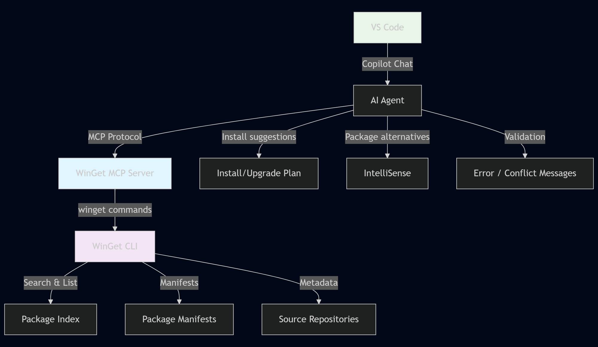
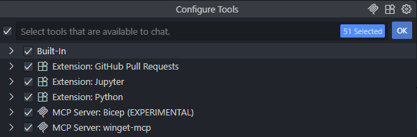
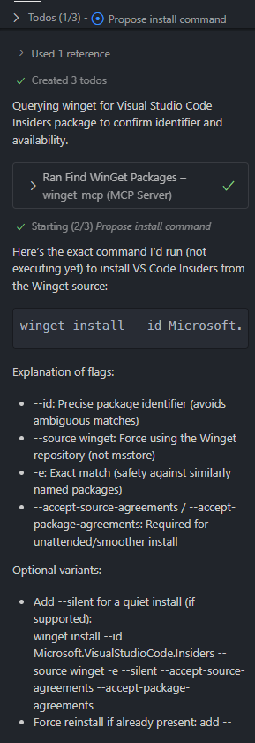

WinGet (Windows Package Manager) now exposes a Model Context Protocol (MCP) server. Tools like VS Code and GitHub Copilot can query, search for, and install packages interactively. Instead of memorizing command switches, you can explore packages conversationally, then copy the exact underlying <code>winget</code> commands or requests for it.

This quick how-to guide shows you how to enable and use the WinGet MCP server inside VS Code to:
<ul><li>Discover available packages.</li><li>Inspect metadata and installer details.</li><li>Install or upgrade software directly.</li><li>Generate raw commands for scripting</li></ul><h2 id="prerequisites">Prerequisites</h2>
If you want to follow along, make sure you have:
<ul><li>VS Code v1.105.1 or higher.</li><li>GitHub Copilot enabled in VS Code.</li><li>WinGet preview v.12.170-preview or above.</li></ul>

💡

If you need the WinGet preview version, you can use the <code spellcheck="false" style="white-space: pre-wrap;">Repair-WinGetPackageManager</code> command with the <code spellcheck="false" style="white-space: pre-wrap;">-IncludePrerelease</code> switch parameter.

To verify if <code>winget mcp</code> exist, run:
<pre><code class="language-powershell">winget --help | Select-String -Pattern mcp</code></pre>
If MCP appears, you're good to go.
<h2 id="how-winget-mcp-integration-works-in-vs-code">How WinGet MCP integration works in VS Code</h2>
The WinGet MCP server is started as a stdio process (<code>WindowsPackageManagerMCPServer.exe</code>) which:
<ol><li>Register the tools (e.g. <code>find-winget-packages</code> or <code>install-winget-package</code>).</li><li>Declares capabilities to the client (VS Code / Copilot).</li><li>Speaks JSON-RPC over stdin/stdout.</li></ol>
A plain, simplified request to list tools looks like:
<pre><code>{
  "jsonrpc": "2.0",
  "id": 1,
  "method": "tools/list",
  "params": {}
}</code></pre>
Behind the scenes, VS Code handles this for you. You only interact via natural language queries (e.g., "Search for a fast code editor), and Copilot maps those to tool invocations.

Here's a complete diagram of what happens behind the scenes:
<figure class="kg-card kg-image-card"></figure><h2 id="manually-starting-winget-mcp-server">Manually starting WinGet MCP server </h2>
Before you actually move directly to VS Code, taking the time to learn MCP pays off later.

You can experiment outside VS Code by running a couple of PowerShell commands in sequence. First, you start by running the WinGet MCP server:
<pre><code class="language-powershell">$psi = [System.Diagnostics.ProcessStartInfo]::new()
$psi.FileName = "WindowsPackageManagerMCPServer.exe"
$psi.RedirectStandardInput = $true
$psi.RedirectStandardOutput = $true
$psi.RedirectStandardError = $true
$proc = [System.Diagnostics.Process]::Start($psi)</code></pre>
Below is a minimal PowerShell helper function to send <code>initialize</code> and then list out the available tools to the running WinGet MCP server process you just started:
<pre><code class="language-powershell"># 1. Initialize session
$init = @{
  jsonrpc = '2.0'
  id = 1
  method = 'initialize'
  params = @{
    protocolVersion = '2024-11-05'
    capabilities    = @{ tools = @{} }
    clientInfo      = @{ name='ManualWinGetClient'; version='0.1.0' }
  }
}
$response = Send-McpRequest -Process $proc -Payload $init
Write-Host "Initialized: $($response.result.serverInfo.name)" -ForegroundColor Green&#10;
# 2. Notify initialized
$notify = @{ jsonrpc = '2.0'; method = 'notifications/initialized' }
Send-McpRequest -Process $proc -Payload $notify -Notify&#10;
# 3. List available tools
$listTools = @{ jsonrpc='2.0'; id=2; method='tools/list'; params=@{} }
$toolsResponse = Send-McpRequest -Process $proc -Payload $listTools</code></pre>
In the <code>$toolsResponse</code> variable, you can list out the available tools:
<pre><code class="language-powershell">$toolsResponse.result.tools&#10;
# Output
name        : install-winget-package
title       : Install WinGet Package
description : Install or update a package using WinGet
inputSchema : @{type=object; properties=; required=System.Object[]}
annotations : @{title=Install WinGet Package; destructiveHint=True; idempotentHint=False; openWorldHint=False;
              readOnlyHint=False}&#10;
name        : find-winget-packages
title       : Find WinGet Packages
description : Find installed and available packages using WinGet
inputSchema : @{type=object; properties=; required=System.Object[]}
annotations : @{title=Find WinGet Packages; openWorldHint=False; readOnlyHint=True}</code></pre>
Understanding why we sent those specific messages in that order clarifies the MCP contract (which is hidden when you use VS Code):
<ol><li><strong>Initialize: </strong>Establishes the protocol version, exchange capabilities, and gives the server a chance to prepare internal tool metadata.</li><li><strong>Notify (initialized): </strong>A signal sent to the server indicating that the client has finished its<strong> </strong>initialization and is ready for normal traffic.</li><li><strong>Tools/list: </strong>Enumerates the tools currently exposed by the MCP server.</li></ol><h2 id="enable-winget-mcp-server-in-vs-code">Enable WinGet MCP Server in VS Code</h2>
Now that you know how to start it manually, it's time to work through the steps by adding it in VS Code:
<ol><li>Open the Command Palette (Ctrl+Shift+P).</li><li>Run: "MCP: Add Server...</li><li>Choose "Command (stdio)</li><li>Run the <code>winget mcp</code> command and grab the <strong>command</strong> for the "Enter command"</li><li>Name it: <code>winget-mcp</code></li><li>Add to workspace</li></ol>
The created <code>.vscode/mcp.json</code> in your workspace should look something like:
<pre><code class="language-json">{
	"servers": {
		"winget-mcp": {
			"type": "stdio",
			"command": "C:\\Users\\&lt;username&gt;\\AppData\\Local\\Microsoft\\WindowsApps\\Microsoft.DesktopAppInstaller_8wekyb3d8bbwe\\WindowsPackageManagerMCPServer.exe",
			"args": []
		}
	},
	"inputs": []
}</code></pre>
You can now open Copilot Chat, click the toolbox icon, and see the WinGet tools available to you:
<figure class="kg-card kg-image-card"></figure><h2 id="asking-questions-and-exploring-packages">Asking questions and exploring packages</h2>
VS Code and CoPilot are configured with the required tools. You can now start asking questions like:
<ul><li>"Is PowerShell installed on my system using WinGet?"</li><li>"Show me metadata for PowerShell"</li><li>"Upgrade PowerShell using WinGet".</li></ul>
If the tool output is summarized, ask questions: "Reveal the underlying command you ran" or "Show me the raw WinGet command". The assistant will surface something like:
<pre><code class="language-plaintext">Metadata snapshot for PowerShell via WinGet MCP (combined Store + Winget source):&#10;
Installed package (Microsoft Store):&#10;
Name: PowerShell
Identifier (Store): 9MZ1SNWT0N5D
Source: msstore
Installed Version: 7.5.3.0
Update Available: No (isUpdateAvailable = false)
Installed: Yes
Winget repository package (not currently installed):&#10;
Name: PowerShell
Identifier (Winget): Microsoft.PowerShell
Source: winget
Installed: No</code></pre><h2 id="installing-a-package-via-mcp">Installing a package via MCP</h2>
The MCP server can assist you with installing or upgrading a package. Ask, for example:

<em>"Install Visual Studio Code Insiders using WinGet and the source also as WinGet. Before doing so, show me the actual command and let me approve it before executing.".</em>

The response may vary on your system, but this was the rough output:
<figure class="kg-card kg-image-card"></figure>
You can then either tell Copilot chat to install it for you or grab the literal command and execute it yourself.
<h2 id="advanced-usage-patterns">Advanced usage patterns</h2>
Here are a couple of advanced usage patterns you can use to accelerate your learning.
<h3 id="filter-by-tag-or-moniker">Filter by tag or moniker</h3>
<em>"Search for packages tagged 'terminal'".</em>
<h3 id="compare-versions">Compare versions</h3>
<em>"Show me installed vs available version for PowerShell".</em>
<h3 id="generate-script-snippets">Generate script snippets</h3>
<em>"Generate a PowerShell script that installs Git, 7zip, and VS Code if not present."</em>
<h2 id="limitations">Limitations</h2>
As you've already noticed, the MCP tooling currently only supports:
<ul><li>Finding packages installed on your system.</li><li>Installing or upgrading packages.</li></ul>
You can follow the <a href="https://github.com/microsoft/winget-cli">WinGet repository</a> issues or discussions for more MCP features.
<h2 id="summary">Summary</h2>
Having the WinGet MCP server in your VS Code tools helps you learn the relevant commands more easily. Copilot maps them to the WinGet commands. You can either reuse these commands or let Copilot do the work for you.

With this knowledge at hand, what's your next question going to be?

