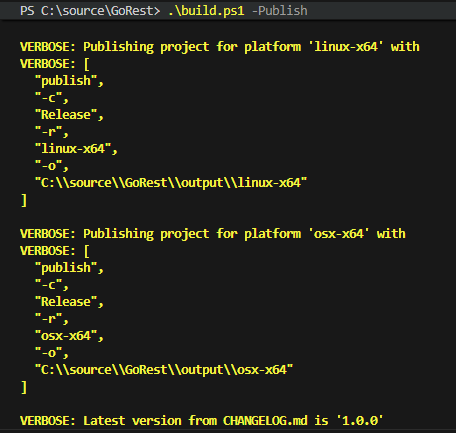
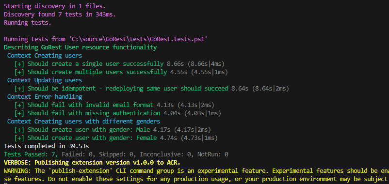
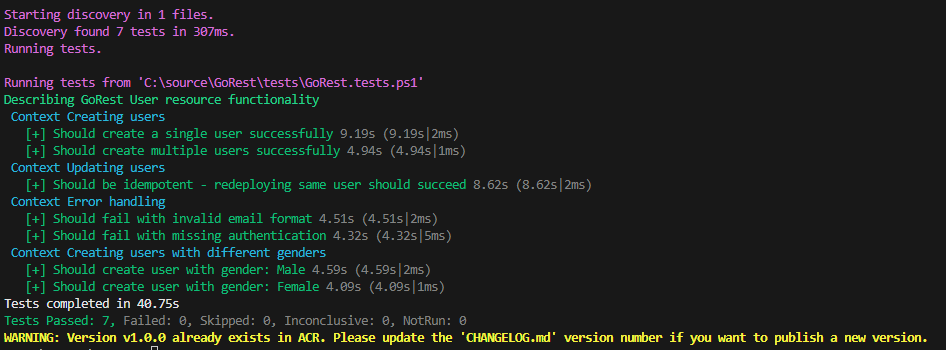

<p>You've finished testing and are confident your extension is production-ready. Are you finished now?</p><p>Not quite. You have built a working extension. You have tested it thoroughly. But no one else can use it yet. Without documentation, users cannot understand what your extension does or how to use it. Without publishing to a registry, users cannot access it directly from their Bicep templates.</p><p>This module transforms your local prototype into a globally accessible tool. You generate documentation from the attributes you added in module 2. You validate the documentation for completeness and, in the end, publish your extension to an Azure Container Registry, allowing anyone to reference it. </p><p>This module completes the journey from code to production-ready extension.</p><p>In this module, you will:</p><ul><li>Understand how <code>Bicep.LocalDeploy</code> documentation attributes work together.</li><li>Generate documentation using the <code>bicep-local-docgen</code> CLI.</li><li>Validate documentation for completeness.</li><li>Publish your extension to Azure Container Registry using Azure PowerShell.</li><li>Reference your published extension in <code>bicepconfig.json</code>.</li></ul><h2 id="prerequisites">Prerequisites</h2><p>To complete this module, you're going to need:</p><ul><li>Completed module 2.</li><li>An Azure subscription.</li><li>Azure PowerShell module v14.0.0+ or above.</li></ul><p>If you do not have an Azure subscription, you can create a <a href="https://azure.microsoft.com/free/">free account</a>, which includes $200 credit for 30 days.</p><p>To install Azure PowerShell, use:</p><pre><code class="language-powershell">Install-PSResource -Name Az -Repository PSGallery</code></pre><h2 id="understanding-documentation-attributes">Understanding documentation attributes</h2><p>In module 2, you added documentation attributes to your GoRest extension models. These attributes are not just decorations. They are the source of truth for your extension's documentation. The <code>bicep-local-docgen</code> CLI tool extracts these attributes and automatically generates professional Markdown documentation.</p><p>This approach keeps documentation synchronized with code. When you update a property, you update its <code>TypeProperty</code> attribute. When you add a new example, you add a <code>BicepDocExample</code> up to date attribute. Regenerate the docs, and everything stays current. No separate documentation files that drift out of sync.</p><h3 id="how-attributes-work-together">How attributes work together</h3><p>Six attributes work together to create complete documentation. <code>Bicep.LocalDeploy</code> provides four attributes specifically for documentation generation. The other two come from Bicep's library (<code>Bicep.Local.Extension.Types.Attributes</code>).</p><p><strong>Documentation attributes (from Bicep.LocalDeploy):</strong></p><ol><li><strong>BicepFrontMatter</strong>: Document-level metadata (title, author, version).</li><li><strong>BicepDocHeading</strong>: Section headers that organize content.</li><li><strong>BicepDocExample</strong>: Code examples within sections.</li><li><strong>BicepDocCustom</strong>: Custom markdown content within sections.</li></ol><p><strong>Resource definition attributes (from Bicep.Local.Extension.Types.Attributes):</strong></p><ol start="5"><li><strong>ResourceType</strong>: Resource type definition (name, description).</li><li><strong>TypeProperty</strong>: Individual property documentation (description, required, readonly).</li></ol><p>The generator processes these attributes in order. It creates the front matter. It builds sections from headings. It places examples and custom content into sections. It generates a property reference table from resource type and property attributes. The result is professional, consistent documentation.</p><h3 id="attribute-processing-flow">Attribute processing flow</h3><p>Understanding how the generator processes attributes helps you organize your documentation effectively.</p><p><strong>Step 1: Extract front matter</strong><br>The generator scans your assembly for classes with the `BicepFrontMatter` attribute. This attribute must appear on a resource type class (one with <code>ResourceType</code> attribute). It becomes the document's metadata block at the top.</p><pre><code class="language-csharp">[BicepFrontMatter(
    Title = "GoRest User Resource",
    Description = "Manage users in the GoRest API",
    Author = "Your Name",
    Version = "1.0.0",
    ExtensionName = "GoRest"
)]
[ResourceType(Name = "User", Description = "User account")]
public class User {  }</code></pre><p>Which in turn generates:</p><pre><code class="language-markdown">---
title: GoRest User Resource
description: Manage users in the GoRest API
author: Your Name
version: 1.0.0
extension: GoRest
---</code></pre><p><strong>Step 2: Build section structure</strong><br>The generator finds all <code>BicepDocHeading</code> attributes. Each heading becomes a top-level section (## in markdown). The heading text and description are used to create the section.</p><pre><code class="language-csharp">[BicepDocHeading("User", "Manages users in the GoRest API.")]</code></pre><p>Generates:</p><pre><code class="language-markdown">## User&#10;
Manages users in the GoRest API.</code></pre><p><strong>Step 3: Add examples to sections</strong><br>The generator finds all <code>BicepDocExample</code> attributes. Each example includes a title, description, and code sample.</p><pre><code class="language-csharp">[BicepDocExample(
    "Creating a basic user",
    "This example creates a simple active user with required fields.",
    @"resource adminUser 'User' = {
  name: 'John Doe'
  email: 'john.doe@example.com'
  gender: 'Male'
  status: 'Active'
}")]</code></pre><p>Generates:</p><pre><code class="language-markdown">### Creating a basic user&#10;
This example creates a simple active user with required fields.&#10;
```bicep
resource adminUser 'User' = {
  name: 'John Doe'
  email: 'john.doe@example.com'
  gender: 'Male'
  status: 'Active'
}
```</code></pre><p><strong>Step 4: Add custom content to sections</strong><br>The generator finds all <code>BicepDocCustom</code> attributes. Each custom content block includes a title and markdown content.</p><pre><code class="language-csharp">[BicepDocCustom(
    "User email requirements",
    @"User emails must be unique in the GoRest system. Key considerations:&#10;
- Email addresses must be valid and unique
- Use organization domain emails for better tracking
- Inactive users can be reactivated by updating their status
- Gender field accepts 'Male' or 'Female' values
- Status field accepts 'Active' or 'Inactive' values")]</code></pre><p>The content is inserted directly as markdown. Use this for notes, warnings, lists, or any explanation that does not fit the other attribute types.</p><p><strong>Step 5: Generate property reference</strong><br>The generator finds the resource type class (marked with <code>ResourceType</code>) and examines its properties. For each property with a <code>TypeProperty</code> attribute, it adds a row to the property reference table.</p><pre><code class="language-csharp">[TypeProperty(
    Description = "User's email address. Must be unique.",
    Required = true,
    ReadOnly = false
)]
public required string Email { get; set; }</code></pre><p>Generates a table row:</p><pre><code class="language-markdown">| Property | Type | Required | Read-Only | Description |
|----------|------|----------|-----------|-------------|
| `email` | string | Yes | No | User's email address. Must be unique. |</code></pre><p>The generator infers the property type from the C# type. It converts the property name to camelCase for Bicep's convention.</p><h3 id="organizing-attributes-effectively">Organizing attributes effectively</h3><p>Place all documentation attributes on the resource type class. This keeps everything together. Order matters for readability in code.</p><p><strong>Recommended order:</strong></p><ol><li>Front matter (once per resource type).</li><li>Headings and their associated examples/custom content (grouped logically).</li><li>Resource type attributes</li><li>Class definition with property attributes.</li></ol><p>Example structure as defined in the <code>User.cs</code>:</p><pre><code class="language-csharp">[BicepFrontMatter("category", "User Management")]
[BicepDocHeading("User", "Manages users in the GoRest API.")]
[BicepDocExample(
    "Creating a basic user",
    "This example creates a simple active user with required fields.",
    @"resource adminUser 'User' = {
  name: 'John Doe'
  email: 'john.doe@example.com'
  gender: 'Male'
  status: 'Active'
}")]
[BicepDocCustom(
    "User email requirements",
    @"User emails must be unique in the GoRest system.")]
[ResourceType("User")]
public class User
{
    [TypeProperty("The unique user ID assigned by GoRest.", ObjectTypePropertyFlags.ReadOnly)]
    public int Id { get; set; }&#10;    
    [TypeProperty("The unique email address of the user.", ObjectTypePropertyFlags.Required | ObjectTypePropertyFlags.Identifier)]
    public required string Email { get; set; }
}</code></pre><p>This structure reads top to bottom: metadata, sections, resource definition, properties.</p><h2 id="generating-documentation">Generating documentation</h2><p>With attributes in place, generate documentation using the <code>bicep-local-docgen</code> CLI tool you installed in module 1. The tool extracts documentation attributes from your compiled assembly and generates Markdown files.</p><h3 id="generating-from-models">Generating from models</h3><p>To generate documentation from the models, you can simply run the following command from the root of the project:</p><pre><code class="language-powershell">bicep-local-docgen generate --source src\Models --verbose&#10;
# Output:
Patterns: *.cs
# Found 3 source file(s) to parse.
# - Parsing C:\source\GoRest\src\Models\Configuration.cs
#   Property: BaseUrl : string [Required]
#   Property: Token : string [Required]
# - Parsing C:\source\GoRest\src\Models\SampleResource\SampleResource.cs
#   ResourceType: SampleResource (SampleResource)
#   FrontMatter: category = 'Sample'
#   Heading: 'SampleResource'
#   Example: 'Creating a basic sample resource' (lang: bicep)
#   Example: 'Creating an advanced sample resource' (lang: bicep)
#   Custom section: 'Notes'
#   Custom section: 'Additional reference'
#   Base types: SampleResourceIdentifiers
#   Property: Description : string?
#   Property: IsEnabled : bool
#   Property: Status : ResourceStatus?
#   Property: MaxRetries : int
#   Property: TimeoutSeconds : int
#   Property: Metadata : ResourceMetadata?
#   Property: ResourceId : string? [ReadOnly]
#   Property: CreatedAt : int [ReadOnly]
#   Property: UpdatedAt : int [ReadOnly]
#   Property: Name : string [Required, Identifier]
#   Property: CreatedBy : string?
#   Property: Version : string?
#   Enum mapped: SampleResource.Status -&gt; ResourceStatus [Active, Inactive, Pending, Deleted]
# - Parsing C:\source\GoRest\src\Models\User\User.cs
#   ResourceType: User (User)
#   FrontMatter: category = 'User Management'
#   Heading: 'User'
#   Example: 'Creating a basic user' (lang: bicep)
#   Example: 'Creating multiple users' (lang: bicep)
#   Custom section: 'User email requirements'
#   Base types: UserIdentifiers
#   Property: Name : string [Required]
#   Property: Gender : UserGender? [Required]
#   Property: Status : UserStatus? [Required]
#   Property: Id : int [ReadOnly]
#   Property: Email : string [Required, Identifier]
#   Enum mapped: User.Gender -&gt; UserGender [Male, Female]
#   Enum mapped: User.Status -&gt; UserStatus [Active, Inactive]
# Generating docs for 2 resource type(s) to 'C:\source\GoRest\docs'...</code></pre><p>The CLI has multiple options to change the behavior:</p><ul><li><code>--source</code>: The source folder storing Bicep models.</li><li><code>--output</code>: The output directory to store generated docs (defaults to <code>docs</code>).</li><li><code>--pattern</code>: Filters to select source files.</li><li><code>--verbose</code>: Enables verbosity logging.</li><li><code>--force</code>: Overwrite existing files if they already exist.</li></ul><p>As you could see in the verbosity logging, the tool analyzes your assembly. It attempts to find all classes with <code>ResourceType</code> attributes and then, for each resource type, it generates one Markdown file containing all the documentation attributes.</p><p>If you open up the <code>docs\User.md</code> file, the following was generated:</p><pre><code class="language-markdown">---
category: "User Management"
---&#10;
# User&#10;
Manages users in the GoRest API.&#10;
## Example usage&#10;
### Creating a basic user&#10;
This example creates a simple active user with required fields.&#10;
```bicep
resource adminUser 'User' = {
  name: 'John Doe'
  email: 'john.doe@example.com'
  gender: 'Male'
  status: 'Active'
}
```&#10;
### Creating multiple users&#10;
This example creates multiple users with different settings.&#10;
```bicep
resource adminUser 'User' = {
  name: 'Jane Admin'
  email: 'jane.admin@company.com'
  gender: 'Female'
  status: 'Active'
}&#10;
resource devUser 'User' = {
  name: 'Bob Developer'
  email: 'bob.dev@company.com'
  gender: 'Male'
  status: 'Active'
}
```&#10;
## Argument reference&#10;
The following arguments are available:&#10;
- `email` - (Required) The unique email address of the user.
- `gender` - (Required) The gender of the user. (Can be `Male`, or `Female`)
- `name` - (Required) The full name of the user.
- `status` - (Required) The status of the user account. (Can be `Active`, or `Inactive`)&#10;
## Attribute reference&#10;
In addition to all arguments above, the following attributes are outputted:&#10;
- `id` - The unique user ID assigned by GoRest.&#10;
## User email requirements&#10;
User emails must be unique in the GoRest system. Key considerations:&#10;
- Email addresses must be valid and unique
- Use organization domain emails for better tracking
- Inactive users can be reactivated by updating their status
- Gender field accepts 'Male' or 'Female' values
- Status field accepts 'Active' or 'Inactive' values&#10;
</code></pre><h2 id="validating-documentation">Validating documentation</h2><p>You generated the documentation successfully because you added the attributes in module 2. But what if that was not the case? That's where the <code>bicep-local-docgen check</code> command catches missing or incomplete attributes.</p><p>Run the <code>check</code> command against the <code>Models</code> directory:</p><pre><code class="language-powershell">bicep-local-docgen check src\Models&#10;
# Outputs:
# Checking 3 files...
# Checked 0 files in 254ms.
# All files have the required documentation attributes.</code></pre><p>All checks pass, and the basic validation confirms:</p><ol><li>At least one <code>BicepDocHeading</code> exists.</li><li>At least one <code>BicepDocExample</code> is present.</li><li>All public properties have <code>TypeProperty</code> attributes.</li><li><code>ResourceType</code> attribute is present.</li></ol><p>If you want a thorough validation, use the <code>--include-extended</code> option to check the other two attributes. The extended validation adds checks for the <code>BicepFrontMatter</code> and <code>BicepDocCustom</code> attributes. These attributes <em>extend </em>documentation quality but are not required for generation.</p><h3 id="understanding-validation-errors">Understanding validation errors</h3><p>To understand what validation catches, let's temporarily disable both examples. Open the <code>User.cs</code> file in your editor and comment out the <code>BicepDocExample</code> attributes:</p><pre><code class="language-csharp">[BicepDocExample(
//     "Creating a basic user",
//     "This example creates a simple active user with required fields.",
//     @"resource adminUser 'User' = {
//   name: 'John Doe'
//   email: 'john.doe@example.com'
//   gender: 'Male'
//   status: 'Active'
// }")]
// [BicepDocExample(
//     "Creating multiple users",
//     "This example creates multiple users with different settings.",
//     @"resource adminUser 'User' = {
//   name: 'Jane Admin'
//   email: 'jane.admin@company.com'
//   gender: 'Female'
//   status: 'Active'
// }&#10;
// resource devUser 'User' = {
//   name: 'Bob Developer'
//   email: 'bob.dev@company.com'
//   gender: 'Male'
//   status: 'Active'
// }")]</code></pre><p>Run the check again:</p><pre><code class="language-powershell">bicep-local-docgen check src\Models&#10;
# Outputs:
# Error src\Models\User\User.cs - Missing required documentation attributes.
#   ----------------------------- Expected: Around Line 55 -----------------------------
#                   [BicepDocExample("Title", "Description", "code")]
#   ----------------------------- Actual: Around Line 55 -----------------------------
#                   // Missing BicepDocExample attribute&#10;
# Checked 1 files in 251ms.</code></pre><p>The validation errors may occur when the documentation is incomplete. Uncomment the example to restore complete documentation.</p><h2 id="publishing-to-azure-container-registry">Publishing to Azure Container Registry</h2><p>Now that you've learned how to generate documentation, it's time to publish it to an Azure Container Registry (ACR). ACR provides a secure, managed registry for your extension that can be used in Bicep templates. Users can reference your extension using the <a href="https://edu.chainguard.dev/open-source/oci/what-is-the-oci/">Open Container Initiative</a> (OCI) artifact syntax in their <code>bicepconfig.json</code> file.</p><h3 id="why-use-azure-container-registry">Why use Azure Container Registry?</h3><p>ACR is the recommended registry for Bicep extensions and for good reason. In the <code>bicepconfig.json</code>, you can directly reference it against a particular version. This native integration makes it easy to distribute extensions.</p><div class="kg-card kg-callout-card kg-callout-card-blue"><div class="kg-callout-emoji">💡</div><div class="kg-callout-text">Always make sure to check to <a href="https://azure.microsoft.com/en-us/pricing/details/container-registry/">costing for Azure resources</a>.</div></div><p></p><h3 id="setting-up-azure-container-registry">Setting up Azure Container Registry</h3><p>To start publishing your extension, you need to create an Azure Container Registry. At the start, you should have installed the <code>Az</code> PowerShell module. You'll only do this once.</p><p>Execute each command in sequence from the code snippet:</p><pre><code class="language-powershell"># Connect to Azure
Connect-AzAccount&#10;
# Check the context
Get-AzContext&#10;
# Create a resource group
New-AzResourceGroup -Name MyExtension -Location westeurope # Or change it&#10;
# Create the registry
New-AzContainerRegistry -Name gorestextensionregistry `
  -Location westeurope `
  -Sku basic `
  -ResourceGroupName MyExtension
</code></pre><div class="kg-card kg-callout-card kg-callout-card-blue"><div class="kg-callout-emoji">⚠️</div><div class="kg-callout-text">The registry name must be globally unique across Azure.</div></div><p></p><h2 id="publish-extension-with-bicep-cli">Publish extension with Bicep CLI</h2><p>The build automation script is already publishing your extension locally using the <code>publish-extension</code> command. But how do you actually publish it to an ACR? There are two key ingredients to it:</p><ul><li>A version number</li><li>The container registry URL</li></ul><p>In the next section, you'll prepare both ingredients to publish them to your newly created ACR.</p><h3 id="preparing-version-number">Preparing version number</h3><p>A best practice for extension versioning is to maintain version numbers. For that, you can use the <code>CHANGELOG.md</code> file. This is commonly used in open-source projects for version history and release notes, and, in this case, actually synchronizes versions in one place.</p><p>Users can easily see what changed in each version and choose which version of your extension to use. To automate the process and add it to your build automation script, you can use the <code>ChangeLogManagement</code> PowerShell module to read and manage this version number from <code>CHANGELOG.md</code> file.</p><p>Run the following command to install the module:</p><pre><code class="language-powershell">Install-PSResource -Name ChangeLogManagement -Scope CurrentUser -Repository PSGallery</code></pre><p>Then, you can create a new <code>CHANGELOG.md</code> file in the project root:</p><pre><code class="language-powershell">New-ChangeLog</code></pre><p>This creates a changelog with an unreleased section and one subheading <code>### Added</code>. Open your editor and add the first version number:</p><pre><code class="language-markdown"># Changelog&#10;
All notable changes to this project will be documented in this file.&#10;
The format is based on [Keep a Changelog](https://keepachangelog.com/en/1.0.0/),
and this project adheres to [Semantic Versioning](https://semver.org/spec/v2.0.0.html).&#10;
## [Unreleased]&#10;
## [1.0.0] - 2025-11-02&#10;
### Added&#10;
- Initial release
</code></pre><p>After you've created an initial version, you want to publish your extension <em>incrementally</em> if changes are being made. To do so, you can change the build automation script and use the <code>Get-ChangelogData</code> command to read this information:</p><pre><code class="language-powershell">if ($Publish.IsPresent) 
{
    $version = Get-ChangelogData -Path (Join-Path $PSScriptRoot 'CHANGELOG.md') | Select-Object -ExpandProperty LastVersion
    Write-Verbose -Message "Latest version from CHANGELOG.md is '$version'" -Verbose
}&#10;
$extensionParams += @(
    '--target', $targetName,
    '--force'
)&#10;
$bicepExe = testBicepExe&#10;
# Truncated</code></pre><p>Don't forget to add the new <code>Publish</code> parameter switch at the top:</p><pre><code class="language-powershell">#Requires -Version 7.0
[CmdletBinding()]
param (
    [ValidateSet("Release", "Debug")]
    [string]
    $Configuration = "Release",&#10;
    [switch]
    $Clean,&#10;
    [switch]
    $Test,&#10;
    [switch]
    $Publish
)</code></pre><p>Now run the <code>.\build.ps1 -Publish</code> script to verify if the version number is picked up:</p><figure class="kg-card kg-image-card kg-card-hascaption"><figcaption><span style="white-space: pre-wrap;">Figure 1: Latest version number picked</span></figcaption></figure><h3 id="building-azure-container-registry-url">Building Azure Container Registry URL</h3><p>With version management set up, you need to build up the ACR URL to publish your extension correctly. You also want to validate if it actually needs to be published by pulling the existing version from the ACR.</p><p>To verify the version doesn't already exist in your registry, add the following function at the top of the build automation script:</p><pre><code class="language-powershell">function Test-AcrVersionExists {
    param(
        [string]$RegistryName,
        [string]$Repository,
        [string]$Version
    )&#10;    
    $tags = Get-AzContainerRegistryTag `
        -RegistryName $RegistryName `
        -RepositoryName $Repository `
        -ErrorAction SilentlyContinue&#10;    
    if ($tags) {
        return $tags.Tags.Name -contains $Version
    }
    return $false
}</code></pre><p>In the <code>bicepconfig.json</code> file, you need to tell the Bicep CLI to take Azure PowerShell as precedence for authentication and authorization:</p><pre><code class="language-json">{
  "experimentalFeaturesEnabled": {
    "localDeploy": true
  },
  "cloud": {
    "credentialPrecedence": [
      "AzurePowerShell"
    ],
    "currentProfile": "AzureCloud"
  },
  "extensions": {
    "GoRestExtension": "output/my-extension"
  },
  "implicitExtensions": []
}</code></pre><p>To construct the Bicep container registry URL, you can use the <code>Get-AzContainerRegistry</code> command and use the <code>LoginServer</code> property to determine the ACR URL:</p><pre><code class="language-powershell">if ($Publish.IsPresent) 
{
    $version = Get-ChangelogData -Path (Join-Path $PSScriptRoot 'CHANGELOG.md') | Select-Object -ExpandProperty LastVersion
    Write-Verbose -Message "Latest version from CHANGELOG.md is '$version'" -Verbose&#10;
    # Construct Bicep registry URL
    $registry = Get-AzContainerRegistry -ResourceGroupName 'MyExtension'
    $loginServer = $registry.LoginServer
    $registryName = $registry.Name&#10;
    $extensionName = 'my-extension'
    $bicepRegistryUrl = [System.String]::Concat('br:', $loginServer, '/gorest/', $extensionName, ':v', $version)&#10;
    $containerParams = $extensionParams
    $containerParams += @('--target', $bicepRegistryUrl)
}</code></pre><p>Lastly, because you want to verify all tests have run appropriately before you do an actual <em>production</em> deployment, you can add the publishing step just after the tests have run:</p><pre><code class="language-powershell">if ($Test.IsPresent)
{
    Write-Verbose "Running tests..." -Verbose&#10;
    $testPath = Join-Path $PSScriptRoot 'tests'
    if (Test-Path $testPath)
    {
        $pesterConfig = New-PesterConfiguration
        $pesterConfig.Run.Path = $testPath
        $pesterConfig.Run.Exit = $true
        $pesterConfig.Output.Verbosity = 'Detailed'&#10;
        Invoke-Pester -Configuration $pesterConfig&#10;
        if ($Publish.IsPresent) 
        {
            $exists = Test-AcrVersionExists -RegistryName $registryName -Repository "gorest/$extensionName" -Version "v$version"
            if ($exists) 
            {
                Write-Warning -Message "Version v$version already exists in ACR. Please update the 'CHANGELOG.md' version number if you want to publish a new version."
            } 
            else 
            {
                Write-Verbose -Message "Publishing extension version v$version to ACR." -Verbose
                &amp; $bicepExe @containerParams
            }
        }
    }
    else
    {
        Write-Warning "Test directory not found at '$testPath'. Skipping tests."
    }
}</code></pre><p>It's time to test it out. Run the build automation script with both <code>-Test</code> and <code>-Publish</code> switches enabled:</p><figure class="kg-card kg-image-card kg-card-hascaption"><figcaption><span style="white-space: pre-wrap;">Figure 2: Publishing extension</span></figcaption></figure><p>The first run takes some time to upload the extension. After it's finished, try re-running it once again to validate if it doesn't publish it again:</p><figure class="kg-card kg-image-card kg-card-hascaption"><figcaption><span style="white-space: pre-wrap;">Figure 3: Version already exists</span></figcaption></figure><p>Perfect, you've validated that the extension isn't published on a second run. This workflow ensures:</p><ol><li>Your <code>CHANGELOG.md</code> is the main entry point to increment version numbers.</li><li>Version numbers are consistent across your documentation and registry.</li><li>You never accidentally overwrite existing versions.</li><li>Your release history is tracked in a standard format.</li></ol><h2 id="using-published-extensions">Using published extensions</h2><p>With the extension published to ACR, your end users can reference your published extension in their <code>bicepconfig.json</code>. Instead of using the local variant, Bicep can automatically download and cache the extension when it gets deployed.</p><p>To use the ACR version, you can instruct your end users to create a <code>bicepconfig.json</code> with the following content:</p><pre><code class="language-json">{
  "experimentalFeaturesEnabled": {
    "localDeploy": true
  },
  "extensions": {
    "GoRestExtension": "br:gorestextensionregistry.azurecr.io.azurecr.io/extension/databricks:v1.0.0"
  },
  "implicitExtensions": []
}</code></pre><p>Each time a new version is released, users can update the version number at the end to use the latest features of your extension.</p><h2 id="versioning-and-maintenance">Versioning and maintenance</h2><p>Before closing this module lesson, a quick word on versioning and maintenance. The <code>CHANGELOG.md</code> file serves as the single source of truth for your extension's version history. This approach was chosen because it consolidates version numbers, release dates, and change descriptions in a single, human-readable location.</p><p>Users can quickly understand what changed between versions without digging through Git commits or release notes scattered across different platforms. You, as a maintainer, benefit too. The <code>ChangeLogManagement</code> module reads this file programmatically, ensuring the version you publish to ACRS matches the version documented in your changelog. This eliminates version number mismatches or accidental overwrites.</p><p>The <code>CHANGELOG.md</code> file follows the Keep a Changelog format, which pairs with Semantic Versioning. Semantic versioning uses a three-part version number (MAJOR.MINOR.PATCH) where each part signals different types of changes. </p><p>A MAJOR version increment (x.0.0) indicates breaking changes that require user action, like renaming the <code>email</code> property to <code>emailAddress</code>. A MINOR version increment (0.x.0) adds new features that remain backward-compatible, such as support for a Post resource type. A PATCH version increment (0.0.x) fixes bugs without changing behavior, like correcting email validation logic. Breaking changes include renaming or removing properties, changing property types, modifying required/optional property flags, removing resource types, or altering API behavior in incompatible ways. Non-breaking changes include adding new properties or resource types, adding examples or documentation, fixing bugs, and improving performance. When uncertain whether a change is breaking, increment the major version. Users don't like surprises.</p><p>This workflow keeps your version history organized and makes it easy to generate release notes. The changelog becomes living documentation that travels with your code, making it simple for users to decide whether to upgrade and for you to maintain a clear version history.</p><h2 id="summary">Summary</h2><p>In this module, you learned:</p><ul><li>How <code>Bicep.LocalDeploy</code> documentation attributes work together to create documentation.</li><li>The attribute processing flow from frontmatter through property reference.</li><li>How to organize attributes in your code.</li><li>Generate Markdown using <code>bicep-local-docgen</code> CLI.</li><li>Validating your documentation for completeness.</li><li>Setting up Azure Container Registry with Azure PowerShell.</li><li>Publish your extension with Bicep's <code>publish-extension</code> command.</li><li>Supporting version numbering using <code>CHANGELOG.md</code>.</li></ul><p>Your GoRest extension is now fully documented, published, and ready for use.</p><h2 id="next-steps"><strong>Next steps</strong></h2><p>Congratulations on completing the Bicep Local Deploy extension course. You built a complete extension from scratch. You tested it. You documented it. You published it.</p><h2 id="knowledge-check">Knowledge check</h2><ol><li><strong>What is the purpose of the BicepFrontMatter attribute?</strong></li></ol><p>Answer: BicepFrontMatter provides document-level metadata, such as title, author, version, and extension name. It appears at the top of the generated documentation as YAML front matter.</p><ol start="2"><li><strong>How does the HeadingTitle property in BicepDocExample work?</strong></li></ol><p>Answer: HeadingTitle specifies which section the example belongs to. It must match the Title property of a BicepDocHeading attribute. The generator places the example under that section.</p><ol start="3"><li><strong>What does the bicep-local-docgen check command validate?</strong></li></ol><p>Answer: It validates that all resource types have front matter, at least one heading, at least one example, all public properties have TypeProperty attributes, and ResourceType attributes are present. It reports warnings for missing or incomplete documentation.</p><ol start="4"><li><strong>What is the difference between MAJOR, MINOR, and PATCH versions?</strong></li></ol><p>Answer: MAJOR versions contain breaking changes that require user action. MINOR versions add new features that are backward compatible. PATCH versions fix bugs without changing behavior. This is Semantic Versioning.</p><p>Thank you for completing this course. Happy extension building!</p>
