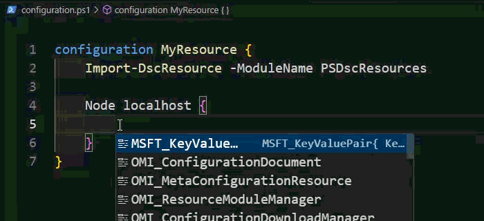
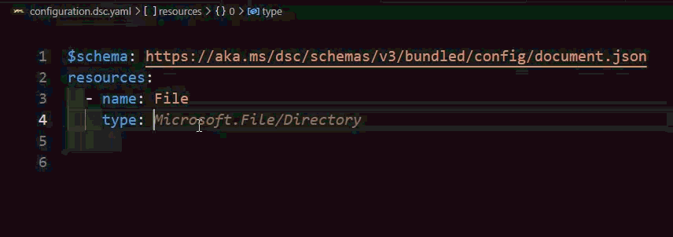
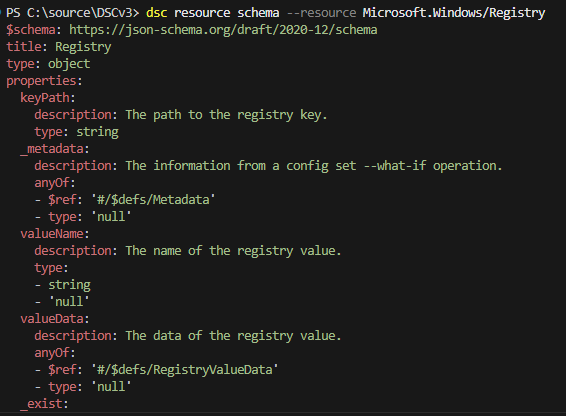
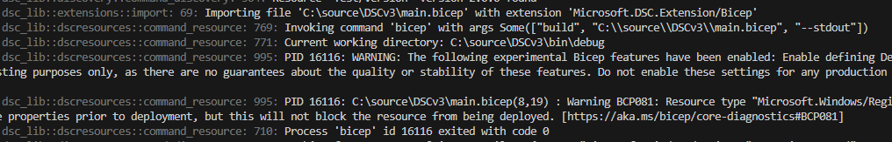
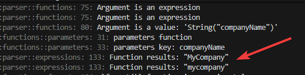
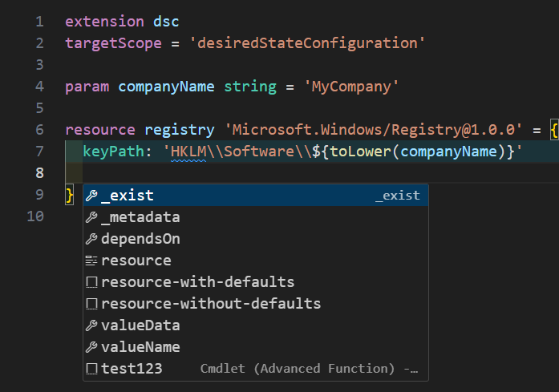

IntelliSense is <em>dead</em> in Microsoft Desired State Configuration (DSC). At least when you start creating configuration documents and declare their properties for the resource you want to use.

When Microsoft DSC launched, it introduced a cross-platform command-line interface utility. However, this evolution compared to PowerShell DSC came with a trade-off: the loss of IntelliSense support that developers had grown accustomed to.

The <code>bicep-types-dsc</code> experimental project tries to restore this experience by leveraging Bicep's type system and its experimental target scope <code>desiredStateConfiguration</code>. 

In this blog post, we'll dive into what was lost in the transition, how Bicep's type system can address this, and how the technical implementation has worked so far.
<h2 id="the-intellisense-problem">The IntelliSense problem</h2>
The PowerShell DSC v1.1 and v2.0 IntelliSense feature has been amazing to this day. You would fire up VS Code (or PowerShell ISE), start declaring the <code>Configuration</code> keyword, import the module containing DSC resources, and declare your resource.

When the resource was declared, you could press <code>Ctrl+Space</code> to trigger IntelliSense, and the available properties are displayed:
<figure class="kg-card kg-image-card kg-card-hascaption"><figcaption>Figure 1: Trigger IntelliSense in configuration document</figcaption></figure>
Trying to do the same in a configuration document targeted for Microsoft DSC doesn't give you the properties you're looking for:
<figure class="kg-card kg-image-card kg-card-hascaption"><figcaption>Figure 2: No IntelliSense for configuration documents in Microsoft DSC</figcaption></figure>
This gap is painful when working with complex resources that have dozens of properties. Without IntelliSense (or GitHub Copilot), you need to:
<ul><li>Remember exact property names.</li><li>Look up valid value types for each property.</li><li>Constantly look up reference documentation.</li><li>Potentially discover configuration errors at runtime.</li></ul>
Now, editors like VS Code aren't entirely unaware of the schemas used in Microsoft DSC. With the <a href="https://learn.microsoft.com/en-us/powershell/dsc/concepts/enhanced-authoring">enhanced authoring schemas</a> available in Microsoft DSC, you can get some IntelliSense support. It allows you to hover over documentation, get snippets, and receive better messages for the configuration document structure.

However, these enhanced schemas focus on the configuration document format itself, not the individual properties of DSC resources. You still need to manually look up the resource schemas to know which properties are available and what types they expect.
<figure class="kg-card kg-image-card kg-card-hascaption"><figcaption>Figure 3: Get resource schema properties</figcaption></figure>
And this only works for command-based DSC resources. Not the adapted ones. So the question becomes: how will IntelliSense get back to our lovely editors?
<h2 id="enter-biceps-ecosystem">Enter Bicep's ecosystem</h2>
The answer comes from an unexpected place if you're not up to date on the latest developments in Bicep. Since Bicep's v0.34.44 release, a new experimental feature flag was added: <code>desiredStateConfiguration</code>. You might already be wondering what Bicep has to do in Microsoft's DSC landscape, since it doesn't focus on Azure resources.

With this experimental support, Bicep introduced a new target scope specifically for Microsoft DSC. Here's the interesting part: while you author configurations in Bicep, the files compile to JSON. This is precisely the format DSC's engine is looking for. Bicep becomes an authoring layer that bridges the gap between developer experience and runtime requirements.

But that didn't solve the entire problem. Bicep alone doesn't automatically know about DSC resources and their properties. Out of the box, it only has type definitions for Azure resources. To get IntelliSense for DSC resources, it needed teaching. And that's exactly what Andy Jordan did.

The <code>bicep-types-dsc</code> project was brought to life. This project works by:
<ul><li>Generate Bicep type definitions from DSC resource manifests.</li><li>Create a Bicep extension package that registers these types</li><li>Leveraging Bicep's DSC target scope to enable authoring DSC configurations, giving the IntelliSense developers look for.</li></ul>
When you author a DSC configuration in Bicep with this setup (using <code>targetScope = 'desiredStateConfiguration'</code> and loading the extension via <code>bicepconfig.json</code>), you get:
<ul><li><strong>Property completion: </strong>All available properties appear as you type.</li><li><strong>Type validation: </strong>Bicep verifies that values match the expected types (e.g., string, integer, boolean, etc.).</li><li><strong>Inline documentation: </strong>Property descriptions defined in the schema appear as tooltips.</li><li><strong>Error detection: </strong>Invalid properties or type mismatches are caught before you apply the configuration document.</li></ul>
This restores the developer experience that was lost during the transition. Now, remember, the <code>bicep-types-dsc</code> is in an experimental state. The package isn't officially published, but it demonstrates the advantages it can provide.

In the following sections, we'll look at its advantages, how it works, and its current limitations.
<h2 id="the-arm-function-advantage">The ARM function advantage</h2>
Beyond the restored IntelliSense with these types, Bicep integration offers another capability: access to Bicep's built-in functions. These are derived from Azure Resource Manager (ARM) template functions. This functionality never existed in PowerShell DSC.

PowerShell DSC allowed you to use PowerShell expressions within configurations. But these were evaluated at authoring time. Microsoft DSC's JSON or YAML configurations are essentially static, and during compilation, Bicep converts these to proper ARM functions. 

When the engine detects ARM functions, they're evaluated at runtime. Let's take a look at how that would look behind the scenes. Imagine the following Bicep file:
<pre><code class="language-bicep">// main.bicep
extension dsc
targetScope = 'desiredStateConfiguration'&#10;
param companyName string = 'MyCompany'&#10;
resource registry 'Microsoft.Windows/Registry@0.1.0' = {
  name: 'SetInstallPath'
  properties: {
    keyPath: 'HKLM\\Software\\${toLower(companyName)}'
    valueName: 'InstallPath'
  }
}</code></pre>
Running the above example with <code>dsc config get --file main.bicep</code> compiles the file to JSON by running <code>bicep build main.bicep --stdout</code>.
<figure class="kg-card kg-image-card kg-card-hascaption"><figcaption>Figure 4: DSC compiles Bicep file for ARM JSON</figcaption></figure>
Then later in the process, you can see DSC evaluating the expression:
<figure class="kg-card kg-image-card kg-card-hascaption"><figcaption>Figure 5: Function expression is parsed</figcaption></figure>
This perfectly gives you the whole authoring experience without writing complex JSON expressions. It allows you to build your configuration document using Bicep dynamically.

But it still didn't fully answer the question of how Bicep knows about DSC resources like <code>Microsoft.Windows/Registry</code> in the first place? How does it provide IntelliSense for their properties and validate their types? That's where the type generation comes in.
<h2 id="how-it-works">How it works</h2>
The magic behind this IntelliSense experience is the <code>bicep-types-dsc</code> generator. This performs a transformation:
<ol><li>It discovers all registered resources using <code>dsc resource list</code>.</li><li>For each resource, it retrieves the JSON schema definition running <code>dsc resource schema</code>.</li><li>It maps JSON schema types to Bicep's type system.</li><li>It packages these types into a Bicep extension type (<code>.tgz</code> file).</li></ol>
Once generated, the extension is referenced in your <code>bicepconfig.json</code> file. Any Bicep file with the <code>extension dsc</code> and <code>targetScope = 'desiredStateConfiguration'</code> keyword defined, gains the IntelliSense for all registered DSC resources.
<figure class="kg-card kg-image-card kg-card-hascaption"><figcaption>Figure 6: IntelliSense support</figcaption></figure><h2 id="current-limitations">Current limitations</h2>
The <code>bicep-types-dsc</code> is gaining traction, but it's experimental. The current limitations are:
<ul><li>Not all JSON schemas map cleanly to Bicep types.</li><li>Adapters are not supported.</li><li>Bicep's DSC support requires experimental feature flags (don't use it in production).</li><li>The generated Bicep files don't yet compile to the final DSC configuration documents format (you've to transform the outputted JSON file from <code>bicep build</code>).</li></ul>
However, as Bicep's extensibility matures, so does DSC integration improve. We can already see its first-class authoring experience in VS Code and the reusability of Bicep's function.
<h2 id="conclusion">Conclusion</h2>
The <code>bicep-types-dsc</code> project illustrates how worlds collide together. It bridges the gap of IntelliSense. By leveraging Bicep's type system and extensibility, you can restore the authoring experience developers expect while benefiting from new capabilities through ARM functions that were never available in PowerShell DSC&gt;

For teams adopting Microsoft DSC and already working with Azure resources, this approach offers a compelling path forward: maintain the cross-platform benefits of Microsoft DSC while writing your configuration documents in Bicep with IntelliSense-driven configuration authoring.

Whether this becomes an official Microsoft solution or remains an experiment, it highlights an important principle: <strong><em>developer experience matters</em></strong>.

