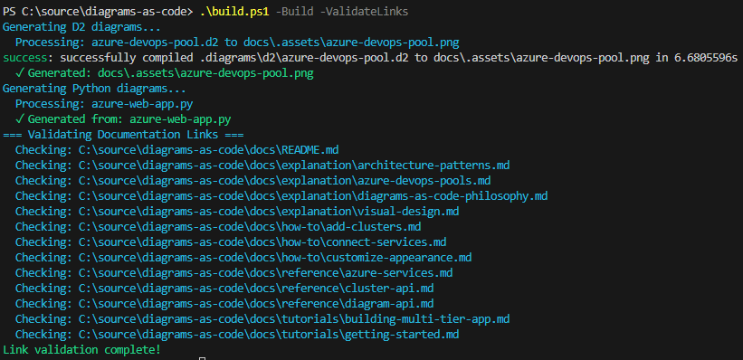

"When did we add the Redis cache?"

My teammate pointed at the architecture diagram in our wiki. No Redis. Just App Service talking directly to SQL Database. But I'd deployed the cache layer three weeks ago. It was already handling 60% of our read traffic.

The diagram was a relic. A beautiful, professionally crafted lie.

Sound familiar?

You spend hours in Visio perfecting your Azure architecture. Aligning boxes. Color-coding regions. Getting the arrows just right. You export a PNG. Upload it to your docs. Everyone nods approvingly.

Two sprints later, you've:
<ul><li>Added Application Insights</li><li>Migrated to Managed Identities</li><li>Introduces a Service Bus queue</li><li>Switched from blob storage to ADLS Gen2</li></ul>
Your diagram? Still showing the old world. Frozen in time. Mocking you from the documentation site.

You know you should update it. But that means:
<ul><li>Finding the original Visio file (or any other tool you created the diagram in)</li><li>Remembering which version was "final"</li><li>Spending another hour dragging boxes around</li><li>Re-exporting and re-uploading</li><li>Doing this every single sprint</li></ul>
So you don't. Nobody does. And slowly, your documentation becomes fiction.

Here's what clicked for me: <strong>your Azure infrastructure changes with every deployment — why are you still drawing diagrams by hand?</strong>

The Azure resources you deploy are defined in code. Bicep files. ARM templates. Terraform configs. But somehow, we're still pointing and clicking to document them. It's madness.

I almost gave up on keeping diagrams current. Then I discovered something that changed everything: treating Azure diagrams the same way we treat our infrastructure — as code that lives in git, updates automatically, and stays synchronized with reality.

This isn't about learning another diagramming tool. It's about never having to update an Azure architecture diagram again manually. <em>Sort of</em>, as you'll see.

Let's dive right into it.
<h2 id="the-diagram-drift-problem">The diagram drift problem</h2>
Your infrastructure changes every sprint.

New services get deployed. Old endpoints get retired. That microservice architecture you documented in January? It's already evolved. But your diagrams? Still showing the old changes.

This happens everywhere:
<ul><li>Sarah uses Visio, version-controlled nowhere</li><li>Mike prefers draw.io, saves to his Google Drive </li><li>The team wiki has a PNG someone exported... from what? Nobody knows</li><li>The actual cloud resources laugh at all of them</li></ul>
You can't win this game. Each tool creates its own silo. Each person has their own "latest version." And when someone asks, "Is this diagram current?" — you have no honest answer.

Here's what nobody admits: most architecture diagrams are outdated the moment you finish drawing them.

The drag-and-drop approach guarantees drift. Because updating diagrams is:
<ul><li>Manual (someone has to remember)</li><li>Tedious (reconnect all those arrows)</li><li>Invisible (no code review catches stale diagrams)</li><li>Lonely (not part of a DevOps pipeline)</li></ul>
I spent six months trying to "just be better" at keeping diagrams up to date. Color-coded reminders. Monthly review meetings. Stern emails about documentation hygiene.

All failed, purely because the problem wasn't discipline. It was the approach itself.
<h2 id="what-you-need-before-we-start">What you need before we start</h2>
This isn't a fluffy concept piece. We're building a real system. Here's what you need:
<ul><li>Python 3.13 or above</li><li>Node v22.17 or above</li><li>A code editor (VS Code recommended)</li><li>Git for version control</li><li>Go v1.24 or above</li></ul>
The tools we'll be using:
<ul><li>D2</li><li>Diagrams (Python library)</li><li>Graphviz</li><li>markdown-link-check</li></ul>
To install the tools:
<pre><code class="language-powershell">pip install diagrams&#10;
go install oss.terrastruct.com/d2@latest&#10;
npm install -g markdown-link-check</code></pre>
Don't skip this. Every tool serves a purpose. D2 gives you declarative syntax. Diagrams handles cloud providers beautifully. Graphviz powers the rendering. And markdown-link-check ensures your docs aren't full of broken links.

Ready? Let's build something that actually works.
<h2 id="the-folder-structure-that-changes-everything">The folder structure that changes everything</h2>
Before writing a single diagram, get your structure right.

Most people dump everything in a <code>docs</code> folder and hope for the best. That's how you end up with <code>diagram-final-v3-ACTUAL.png</code>. Instead, organize by intent:
<pre><code class="language-plaintext">project-root/
├── diagrams/
│   ├── d2/
│   │   ├── azure-devops-pool.d2
│   │   └── network-topology.d2
│   ├── graphviz/
│   │   ├── aws-infrastructure.py
│   │   └── azure-web-app.py
├── docs/
|   ├── .assets/
│   ├── architecture/
│   │   ├── overview.md
│   │   └── deployment-guide.md
│   ├── explanation/
│   └── reference/
├── build.ps1
└── README.md</code></pre>
So why does the above matter?

The <code>diagrams/</code> folder separates your source (<code>.d2</code>, <code>.py</code>) from <code>.assets</code> folder in the <code>docs</code>. This is a critical piece. Your source code (diagram as code) lives in version control. Your generated images get referenced in Markdown.

The <code>docs/</code> folder follows the <a href="https://diataxis.fr/">Diataxis framework</a> — organizing by reader intent (tutorials, how-to, reference, explanation). This makes documentation discoverable.

The <code>build.ps1</code> script (we'll create this) generates all diagrams and validates all links. One command. Everything updated.

Your markdown files reference diagrams using relative paths:
<pre><code class="language-markdown"></code></pre>
When the build script regenerates diagrams, your docs automatically show the latest version. No manual image updates. No version confusion. Just truth.
<h2 id="why-diagrams-as-code-changes-the-game">Why Diagrams as Code changes the "Game"</h2>
Here's what clicked for me: <strong>diagrams are infrastructure documentation, and infrastructure is code.</strong>

If you define your cloud resources in Terraform or Bicep — why are you drawing diagrams by hand?

Diagrams as code means:

<strong>Version control that actually works</strong>
<pre><code class="language-bash">git diff diagrams/python/aws-infrastructure.py</code></pre>
Shows exactly what changed in your architecture. Not a binary blob that git can't parse. Actual, reviewable changes. Your team sees: "Added Redis cache between API and database."  Pull requests become architecture reviews.

<strong>Automated generation</strong>

Your DevOps pipeline can regenerate diagrams on every commit. Or you run it locally. Deploy a new service? The diagram updates automatically. No human remembers to update it. No diagram drift.

<strong>Single source of truth</strong>

The <code>.d2</code> file or <code>.py</code> file IS the source. Everything else is generated. No more "which version is correct?" There's only one version.

<strong>Consistency by default</strong>

Use the same cloud provider icons. The same styling. The same layout engine. Every diagram looks professional without you having to think about it.
<h2 id="building-your-first-d2-diagram"><strong>Building your first D2 diagram</strong></h2>
D2 is beautifully simple. Declarative syntax that reads like plain English:
<pre><code class="language-d2"># diagrams/d2/simple-api.d2&#10;
client: Mobile App {
  shape: rectangle
}&#10;
api: API Gateway {
  shape: hexagon
}&#10;
database: PostgreSQL {
  shape: cylinder
}&#10;
cache: Redis {
  shape: stored_data
}&#10;
# Define connections
client -&gt; api: HTTPS
api -&gt; cache: Check cache
api -&gt; database: Query data
cache -&gt; database: Cache miss</code></pre>
Then, to generate it, open your terminal and run:
<pre><code class="language-powershell">d2 diagrams/d2/simple-api.d2 docs/.assets/simple-api.png</code></pre>
That's it. You now have a diagram that:
<ul><li>Lives in version control</li><li>Can be reviewed in pull requests</li><li>Regenerates consistently</li><li>Documents your actual architecture</li></ul>
Want to add a message queue? Edit the <code>.d2</code> file:
<pre><code class="language-d2">queue: Message Queue {
  shape: queue
}&#10;
api -&gt; queue: Publish events
worker -&gt; queue: Consume events</code></pre>
Run the command again. Diagram updated. Commit the change. Your team can see exactly what changed during the architecture review.
<h2 id="python-diagrams-for-cloud-architecture">Python diagrams for cloud architecture</h2>
For cloud-specific diagrams, Python's <code>diagrams</code> library is exceptional:
<pre><code class="language-python"># azure-web-app.py&#10;
from diagrams import Diagram, Cluster
from diagrams.azure.compute import AppServices, FunctionApps
from diagrams.azure.database import SQLDatabases
from diagrams.azure.network import LoadBalancers
from diagrams.azure.storage import BlobStorage&#10;
with Diagram("Azure Web App", 
             filename="docs/.assets/azure-web-app",
             show=False):&#10;    
    lb = LoadBalancers("Load Balancer")&#10;    
    with Cluster("Web Tier"):
        web = AppServices("Web App")&#10;    
    with Cluster("Data Tier"):
        db = SQLDatabases("SQL Database")
        storage = BlobStorage("Blob Storage")&#10;    
    lb &gt;&gt; web &gt;&gt; db
    web &gt;&gt; storage</code></pre>
To run it, call <code>python</code>:
<pre><code class="language-python">python .diagrams/python/azure-web-app.py
</code></pre>
Boom. Professional cloud architecture diagram using official Azure icons. The <code>Cluster</code> grouping shows logical tiers. The connections show data flow. And it's all defined in 20 lines of Python.
<h2 id="the-build-script-that-ties-it-all-together">The build script that ties it all together</h2>
Here's where magic happens. A single script that:
<ol><li>Generate all D2 diagrams</li><li>Execute all Python diagrams</li><li>Validates all Markdown links</li><li>Reports any problems</li></ol>
Create <code>build.ps1</code>:
<pre><code class="language-powershell">&lt;#
.SYNOPSIS
    Build and validate all diagrams and documentation
.DESCRIPTION
    Generates diagrams from D2 and Python sources,
    then validates all markdown links
#&gt;&#10;
param(
    [switch]$Build,
    [switch]$ValidateLinks,
    [switch]$Verbose
)&#10;
$ErrorActionPreference = 'Stop'&#10;
$assetPath = Join-Path -Path "docs" -ChildPath ".assets"&#10;
function Write-Success { Write-Host $args -ForegroundColor Green }
function Write-Info { Write-Host $args -ForegroundColor Cyan }
function Write-Failure { Write-Host $args -ForegroundColor Red }&#10;
if ($Build) {
    Write-Info "=== Building Diagrams ==="&#10;    
    # Generate D2 diagrams
    Write-Info "Generating D2 diagrams..."
    Get-ChildItem -Path ".diagrams/d2" -Filter "*.d2" | ForEach-Object {
        $outputName = $_.BaseName
        $outputPath = Join-Path $assetPath "$outputName.png"&#10;        
        Write-Info "  Processing: $($_.Name) to $outputPath"
        d2 $_.FullName $outputPath&#10;        
        if ($LASTEXITCODE -eq 0) {
            Write-Success "  ✓ Generated: $outputPath"
        } else {
            Write-Failure "  ✗ Failed: $($_.Name)"
        }
    }&#10;    
    Write-Info "Generating Python diagrams..."
    Get-ChildItem -Path ".diagrams/graphviz" -Filter "*.py" | ForEach-Object {
        Write-Info "  Processing: $($_.Name)"
        python3 $_.FullName&#10;        
        if ($LASTEXITCODE -eq 0) {
            Write-Success "  ✓ Generated from: $($_.Name)"
        } else {
            Write-Failure "  ✗ Failed: $($_.Name)"
        }
    }
}&#10;
if ($ValidateLinks) {
    Write-Info "=== Validating Documentation Links ==="&#10;    
    Get-ChildItem -Path "docs" -Filter "*.md" -Recurse | ForEach-Object {
        Write-Info "  Checking: $($_.FullName)"
        $result = markdown-link-check $_.FullName --quiet&#10;        
        if ($result) 
        {
            $result | ForEach-Object {Write-Failure "  ✗ $_" }
        }
    }&#10;    
    Write-Success "Link validation complete!"
}
</code></pre>
Now your workflow becomes:
<pre><code class="language-powershell">./build.ps1 -Build -ValidateLinks</code></pre><figure class="kg-card kg-image-card kg-card-hascaption"><figcaption>Figure 1: Producing images from build script</figcaption></figure>
This system shines the most when it's part of:
<ul><li>Git pre-commit hook</li><li>DevOps pipeline</li><li>Documentation lives in Markdown</li></ul><h2 id="what-changes-when-you-do-this">What changes when you do this</h2>
I just implemented this and here's what happened:

Our architecture diagrams are <strong>always current</strong>. Every deployment updates them. No manual intervention required.

Pull requests include <strong>architecture changes</strong>. Teams discuss the `.d2` changes alongside the code. Better reviews. Fewer surprises.

New developers <strong>trust the docs</strong>. They know diagrams reflect reality because they're generated from the same repo as the infrastructure.

We stopped having <strong>"which version is right?"</strong> conversations. There's one version. In git. Generated automatically.

And here's the surprising part: we create <strong>more diagrams</strong> now. Because it's easy. Add 15 lines to a <code>.d2</code> file, run the build script, done. No hunting for the right tool. No fighting with connector arrows. Just describe what exists, generate, and commit. Or if you aren't sure, ask Copilot to develop one for you.
<h2 id="your-turn">Your turn</h2>
Stop letting your diagrams lie to you.

Set up the folder structure today. Create one D2 diagram. One Python diagram. Build the automation script. Commit everything to git.

Then watch what happens when your team sees diagrams that actually stay current.

The best ROI of your time? It's in this automation. Because every hour you spend setting it up saves hundreds of hours of manual updates, confusion, and deployment mistakes caused by outdated diagrams.

Your infrastructure changes constantly. Your diagrams should too.

Make them code. Make them automatic. Make them trustworthy.

If you want to learn more, check out the following references:
<ul><li><a href="https://daily.dev/blog/diagrams-as-code-intro-for-developers">Diagrams as Code intro for developers</a></li><li><a href="https://d2lang.com/">D2Lang</a></li><li><a href="https://diagrams.mingrammer.com/">Python diagrams library</a></li></ul>
