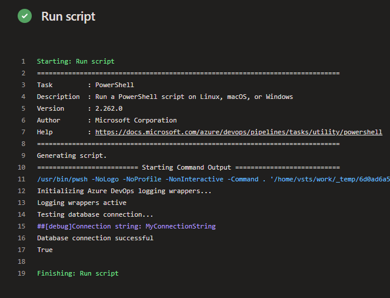

If you've worked with Azure DevOps pipelines and PowerShell, you know you've to change that tiny <code>Write-*</code> command text to be wrapped correctly:
<pre><code class="language-powershell">Write-Warning -Message "My message"&#10;
# Becomes:
Write-Warning -Message "##[warning]My Message"&#10;
</code></pre>
The same applies for <code>Write-Error</code> and <code>Write-Warning</code>. 

But if you have an extensive script or function, it becomes a tremendous task to manually update each <code>Write-*</code> call throughout your codebase. Imagine going through hundreds of lines of code, wrapping each message with the specific levels, only to break compatibility when running the script locally outside Azure Pipelines.

What if your scripts could automatically detect <em>if </em>they're running in Azure Pipelines and format the output correctly without touching a single line of your existing code?
<h2 id="the-challenge">The challenge</h2>
When PowerShell code runs through Azure Pipelines, the standard output cmdlets don't get special treatment.

When you run PowerShell in Azure Pipelines, standard output cmdlets<em> use </em>the formatting commands known in Azure DevOps<em>. </em>Your warnings look like regular text, errors don't stand out, and debug messages are just... there.

Azure DevOps supports <a href="https://learn.microsoft.com/en-us/azure/devops/pipelines/scripts/logging-commands?view=azure-devops&amp;tabs=powershell#formatting-commands">formatting commands</a> that format output with colors:
<ul><li><code>##[warning]</code> - Displays yellow warning messages.</li><li><code>##[error]</code> - Displays red error messages.</li><li><code>##[debug]</code> - Displays purple debug messages.</li></ul>
But each of the formatting commands requires manual writing:
<pre><code class="language-powershell">Write-Host "##[warning]Configuration file not found"
Write-Host "##[error]Failed to connect to database"</code></pre>
This means that every script or function needs to:
<ul><li>Be littered with Azure DevOps-specific code.</li><li>Handle both Azure DevOps and local execution separately.</li><li>Lose the semantic meaning of <code>Write-Warning</code> and <code>Write-Error</code> by using <code>Write-Host</code> instead.</li></ul><h2 id="the-solution-auto-wrapping">The solution: Auto-wrapping</h2>
The solution is actually quite simple: a simple wrapper that detects Azure Pipelines and automatically overrides <code>Write-Warning</code>, <code>Write-Error</code>, and <code>Write-Debug</code>.

It works by:
<ol><li>Detecting if PowerShell code is running through Azure Pipelines (the <code>$env:TF_BUILD</code> environment variable).</li><li>Overriding the built-in cmdlets with global functions that shadow them.</li><li>Formatting messages with Azure DevOps formatting command syntax.</li></ol>
The remaining part is transparency, as you don't have to change your existing code. Take a look at the following code snippet:
<pre><code class="language-powershell">if ($env:TF_BUILD -eq 'true') {
    Write-Host "Initializing Azure DevOps logging wrappers..."&#10;    
    # Override Write-Warning
    function global:Write-Warning {
        [CmdletBinding()]
        param(
            [Parameter(Mandatory = $true, Position = 0, ValueFromPipeline = $true)]
            [string]$Message
        )&#10;        
        process {
            Write-Host "##[warning]$Message"
        }
    }&#10;    
    # Override Write-Error
    function global:Write-Error {
        [CmdletBinding()]
        param(
            [Parameter(Mandatory = $true, Position = 0, ValueFromPipeline = $true)]
            [string]$Message
        )&#10;        
        process {
            Write-Host "##[error]$Message"
        }
    }&#10;    
    # Override Write-Debug
    function global:Write-Debug {
        [CmdletBinding()]
        param(
            [Parameter(Mandatory = $true, Position = 0, ValueFromPipeline = $true)]
            [string]$Message
        )&#10;        
        process {
            if ($DebugPreference -ne 'SilentlyContinue') {
                Write-Host "##[debug]$Message"
            }
        }
    }&#10;    
    Write-Host "Logging wrappers active"
}</code></pre>
Now your scripts or functions work both locally and in Azure DevOps:
<pre><code class="language-powershell"># This works locally AND in Azure DevOps
Write-Warning "API rate limit approaching"
Write-Error "Database connection failed"
Write-Debug "Processing item: $item" -Debug&#10;
# In Azure DevOps, output becomes:
# ##[warning]API rate limit approaching
# ##[error]Database connection failed  
# ##[debug]Processing item: MyItem</code></pre>

ℹ️

The <code spellcheck="false" style="white-space: pre-wrap;">Write-Verbose</code> cannot be mapped to a formatting command because it isn't known in Azure Pipelines.

<h2 id="how-to-implement">How to implement</h2>
To have the script available for all your Azure Pipelines, you can store it as a function that others can standard in a PowerShell task:
<pre><code class="language-powershell">function Initialize-AzureDevOpsLogging {
    &lt;#
    .SYNOPSIS
    Wraps Write-* cmdlets for Azure DevOps logging commands.&#10;    
    .DESCRIPTION
    Automatically detects Azure DevOps environment and wraps
    Write-Warning, Write-Error, and Write-Debug with proper
    logging command syntax.&#10;    
    .EXAMPLE
    Initialize-AzureDevOpsLogging
    Write-Warning "This appears with warning icon in Azure DevOps"
    #&gt;&#10;    
    if ($env:TF_BUILD -ne 'true') {
        Write-Verbose "Not in Azure DevOps - skipping wrapper initialization"
        return
    }&#10;    
    Write-Host "Initializing Azure DevOps logging wrappers..."&#10;    
    # Override Write-Warning
    function global:Write-Warning {
        [CmdletBinding()]
        param(
            [Parameter(Mandatory = $true, Position = 0, ValueFromPipeline = $true)]
            [string]$Message
        )&#10;        
        process {
            Write-Host "##[warning]$Message"
        }
    }&#10;    
    # Override Write-Error
    function global:Write-Error {
        [CmdletBinding()]
        param(
            [Parameter(Mandatory = $true, Position = 0, ValueFromPipeline = $true)]
            [string]$Message
        )&#10;        
        process {
            Write-Host "##[error]$Message"
        }
    }&#10;    
    # Override Write-Debug
    function global:Write-Debug {
        [CmdletBinding()]
        param(
            [Parameter(Mandatory = $true, Position = 0, ValueFromPipeline = $true)]
            [string]$Message
        )&#10;        
        process {
            if ($DebugPreference -ne 'SilentlyContinue') {
                Write-Host "##[debug]$Message"
            }
        }
    }&#10;    
    Write-Host "Logging wrappers active"
}</code></pre>
Then, to sketch out the complete example, imagine you've the following function:
<pre><code class="language-powershell">function Test-DatabaseConnection {
    [CmdletBinding()]
    param(
        [string]$ConnectionString
    )&#10;    
    Write-Host "Testing database connection..."&#10;    
    if ([string]::IsNullOrEmpty($ConnectionString)) {
        Write-Warning "Connection string is empty, using default configuration"
        $ConnectionString = "Server=localhost;Database=TestDB"
    }&#10;    
    Write-Debug "Connection string: $ConnectionString"&#10;    
    try {
        # Simulate connection attempt
        $random = Get-Random -Minimum 1 -Maximum 10&#10;        
        if ($random -gt 7) {
            Write-Error "Failed to connect to database: Connection timeout"
            return $false
        }&#10;        
        Write-Host "Database connection successful"
        return $true
    }
    catch {
        Write-Error "Unexpected error during connection: $_"
        return $false
    }
}</code></pre>
In your Azure DevOps pipeline YAML file, you would add:
<pre><code class="language-powershell">- task: PowerShell@2
  displayName: 'Run script'
  inputs:
    targetType: 'inline'
    script: |
      # Dot-source the functions
      . (Join-Path '$(System.DefaultWorkingDirectory)' 'Initialize-AzureDevOpsLogging.ps1')
      . (Join-Path '$(System.DefaultWorkingDirectory)' 'Test-DatabaseConnection.ps1')&#10;
      # Initialize the wrapper function
      Initialize-AzureDevOpsLogging&#10;      
      # Run the function
      Test-DatabaseConnection -ConnectionString MyConnectionString -Debug
    errorActionPreference: 'continue'
    pwsh: true</code></pre>
The benefits are clear:
<ul><li>No code changes required.</li><li>It only activates in Azure DevOps (environment-aware).</li><li>Keeps using the standard semantics, e.g., <code>Write-Warning</code>, not <code>Write-Host</code>.</li><li>One wrapper for all your pipelines</li><li>Better log messages are displayed in Azure Pipelines.</li></ul><figure class="kg-card kg-image-card kg-card-hascaption"><figcaption>Figure 1: Formatting messages in Azure Pipelines</figcaption></figure><h2 id="conclusion">Conclusion</h2>
It's an easy trick to do. You don't have to wrap your PowerShell code with output manually <code>##[warning]</code>, <code>##[debug]</code> and <code>##[error]</code>. 

This simple wrapper makes your scripts work beautifully in Azure Pipelines while remaining functional locally. Your DevOps team will thank you for this. And of course, your pipeline logs will look beautified.

