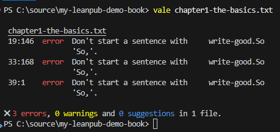
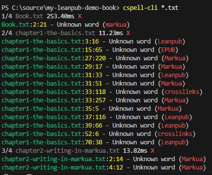
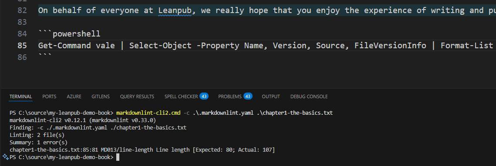
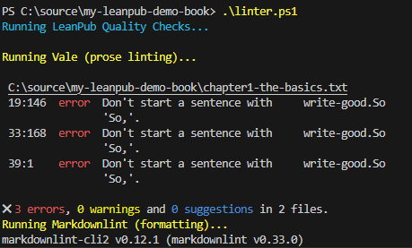

You've got ideas. After cranking out a big post, you thought: "Doesn't this deserve a book and not another forgotten blog post?"  I had the same, especially with my first book. It took me roughly 1,5 years to get from the idea to actually just "acting" and starting to write.  But here's the thing. Most people who start writing a book give up. Not because they run out of ideas (otherwise you wouldn't still be blogging). Not because they can't write. They give up because the big bear comes watching around the corner while you've to fight it blindfolded.  I get it. But did you ever wonder if you're using the right tools? Not mental tools. Real tools that let your writing flow. Tools that help you catch typos before you publish. Tools that support your writing in a good manner. And when you are an illustrative person, sync your diagrams into pictures easily.  Throw away the motivation. You just need a better system with tools integrated before you publish.  This how-to guide shows you how to set up a writing environment that actually works. The environment that catches your mistakes. Supports you in creating professional diagrams and lets you focus on what actually matters: writing something worth reading.  Let's build your ultimate Leanpub setup.
<h2 id="prerequisites">Prerequisites</h2>
Before you dive in, you're going to need a hard, non-negotiable prerequisites. This is the foundation everything builds upon:
<ul><li><a href="https://help.leanpub.com/en/articles/2916385-getting-started-using-leanpub-s-git-and-github-writing-mode-to-write-and-publish-a-book">Getting Started Using LeanPub's Git and GitHub Writing Mode</a></li></ul>
You'll also need NPM installed. This comes with Node.JS. If you're working on a Windows machine, you can install it using WinGet:
<pre><code class="language-powershell">winget install OpenJS.NodeJS.LTS --source winget</code></pre>
For alternative options based on your operating system, check out the <a href="https://nodejs.org/en/download">official website</a>.

Read it and set it up. The hardest part here is that you'll need to buy a standard subscription to enable GitHub integration.

If you're done, come back here. I'll wait.
<h2 id="why-this-setup-will-change-your-writing">Why this setup will change your writing</h2>
Most writers use good old Microsoft Word or Google Docs. That's fine if you take it to the supermarket as a grocery list. But for a book? You need:
<ul><li><strong>Version control </strong>- so you can experiment and see your changes automatically.</li><li><strong>Automated quality checks </strong>- because it's embarrassing to see typos in your official book release.</li><li><strong>Professional diagrams</strong> - Throw away Microsoft Paint, create it by code, and let it generate automatically.</li><li><strong>Consistency</strong> - in tone, styling, and formatting.</li></ul>
This setup gives you all of that with free tools, the same ones other professionals use.
<h2 id="the-three-pillars-of-a-great-writing-environment">The three pillars of a great writing environment</h2>
Writing a book is hard enough. That's why introducing tools shouldn't make you fight harder.

The three tools you can introduce to set up your writing environment is going to form the foundation. A foundation for a professional writing environment. Each tool solves a specific problem that trips up most authors. Together, they create a system where quality is automatic, not accidental.

These tools are:
<ul><li>Vale</li><li>D2</li><li>Code Spell Checker</li></ul>
Think of them like this: Vale is your editor, D2 is your designer, and Code Spell Checker is your proofreader. These tools work 24/7 and never get tired, and never charge you by the hour.

The best part? Once you've set them up correctly, they fade into the background. You only focus on the writing, while they watch your back. 

Let's start with the big one.
<h3 id="vale-your-writing-angel">Vale: Your writing angel</h3>
Remember your teacher who always caught your mistakes before you even knew it? Vale is like that, but doesn't give you a punishment.

Vale is a command-line utility linter for prose. A quick translation: it reads your writing and tells you when you're being unclear, wordy, or just dead wrong.

What Vale does for you:
<ul><li>Catches inconsistent terminology use.</li><li>Enforces your style guide.</li><li>Finds passive voice that makes your writing weak.</li><li>Spots complex words when simple ones would work better.</li></ul>
To set up Vale, run the following steps:
<ol><li>Open your terminal and run:</li></ol><pre><code class="language-powershell"># Install Chocolatey
Set-ExecutionPolicy Bypass -Scope Process -Force; [System.Net.ServicePointManager]::SecurityProtocol = [System.Net.ServicePointManager]::SecurityProtocol -bor 3072; iex ((New-Object System.Net.WebClient).DownloadString('https://community.chocolatey.org/install.ps1'))&#10;
# Install Vale
choco install Vale&#10;
# Or download directly from GitHub releases
# https://github.com/errata-ai/vale/releases</code></pre><ol start="2"><li>In your Leanpub repository root, create a file named <code>.vale.ini</code>:</li></ol><pre><code class="language-plaintext">StylesPath = styles&#10;
MinAlertLevel = suggestion&#10;
[*]
Vale.Spelling = NO&#10;
[*.txt]
BasedOnStyles = Vale, write-good</code></pre><ol start="3"><li>Prepare style packages:</li></ol><pre><code class="language-powershell"># Navigate to your book directory
cd c:\source\my-leanpub-demo-book&#10;
# Create styles directory
mkdir styles&#10;
cd styles
mkdir write-good</code></pre><ol start="4"><li>Add custom style rules, for example, create a rule that catches you saying<em> So</em>:</li></ol><pre><code class="language-powershell"># Create a file named So.yml
New-Item -Path So.yml -ItemType File&#10;
# Add rule content
@'
extends: existence
message: "Don't start a sentence with '%s'."
level: error
raw:
  - '(?:[;-]\s)so[\s,]|\bSo[\s,]'
'@ | Set-Content -Path So.yml -Encoding UTF8</code></pre>
Now, Vale will flag you when you start a sentence with "So". You can create similar rules for:
<ul><li>Weasel words.</li><li>Passive voice detection.</li><li>Forbidden terminology.</li><li>Oversued words specific to your domain.</li></ul>
To see a full list of pre-built rules, browse the <a href="https://github.com/errata-ai/packages">Vale package hub</a>.
<ol start="5"><li>Run <code>vale</code> against your manuscript files:</li></ol><pre><code class="language-powershell">vale chapter1-the-basics.txt</code></pre><figure class="kg-card kg-image-card kg-card-hascaption"><figcaption>Figure 1: Running Vale against manuscript</figcaption></figure>
As you can see in the image above, you can instantly identify what needs fixing. No more wondering if your writing is any good.
<h2 id="create-d2-diagrams-that-dont-look-like-garbage">Create D2 diagrams that don't look like garbage</h2>
With AI tools flying around, creating diagrams becomes easy. The thing with AI tools is, they don't always get it right on the fly. You can constantly prompt ChatGPT, or any other tool, to spit out a diagram, or...

... you can store it as code and modify it later to suit your needs.

That's where D2 comes around the corner. With D2, you can define a diagram based on scripting that, in turn, outputs images in the format you like. D2 does:
<ul><li>Flowcharts, sequence diagrams, entity relationships, and more.</li><li>Maintaining consistent styling across all diagrams.</li><li>Lives in your repository as text (meaning it can be version-controlled).</li><li>Renders to SVG or PNG for Leanpub.</li><li>Updates instantly when you change the code.</li></ul>
To set up D2, follow the steps below:
<ol><li>Install D2:</li></ol><pre><code class="language-powershell"># Using chocolatey
choco install d2&#10;
# Or download from the official site
# https://d2lang.com/tour/install</code></pre><ol start="2"><li>Create your first diagram:</li></ol><pre><code class="language-powershell"># Create a folder to hold your diagrams
mkdir diagrams&#10;
# Create a D2 file
cd diagrams
New-Item -Path writing-workflow.d2 -ItemType File&#10;
@'
title: LeanPub Writing Workflow {
  shape: text
  near: top-center
}&#10;
writer: Writer {
  shape: person
}&#10;
github: GitHub Repository {
  shape: cylinder
}&#10;
leanpub: LeanPub {
  shape: cloud
}&#10;
readers: Readers {
  shape: person
}&#10;
writer -&gt; github: Push changes
github -&gt; leanpub: Webhook triggers
leanpub -&gt; leanpub: Generate book
leanpub -&gt; readers: Deliver updates
'@ | Set-Content -Path writing-workflow.d2 -Encoding UTF8</code></pre><ol start="3"><li>Generate the diagram:</li></ol><pre><code class="language-powershell"># Generate SVG
d2 writing-workflow.d2 ..\resources\writing-workflow.svg&#10;
# Generate PNG
d2 writing-workflow.d2 ..\resources\writing-workflow.png</code></pre>
The images should be placed in the <code>resources</code> directory to be synced for Leanpub. In your manuscript file, you can now add:
<pre><code class="language-markdown">&lt;!-- For SVG --&gt;
&#10;
&lt;!-- For PNG --&gt;
</code></pre>

ℹ️

You don't need to specify <code spellcheck="false" style="white-space: pre-wrap;">resources/writing-workflow.svg</code> or <code spellcheck="false" style="white-space: pre-wrap;">resources/writing-workflow.png</code>.

<h2 id="code-spell-checker-because-typos-kill-the-game">Code Spell Checker: Because typos kill "the game"</h2>
You know what ruins a great book? Seeing "recieve" instead of "receive" on page 47.

It happened to me many times. 

Your brain autocorrects typos when you read your own work. But can you be consistent? Every typo is a crack in your credibility to deliver a "good quality" book.

Code Spell Checker can be run both from the CLI and is a VS Code extension. It catches spelling errors in real time, or, if you run it through the CLI, it gives you an overview. It understands your text, code, and technical terms if you create a dictionary.

To install Code Spell Checker, follow the steps below:
<ol><li>Install Code Spell Checker both as CLI and in Visual Studio Code (VS Code):</li></ol><pre><code class="language-powershell"># Install CLI using NPM
npm install -g git+https://github.com/streetsidesoftware/cspell-cli&#10;
# Install it in VS Code
code --install-extension streetsidesoftware.code-spell-checker
</code></pre><ol start="2"><li>To configure Code Spell Checker, add the following two files at the root of the directory:</li></ol><pre><code class="language-yaml"># cspell.config.yaml
dictionaryDefinitions:
  - name: words
    path: cSpell_dict.txt
    addWords: true
dictionaries:
  - words</code></pre>
The word dictionary for false positives or technical terms:
<pre><code class="language-text"># cSpell_dict.txt
# Add words here</code></pre><ol start="3"><li>Run the <code>cspell-cli</code>:</li></ol><pre><code class="language-powershell">cspell-cli *.txt</code></pre><figure class="kg-card kg-image-card kg-card-hascaption"><figcaption>Figure 2: Run Code Spell Checker CLI</figcaption></figure>
If you think these are all valid (false-positives), you can easily output the words only and copy the unique words in the <code>cSpell_dict.txt</code> by running the following:
<pre><code class="language-powershell">$words = cspell-cli *.txt --words-only
$words | Sort-Object -Unique | clip</code></pre>
Now you've the unique words "clipped" on your clipboard. Paste these words in the <code>cSpell_dict.txt</code> file and run the CLI again. Notice that no words are marked now.
<h2 id="bonus-tip-formatting-code-fenced-blocks">Bonus tip: Formatting code fenced blocks</h2>
One of the painful lessons most Leanpub authors learn is the fact that long code blocks get cut off when the PDF is produced.

Imagine you are writing a code block example that is 120 characters wide. It looks fantastic in your editor, but when you generate the PDF, you think, "What has happened?"

The line wraps awkwardly, making it difficult for your readers to copy and paste the code. Your credibility takes a hit.

Markdownlint can catch these issues before hand. It enforces consistent formatting and warns you when code blocks are too wide for print.

Just as the code spell checker, you can install Markdownlint in VS Code or as a CLI option. The steps below describe how you can install <code>markdownlint-cli2</code> in VS Code and CLI:
<ol><li>Install Markdownlint both as CLI and in Visual Studio Code (VS Code):</li></ol><pre><code class="language-powershell"># Install as a global CLI tool using npm
npm install markdownlint-cli2 --global&#10;
# Install in VS Code
code --install-extension DavidAnson.vscode-markdownlint</code></pre><ol start="2"><li>To configure Markdownlint only for code-fenced blocks longer than, create a <code>.markdownlint.yaml</code> configuration file:</li></ol><pre><code class="language-yaml"># .markdownlint.yaml
default: false
MD013:
  code_block_line_length: 80
  code_blocks: true
  tables: false
  line_length: 800</code></pre>
When you run <code>markdownlint-cli2</code> from the command line, notice it picks up the code-fenced block.
<figure class="kg-card kg-image-card kg-card-hascaption"><figcaption>Figure 3: Linting issue on code-fenced line-length</figcaption></figure><h2 id="putting-it-all-together-your-daily-workflow">Putting it all together: Your daily workflow</h2>
You now have four different tools. Running them every time separately before a commit? Annoying.

Let's create an automation script that does the heavy lifting. Create a single PowerShell script named <code>linter.ps1</code> in the root of the project running all quality checks in one go. In that way, you know before you commit that something might be broken.
<pre><code class="language-powershell"># linter.ps1
param(
    [string]$Path = "manuscript",
    [switch]$SkipDiagrams,
    [switch]$Verbose
)&#10;
Write-Host "Running LeanPub Quality Checks..." -ForegroundColor Cyan
Write-Host ""
Write-Host "Running Vale (prose linting)..." -ForegroundColor Yellow
if (Get-Command vale -ErrorAction Ignore)
{
    $chapters = Get-ChildItem -Path *.txt | 
    Where-Object -Property Name -NotIn @('Book.txt', 'cSpell_dict.txt') |
    Select-Object -ExpandProperty FullName
    vale $chapters
}&#10;
Write-Host "Running Markdownlint (formatting)..." -ForegroundColor Yellow
if (Get-Command markdownlint-cli2 -ErrorAction Ignore)
{
    markdownlint-cli2 "*.txt" --config .markdownlint.yaml
}&#10;
Write-Host "Running Code Spell Checker..." -ForegroundColor Yellow
if (Get-Command cspell -ErrorAction Ignore)
{
    $words = cspell-cli *.txt --words-only -c cspell.config.yaml
    $words | Sort-Object -Unique&#10;
    Write-Host "Words found in manuscript:" -ForegroundColor Cyan
    $words | ForEach-Object { Write-Host " - $_" -ForegroundColor Gray }
    Write-Host ""
}&#10;
Write-Host "Validating D2 diagrams..." -ForegroundColor Yellow
if (Get-Command d2 -ErrorAction Ignore)
{
    $d2Files = Get-ChildItem -Path "diagrams\*.d2"
    $resourcesFolder = Join-Path -Path $PSScriptRoot -ChildPath 'resources'
    foreach ($file in $d2Files)
    {
        $fileName = $file.Name.Replace('.d2', '.png')
        $outputPath = Join-Path -Path $resourcesFolder -ChildPath $fileName
        Write-Host "  Generating diagram for $($file.Name) in $resourcesFolder..." -ForegroundColor Gray
        d2 $file.FullName $outputPath
    }
}</code></pre>
If you open a PowerShell terminal prompt, you can run the script: <code>.\linter.ps1</code>.
<figure class="kg-card kg-image-card kg-card-hascaption"><figcaption>Figure 4: Execute quality checks script</figcaption></figure>
Here is the setup of how your writing looks with this setup:
<ol><li>In the <strong><em>morning</em></strong>, you open VS Code and start writing. The Code Spell checker highlights typos for you.</li><li>Before you <strong><em>commit</em></strong>, you execute <code>linter.ps1</code>.</li><li>You fix up <strong><em>potential issues + all diagrams</em></strong> are updated with <code>.png</code> files.</li><li>After fixing, you push it to GitHub, and you start generating the book's content.</li><li>Once you know your book's <strong><em>quality</em></strong> has been checked, you can go back to bed.</li></ol><h2 id="conclusion">Conclusion</h2>
Tools won't, of course, write your book for you. But the right tools remove that initial friction so you can get started. They catch your mistakes and make the process feel less like a chore.

You've got your ideas now and the setup. Now you just need to write. Open your editor, start writing a new chapter, and put the words on the page.

Your readers are waiting.

