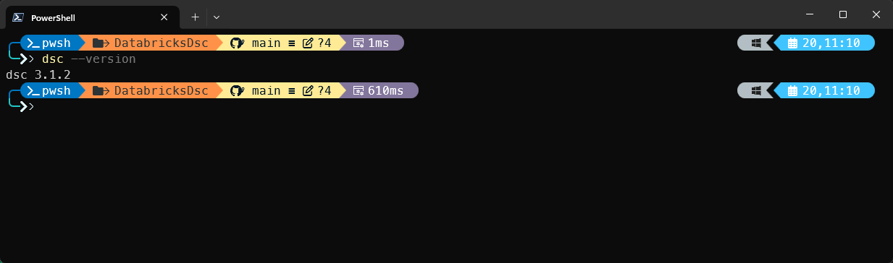

When managing Databricks infrastructure and configurations, teams often use Terraform as the main option. While the tool is effective, it couples infrastructure provisioning with configuration management.

An alternative approach to separating these concerns uses Azure Bicep and Microsoft Desired State Configuration (DSC). Azure Bicep is used for infrastructure provisioning, whilst Microsoft DSC configures Databricks-specific settings.

This how-to guide demonstrates:
<ul><li>Deploy a Databricks workspace using Bicep and Azure Verified Modules (AVM).</li><li>Configure Databricks resources using the <code>DatabricksDsc</code> PowerShell module.</li><li>Automate the entire process with Azure Pipelines.</li></ul><h2 id="prerequisites">Prerequisites</h2>
Before you begin, ensure you have:
<ul><li>An active Azure subscription with permissions to create Azure resources.</li><li>Azure CLI or Azure PowerShell installed locally.</li><li>PowerShell 7.2 or later.</li><li>An Azure DevOps account if you want to deploy it through Azure Pipelines.</li></ul><h2 id="deploy-databricks-workspace-with-bicep">Deploy Databricks workspace with Bicep</h2>
The first step is to provision the Databricks workspace infrastructure. To simplify the process, you can use Azure Verified Modules (AVM), which offer pre-built, tested modules for many Azure services.

Create the following Bicep file that references the AVM resource group and Databricks workspace module.
<pre><code class="language-bicep">// main.bicep
targetScope = 'subscription'&#10;
@description('The name of the Databricks workspace')
param workspaceName string&#10;
@description('The Azure region for deployment')
param location string = 'westeurope'&#10;
@description('The name of the resource group')
param resourceGroupName string = 'rg-databricks'&#10;
module rg 'br/public:avm/res/resources/resource-group:0.4.2' = {
  scope: subscription()
  params: {
    name: resourceGroupName
    location: location
  }
}&#10;
module databricksWorkspace 'br/public:avm/res/databricks/workspace:0.11.2' = {
  scope: resourceGroup(resourceGroupName)
  params: {
    name: workspaceName
    location: location
    skuName: 'premium'
  }
}&#10;
output workspaceUrl string = 'https://${databricksWorkspace.outputs.workspaceUrl}'
</code></pre>
Save this file as <code>main.bicep</code> in your repository. The Bicep template creates both the resource group and the Databricks workspace.

To deploy the resource, use the Azure CLI or Azure PowerShell:

<strong>Using Azure CLI:</strong>
<pre><code class="language-powershell">az deployment sub create `
  --template-file main.bicep `
  --parameters workspaceName=&lt;your-workspace-name&gt;</code></pre>
<strong>Using Azure PowerShell:</strong>
<pre><code class="language-powershell">New-AzSubscriptionDeployment `
  -TemplateFile main.bicep `
  -workspaceName &lt;your-workspace-name&gt;</code></pre>
The deployment creates the workspace and outputs the workspace URL, which you'll use for configuration in the next step.
<h2 id="install-databricksdsc-module">Install DatabricksDsc module</h2>
After the infrastructure is deployed, you can use the <code>DatabricksDsc</code> PowerShell module to manage workspace configuration. This module provides resources for:
<ul><li>Managing users</li><li>Service principals</li><li>Cluster policies</li><li>Permissions</li></ul>

ℹ️

In the future, more resources might be added to manage workspace configuration.

Install the module from the PowerShell Gallery:
<pre><code class="language-powershell">Install-PSResource -Name DatabricksDsc, PSDesiredStateConfiguration -Repository PSGallery -TrustRepository -Scope AllUsers</code></pre>
The <code>PSDesiredStateConfiguration</code> module can be used to verify the installation by listing available DSC resources:
<pre><code class="language-powershell">Get-DscResource -Module DatabricksDsc</code></pre>
The command displays resources such as <code>DatabricksUser</code>, <code>DatabricksServicePrincipal</code>, <code>DatabricksClusterPolicy</code>, and <code>DatabricksClusterPolicyPermission</code>.
<h2 id="install-microsoft-dsc">Install Microsoft DSC</h2>
The <code>DatabricksDsc</code> module is installed. You can now install <code>dsc.exe</code> by using one more module.

Install the <code>PSDSC</code> PowerShell module from the PowerShell Gallery and execute <code>Invoke-DscExe</code>:
<pre><code class="language-powershell"># Install module
Install-PSResource -Name PSDSC -Repository PSGallery&#10;
# Install dsc.exe
Install-DscExe</code></pre>
When the installation is successful, you can run <code>dsc --version</code> to display the version installed.
<figure class="kg-card kg-image-card kg-card-hascaption"><figcaption>Figure 1: <code spellcheck="false" style="white-space: pre-wrap;">dsc.exe</code> version</figcaption></figure><h2 id="create-dsc-configuration-document">Create DSC configuration document</h2>
Microsoft DSC configurations define the desired state of your Databricks workspace. Microsoft DSC uses YAML and JSON, with YAML often preferred because it's easier to read. 

You can create a configuration document that defines workspace users and service principals. This example shows how to configure both types of identities with entitlements:
<pre><code class="language-yaml"># databricks-config.dsc.config.yaml
$schema: https://aka.ms/dsc/schemas/v3/bundled/config/document.json
resources:
  - name: Configure workspace identities
    type: Microsoft.DSC/PowerShell
    properties:
      resources:
        - name: Data engineering user
          type: DatabricksDsc/DatabricksUser
          properties:
            WorkspaceUrl: 'https://&lt;workspaceUrl&gt;.azuredatabricks.net'
            AccessToken: '[envvar("DATABRICKS_TOKEN")]'
            UserName: 'dataengineer@youremail.com'
            DisplayName: 'Data Engineer'
            Active: true
            Emails:
              - Value: 'dataengineer@youremail.com'
                Type: 'work'
                Primary: true
            Name:
              GivenName: 'Data'
              FamilyName: 'Engineer'
            Entitlements:
              - Value: 'allow-cluster-create'
              - Value: 'workspace-access'&#10;
        - name: Analytics service principal
          type: DatabricksDsc/DatabricksServicePrincipal
          properties:
            WorkspaceUrl: 'https://&lt;workspaceUrl&gt;.azuredatabricks.net'
            AccessToken: '[envvar("DATABRICKS_TOKEN")]'
            ApplicationId: '12345678-1234-1234-1234-123456789012'
            DisplayName: 'Analytics Service Principal'
            Active: true
            Entitlements:
              - Value: 'allow-cluster-create'&#10;
        - name: Data science cluster policy
          type: DatabricksDsc/DatabricksClusterPolicy
          properties:
            WorkspaceUrl: 'https://&lt;workspaceUrl&gt;.azuredatabricks.net'
            AccessToken: '[envvar("DATABRICKS_TOKEN")]'
            PolicyName: 'data-science-policy'
            Definition:
              spark_version:
                type: unlimited
                defaultValue: 'auto:latest-lts'
              node_type_id:
                type: allowlist
                values:
                  - Standard_DS3_v2
                  - Standard_DS4_v2
              autotermination_minutes:
                type: fixed
                value: 30&#10;
        - name: Data science policy permissions
          type: DatabricksDsc/DatabricksClusterPolicyPermission
          properties:
            WorkspaceUrl: 'https://&lt;workspaceUrl&gt;.azuredatabricks.net'
            AccessToken: '[envvar("DATABRICKS_TOKEN")]'
            ClusterPolicyId: '[reference(resourceId("DatabricksDsc/DatabricksClusterPolicy", "data-science-policy")).Id]'
            AccessControlList:
              - UserName: 'dataengineer@youremail.com'
                PermissionLevel: 'CAN_USE'
              - ServicePrincipalName: '12345678-1234-1234-1234-123456789012'
                PermissionLevel: 'CAN_USE'</code></pre>
Save this file as <code>databricks-config.dsc.yaml</code>. The configuration uses an ARM function to read the environment variable where you store your authentication and authorization token.
<h2 id="apply-dsc-configuration-document">Apply DSC configuration document</h2>
With the configuration document created, you can now apply the document to your Databricks workspace using <code>dsc.exe</code>. The engine reads the YAML file, evaluates the current state, and makes the changes to achieve the desired state.

Before you can apply the configuration document, you've to set the environment variable. You can use the <code>Get-AzAccessToken</code> command or <code>az account get-access-token</code>:

<strong>Use Azure CLI:</strong>
<pre><code class="language-powershell">$env:DATABRICKS_TOKEN = az account get-access-token --resource 2ff814a6-3304-4ab8-85cb-cd0e6f879c1d --query accessToken -o tsv | ConvertTo-SecureString -AsPlainText -Force</code></pre>
<strong>Use Azure PowerShell:</strong>
<pre><code class="language-powershell">$env:DATABRICKS_TOKEN = (Get-AzAccessToken -ResourceUrl 2ff814a6-3304-4ab8-85cb-cd0e6f879c1d).Token</code></pre>
Time to apply the configuration document:
<pre><code class="language-powershell">dsc config set --file databricks-config.dsc.yaml</code></pre>
The command processes each resource in order. First, users are created, then service principals, and finally, the cluster policies are defined.

To verify the configuration without making changes, use the test operation:
<pre><code class="language-powershell">dsc config test --file databricks-config.dsc.yaml</code></pre>
This command returns whether the current state matches the desired state, which is helpful for validation.
<h2 id="automate-with-azure-pipelines">Automate with Azure Pipelines</h2>
Combining both Bicep and DSC configurations in an Azure Pipeline gives you the complete solution you're looking for. The pipeline deploys the workspace and applies the DSC configuration in a single automated workflow.

The following YAML represents an Azure Pipeline that orchestrates both:
<pre><code class="language-yaml">variables:
  azureSubscription: 'your-service-connection-name'
  resourceGroupName: 'rg-databricks-prod'
  workspaceName: 'dbw-prod-001'
  location: 'westeurope'
  vmImage: 'ubuntu-latest'&#10;
stages:
  - stage: DeployInfrastructure
    displayName: 'Deploy infrastructure'
    jobs:
      - job: DeployBicep
        displayName: 'Deploy Bicep template'
        pool:
          vmImage: $(vmImage)
        steps:
          - checkout: self&#10;
          - task: AzurePowerShell@5
            displayName: 'Deploy infrastructure'
            inputs:
              azureSubscription: $(azureSubscription)
              azurePowerShellVersion: 'LatestVersion'
              scriptType: 'inlineScript'
              inline: |
                $deployment = New-AzSubscriptionDeployment `
                  -Location $(location) `
                  -TemplateFile main.bicep `
                  -workspaceName $(workspaceName) `
                  -location $(location) `
                  -resourceGroupName $(resourceGroupName)&#10;
                $workspaceUrl = $deployment.Outputs.workspaceUrl.Value
                Write-Host "Workspace URL: $workspaceUrl"
                Write-Host "##vso[task.setvariable variable=workspaceUrl;isOutput=true]$workspaceUrl"
            name: deploymentOutput&#10;
  - stage: ConfigureWorkspace
    displayName: 'Configure Databricks Workspace'
    dependsOn: DeployInfrastructure
    condition: succeeded()
    jobs:
      - job: ApplyDSC
        displayName: 'Apply DSC Configuration'
        pool:
          vmImage: $(vmImage)
        variables:
          workspaceUrl: $[ stageDependencies.DeployInfrastructure.DeployBicep.outputs['deploymentOutput.workspaceUrl'] ]
        steps:
          - checkout: self&#10;
          - task: PowerShell@2
            displayName: 'Install dsc executable and DatabricksDsc'
            inputs:
              targetType: 'inline'
              pwsh: true
              script: |
                # Install required modules
                Install-PSResource -Name PSDSC, DatabricksDsc -Repository PSGallery -TrustRepository -Scope AllUsers -Reinstall&#10;
                # Install dsc.exe
                Install-DscExe -Force&#10;
                Write-Host "DSC executable and DatabricksDsc module installed."&#10;
          - task: AzurePowerShell@5
            displayName: 'Apply DSC configuration document'
            inputs:
              azureSubscription: $(azureSubscription)
              azurePowerShellVersion: 'LatestVersion'
              scriptType: 'inlineScript'
              inline: |
                # Get Databricks access token using Azure authentication
                $token = (Get-AzAccessToken -ResourceUrl '2ff814a6-3304-4ab8-85cb-cd0e6f879c1d').Token
                $env:DATABRICKS_TOKEN = $token&#10;
                Write-Host "Applying DSC configuration to workspace: $(workspaceUrl)"&#10;
                $result = dsc config set --file databricks-config.dsc.yaml&#10;
                if ($LASTEXITCODE -eq 0) {
                  Write-Host "##[section]DSC configuration applied successfully"
                  Write-Host $result
                } else {
                  Write-Error "##[error]DSC configuration failed with exit code: $LASTEXITCODE"
                  Write-Host $result
                  exit 1
                }
</code></pre><h2 id="summary">Summary</h2>
This guide showcased how you can use Bicep, <code>DatabricksDsc</code>, and Microsoft DSC to build an end-to-end solution for Databricks. 

It leveraged the Azure Verified Modules to deploy the Azure resources. Then, Microsoft DSC, the declarative configuration management tool, was used to configure Databricks users, cluster policies, and service principals. 

By making this separation, you gain a clear ownership of boundaries and the ability to use native Azure tooling alongside Microsoft DSC for Databricks-specific settings.
<h2 id="see-also">See also</h2><ul><li><a href="https://github.com/Gijsreyn/DatabricksDsc/tree/main/source/Examples">DatabricksDsc documentation</a></li><li><a href="https://azure.github.io/Azure-Verified-Modules/">Azure Verified Modules</a></li><li><a href="https://learn.microsoft.com/powershell/dsc/overview" rel="noreferrer">Microsoft Desired State Configuration (DSC) documentation</a></li></ul>
