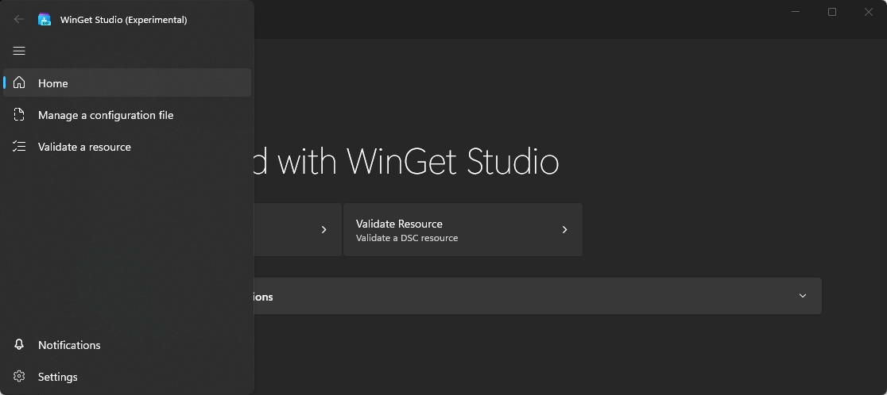
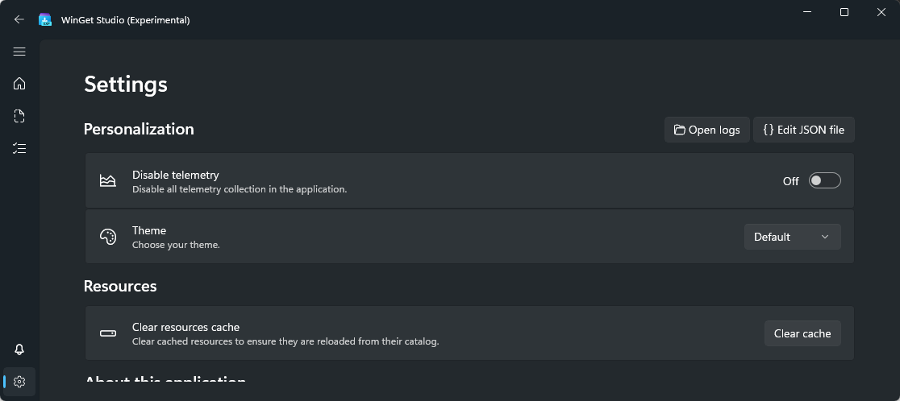
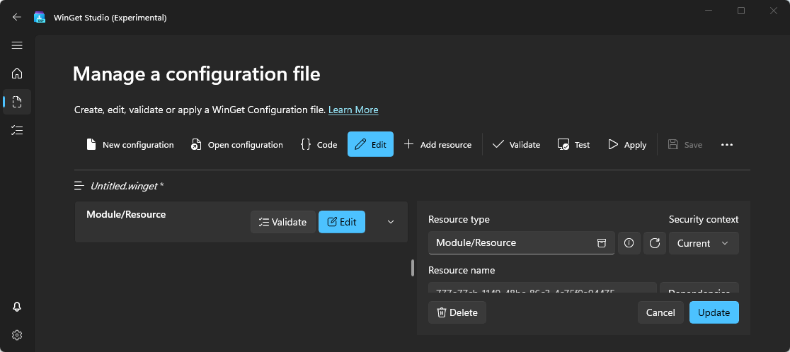
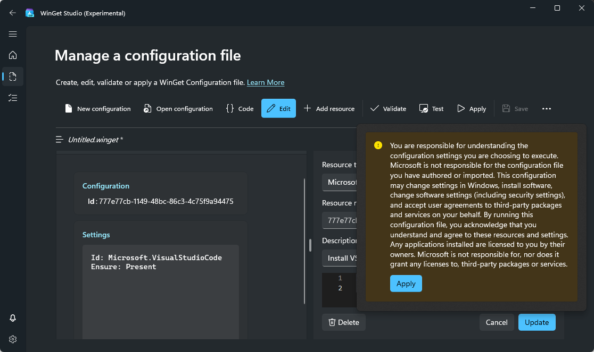
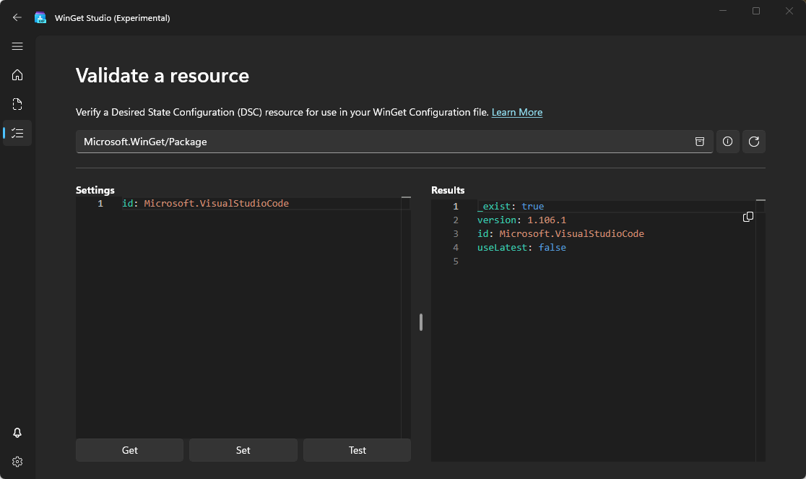
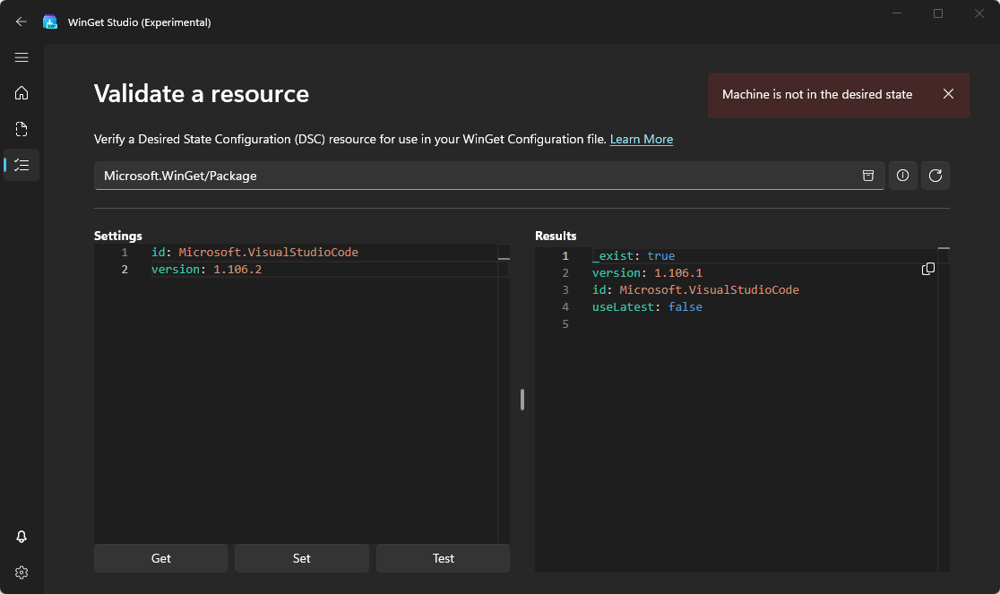
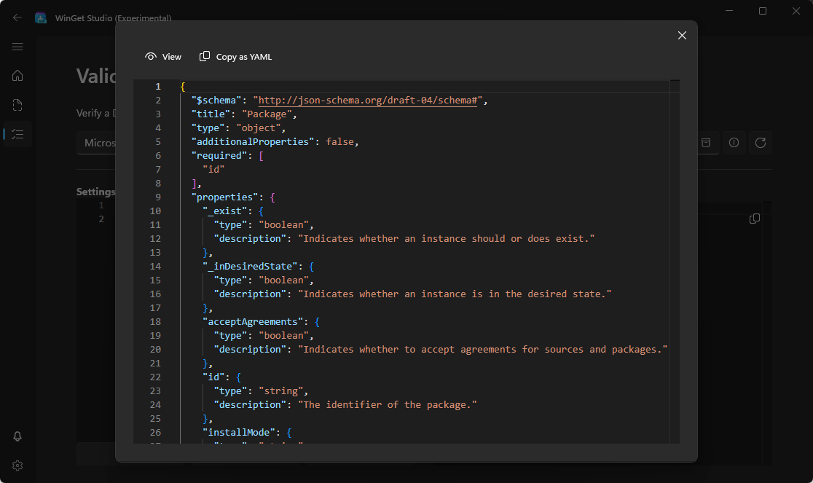

You've been there, blankly staring at a WinGet configuration file. With each YAML line, you're second-guessing if the indentation still looks proper.

You're trying to set up a configuration file that scales. But instead of focusing on what matters, you're trying to debug the syntax error if it's like 2005.

While YAML is better than JSON and machines, it's not easy to craft it by hand (even with all the tooltips you get).

WinGet Studio just went GA during Ignite and aims to solve this challenge—no more fighting with indentation or copying configurations from Stack Overflow. 

This guide will get you from shipping your first configuration in under 15 minutes. You'll learn about DSC resources, validating each document, and enjoy creating these documents. Let's get this fixed up.

By the end of this guide, you'll be able to:
<ul><li>Create and manage WinGet configuration files visually.</li><li>Validate DSC resources without breaking your system.</li><li>Test configurations before applying them.</li><li>Exporting the existing system state to reusable configurations.</li></ul><h2 id="prerequisites">Prerequisites</h2>
Before you start with this guide, make sure you're working on a Windows 11 version 22H2 or later. This comes with <code>winget.exe</code> pre-installed. You also need:
<ul><li><a href="https://github.com/PowerShell/DSC/tree/main">Microsoft Desired State Configuration v3.1.2</a> or above.</li></ul>
To install WinGet Studio, you can use two methods:

<strong>Use GitHub:</strong> Download WinGet Studio from <a href="https://github.com/microsoft/winget-studio/releases">GitHub releases page</a>.

<strong>Use WinGet:</strong> To install WinGet Studio using the command-line:
<pre><code class="language-bash">winget install --id Microsoft.WinGetStudio.Experimental --source winget</code></pre>
After you've installed WinGet Studio, let's take a look at the interface.
<h2 id="understanding-the-interface">Understanding the interface</h2>
When you first launch WinGet Studio, you'll see three main options:
<figure class="kg-card kg-image-card kg-card-hascaption"><figcaption>Figure 1: WinGet Studio main options</figcaption></figure>
The <em>"Manage a configuration file"</em> is where you'll spend most of your time. This can create a new configuration file, edit existing ones, and apply them to your system. 

In the <em>"Validate a resource"</em> menu, you can test your configuration files. See this as your testing playground to check for valid syntax before going to production.

Then lastly, the <em>"Settings" </em>menu. Here's where you can customize WinGet Studio, find the log files, clear the cache, or change your theme.
<figure class="kg-card kg-image-card kg-card-hascaption"><figcaption>Figure 2: Settings menu</figcaption></figure>

💡

Start with "Validate a resource" if you're new to WinGet configuration files and DSC.

<h2 id="your-first-configuration">Your first configuration</h2>
Let's start by creating our first configuration file. We'll keep it simple by installing Microsoft Visual Studio Code:
<ol><li>Click <strong>Manage a configuration file</strong> on the home screen.</li><li>Select <strong>New configuration </strong>from the toolbar.</li><li>WinGet Studio creates an empty configuration file for you:</li></ol><figure class="kg-card kg-image-card kg-card-hascaption"><figcaption>Figure 3: New configuration file</figcaption></figure>
Time to add a resource:
<ol start="4"><li>In the <strong>Resource type </strong>field, type in <code>Microsoft.WinGet/Package</code>.</li><li>Add the <strong>Description </strong>"Install VSCode".</li><li>To configure the resource, add the following fields in the code view in the right editor and press <strong>Update</strong></li></ol><pre><code class="language-yaml">Id: Microsoft.VisualStudioCode
Ensure: Present</code></pre>
<em>What just happened? </em>You've added your first DSC resource. Resources are the building blocks of WinGet Studio. Because you've WinGet installed, the <code>WinGetPackage</code> DSC resource is exposed to WinGet studio.

Now you can save the file to disk by pressing the <strong>three dots</strong>, select <strong>Save as</strong>,<strong> </strong>and giving it a descriptive name <code>vscode-setup.winget</code>. After saving the file, you can validate the resource by pressing <strong>Validate</strong>. This should return a notification that the code is <em>valid.<strong> </strong></em>Your first syntax check is completed.

Now the moment of truth. When you press <strong>Apply</strong>, a warning message is displayed:
<figure class="kg-card kg-image-card kg-card-hascaption"><figcaption>Figure 4: Warning before applying configuration</figcaption></figure>
Read the warning, then press <strong>Apply </strong>again. And that's it, your first configuration file is applied, and Visual Studio Code should be installed on your system.
<h2 id="validating-individual-resources">Validating individual resources</h2>
Whilst you've now already officially applied your first configuration file and broke the tip earlier, it was a safe operation to do. But if you go to production, you need to test individual resources and potentially test the behaviour with different properties available.

That's where the validate a resource feature becomes your lovely friend. In the menu, you're going to find three operations:
<ul><li><strong>Get </strong>- gets your current configuration</li><li><strong>Test </strong>- to see if your system matches the desired state</li><li><strong>Set - </strong>your system in the desired state</li></ul>
Each operation can be individually tested. Let's go through each of them to see what happens.
<ol><li>In the <strong>search box</strong>, type in <code>Microsoft.WinGet/Package</code> again.</li><li>Add the <code>id: Microsoft.VisualStudioCode</code> in the <strong>Settings </strong>field.</li><li>Press <strong>Get</strong></li></ol><figure class="kg-card kg-image-card kg-card-hascaption"><figcaption>Figure 5: Get current state</figcaption></figure>
This gets the current state of your system. As you can see, it returned four properties:
<ul><li>The <code>_exist</code> property indicates that the resource exists on the system.</li><li>The <code>version</code> property shows what version is installed.</li><li>The <code>id</code> property is the unique identifier of a package.</li><li>The <code>useLatest</code> property is a boolean flag to use the latest version of a package.</li></ul>
Imagine that you now want a different version to be installed. The actual latest version as per today is <code>1.106.2</code>. To test this out, you can add the <code>version</code> property in the <strong>Settings</strong>.
<ol><li>Add the <code>version: 1.106.2</code> property in the <strong>Settings </strong>field.</li><li>Press <strong>Test </strong>to see if the system is in the desired state.</li></ol><figure class="kg-card kg-image-card kg-card-hascaption"><figcaption>Figure 6: Machine is not in the desired state</figcaption></figure>
Of course, we already knew that the machine was out of its desired state because version <code>1.106.1</code> was installed. But in this way, you can validate systems that aren't in the desired state. 

If you haven't installed version <code>1.106.2</code>, you can press the <strong>Set</strong> button, which is going to upgrade your package by calling <code>winget.exe upgrade</code> underneath.
<h2 id="pro-tips-for-managing-configurations">Pro tips for managing configurations</h2>
You've going through each menu option and learned how to create a configuration file, validate it, and apply it. But what about the actual properties themselves? Where do they come from?

WinGet Studio has a long laundry list of improved functionality that will eventually make discovery and working with resources easier. But for now, here are some tips to work better with what you've already learned.

<strong>Tip 1: Finding resource properties</strong> Every DSC resource has different properties, and knowing which ones exist is half of the battle. To find available properties, follow the steps below:
<ol><li>In the <strong>Validate a resource</strong> section, search for <code>Microsoft.WinGet/Package</code>.</li><li>Once selected, press the <strong>Information button</strong>.</li><li>Press the <strong>View JSON schema </strong></li></ol><figure class="kg-card kg-image-card kg-card-hascaption"><figcaption>Figure 7: WinGet package properties</figcaption></figure>
This opens up the JSON schema for <code>Microsoft.WinGet/Package</code>, displaying all available properties. Notice the <strong>required </strong>field. The <code>id</code><strong> </strong>property is always mandatory. The rest is optional. 

Another way you've already seen when using the <code>Get</code> operation. This partially returned the available properties already.

<strong>Tip 2: Manage configurations in code editor</strong> The WinGet Studio visual editor is great. But if you're already a pro, you can manage configuration files using the <strong>code editor</strong>:
<ol><li>Open the <strong>Manage a configuration file </strong>menu.</li><li>Select <strong>New configuration </strong>and press <strong>Code.</strong></li><li>Paste in the following <strong>YAML </strong>code:</li></ol><pre><code class="language-yaml">$schema: https://raw.githubusercontent.com/PowerShell/DSC/main/schemas/2023/08/config/document.json
metadata:
  winget:
    processor:
      identifier: dscv3
resources:
- type: Microsoft.WinGet/Package
  name: Visual Studio Code
  properties:
    id: Microsoft.VisualStudioCode
    version: 1.106.2</code></pre>
You've now manually crafted the WinGet configuration file. Press <strong>Apply changes </strong>to set the actual changes. This will update the right panel editor view.

Now, imagine that after installing VS Code, you want to install an extension right away. How will WinGet know that it <code>dependsOn</code> another resource? Well, you specify that property, actually.
<ol><li>Re-open the <strong>Code </strong>editor.</li><li>Paste in the following <strong>YAML </strong>code:</li></ol><pre><code class="language-yaml">$schema: https://raw.githubusercontent.com/PowerShell/DSC/main/schemas/2023/08/config/document.json
metadata:
  winget:
    processor:
      identifier: dscv3
resources:
- type: Microsoft.WinGet/Package
  name: Visual Studio Code
  properties:
    id: Microsoft.VisualStudioCode
    version: 1.106.2
- type: Microsoft.VSCode.Dsc/VSCodeExtension
  name: PowerShell Extension
  dependsOn: 
  - "[resourceId('Microsoft.WinGet/Package', 'Visual Studio Code')]"
  properties:
    name: ms-vscode.powershell</code></pre><ol start="3"><li>Press <strong>Validate</strong>.</li></ol>
Notice the code has validated successfully. This is because WinGet Studio underneath leverages <code>dsc.exe</code> engine. DSC's engine allows adding ARM expressions. In this case, it uses the <code>resourceId()</code> function to grab the existing resource for reference.
<h2 id="summary">Summary</h2>
You've successfully gone through WinGet Studio using both the graphical user interface (GUI) and YAML. You created a configuration file without wrestling with YAML much. 

Resources are validated using <code>Get</code>, <code>Test</code>, and <code>Set</code>. WinGet Studio makes the job easier, and you can now configure something. 

For more information, check out the <a href="https://github.com/microsoft/winget-studio">GitHub repository</a>.

