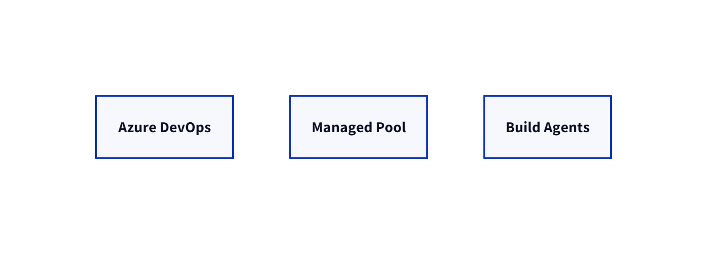
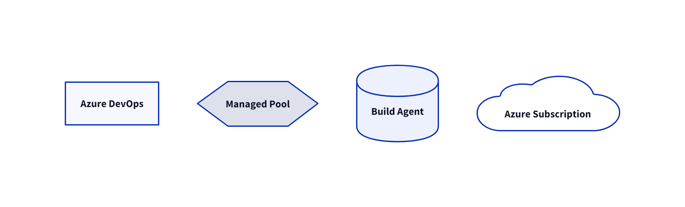
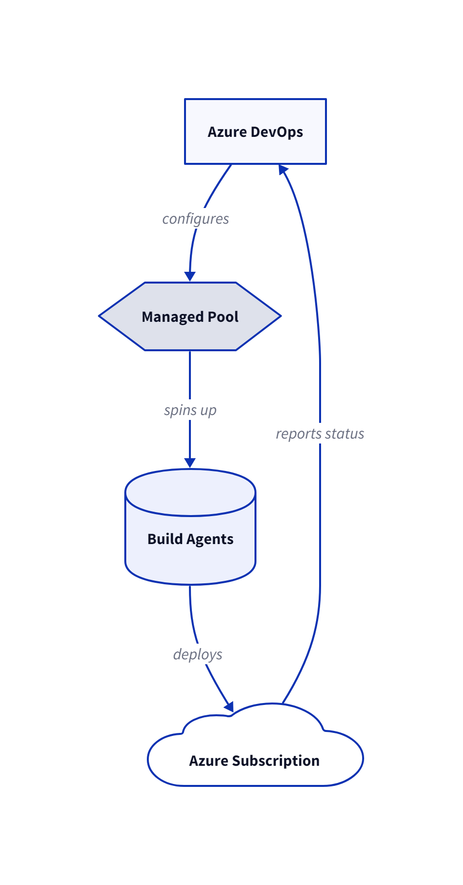
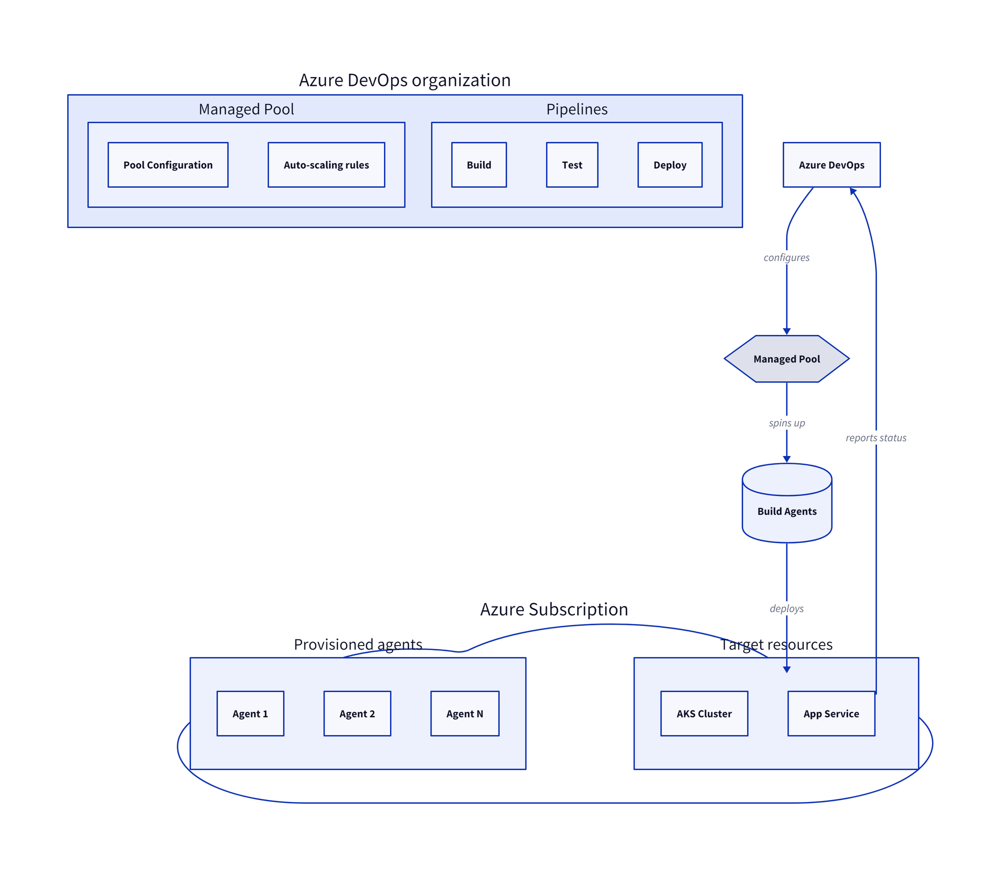
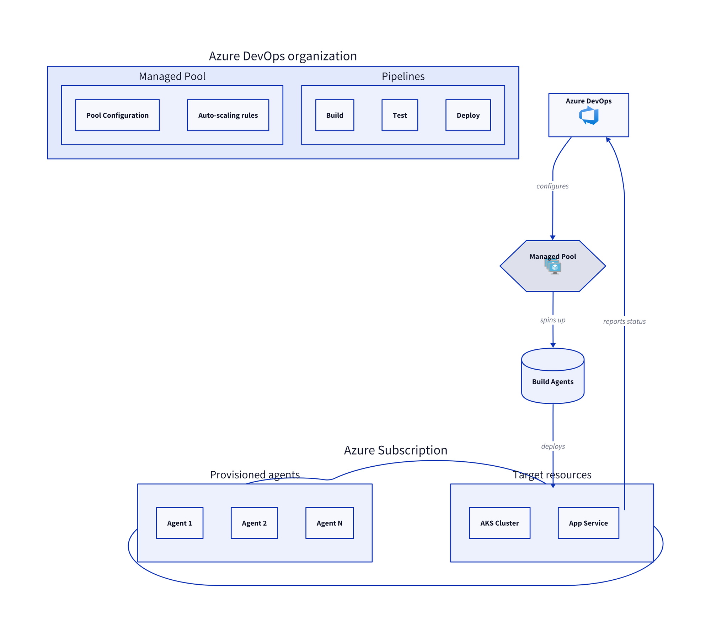
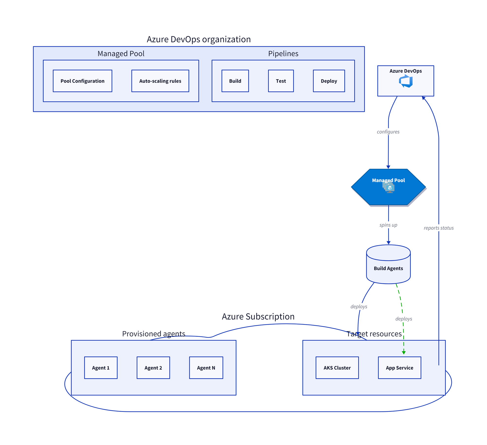
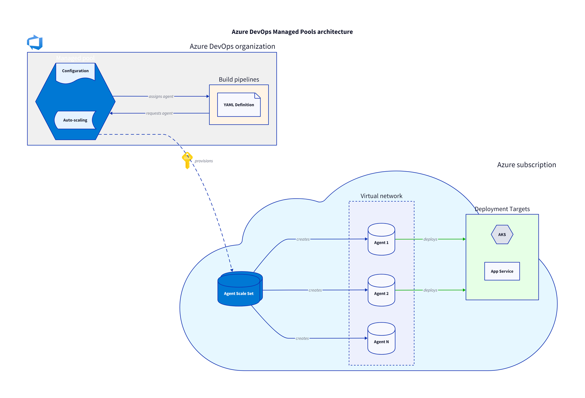

A reader asked me in my <a href="/how-to-fix-your-outdated-azure-diagrams-forever/">previous article</a>: "What does that D2 code actually produce?"

Fair question. I showed the syntax. Explained the benefits. But never showcased through how a diagram comes together piece by piece with images.

Let's fix that.

Today, we're going to build a complete architecture diagram for Azure DevOps Managed Pools from scratch. Each section adds one concept. By the end, you'll have a professional diagram and understand precisely how every line of D2 contributes to it.
<h2 id="what-were-building">What we're building</h2>
Azure DevOps Managed Pools is Microsoft's managed build agent solution. No more maintaining VMs or patch agent software. You define a pool, and Azure handles the rest.

The diagram will show:
<ul><li>The Azure DevOps organization structure.</li><li>Managed Pool configuration.</li><li>Agent provisioning flow.</li><li>Connection to Azure resources.</li></ul>
If you want to follow along, make sure you have D2 installed on your local machine. If you've installed D2, let's start with the basics.
<h2 id="step-1-defining-shapes">Step 1: Defining shapes</h2>
Every D2 diagram starts with shapes. These are your building blocks. It includes boxes, cylinders, and clouds that represent the components of your architecture.

The syntax is simple. Just name it:
<pre><code class="language-d2">azdo: Azure DevOps
pool: Managed Pool
agents: Build Agents</code></pre><figure class="kg-card kg-image-card kg-card-hascaption"><figcaption>Figure 1: Defining shapes</figcaption></figure>
That's three shapes generated by D2. They automatically render as rectangles with your labels. But rectangles are boring for architectural diagrams. Let's add a <em>tint </em>to it.

D2 supports multiple shape types. Here are the ones we'll use:
<pre><code class="language-d2">azdo: Azure DevOps {
  shape: rectangle
}&#10;
pool: Managed Pool {
  shape: hexagon
}&#10;
agents: Build Agents {
  shape: person
}&#10;
azure: Azure Subscription {
  shape: cloud
}</code></pre><figure class="kg-card kg-image-card kg-card-hascaption"><figcaption>Figure 2: Different shape types</figcaption></figure>
The <code>shape</code> property changes how D2 renders each element. To see a list of available shapes, check out the <a href="https://d2lang.com/tour/shapes/">official documentation</a>.

For our Azure DevOps Managed Pools diagram, we're using:
<ul><li><code>rectangle</code> – for the Azure DevOps organization (it's a boundary).</li><li><code>hexagon</code> – for the Managed Pool (it's a service/process).</li><li><code>cylinder</code> - for agents (they do the work).</li><li><code>cloud</code> – for Azure (because well, it's Azure).</li></ul><h2 id="step-2-creating-connections">Step 2: Creating connections</h2>
The shapes are now loosely defined. There aren't any connections, meaning they're just floating around. Connections show the relationships among shapes, data flow, and their dependencies.

D2 uses arrows to define connections between boxes:
<pre><code class="language-d2">azdo -&gt; pool: manages
pool -&gt; agents: provisions
agents -&gt; azure: deploys to</code></pre>
Four connection types are supported in D2:
<ul><li><code>--</code> – Undirected line.</li><li><code>-&gt;</code> – Arrow pointing right.</li><li><code>&lt;-</code> – Arrow pointing left.</li><li><code>&lt;-&gt;</code> – Bidirectional arrow.</li></ul>
The text after the colon becomes the connection label. This is where you describe what flows between components.  Let's expand our diagram:
<pre><code class="language-d2">azdo: Azure DevOps {
  shape: rectangle
}&#10;
pool: Managed Pool {
  shape: hexagon
}&#10;
agents: Build Agents {
  shape: cylinder
}&#10;
azure: Azure Subscription {
  shape: cloud
}&#10;
azdo -&gt; pool: configures
pool -&gt; agents: spins up
agents -&gt; azure: deploys
azure -&gt; azdo: reports status</code></pre><figure class="kg-card kg-image-card kg-card-hascaption"><figcaption>Figure 3: Creating connections between boxes</figcaption></figure>
You now have a cycle showing the complete flow. It starts by configuring the Managed Pools, then spins up (provisions), deploys the agents in Azure, and finally reports back the status to Azure DevOps.
<h2 id="step-3-using-containers-for-grouping">Step 3: Using containers for grouping</h2>
An architectural diagram without hierarchy isn't a <em>real </em>diagram. Services live inside subscriptions. The pool contains agents, and Azure DevOps Services has projects.

D2 can handle this with containers, meaning shapes that contain other shapes:
<pre><code class="language-d2">organization: MyProject DevOps {
  project: MyProject {
    pipeline: Build Pipeline
    pipeline2: Release Pipeline
  }&#10;  
  project2: Portal {
    pipeline3: CI Pipeline
  }
}</code></pre>
Nesting creates visual grouping and allows the outer shape to become a container with a label. Inner shapes appear inside it.

For our Azure DevOps Managed Pools diagram, this is compelling:
<pre><code class="language-d2">organization: Azure DevOps organization {
  pool: Managed Pool {
    config: Pool Configuration
    scaling: Auto-scaling rules
  }&#10;  
  pipelines: Pipelines {
    build: Build
    test: Test
    deploy: Deploy
  }
}&#10;
azure: Azure Subscription {
  agents: Provisioned agents {
    agent1: Agent 1
    agent2: Agent 2
    agent3: Agent N
  }&#10;  
  resources: Target resources {
    aks: AKS Cluster
    webapp: App Service
  }
}</code></pre><figure class="kg-card kg-image-card kg-card-hascaption"><figcaption>Figure 4: Containers and grouping</figcaption></figure>
In the above example, the target resources refer to the Azure services where your pipelines actually deploy your applications or infrastructure. You can now see the structure clearly: an organization containing the pool and pipelines, while Azure contains the agents and target resources.
<h2 id="step-4-adding-icons">Step 4: Adding icons</h2>
Text labels are fine, but icons make diagrams come to <em>life</em>. D2 supports icons via URLs. There's a known side for hosting various useful icons, which is <a href="https://icons.terrastruct.com/">Terrastruct</a>:
<pre><code class="language-d2">azdo: Azure DevOps {
  icon: https://icons.terrastruct.com/azure%2FDevOps%20Service%20Color%2FAzure%20DevOps.svg
}&#10;
pool: Managed Pool {
  icon: https://icons.terrastruct.com/azure%2FCompute%20Service%20Color%2FVM%2FVM%20Scale%20Sets.svg
}</code></pre>
The <code>icon</code> property accepts any image URL. Terrastruct hosts a free icon library with hundreds of icons for cloud providers. It's also possible to use local files:
<pre><code class="language-d2">myservice: My service {
  icon: ./icons/custom-service.png
}</code></pre>
Or you can even use it as standalone icons (no box, just the image) by using <code>shape: image</code>:
<pre><code class="language-d2">github: {
  shape: image
  icon: https://icons.terrastruct.com/dev%2Fgithub.svg
}</code></pre><figure class="kg-card kg-image-card kg-card-hascaption"><figcaption>Figure 5: Adding icons</figcaption></figure><h2 id="step-5-styling-your-diagram">Step 5: Styling your diagram</h2>
By now, we've only used the default D2 styling. D2's <code>style</code> property lets you customize colors, borders, and effects:
<pre><code class="language-d2">pool: Managed Pool {
  style: {
    fill: "#0078D4"
    stroke: "#005A9E"
    font-color: white
    border-radius: 8
    shadow: true
  }
}</code></pre>
The following list represents the available style properties you can use:
<ul><li><code>fill</code> — Background color (CSS color or hex).</li><li><code>stroke</code> — Border color.</li><li><code>stroke-width</code> — Border thickness (1-15).</li><li><code>stroke-dash</code> — Dashed border (0-10).</li><li><code>font-color</code> — Text color.</li><li><code>font-size</code> — Text size (8-100).</li><li><code>opacity</code> — Transparency (0-1).</li><li><code>shadow</code> — Drop shadow (true/false).</li><li><code>3d</code> — 3D effect for rectangles (true/false).</li><li><code>border-radius</code> — Rounded corners (0-20)</li></ul>
There's one more style you can use for connections that lets you animate. This is perfect for indicating a data flow, for example:
<pre><code class="language-d2">agents -&gt; azure: deploys {
  style: {
    animated: true
    stroke: "#00AA00"
  }
}</code></pre><figure class="kg-card kg-image-card kg-card-hascaption"><figcaption>Figure 6: Animated with style</figcaption></figure><h2 id="the-complete-diagram">The complete diagram</h2>
Time to put everything together. Here's a complete Azure DevOps Managed Pools diagram:
<pre><code class="language-d2">direction: right&#10;
title: Azure DevOps Managed Pools architecture {
  shape: text
  near: top-center
  style.font-size: 24
  style.bold: true
}&#10;
organization: Azure DevOps organization {
  icon: https://icons.terrastruct.com/azure%2FDevOps%20Service%20Color%2FAzure%20DevOps.svg
  style.fill: "#f0f0f0"&#10;  
  pool: Managed pool {
    shape: hexagon
    style.fill: "#0078D4"
    style.font-color: white&#10;    
    config: Configuration {
      shape: document
      style.fill: "#E6F2FF"
    }&#10;    
    scaling: Auto-scaling {
      shape: stored_data
      style.fill: "#E6F2FF"
    }
  }&#10;  
  pipelines: Build pipelines {
    style.fill: "#FFF4E6"&#10;    
    yaml: YAML Definition {
      shape: page
    }
  }
}&#10;
azure: Azure subscription {
  shape: cloud
  icon: https://icons.terrastruct.com/azure%2FGeneral%20Service%20Icons%2FSubscriptions.svg
  style.fill: "#E6F7FF"&#10;  
  vmss: Agent Scale Set {
    shape: cylinder
    style.fill: "#0078D4"
    style.font-color: white
    style.multiple: true
  }&#10;  
  vnet: Virtual network {
    style.stroke-dash: 3&#10;    
    agent1: Agent 1 {
      shape: cylinder
    }
    agent2: Agent 2 {
      shape: cylinder
    }
    agentN: Agent N {
      shape: cylinder
    }
  }&#10;  
  targets: Deployment Targets {
    style.fill: "#E6FFE6"&#10;    
    aks: AKS {
      shape: hexagon
    }
    webapp: App Service {
      shape: rectangle
    }
  }
}&#10;
# Connections
organization.pool -&gt; azure.vmss: provisions {
  style.animated: true
}&#10;
azure.vmss -&gt; azure.vnet.agent1: creates
azure.vmss -&gt; azure.vnet.agent2: creates
azure.vmss -&gt; azure.vnet.agentN: creates&#10;
organization.pipelines -&gt; organization.pool: requests agent
organization.pool -&gt; organization.pipelines: assigns agent&#10;
azure.vnet.agent1 -&gt; azure.targets: deploys {
  style.stroke: "#00AA00"
}
azure.vnet.agent2 -&gt; azure.targets: deploys {
  style.stroke: "#00AA00"
}</code></pre><figure class="kg-card kg-image-card kg-card-hascaption"><figcaption>Figure 6: Complete diagram</figcaption></figure>
Save this file as <code>azure-devops-managed-pool.d2</code> and run:
<pre><code class="language-bash">d2 azure-devops-managed-pool.d2 azure-devops-managed-pool.png</code></pre><h2 id="summary">Summary</h2>
As you can see, in just about 100 lines of D2 code, we built a complete architectural diagram showing:
<ol><li><strong>Shapes </strong>–<strong> </strong>The building blocks.</li><li><strong>Connections </strong>–<strong> </strong>Adds relationships and data flow.</li><li><strong>Containers </strong>–<strong> </strong>Hierarchy and grouping.</li><li><strong>Icons</strong> – Visual recognitions.</li><li><strong>Styling</strong> – Professional polishing.</li></ol>
You can safely store this in version control and update it with a single command. Storing it in version control makes it <em>reviewable</em>. And it never lies about your architecture because you update the code when you update the architecture.  

It's now your turn. Pick one of your existing architectural diagrams, especially an outdated one. Try creating it in D2 by starting simple. Define shapes, start making the connections, and in the end, add the containers for logical grouping. 
<h2 id="references">References</h2>
Here are the references I used for this blog post:
<ul><li><a href="https://d2lang.com/tour/intro">D2 language tour</a></li><li><a href="https://d2lang.com/tour/shapes">D2 shapes reference</a></li><li><a href="https://d2lang.com/tour/connections">D2 connections</a></li><li><a href="https://d2lang.com/tour/containers">D2 containers</a></li><li><a href="https://d2lang.com/tour/icons">D2 icons &amp; styling</a></li><li><a href="https://icons.terrastruct.com/">Terrastruct icon library</a></li></ul>
