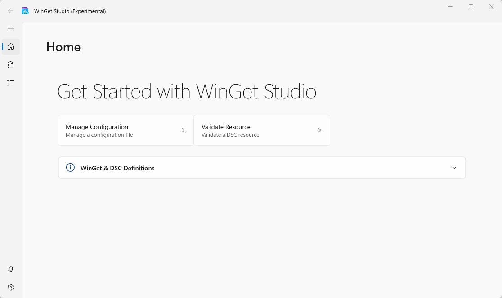

Ho ho ho! It's that time of the year again. The festive season is starting. For the Americans, Thanksgiving. For the "dutchies", like myself, the "Sint and Piet" are coming around. And then of course, Christmas and New Year's Eve.

Now, picture this: It's Christmas Eve. You're wrapping all your presents. But instead of wrapping each gift individually with the attention it deserves, you simply describe to your wife what you want. You want it perfectly wrapped with a red bow, and after a few minutes, it suddenly happened. That's the magic of your wife... 

No, that's not what I meant.

It's the magic of "declarative configuration", and it's the gift that Microsoft Desired State Configuration (DSC), WinGet, and Azure Bicep bring to infrastructure, configuration, and application management.

Like the Beatles brought together different talents into one peaceful band, so do these three Microsoft technologies come together to create a unified, declarative solution for managing everything from cloud infrastructure to your desktop workstation.

Let's unwrap these gifts and see what makes them special.
<h2 id="the-spirit-of-declarativeness-what-does-it-mean">The spirit of declarativeness: What does it mean?</h2>
Before diving into the specifics, let's first understand what "declarative" means. 

Think of it like writing a letter to Santa (or Sint, depending on your cultural background). You don't tell Santa the step-by-step process for manufacturing a toy, packaging it, loading it onto the sleigh, and navigating it to your amazing Christmas tree.

You simply declare what you want: "I want a brand new car" (good luck with that, Santa thinks).

Diving a bit deeper, but in technical terms, this means you describe the <em>desired state</em> of your system. You describe what you want it to look like rather than the imperative steps to achieve it. The system figures out how to get there. It handles other complexities and ensures the results match your declaration.

This is different from how imperative scripting does it. In imperative scripting, you write commands like:
<ol><li>First, install this package.</li><li>Then, configure that setting.</li><li>After the setting is configured, restart the service.</li></ol>
With declarative approaches, you say, "This package should be installed with these settings." The platform will handle the rest. Here's the difference: it's like telling Santa for a detailed manufacturing plan for the car versus just saying "give me the car, please!"
<h2 id="microsoft-desired-state-configuration-the-gift-reborn">Microsoft Desired State Configuration: The gift reborn</h2>
Hold this thought for the rest of the blog post: Microsoft's Desired State Configuration (DSC) tool is the foundation of our declarative story.

Think of it as the Christmas tree around which all the other gifts gather. Microsoft DSC is the latest iteration and is a cross-platform command-line utility. It's also open-source and manages software components <em>declaratively</em> and <em>idempotently</em>.

You're now wondering, what's <em>idempotency</em>? It's the wish list that stays consistent, no matter how many times you read it. DSC configuration documents are idempotent. They produce the same result whether applied once or a hundred times. To make a Christmas analogy, it's like knowing your favorite cookies will taste exactly the same every year—unless, of course, the bakery decides to change the recipe.
<h2 id="what-makes-microsoft-dsc-special">What makes Microsoft DSC special?</h2>
DSC works on at least four core principles that make it the perfect Christmas gift for configuration management. Let's look at each of them:
<ol><li><strong>Language agnostic resources</strong></li></ol>
Unlike its predecessor (PowerShell DSC), Microsoft DSC doesn't depend on PowerShell anymore. This doesn't mean you can't run the existing, old, juicy DSC resources, but you can author DSC resources in any language. Want to use Bash? You can. Coming from a .NET background? Write it in C#. Going with the flow on the Rust hype? Create a CLI utility in Rust. 

All those things come together by defining an explicit schema using JSON or YAML files, making them universally understandable.

If we're talking about DSC resources, think of them like the decorative objects in the Christmas tree. Each one is unique, each one created by different craftsmanship. But they can all hang together on the same tree. A DSC resource might manage files, registry keys, or even software installations. Each resource can <strong><em>individually</em></strong> hook into the simple operations:
<ul><li><strong>Get</strong>: Retrieve the current state of your system.</li><li><strong>Test</strong>: Check if the state matches what you've specified.</li><li><strong>Set</strong>: Enforces the desired state on your system.</li><li><strong>Export</strong>: Generate configurations from the current state.</li></ul><ol start="2"><li><strong>Configuration documents are the blueprint</strong></li></ol>
DSC configuration documents are the heart. They are declarative data files, typically written in YAML or JSON. It defines instances of resources and their desired state. Here's where the magic happens. Instead of writing those imperative scripts, you define a list of what you want:
<pre><code class="language-yaml">$schema: https://aka.ms/dsc/schemas/v3/bundled/config/document.json
resources:
  - name: Ensure Developer Mode
    type: Microsoft.Windows.Settings/WindowsSettings
    properties:
      DeveloperMode: true
  - name: Install Git
    type: Microsoft.Windows/WindowsPowerShell
    properties:
      resources:
        - name: Git Package
          type: Microsoft.WinGet.DSC/WinGetPackage
          properties:
            id: Git.Git
            source: winget</code></pre>
You instantly notice how readable this is. Even a non-technical family member at the Christmas dinner table can understand: "We are enabling developer mode and want to install Git". It's just like your Christmas gift list: clear, straightforward, and direct to the point.
<ol start="3"><li><strong>No Local Configuration Manager (LCM) required</strong></li></ol>
In the good (or bad) days, PowerShell DSC ran as a background service, which was the LCM. In the parentheses, I added the <em>bad </em>part because, whilst there wasn't anything "wrong" with it, the architecture around it became a major limitation:
<ol><li>Too many settings were static, like refresh mode, frequency, and reboot behaviour. All of these settings weren't easily changeable at scale.</li><li>The pull server was complex as it was tightly coupled.</li><li>Windows-only and too tied to PowerShell, even though tools like Azure Machine Configuration changed this by orchestrating around the <code>PSDesiredStateConfiguration</code> module.</li></ol>
Microsoft DSC is different. It is invoked as a command. It executes, does its job, and returns the information (and exits). This makes it a pretty lightweight tool for macOS, Linux, and Windows. And that's where we land on the last principle, built for orchestration.
<ol start="4"><li><strong>Built for orchestration</strong></li></ol>
Here's where the beast shines as the team player for other tools. Because it's just a simple CLI utility, other platforms can easily invoke it as their configuration engine. WinGet is one of those examples. It didn't reinvent the wheel for configuration management. Instead, it calls <code>dsc.exe</code> under the hood to do the heavy lifting. Think of it like this: In Santa's workshop, other tools like WinGet act as the delivery service by bringing configurations to your system. But... <code>dsc.exe</code> is the one that actually applies the configuration document.

This orchestration design means you're not locked into a single tool. Whether you're using WinGet, GitHub Actions, or your own custom pipeline, Microsoft DSC can hook into it as the engine that powers declarative configuration.
<h2 id="winget-configuration-trimming-the-tree">WinGet configuration: Trimming the tree</h2>
Windows Package Manager (WinGet) was the frontrunner by adopting Microsoft DSC in its ecosystem. WinGet is the tool for installing applications on Windows, but its configuration feature takes it to the next level by embracing this declarativeness. 

See, WinGet configuration files are in some form just DSC configuration documents that use a <em>special </em>processor syntax. This example from the WinGet project shows exactly this:
<pre><code class="language-yaml">$schema: https://raw.githubusercontent.com/PowerShell/DSC/main/schemas/2024/10/config/document.json
metadata:
  winget:
    processor: dscv3
resources:
  - name: Test File
    type: Microsoft.WinGet.Dev/TestFile
    metadata:
      description: Description 1.
    properties:
      path: ${WinGetConfigRoot}\ShowDetails_DSCv3.txt
      content: DSCv3 Contents!</code></pre>
This is declarative magic. The <code>processor: dscv3</code> metadata tells WinGet to use <code>dsc.exe</code> to process this configuration. You're declaring which file should exist, which application should be installed, and which setting should be configured. All in one single readable document once again.

But here comes another addition to the mix. Not everyone likes writing YAML or JSON files (just as not everyone enjoys wrapping their Christmas presents by hand). For those who missed Microsoft Ignite, WinGet Studio was launched publicly. WinGet Studio is a graphical user interface (GUI) for creating WinGet configuration files. It's your helpful elf assistant who helps you organize your wish list by drag-and-dropping with ease.

WinGet Studio integrates deeply with Microsoft DSC:
<ul><li>It discovers DSC resources from the PowerShell Gallery and your local system.</li><li>Provides visual editing of configuration properties.</li><li>Tests resources before including them in your configuration.</li><li>Exports configuration in both <code>0.2.0</code> and DSC formats.</li><li>Validates configurations against JSON schemas.</li></ul><figure class="kg-card kg-image-card kg-card-hascaption"><figcaption>Figure 1: WinGet Studio</figcaption></figure>
The tool bridges the gap between PowerShell DSC v2 resources and native Microsoft DSC command-based resources. It's the <em>Swiss Army knife</em> of declarative configuration authoring.
<h2 id="azure-bicep-authoring-gingerbread-houses">Azure Bicep: Authoring gingerbread houses</h2>
Now we've arrived at the last station of tools. What does Azure Bicep have to do with Microsoft DSC? Isn't Azure Bicep for Azure resources? The previous question is valid. Azure Bicep is a domain-specific language for deploying Azure resources, and whilst Microsoft DSC focuses on configuration systems and WinGet handles application installations, there's one principle that's the same:
<blockquote>The follow the same declarative philosophy.</blockquote>
Azure Bicep is, at its core, a more readable and maintainable way to write Azure Resource Manager (ARM) templates. But the fascinating part is how Azure Bicep fits into the Microsoft DSC ecosystem. The project includes a Bicep extension, allowing Bicep files to be passed in directly to DSC's engine:
<pre><code class="language-json">{
    "$schema": "https://aka.ms/dsc/schemas/v3/bundled/extension/manifest.json",
    "type": "Microsoft.DSC.Extension/Bicep",
    "version": "0.1.0",
    "description": "Enable passing Bicep file directly to DSC",
    "import": {
        "fileExtensions": ["bicep"],
        "executable": "bicep",
        "args": ["build", "--stdout"]
    }
}</code></pre>
Because Microsoft DSC has adopted ARM syntax from the beginning, under the hood, when Bicep compiles, it perfectly understands Bicep files. When <code>dsc.exe</code> encounters a <code>.bicep</code> file, it invokes the Bicep compiler (if installed) to transpile it to JSON, then processes it in the engine.

Here's just a rough, easy example of what it looks like:
<pre><code class="language-bicep">targetScope = 'desiredStateConfiguration'&#10;
resource echo 'Microsoft.DSC.Debug/Echo@2025-08-27' = {
  name: 'exampleEcho'
  properties: {
    output: 'Hello, world!'
  }
}</code></pre>
Notice this <code>targetScope = 'desiredStateConfiguration'</code>. This is experimental, but tells Bicep we're not deploying Azure resources. Rather, it's describing the desired state of a DSC resource!
<h2 id="the-beatles-of-microsoft-technologies">The Beatles of Microsoft technologies</h2>
Remember when I mentioned the Beatles in the intro? Let me explain why these technologies really do come together like the legendary band itself. Just as John, Paul, George, and Ringo brought different strengths, so do these tools.

<strong>Microsoft DSC is the rhythm guitar (John)</strong>: The steady and reliable foundation keeping everything in rhythm. It provides the platform tool, the resource model (schemas), and the execution engine, enabling declarative configuration.  Without it, you don't have a band.

<strong>Winget is the bass player (Paul)</strong>: It's the bridge that gaps infrastructure and applications, allowing everyone to be grounded. It leverages DSC's power to perform application installations and configurations.

<strong>Azure Bicep is the lead guitar (George)</strong>: While Azure Bicep is for Azure resources, with its extensible model, it extends itself with the declarative approach it already has and harmonizes with DSC's principles by spitting out the JSON the engine wants.

<strong>WinGet Studio is the drummer (Ringo)</strong>: Keeping the beat steady and providing the GUI that makes it easy for everyone to participate in the declarative coup. It's the one making sure everything is running smoothly.
<h2 id="wrapping-it-up">Wrapping it up</h2>
As we close out this festive exploration, it's clear that Microsoft Desired State Configuration, WinGet Configuration, and Azure Bicep share more than just corporate branding. They share a fundamental philosophy that makes our lives easier: <strong>describe what you want, not how to get it</strong>.

This declarative approach:
<ul><li>Makes it readable for humans (even your manager can understand it).</li><li>Reduces cognitive load and complex scripts (no more than 500 lines of scripting).</li><li>Enables repeatable deployments (no more saying: "hey, it worked on my machine").</li><li>Provides idempotent operations (run it every time and you know what to expect).</li><li>Separates intent from implementation (you focus on what, not the how).</li></ul>
When you're thinking about automation and configuration management during the holiday season, remember this: the best gift you can give your infrastructure is a clear declaration of what you want it to be. Let Microsoft DSC, WinGet, and Bicep come together and let them figure out the rest. After all, isn't that what the holidays should be about?

Want to learn more? Here are a couple of references:
<ul><li><a href="https://learn.microsoft.com/en-us/powershell/dsc/overview?view=dsc-3.0">Explore Microsoft DSC's documentation</a></li><li><a href="https://github.com/microsoft/winget-studio/tree/main/docs">Learn about WinGet Studio</a></li><li><a href="/how-bicep-is-bringing-back-intellisense-to-microsoft-desired-state-configuration/">How is Bicep bringing IntelliSense to Microsoft DSC</a></li></ul>
