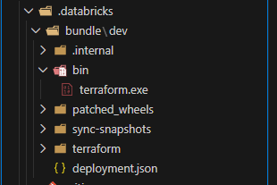
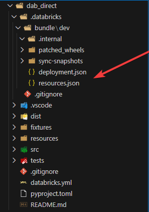

I’ve watched this <a href="https://github.com/databricks/cli/issues/1238" rel="noopener">issue</a> for a while: Each step requires internet access to Terraform's registry, allowing for failure points in locked-down environments, since 2024. I have commented on it, and I've used the workaround. It's a nasty workaround every single day, and explaining the error messages to my colleagues is a burden:
<pre><code class="language-plaintext">Error: Failed to query available provider packages
Could not retrieve the list of available versions for provider databricks/databricks: 
could not connect to registry.terraform.io</code></pre>
If you work in a heavily regulated environment (like I do), you know this error. Either your CI/CD agents can't reach the internet, or your lab environments behind a firewall are returning this error message.

Now you're probably just like me, knocking on the security team's door and asking: "Hey, can you whitelist Hashicorp's registry?" But they gave you a big fat no, and Databricks Asset Bundles (DABs) became a nightmare to maintain.

Back to the point.

I've done the workaround by downloading the binaries manually. I've created the mirror for the Terraform providers and updated the Databricks CLI every time it updates.

It worked. But it wasn't sustainable to ask my colleagues every time.

Now, finally, even though the issue was labelled as not planned, with v0.279.0, that chapter <em>starts </em>to close. The new direct engine deployment removes Terraform and begins to invoke the REST API directly. Or does it?

In this blog post, I'll take you through what has changed in the Databricks CLI for DAB deployments.
<h2 id="what-changed">What changed</h2>
Whenever you deploy DABs, the <code>databricks bunde deploy</code> command retrieves the Terraform provider and leverages its state file to determine <em>what has changed</em>.
<figure class="kg-card kg-image-card"></figure>
The CLI would do the following in sequence:
<ol><li>Download Terraform (if not present).</li><li>Download the Databricks Terraform provider from registry.terraform.io.</li><li>Generate Terraform configuration files.</li><li>Run <code>terraform apply</code>.</li></ol>
Each step requires internet access to Terraform's registry, allowing for failure points in locked-down environments.

The new <em>direct </em>deployment engine does it differently. It implements direct CRUD operations through the CLI's library, which doesn't require Terraform. This results in the CLI being a self-contained binary. That's it.
<h2 id="why-this-matters">Why this matters</h2>
I'm working in an organization that deploys DABs either in a locked-down environment or CI/CD pipelines that leverage internal repositories. These environments (or agents) don't have:
<ul><li>Outbound internet access.</li><li>Cannot install software at runtime.</li><li>Must use pre-approved binaries.</li></ul>
Before v0.279.0 of the Databricks CLI, enabling DABs in these environments required the workaround mentioned earlier: we first had to mirror Terraform binaries, host the plugins internally, and update everything whenever Databricks or Hashicorp released a new version.

Now, as you'll see in the next section, this is improved in the <em>direct engine, </em>where we only need to download the Databricks CLI.
<h2 id="how-to-enable-direct-deployment">How to enable direct deployment</h2>
The direct deployment is an experimental feature. You need to opt in for new bundles that never deployed:
<pre><code class="language-bash">DATABRICKS_BUNDLE_ENGINE=direct</code></pre>
Or use PowerShell:
<pre><code class="language-powershell">$env:DATABRICKS_BUNDLE_ENGINE='direct'</code></pre>
Then, whenever you run <code>databricks bundle deploy</code>, you'll notice the provider not being downloaded anymore:
<figure class="kg-card kg-image-card"></figure>
For existing bundles that you want to migrate, you have to do it slightly differently. First, you need to migrate the state file:
<pre><code class="language-bash"># Step 1: Ensure current deployment is complete
databricks bundle deploy -t my_target&#10;
# Step 2: Migrate the state file
databricks bundle deployment migrate -t my_target&#10;
# Step 3: Verify migration (should show no changes)
databricks bundle plan -t my_target&#10;
# Step 4: Deploy with the new engine
DATABRICKS_BUNDLE_ENGINE=direct databricks bundle deploy -t my_target</code></pre>
The migration command converts your Terraform state file to the new format (stored in <code>resources.json</code>). If something goes wrong, you can always restore it from a backup:
<pre><code class="language-bash">mv .databricks/bundle/my_target/terraform/tfstate.json.backup .databricks/bundle/my_target/terraform/tfstate.json
rm .databricks/bundle/my_target/resources.json</code></pre><h2 id="the-benefits">The benefits</h2>
Beyond the fact that you don't require internet access anymore, there are three more benefits you gain:
<ol><li><strong>Faster deployments: </strong>if you ran the command yourself, you noticed the CLI talking directly to the Databricks APIs, which was significantly quicker.</li><li><strong>Better diagnostics: </strong>you can run <code>databricks bundle plan -o json</code> to see exactly what changes are planned.</li><li><strong>Simpler maintenance: </strong>no more requirements for the Terraform provider. You only need the Databricks CLI.</li></ol><h2 id="what-to-watch-out-for"><strong>What to watch out for</strong></h2>
Be careful when using this feature in production. It's still experimental, but as described in the documentation, the direct engine will become the only supported one in 2026. But for now:
<ul><li>Try to test it out thoroughly.</li><li>Check the known issues on GitHub.</li><li>Report any bugs you find to help improve the product.</li></ul>
The format changes versus the state file. You can always switch back by recovering the backup file.
<h2 id="conclusion">Conclusion</h2>
I'm pretty stoked about this change, and I was quick to recognize this feature as a way to remove a friction point for enterprises with secure environments. The Terraform dependency was holding back DAB's adoption in environments that need infrastructure-as-code the most.

In the introduction, I ended with <em>or does it?</em> Whenever you run the migration command, you'll still see the Terraform provider downloaded. Keep this in mind when you're migrating. You probably want to do it in an environment with internet access first.

If you want to try out this feature, start by downloading v0.279.0, setting the environment variable, and deploying your bundle.

For more information, check out the <a href="https://github.com/databricks/cli/blob/main/docs/direct.md">documentation on GitHub</a>.

