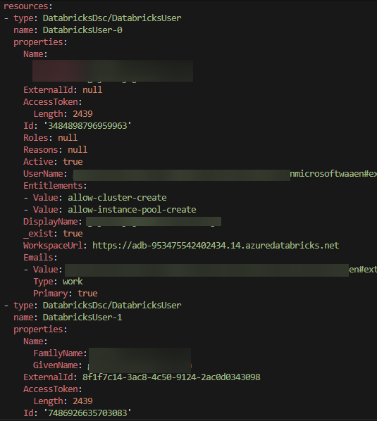

You've just joined a new company and your first task is to set up a development environment that mirrors production. The Databricks workspace has a lot of configuration, ranging from dozens of users, groups, service principals, and secret scopes. 

All configured over months of careful work without automation. How do you capture all of that? Are you going to click through the UI? Parse API responses with custom scripts? Or even worse, ask your fresh new colleagues what they configured six months ago?

Whilst my heart always goes to "automation first", I've encountered the same. But what if I told you there's now a command that captures your Databricks configuration as code? 

That's precisely what the new <code>Export</code> functionality in <code>DatabricksDsc</code> makes possible. And I wish I'd had it developed back then. 

In this blog post, you will learn all about it.
<h2 id="prerequisites">Prerequisites</h2>
If you want to try it out for yourself, you're going to need:
<ul><li>An Azure Databricks instance.</li><li><a href="https://www.powershellgallery.com/packages/DatabricksDsc/"><code>DatabricksDsc</code> PowerShell module</a> v0.6.0 or above.</li><li><a href="https://github.com/PowerShell/DSC/releases">Microsoft DSC v3.2.0-preview.9</a> or above.</li></ul><h2 id="the-export-challenge-in-powershell-dsc">The export challenge in PowerShell DSC</h2>
For years, PowerShell Desired State Configuration (DSC) has been developed, and it has been the go-to solution for Windows administrators managing infrastructure as code. You define the desired state, and DSC matches that configuration. 

But there's always been a gap.

You were able to retrieve a current instance using the <code>Get</code> operation. But that's for a single instance. What if you wanted multiple instances, say <em>all </em>users from your Databricks instance? 

Traditional PSDSC never provided a native export capability. If you wanted to document an existing configuration, you would need to create a custom script to parse the output and construct your DSC configuration document. 

Microsoft's DSC changes this.
<h2 id="microsoft-dsc-and-the-export-command">Microsoft DSC and the export command</h2>
Microsoft's DSC team introduced a proper <code>export</code> command. This wasn't just an incremental improvement. It was a fundamental shift in how we think about configuration management, driven by a partnership with the WinGet team.

WinGet faced similar challenges in the application configuration landscape. WinGet needed a way to export current application states, and, together with the DSC team, they built a generalized export capability that benefited not only WinGet but also the entire configuration management ecosystem.

What does it have to do with the <code>DatabricksDsc</code> module? This means every resource can implement a static <code>Export()</code> method that discovers existing resources and returns them as ready-made objects. You instantly get documentation and reproducibility in a single command. Let's take a look.
<h2 id="using-dscs-engine-to-export-resources">Using DSC's engine to export resources</h2>
The most straightforward way to export resources is using the <code>dsc.exe</code> command-line tool. This approach gives you native YAML or JSON output that integrates directly with DSC configuration workflows.

Before we can export resources, we need to identify which resources support exporting. To do so, you can run the following command:
<pre><code class="language-powershell">dsc resource list | 
  ConvertFrom-Json |
  Where-Object {$_.type match 'DatabricksDsc*' -and $_.capabilities -contains @('export')}</code></pre>
The output:
<pre><code class="language-plaintext">type            : DatabricksDsc/DatabricksAccountMetastoreAssignment                                                                                                           
kind            : resource
version         : 0.6.0
capabilities    : {get, test, set, export}
path            : C:\Program Files\PowerShell\Modules\DatabricksDsc\0.6.0\DatabricksDsc.psm1
description     : This module contains class-based DSC resources for Databricks and Unity Catalog with a focus on Azure.
directory       : C:\Program Files\PowerShell\Modules\DatabricksDsc\0.6.0
implementedAs   : 1
author          : 
properties      : {WorkspaceUrl, AccessToken, Reasons, AccountsUrl…}
requireAdapter  : Microsoft.DSC/PowerShell
target_resource : 
manifest        : &#10;
type            : DatabricksDsc/DatabricksAccountWorkspacePermissionAssignment
kind            : resource
version         : 0.6.0
capabilities    : {get, test, set, export}
path            : C:\Program Files\PowerShell\Modules\DatabricksDsc\0.6.0\DatabricksDsc.psm1
description     : This module contains class-based DSC resources for Databricks and Unity Catalog with a focus on Azure.
directory       : C:\Program Files\PowerShell\Modules\DatabricksDsc\0.6.0
implementedAs   : 1
author          : 
properties      : {WorkspaceUrl, AccessToken, Reasons, AccountsUrl…}
requireAdapter  : Microsoft.DSC/PowerShell
target_resource : 
manifest        : &#10;
# truncated</code></pre>
Now, imagine you want to export all current users in your instance. You can run the following command:
<pre><code class="language-powershell">$workspaceUrl = '&lt;workspaceUrl&gt;' # Replace with your workspace
$accessToken = '&lt;accessToken&gt;'
$jsonInput = @{workspaceUrl = $workspaceUrl; accessToken = $accessToken} | ConvertTo-Json&#10;
dsc resource export --resource DatabricksDsc/DatabricksUser --input $jsonInput</code></pre><figure class="kg-card kg-image-card kg-card-hascaption"><figcaption>Figure 1: Export output result</figcaption></figure><h2 id="exporting-to-a-file">Exporting to a file</h2>
If you want to export the results to a file so you can apply them to another instance, you can redirect to a file:
<pre><code class="language-powershell">dsc resource export --resource DatabricksDsc/DatabricksUser --input $jsonInput --output-format yaml &gt; databricks-users.dsc.config.yaml</code></pre>
Of course, there's a small gotcha here. Not all properties are configurable or are returned differently. For example, it doesn't make sense to set the <code>Id</code> property, and the <code>AccessToken</code> requires to be parsed as plaintext (not the <code>Length</code> property you see in the image above). For the rest, after you've scratched up the document with these properties, you can apply it to a different instance using <code>dsc resource set</code>.
<h2 id="exporting-multiple-resource-types">Exporting multiple resource types</h2>
You can export different resource types and eventually combine them into one big document:
<pre><code class="language-powershell"># Export groups
dsc resource export --resource DatabricksDsc/DatabricksGroup --input $jsonInput --output-format YAML &gt; databricks-groups.dsc.yaml&#10;
# Export secret scopes
dsc resource export --resource DatabricksDsc/DatabricksSecretScope --input $jsonInput --output-format YAML &gt; databricks-scopes.dsc.yaml&#10;
# Export secrets (metadata only - values are not returned by API)
dsc resource export --resource DatabricksDsc/DatabricksSecret --input $jsonInput --output-format YAML &gt; databricks-secrets.dsc.yaml
</code></pre>
All three commands create separate documents. If you want to combine them into one big document, you can now.

💡

If you prefer JSON over YAML, don't add the <code spellcheck="false" style="white-space: pre-wrap;">--output-format</code> flag.

<h2 id="how-export-works-in-databricksdsc">How export works in DatabricksDsc</h2>
Under the hood, <code>DatabricksDsc</code> implements export functionality across its resources. Each resource class includes a static <code>Export()</code> method that:
<ol><li>Connects to your Databricks instance (or account).</li><li>Queries the relevant APIs to discover all existing resources.</li><li>Returns an array of configured resource instances.</li></ol>
It's also possible to use a filter. For example, if you only want to return a subset of active users, you can add the <code>Active</code> property:
<pre><code class="language-powershell"># Rebuild JSON input
$jsonInput = @{workspaceUrl = $workspaceUrl; accessToken = $accessToken; Active = $true} | ConvertTo-Json&#10;
dsc resource export --resource DatabricksDsc/DatabricksUser --input $jsonInput</code></pre>
The static <code>Export()</code> method will use a filtered properties list to search for active users and return the result to DSC's engine.
<h2 id="conclusion">Conclusion</h2>
If you were on a tight deadline to spin up a fresh Databricks instance, you now have the power to do it easily. And the most beautiful part about it is that it is completely reproducible and repeatable. 

As the module continues to grow, more resources will gain the <code>Export</code> capability. But even today, you can document users, groups, service principals, secret scopes, and secrets (to a limited extent). This is true 9 out of 10 times for the foundation of any Databricks instance. 

For more information, visit the <a href="https://github.com/Gijsreyn/DatabricksDsc">DatabricksDsc GitHub repository</a> and check out the examples in the documentation.

