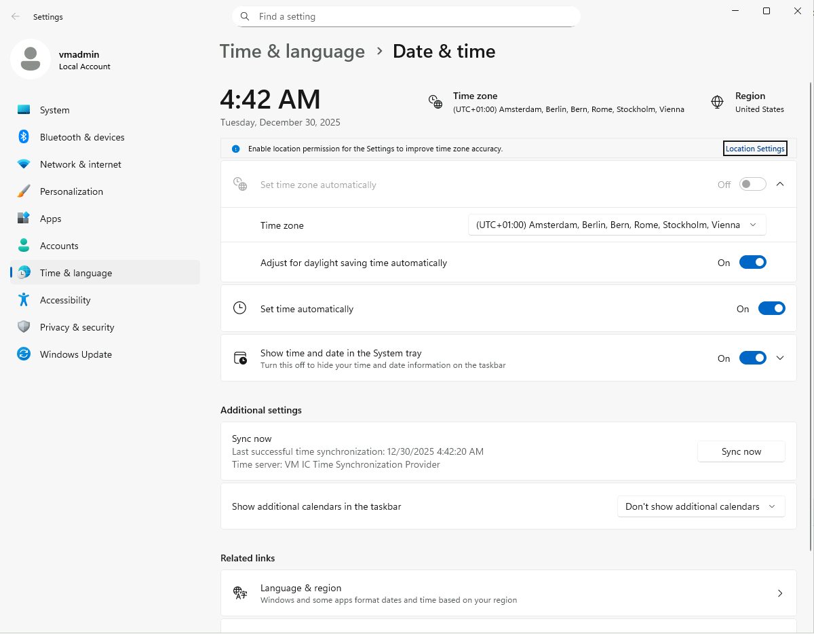
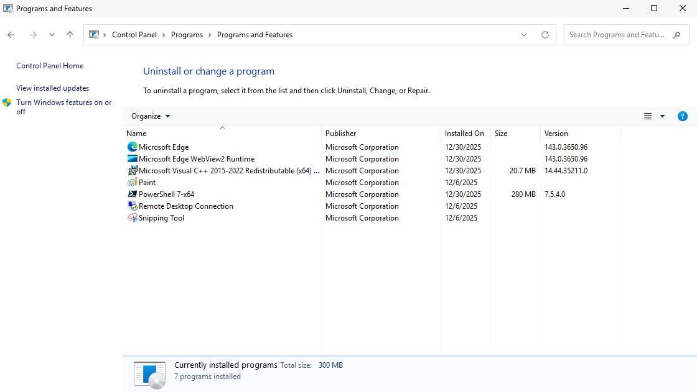

Windows Server 2025 comes preinstalled with WinGet, reducing another prerequisite in the automation steps.

<em>Or does it?</em>

After trying everything under my local account, things looked pretty smooth. The process got fully automated for what I wanted to achieve:
<ul><li>Upgrade to the latest WinGet version.</li><li>Install Microsoft DSC.</li><li>Perform post-configuration, such as setting the time zone, and install PowerShell 7</li></ul>
But here's the kicker: when you want to automate the process on Azure fully, you should simply be able to use the "RunPowerShellScript" task, crank out a couple of lines of PowerShell code, and it should be good to go.

Unfortunately, this was <em>not the case</em>.

Reviewing my approach, I realized that a couple of workarounds were needed. And in this blog post, I'll share everything about it.
<h2 id="prerequisites">Prerequisites</h2>
If you feel strong about it and you want to follow along, you need:
<ul><li>An active Azure subscription</li><li>The <code>Az</code> PowerShell module installed (v15.0.0 or above)</li><li>Bicep installed (v0.38.4 or above)</li><li>Git installed</li></ul><h2 id="creating-the-azure-vm">Creating the Azure VM</h2>
Before you can actually configure <em>anything</em>, you'll need an Azure VM. I didn't want to spend much time developing my own Bicep code, and that's why we'll be using the <code>avm-bicep-labs</code> repository to easily spawn up the required resources.

Follow the steps below to clone the repository, update the VM image to use Windows Server 2025, and deploy it using Azure PowerShell:
<ol><li>Open a PowerShell terminal prompt and clone the repo:</li></ol><pre><code class="language-powershell">git clone https://github.com/Azure-Samples/avm-bicep-labs.git</code></pre><ol start="2"><li>Find the Windows Server 2025 marketplace SKU for your region (this example uses <code>westeurope</code>)</li></ol><pre><code class="language-powershell">Get-AzVMImageSku -Location westeurope `
  -PublisherName MicrosoftWindowsServer `
  -Offer WindowsServer</code></pre><ol start="3"><li>Edit the Bicep module <code>lab02\childModules\workload.bicep</code> and update the <code>imageReference</code> property under the VM resource:</li></ol><pre><code class="language-bicep">imageReference: {
	publisher: 'MicrosoftWindowsServer'
	offer:    'WindowsServer'
	sku:      '&lt;YOUR-SKU-HERE&gt;'
	version:  'latest'
}</code></pre><ol start="4"><li>Authenticate with Azure and deploy using Azure PowerShell:</li></ol><pre><code class="language-powershell">Connect-AzAccount
New-AzDeployment -Location &lt;location&gt; `
  -TemplateFile lab02\main.bicep `
  -DeploymentName dscdemo</code></pre><blockquote>You will be prompted to fill in a password for the Azure VM. Store this for later.</blockquote>
The deployment takes roughly 10 minutes because of Azure Bastion. After the deployment finishes, go to the Azure Portal and locate your newly created VM. From there, you can <a href="https://learn.microsoft.com/en-us/azure/bastion/bastion-connect-vm-rdp-windows">connect using Azure Bastion</a>.
<h2 id="debunking-winget-installation">Debunking WinGet installation</h2>
As mentioned in the introduction, WinGet comes preinstalled with Windows Server 2025. This only applies to local user accounts. Whenever you try to run WinGet under the <code>System</code> context, it cannot find it.

That begs the question, why do you want to run under the <code>System</code> context?

If you want to automate the process fully, you can leverage the <code>Invoke-AzVMRunCommand</code> command. But this command runs under the <code>NT AUTHORITY\SYSTEM</code> account, and there are a couple of issues with this:
<ul><li>WinGet needs to be reinstalled under this context</li><li>It requires <code>dsc.exe</code> installed and discoverable</li><li>PowerShell modules require preinstallation</li></ul>
Luckily, a couple of folks already figured out how to get WinGet working properly under this context. With some slight modification, it can be executed after the VM has been created:
<ol><li>Create a new file named <code>bootstrap.ps1</code></li><li>Add the following code snippet, replace the placeholder values, and save the file:</li></ol><pre><code class="language-powershell">$scriptBlock = {
    # Bootstrap package provider for NuGet
    Install-PackageProvider -Name NuGet -MinimumVersion 2.8.5.201 -Force&#10;
    # Install Visual C++ Redistributable and WinGet
    $downloadurl = 'https://aka.ms/vs/17/release/vc_redist.x64.exe'
    $WebClient = New-Object System.Net.WebClient
    $WebClient.DownloadFile($downloadurl, "$env:Temp\vc_redist.x64.exe")
    $WebClient.Dispose()
    $Install = start-process "$env:temp\vc_redist.x64.exe" -argumentlist "/q /norestart" -Wait -PassThru
    $7zipFolder = "${env:WinDir}\Temp\7zip"
    New-Item -ItemType Directory -Path "${env:WinDir}\Temp\WinGet-Stage" -Force
    Invoke-WebRequest -UseBasicParsing -Uri https://aka.ms/getwinget -OutFile "${env:WinDir}\Temp\WinGet-Stage\Microsoft.DesktopAppInstaller_8wekyb3d8bbwe.msixbundle"
    New-Item -ItemType Directory -Path $7zipFolder -Force
    Invoke-WebRequest -UseBasicParsing -Uri https://www.7-zip.org/a/7zr.exe -OutFile "$7zipFolder\7zr.exe"
    Invoke-WebRequest -UseBasicParsing -Uri https://www.7-zip.org/a/7z2408-extra.7z -OutFile "$7zipFolder\7zr-extra.7z"
    &amp; "$7zipFolder\7zr.exe" x "$7zipFolder\7zr-extra.7z" -o"$7zipFolder" -y
    New-Item -ItemType Directory -Path "${env:ProgramData}\Microsoft.DesktopAppInstaller" -Force
    &amp; "$7zipFolder\7za.exe" x "${env:WinDir}\Temp\WinGet-Stage\Microsoft.DesktopAppInstaller_8wekyb3d8bbwe.msixbundle" -o"${env:WinDir}\Temp\WinGet-Stage" -y
    &amp; "$7zipFolder\7za.exe" x "${env:WinDir}\Temp\WinGet-Stage\AppInstaller_x64.msix" -o"${env:ProgramData}\Microsoft.DesktopAppInstaller" -y&#10;
    # Add to current session PATH
    $env:Path += [System.IO.Path]::PathSeparator + "${env:ProgramData}\Microsoft.DesktopAppInstaller"&#10;
    # Install Microsoft DSC
    $uri = 'https://github.com/PowerShell/DSC/releases/download/v3.2.0-preview.10/DSC-3.2.0-preview.10-x86_64-pc-windows-msvc.zip'
    $tmpDir = [System.IO.Path]::GetTempPath()
    $zipPath = Join-Path $tmpDir 'DSC-3.2.0-preview.10-x86_64-pc-windows-msvc.zip'
    $installPath = Join-Path $env:LOCALAPPDATA 'dsc'
    (New-Object Net.WebClient).DownloadFile($uri, $zipPath)
    Expand-Archive -LiteralPath $zipPath -DestinationPath $installPath -Force
    # Add to current session PATH
    $env:PATH += [System.IO.Path]::PathSeparator + $installPath
    # Unblock extracted files
    Get-ChildItem -Path $installPath -Recurse | Unblock-File&#10;
    # Create a WinGet DSC configuration file
    $string = @'
$schema: https://raw.githubusercontent.com/PowerShell/DSC/main/schemas/2023/08/config/document.json
metadata:
  winget:
    processor: dscv3
resources:
  - name: Install PowerShell
    type: Microsoft.WinGet/Package
    properties:
      id: Microsoft.PowerShell
      source: winget
  - name: Time zone
    type: ComputerManagementDSC/TimeZone
    properties:
      IsSingleInstance: "Yes"
      TimeZone: "W. Europe Standard Time"
'@&#10;
    $configPath = Join-Path -Path $env:TEMP -ChildPath 'configuration.winget'
    Set-Content -Value $string -Path $configPath&#10;
    # Install PowerShell modules
    Install-Module -Name ComputerManagementDSC -Repository PSGallery -Scope AllUsers -Force&#10;
    # Execute WinGet
    winget configure --file $configPath --processor-path (Join-Path $installPath 'dsc.exe') --accept-configuration-agreements --suppress-initial-details
}&#10;
$script = [scriptblock]::create($scriptBlock)
Invoke-AzVMRunCommand -ResourceGroupName '&lt;resourceGroupName&gt;' -VMName '&lt;vmName&gt;' -CommandId 'RunPowerShellScript' -ScriptString $script&#10;
</code></pre><ol start="3"><li>Open your PowerShell terminal and run the script: <code>.\bootstrap.ps1</code></li></ol>
What this script does:
<ul><li>It bootstraps the NuGet package provider for PowerShell</li><li>Downloads and installs Visual C++ Redistributable and WinGet</li><li>Installs Microsoft DSC</li><li>Installs required PowerShell modules</li><li>Uses the <code>--processor-path</code> to detect <code>dsc.exe</code></li><li>Execute <a href="https://learn.microsoft.com/en-us/windows/package-manager/winget/configure"><code>winget configure</code></a> to appy the configuration document</li></ul>
The script takes a little while, but after it is completed, notice the time zone changed:
<figure class="kg-card kg-image-card kg-card-hascaption"><figcaption>Figure 1: Time zone set to West Europe</figcaption></figure>
If you look at the installed software, you notice PowerShell is successfully installed:
<figure class="kg-card kg-image-card kg-card-hascaption"><figcaption>Figure 2: PowerShell installed on Azure VM</figcaption></figure><h2 id="summary">Summary</h2>
Whilst WinGet comes preinstalled with Windows Server 2025, you just learned the nitty-gritty things to get it working under a different context. This becomes useful when you want to <em>fully </em>automate the process after the VM is created.

More post-configuration steps can be added in the bootstrap script. But don't forget to install the required PowerShell modules if you're using different ones.

After you are done, don't forget to clean up the resources:
<pre><code class="language-powershell">Remove-AzResourceGroup -Name "&lt;workloadResourceGroup&gt;" -ForceDeletionType "Microsoft.Compute/virtualMachines"
Remove-AzResourceGroup -Name "&lt;resourceGroup&gt;</code></pre>
