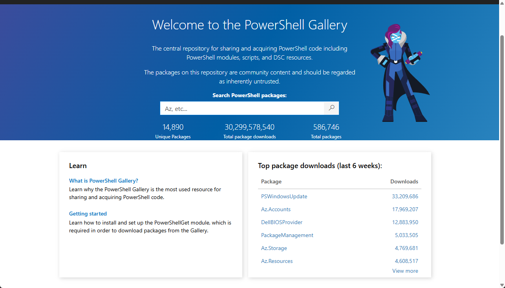
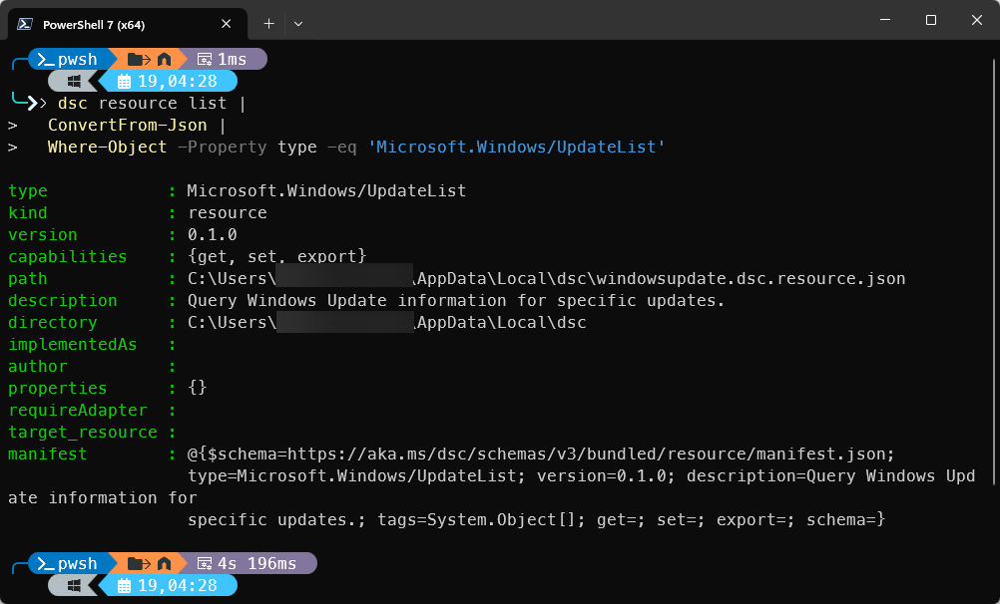
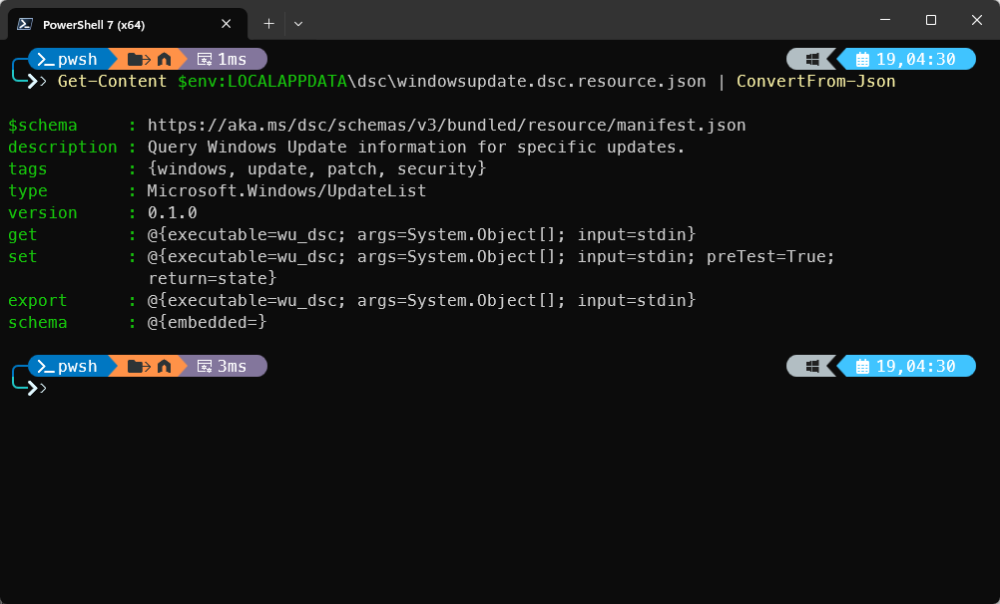
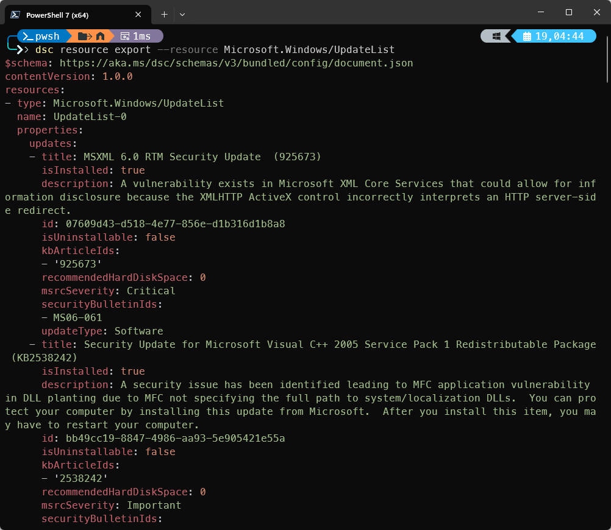
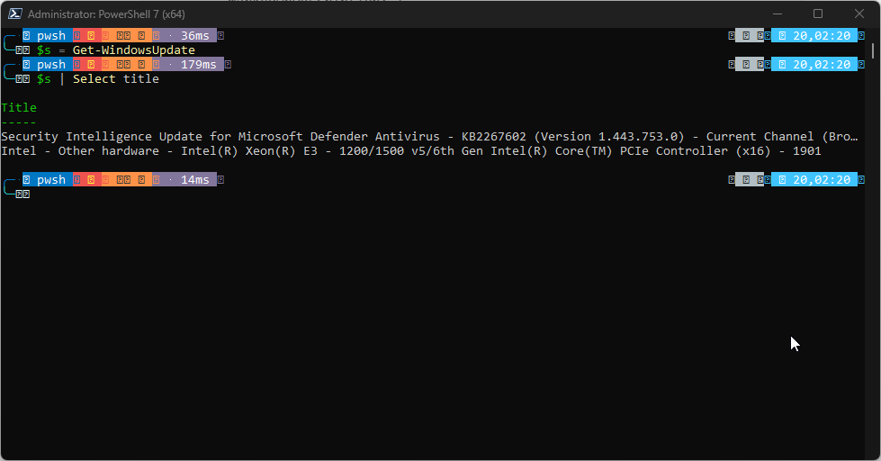
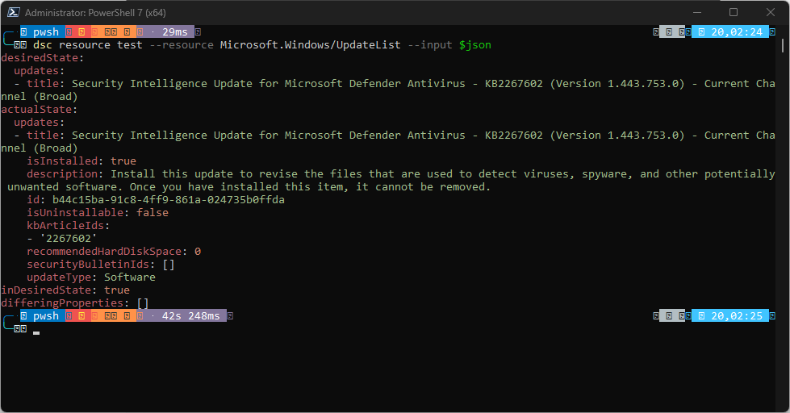

What's one of the most popular PowerShell modules used today? Well, if we look at the statistics, there's one that shines above all:
<figure class="kg-card kg-image-card"></figure>
Ever since PSWindowsUpdate launched, it has become one of the go-to modules for individual admins who didn't have big orchestration tools to update Windows machines at scale. Or just for ease of use when setting up a new machine, like my fellow MVP friend Harm demonstrated in his <a href="https://powershellisfun.com/2024/01/19/using-the-powershell-pswindowsupdate-module/"><strong>blog post</strong></a>.

But there might be a new way of thinking about Windows updates. One that isn't meant to replace PSWindowsUpdate, just about describing Windows Updates as part of your machine's Desired State Configuration (DSC).

In Microsoft DSC's preview.11 release, a new <em>command-based DSC resource</em> is shipped called <code>Microsoft.Windows/UpdateList</code>.

This blog post quickly covers the new DSC resource and shows a different lens of managing Windows Updates.
<h2 id="what-is-microsoftwindowsupdatelist">What is Microsoft.Windows/UpdateList?</h2>
I could already hear you thinking: command-based DSC resource? For newcomers to DSC, this is a new concept introduced in Microsoft DSC. It's basically just an executable adhering to the DSC's engine contract how to execute the <code>Get-Test-Set</code> pattern from its predecessor (PowerShell DSC).

That executable, in this case, is shipped whenever you install Microsoft DSC. To see this in action, you can use a PowerShell module to install <code>dsc.exe</code> and then discover the resource:
<pre><code class="language-powershell">Install-PSResource -Name PSDSC&#10;
# Install the latest prerelease version
Install-DscExe -IncludePreRelease&#10;
# List out the UpdateList resource
dsc resource list | 
  ConvertFrom-Json |
  Where-Object -Property type -eq 'Microsoft.Windows/UpdateList'</code></pre><figure class="kg-card kg-image-card kg-card-hascaption"><figcaption>Figure 1: Microsoft.Windows/UpdateList resource</figcaption></figure>
If you now run: <code>Get-Content $env:LOCALAPPDATA\dsc\windowsupdate.dsc.resource.json | ConvertFrom-Json</code>, you reveal the underlying executable <code>wu_dsc.exe</code>.
<figure class="kg-card kg-image-card kg-card-hascaption"><figcaption>Figure 2: The 'wu_dsc.exe' executable</figcaption></figure>
With this new resource, you declare intent, not the steps you might do when using PSWindowsUpdate. For example, you state the updates that should be installed, not "Run Windows Update now."
<h2 id="the-crucial-distinction">The crucial distinction</h2>
Again, the resource introduced in Microsoft DSC isn't there to replace PSWindowsUpdate. Instead, it's introduced to give you a different lens through which to view. PSWindowsUpdate is great for:
<ul><li>Scheduled patching (through task scheduler or any other tool)</li><li>One-off remediations when you spawn up a new Windows machine</li><li>Quick reporting </li></ul>
But it's inherently procedural. 

With the <code>Microsoft.Windows/UpdateList</code> DSC resource, it fundamentally answers the question:
<ol><li>"Is this system compliant with its update state?"</li><li>Can I re-run this safely, not once, but many times?</li></ol>
DSC is more about what must be true when configurations mingle, not about when updates <em>should </em>run.
<h2 id="a-quick-demo">A quick demo</h2>
Knowing the distinction between the two, it's time to look at a demo and use both the DSC resource and the PSWindowsUpdate module together. But first, let's see what happens when we attempt to export the available updates from the system using the <code>export</code> command:
<pre><code class="language-powershell">dsc resource export --resource Microsoft.Windows/UpdateList</code></pre>
This returned the currently installed Windows Updates on my machine:
<figure class="kg-card kg-image-card kg-card-hascaption"><figcaption>Figure 3: Exported Windows updates</figcaption></figure>
I now have a list of updates that I can extract and store in a DSC configuration document if I want to. If you extract the content, you can apply it to a different machine and have it perfectly mimic the same updates.

To apply a Windows Update, we need to know what input is required. To find this, you can use the <code>dsc resource schema</code> command:
<pre><code class="language-powershell">dsc resource schema --resource Microsoft.Windows/UpdateList</code></pre>
Output:
<pre><code class="language-yaml">$schema: http://json-schema.org/draft-07/schema#
$id: https://raw.githubusercontent.com/PowerShell/DSC/main/schemas/resources/Microsoft.Windows/UpdateList/v0.1.0/schema.json
title: Windows Update List
description: |
  Query information about Windows Updates.&#10;
  https://learn.microsoft.com/powershell/dsc/reference/microsoft.windows/updatelist/resource
markdownDescription: |
  The `Microsoft.Windows/UpdateList` resource enables you to query information about Windows Updates using the Windows Update Agent COM APIs.&#10;
  [Online documentation][01]&#10;
  [01]: https://learn.microsoft.com/powershell/dsc/reference/microsoft.windows/updatelist/resource
type: object
required:
- updates
additionalProperties: false
properties:
  updates:
    type: array
    title: Updates
    description: An array of update filters or update information objects.
    items:
      type: object
      additionalProperties: false
      properties:
        title:
          type: string
          title: Update title
          description: |
            The exact title of the Windows Update to search for (for get operation) or a title pattern with wildcards (* supported) for filtering (for export operation). Either title or id must be specified for get operation.&#10;
            https://learn.microsoft.com/powershell/dsc/reference/microsoft.windows/updatelist/resource#title
          markdownDescription: |
            The exact title of the Windows Update to search for (for get operation) or a title pattern with wildcards (* supported) for filtering (for export operation). Either title or id must be specified for get operation.&#10;
            [Online documentation][01]&#10;
            [01]: https://learn.microsoft.com/powershell/dsc/reference/microsoft.windows/updatelist/resource#title
        id:
          type: string
          title: Update ID
          description: |
            The unique identifier (GUID) for the Windows Update to search for (for get operation) or filter by (for export operation). Either title or id must be specified for get operation.&#10;
            https://learn.microsoft.com/powershell/dsc/reference/microsoft.windows/updatelist/resource#id
# Truncated
</code></pre>
To make it more readable, the input that is expected for the <code>set</code> capability will be:
<pre><code class="language-powershell">$json = @{
    updates = @(
        @{
            title = '&lt;title&gt;'                                
        }
    )
} | ConvertTo-Json -Depth 10 -Compress</code></pre>
We only need to know a title. By running <code>Get-WindowsUpdate</code> from the PSWindowsUpdate module, I found out that my Microsoft Defender definitions weren't up to date:
<figure class="kg-card kg-image-card kg-card-hascaption"><figcaption>Figure 4: Outdated updates</figcaption></figure>
I now executed the following command:
<pre><code class="language-powershell">$json = @{
    updates = @(
        @{
            title = 'Security Intelligence Update for Microsoft Defender Antivirus - KB2267602 (Version 1.443.753.0) - Current Channel (Broad)'
        }
    )
} | ConvertTo-Json -Depth 10 -Compress&#10;
dsc resource set --resource Microsoft.Windows/UpdateList --input $json</code></pre>
To test if the update actually was applied, I swapped the <code>set</code> for <code>test</code>:
<figure class="kg-card kg-image-card kg-card-hascaption"><figcaption>Figure 5: System is in desired state</figcaption></figure>
Perfect, my system is in the desired state and secure (again).
<h2 id="conclusion">Conclusion</h2>
The DSC resource is just fresh off the table, and the resource shows that Windows Updates can be declarative. Even without an orchestrator today for Microsoft DSC, the model can be important for a future control plane by reporting compliance. It also standardizes how updates can be described in configuration documents.

It's also the first time that we see Microsoft giving attention to Windows Updates with a new <em>declarative identity </em>for the first time. 

