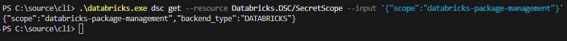

I needed to automate Databricks configuration at my work, and everyone around me naturally pointed at Terraform. A solid choice. It is already a proven technology and popular amongst many DevOps engineers.  But I didn't want to go that road. Not because Terraform is wrong, but because I'm biased towards Microsoft DSC (and know it pretty much by heart). So I did what any person with too much curiosity would do: I built my own PowerShell module.  <a href="https://github.com/Gijsreyn/DatabricksDsc">DatabricksDsc</a> was born.  From the beginning, I tried to respect the new Microsoft DSC semantics. I wanted my module to feel like it was native to <code>dsc.exe</code>. Not just simply API calls with PowerShell syntax (even though it was). The first versions worked. It was usable, and it solved the problems I had.  And yet... something still didn't sit right with me.  I've been spending a long time on the DSC project, and I know where it's going. Whilst I could have produced a resource manifest alongside the published module, I didn't. I relied on the adapter. That got me thinking. I knew that the future wasn't just PowerShell modules anymore. Microsoft DSC evolved so that you can now build a DSC resource in any programming language.  With that, existing executables could now implement <code>Get</code>, <code>Set</code>, <code>Test</code>, <code>Delete</code>, and <code>Export</code>... as long as they spoke the JSON contract. Then it hit me.  Databricks already has an executable (<code>databricks.exe</code>). The project is open source, so why was I still pretending this belonged in a PowerShell module?

So instead of asking <em>"How do I improve my PowerShell module?"</em>, it became: <em>"What would Databricks look like if Microsoft DSC were a first-class citizen inside <code>databricks.exe</code>?"</em>

And that's where the work started.

There was only one thing I had to admit first: <em>my model</em> of a DSC resource was still slightly stuck in the past because, for years, a DSC resource meant a PowerShell module. That model served in the old PowerShell DSC landscape, but, as I said, Microsoft DSC has moved on. And I still needed to catch up with it.

Before I could make Databricks speak DSC, I had to reframe what a DSC resource actually is. It isn't a PowerShell artifact, nor a module anymore. But it's a <em>contract</em>.
<h2 id="reframing-what-a-microsoft-dsc-resource-is">Reframing what a (Microsoft) DSC Resource is</h2>
A DSC resource with a PowerShell module (referring to PowerShell DSC) has a well-known folder structure, a schema based on the properties defined in <code>Get-TargetResource</code>, <code>Set-TargetResource</code>, and <code>Test-TargetResource</code>. That model shaped how many PowerShell DSC developers learned DSC. And yes, till this day, it still works brightly.

But Microsoft DSC redefined what a resource is in a different jacket.

It isn't tied to PowerShell at all. It is command-based, meaning, at its core, it is just an executable that understands how to perform operations like those mentioned in the introduction. And the trick here is, they can communicate using a well-defined JSON contract. The language behind it becomes implementation details, not requirements.

DSC doesn't really care anymore <em>what </em>the resource actually is, meaning a compiled binary, a shell script, or even a CLI tool that already exists. As long as it's discoverable in the <em>PATH </em>and returns, for example, the right exit codes combined with a <a href="https://learn.microsoft.com/en-us/powershell/dsc/concepts/resources/anatomy?view=dsc-3.0#dsc-resource-manifests">resource manifest</a>, DSC can call and orchestrate it.

The resource manifest brings it all together. It defines how input flows—via JSON over stdin, a JSON argument, or traditional command-line flags—depending on what fits the operation best. This is precisely what makes the Microsoft DSC platform-agnostic: resources are now contracts that any executable can implement.

This is precisely what makes the Microsoft DSC engine platform-agnostic. They're now contracts that any executable can implement.
<h2 id="why-databricksexe-became-the-obvious-place">Why databricks.exe became the "obvious place"</h2>
Having my head wrapped around DSC as a <em>contract</em>, I could have continued building another layer on top of PowerShell and produced that contract in DatabricksDsc. But I wasn't really building for myself anymore as I already open-sourced it. 

I wanted to challenge myself and take it one step further: the <a href="https://github.com/databricks/cli">Databricks CLI</a> project on GitHub.

The Databricks CLI project already existed (for a long time). It already had the core functionality I needed:
<ul><li>Managing users and groups</li><li>Creating secret scopes and secrets</li><li>Access control lists</li><li>And more...</li></ul>
When you install the CLI on Windows through WinGet (for example), it will be added to the PATH environment variable. All the pieces started to click. I didn't need to wrap this CLI as with a PowerShell DSC resource. I only needed it to teach and speak DSC natively.

The beauty of this approach became obvious to me. There's no need for my extra module, and it doesn't need to go through an adapter. It's just a single executable for both CLI workflows and <em>DSC automation.</em> The executable itself became the resource.

At that moment, my experiment already with DatabricksDsc turned into another opportunity: to implement Microsoft DSC capabilities into the Databricks CLI itself, making it natively and future-proof.
<h2 id="teaching-an-executable-to-speak-dsc">Teaching an executable to speak DSC</h2>
Once my stubborn head couldn't let go of the idea, I decided <code>databricks.exe</code> would be the home for DSC. The challenge: <em>how do I actually teach an executable to behave like a DSC resource</em>?

That's where I started small. I picked two resource areas to focus on. The <strong>Users </strong>and <strong>Secrets</strong> (including secret scopes and ACLs). These areas are mostly foundational to most Databricks configurations as they touch upon security and identity, and were just a little complex enough to validate my design thinking. 

I explored several designs. My first design separated commands per resource. It would look something like <code>databricks dsc secret get</code>. In my head, it could work. But it would be better for DSC to expect a single executable with arguments specifying the <em>resource type</em>. That's where I borrowed the same idea my fellow DSC buddy Thomas Nieto already implemented: add a <code>--resource</code> flag, allowing the manifest to specify operations like:
<pre><code class="language-json">["dsc", "get", "--resource", "Databricks.DSC/Secret", {"jsonInputArg": "--input"}]
</code></pre>
DSC will then understand it natively. Input will flow naturally via <code>--input</code>, accepting JSON directly from stdin, matching the <code>jsonInputArg</code> pattern.

From there onwards, it became straightforward to add new resources for the future. Each resource is a single file implementing a <code>ResourceHandler</code> interface with the relevant operations (<code>Get</code>, <code>Set</code>, etc...).

By the end of this design exercise, it became clear to me. The executable wasn't just a helper for DSC – it could fully define and implement the resource itself. That means the executable controls the operations, handles the input and output, and returns meaningful exit codes. All in one place.
<h2 id="the-pull-request-moment">The pull request moment</h2>
After the design exercise, I was exploding of excitement. But there was a practical challenge. I'm far from a Go programmer. I know my way around PowerShell and a little Python, but Databricks' CLI is written in Go. 

I leaned heavily on AI tools to help generate and boilerplate the design. The AI couldn't fully write the story for me. I still had to design the operations and try to understand the patterns. Eventually, I was able to teach it how the JSON input should flow, how to output JSON, and how to generate the contracts (JSON Schema).

Once I was able to implement the <code>Databricks.DSC/Users</code> and <code>Databricks.DSC/Secrets</code> resource, I tested it with DSC. That would now look like:
<pre><code class="language-bash"># Secret
dsc resource get --resource Databricks/Secret --input '{"scope":"my-scope","key":"my-key"}'&#10;
# SecretScope
dsc resource get --resource Databricks/SecretScope --input '{"scope":"my-scope"}'&#10;
# SecretAcl
dsc resource get --resource Databricks/SecretAcl --input '{"scope":"my-scope", "principal":"users"}'</code></pre>
Did it work? Of course it did. 
<figure class="kg-card kg-image-card kg-card-hascaption"><figcaption>Figure 1: Calling <code spellcheck="false" style="white-space: pre-wrap;">get</code> on SecretScope</figcaption></figure>
And now it was time to take it to the next step. That little nerve-racking one: open up a pull request on the Databricks CLI GitHub repository. Why was it nerve-racking, even though I have opened up more than 100+ pull requests on the DSC project? Well, my code now sits there, publicly available for everyone to see. I have no control over it. I don't know if it is going to be accepted, and it's an experimental, AI-assisted DSC integration put into the hands of the maintainers.

And now... <em>we</em> wait.
<h2 id="will-it-get-merged">Will it get merged?</h2>
I never know. All I could do is wait. But there was also time to reflect. Since 2024, I've been actively involved in open source projects, and it has taught me two things for sure.

The first one is patience. Open source always moves on its own timeline (and priority). A pull request doesn't merge because <em>I</em> want it to. It only merges when it's ready and understood by others. Learning to let go of this is sometimes hard because you (and I) have spent enough time working on it. 

The second thing is that contributions are seeds for ideas. These ideas grow into something bigger, or they fade into the abyss. But nine out of ten times it starts a conversation. And that conversation explores more possibilities and sees if it is going to stick.

The good thing? Even if this <a href="https://github.com/databricks/cli/pull/4349">particular PR</a> never gets merged, it has already done one job for me: it pushed my boundaries of what I thought was possible. And it taught me a little Go if I was glancing at it.

That brings me to a final punch line:
<blockquote>"In open source, the journey is just as valuable as the merge."</blockquote>
