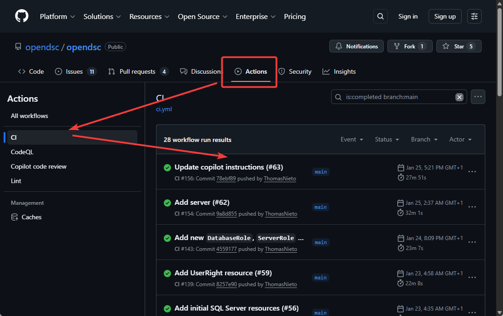
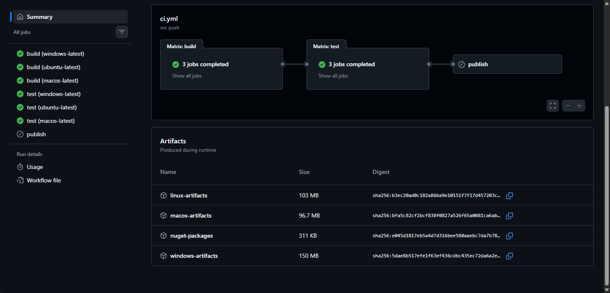
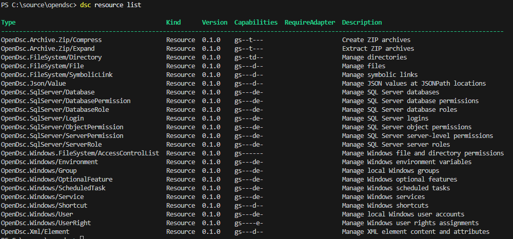
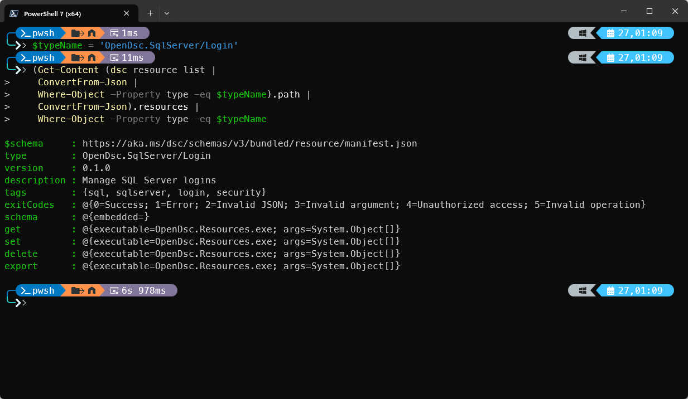
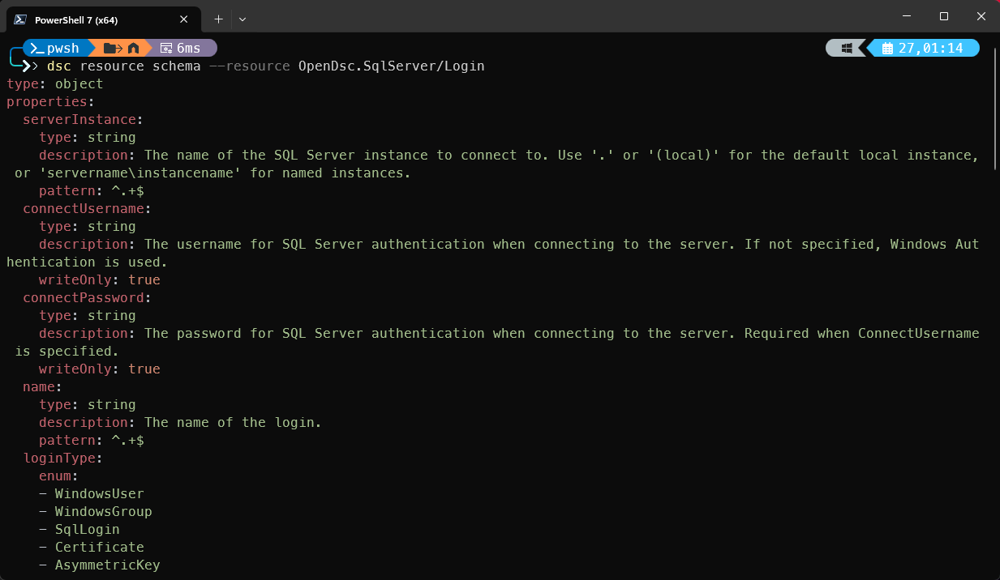
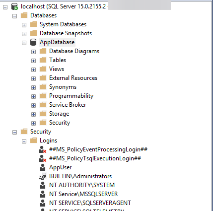

If there's one DSC resource that survived the dawn of time, it's definitely <a href="https://github.com/dsccommunity/SqlServerDsc/tree/main">SqlServerDSC</a>. It has served many organizations to automate SQL Server installations using PowerShell Desired State Configuration (DSC).
<blockquote>But time never stands still. And with time, platforms evolve</blockquote>
That change came with the launch of Microsoft DSC. Whilst it can still run SQL Server DSC resources through its adaptive model, expanding the capabilities means rewriting every DSC resource, at least to class-based DSC resources. Let alone can it take full advantage of the new "command-based" DSC resource model.

It was time for a change.

This is where the <a href="https://github.com/opendsc/opendsc">OpenDsc project</a> comes in. OpenDsc provides a .NET development kit and a growing collection of native Microsoft DSC resources. These include a new set of resources targeted to configure and automate SQL Server. The difference? Resources are shipped as executables, rather than PowerShell modules.

Same mission, same idempotency, but with a "modern jacket."

The <a href="https://github.com/opendsc/opendsc">OpenDsc project</a> contains a .NET development kit and, in this case, new DSC resources targeted to configure and automate SQL Server installations. Let's dive into how these resources can help you manage SQL Server in an idempotent way using Microsoft DSC.
<h2 id="a-shift-in-how-resources-are-built">A shift in how resources are built</h2>
Microsoft DSC does <em>things </em>differently compared to PowerShell DSC. You don't have PowerShell modules anymore, no functions, or a runtime that executes the resources through PowerShell. 

No...

It simply introduces a basic, but powerful idea: a DSC resource as executable with a well-defined (JSON) contract. This resource doesn't have to be written in PowerShell (even though it can), but you can use .NET, Rust, Bash, or whatever you like. As long as it complies with that contract.

Now I could talk for hours about this, but we're here for SQL Server. <code>OpenDsc.SqlServer</code> delivers these resources in this jacket. Each resource is an executable with this contact. It has the same domain knowledge and automation goals as <code>SqlServerDsc</code>. But the difference is that it's packaged as a first-class citizen for Microsoft DSC's engine.

The following resources are already available to be tested out:
<ul><li><code>OpenDsc.SqlServer/Login</code> - Manage SQL Server logins</li><li><code>OpenDsc.SqlServer/Database</code> - Manage SQL Server databases</li><li><code>OpenDsc.SqlServer/DatabaseRole</code> - Manage SQL Server database roles</li><li><code>OpenDsc.SqlServer/ServerRole</code> - Manage SQL Server server roles</li><li><code>OpenDsc.SqlServer/DatabasePermission</code> - Manage SQL Server database permissions</li><li><code>OpenDsc.SqlServer/ServerPermission</code> - Manage SQL Server server permissions</li><li><code>OpenDsc.SqlServer/ObjectPermission</code> - Manage SQL Server object permissions</li><li>And more to come...</li></ul>
That's the theory, but how do you actually get started? That's where it's going to be different compared to PowerShell. So let's move from concept to something tangible.
<h2 id="installing-and-using-opendscsqlserver">Installing and using OpenDsc.SqlServer</h2>
Normally, you would open your PowerShell module and type in: <code>Install-Module</code> or <code>Install-PSResource</code>. <code>OpenDsc.SqlServer</code> resources are distributed as versioned binaries through GitHub releases, or the latest versions can be grabbed from GitHub actions. In this case, there hasn't been an official release (yet) for the resources, so we can download them from the actions job.

What you would do is download the <code>.zip</code> file, or the format that is distributed for the operating systems (yes, resources can be cross-platform), extract it to your <code>PATH</code> environment variable, and you should be set to go. The step below to do so:
<ol><li>Go to the OpenDsc repository on GitHub</li><li>Locate the <em>Actions </em>tab and in the  list of workflows, select <em>CI</em></li><li>In the filters, select the <em>main </em>branch and pick the latest run</li></ol><figure class="kg-card kg-image-card kg-card-hascaption"><figcaption>Figure 1: Workflow run</figcaption></figure><ol start="4"><li>Download the <em>artifact </em>for your operating system</li></ol><figure class="kg-card kg-image-card kg-card-hascaption"><figcaption>Figure 2: Download artifact</figcaption></figure><ol start="5"><li>Extract the <code>.zip</code> file and add it to the <code>PATH</code> environment variable</li><li>Run <code>dsc resource list</code> in your shell to validate if the resources are found</li></ol><figure class="kg-card kg-image-card kg-card-hascaption"><figcaption>Figure 3: Discover OpenDsc resources</figcaption></figure><h2 id="discovering-resources-with-microsoft-dsc">Discovering resources with Microsoft DSC</h2>
Once the executables are extracted and part of your <code>PATH</code> variable, Microsoft DSC detects them automatically. No registration is needed or import required. If the executable exists and the resource manifest is located, <em>it is </em>participating.

Each of the resources you saw in Figure 3 is part of <em>one executable</em>. It's all packaged into one. Run the following command in a PowerShell terminal session to see this:
<pre><code class="language-powershell">$typeName = 'OpenDsc.SqlServer/Login'
(Get-Content (dsc resource list | 
    ConvertFrom-Json | 
    Where-Object -Property type -eq $typeName).path | 
    ConvertFrom-Json).resources | 
    Where-Object -Property type -eq $typeName
  </code></pre><figure class="kg-card kg-image-card kg-card-hascaption"><figcaption>Figure 4: Discover executable</figcaption></figure>
Okay, you know the DSC resource is an executable now. But how do we know the available properties? Can we run <code>Get-DscResource</code>? Not really, we're using a CLI, remember?

To see the available properties, run the following command: <code>dsc resource schema --resource OpenDsc.SqlServer/Login</code>
<figure class="kg-card kg-image-card kg-card-hascaption"><figcaption>Figure 5: List available properties</figcaption></figure>
The image is reduced, but if you've scrolled down, you've noticed the two required properties: <code>serverInstance</code> and <code>name</code>. To create an SQL Server login using this resource, you can create a configuration document:
<pre><code class="language-yaml"># sqlLogin.dsc.config.yaml
$schema: https://aka.ms/dsc/schemas/v3/bundled/config/document.json
resources:
- name: Configure parallelism settings
  type: OpenDsc.SqlServer/Login
  properties:
    serverInstance: localhost
    name: myLogin</code></pre>
And that's basically it. Then you would run <code>dsc config set --file sqlLogin.dsc.config.yaml</code> and the login will be created.
<h2 id="putting-it-all-together">Putting it all together</h2>
At this point, you know how to discover the resources and how to get the available properties. Now you can create a whole flow that starts from a database to setting secure permissions. Let's put it together:
<pre><code class="language-yaml"># database.dsc.config.yaml
$schema: https://aka.ms/dsc/schemas/v3/bundled/config/document.json&#10;
# Configuration metadata
metadata:
  description: SQL Server database configuration
  author: Gijs Reijn
  version: 1.0.0&#10;
# Parameters for reusable values
parameters:
  serverInstance:
    type: string
    defaultValue: "."
    description: SQL Server instance name (e.g., '.', 'localhost', 'server\instance')&#10;
# 1. Create Database (first, as foundation)
  - name: Create application database
    type: OpenDsc.SqlServer/Database
    properties:
      serverInstance: "[parameters('serverInstance')]"
      name: AppDatabase
      collation: SQL_Latin1_General_CP1_CI_AS
      recoveryModel: Full
      owner: sa&#10;
  # 2. Create SQL Server Login
  - name: Create application login
    type: OpenDsc.SqlServer/Login
    properties:
      serverInstance: "[parameters('serverInstance')]"
      name: AppUser
      loginType: SqlLogin
      password: "SecureP@ssw0rd123!"
      defaultDatabase: AppDatabase
      disabled: false
    dependsOn:
      - "[resourceId('OpenDsc.SqlServer/Database', 'Create application database')]"&#10;
  # 3. Create Windows Authentication Login
  - name: Create Windows login
    type: OpenDsc.SqlServer/Login
    properties:
      serverInstance: "[parameters('serverInstance')]"
      name: "BUILTIN\\Administrators"
      loginType: WindowsGroup
      defaultDatabase: master&#10;
  # 4. Create custom database role (without members for now)
  - name: Create application database role
    type: OpenDsc.SqlServer/DatabaseRole
    properties:
      serverInstance: "[parameters('serverInstance')]"
      databaseName: AppDatabase
      name: AppRole
      owner: dbo
    dependsOn:
      - "[resourceId('OpenDsc.SqlServer/Database', 'Create application database')]"&#10;
  # 5. Create server role
  - name: Create monitoring server role
    type: OpenDsc.SqlServer/ServerRole
    properties:
      serverInstance: "[parameters('serverInstance')]"
      name: MonitoringRole
      owner: sa
      members:
        - AppUser
    dependsOn:
      - "[resourceId('OpenDsc.SqlServer/Login', 'Create application login')]"&#10;
  # 6. Grant server permission
  - name: Grant view server state permission
    type: OpenDsc.SqlServer/ServerPermission
    properties:
      serverInstance: "[parameters('serverInstance')]"
      principal: AppUser
      permission: ViewServerState
      state: Grant
    dependsOn:
      - "[resourceId('OpenDsc.SqlServer/Login', 'Create application login')]"&#10;
  # 7. Grant connect SQL permission
  - name: Grant connect SQL permission
    type: OpenDsc.SqlServer/ServerPermission
    properties:
      serverInstance: "[parameters('serverInstance')]"
      principal: AppUser
      permission: ConnectSql
      state: Grant
    dependsOn:
      - "[resourceId('OpenDsc.SqlServer/Login', 'Create application login')]"</code></pre>
To apply the configuration document to your instance, run <code>dsc config set --file database.dsc.config.yaml</code>. 
<figure class="kg-card kg-image-card kg-card-hascaption"><figcaption>Figure 6: Create database objects using OpenDsc</figcaption></figure>
If you want to specify a different instance, use the <code>--parameters</code> option like this:
<pre><code class="language-powershell">$parameters = @{
  parameters = @{
    serverInstance = '&lt;yourInstance&gt;'
  }
} | ConvertTo-Json -Depth 5 -Compress
dsc config --parameters $parameters --file databricks.dsc.config.yaml</code></pre>
And there you have it, a configured database with roles, logins, and permissions!
<h2 id="summary">Summary</h2>
Let's keep things clear. <code>SqlServerDsc</code> didn't disappear, and it will exist as it is today. The OpenDsc project is not there to replace it, and if you're still looking for LCM functionality for PowerShell DSC, I would stick with where you are. Microsoft hasn't officially released an orchestration tool for Microsoft DSC.

But...

This is a "new jacket" for configuring SQL Server, and as seen from the performance, it's pretty quick! Once you get in the flow (and somewhere in the future when an LCM comes), you don't want to go back.

