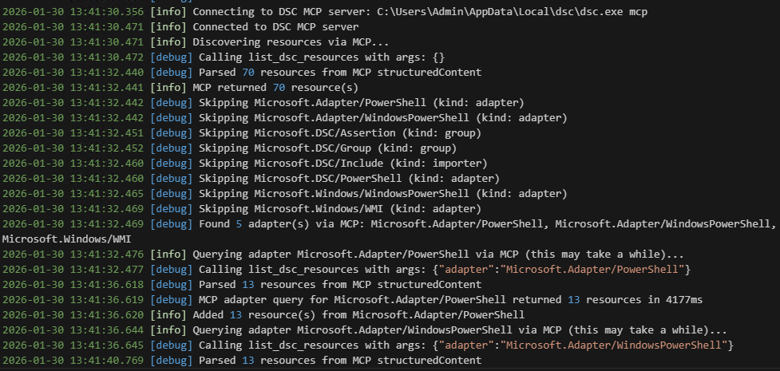

Remember when you used that <code>Configuration</code> keyword in PowerShell DSC and it provided some IntelliSense? It wasn't perfect, but it was something.

Then came Microsoft DSC with configuration documents written in YAML and JSON. I tried IntelliSensing... but I thought something was broken. No completions, no hints, no nothing.

Just me, a text editor, and a lot of guessing what resource types and properties I need.

It felt like taking a small step backwards. The frustrating part wasn't that the problem was new. YAML and JSON are just data serialization formats, not DSLs. And without proper tooling, they offer very little guidance to the author.

That gap in tooling wasn't overlooked, as back in 2024, one of the official members (back then) tried to fix it. <a href="https://youtu.be/cGTpYDsmMN8?si=5KdRKOpSPppHAsGI&amp;t=1245">A prototype VS Code completion</a> extension was created by Andrew Menagarishvili. This extension was created to address the authoring experience for DSC configuration documents, and for a moment, it looked like things were heading in the right direction.

But that didn't last long.

The broader idea at the time was that DSC authoring would eventually be handled through Bicep, and it looked promising. A Bicep extension was developed in 2025. 

But then again fast forwarding to 2026...

Support for DSC via Bicep was dropped in this <a href="https://github.com/PowerShell/DSC/pull/1363">pull request</a>. Back to zero. At that point, waiting didn't make much sense anymore, so it was time to take matters into my own hands.

It was time to pick up that prototype and give it another heartbeat. And don't get me wrong, this is not to prove a point; I simply needed a better authoring experience for DSC configuration documents.

So, instead of waiting for the "right" solution to appear, which I still believe will happen, I decided to develop my own VS Code extension.
<h2 id="im-not-a-vs-code-extension-developer">I'm not a VS Code extension developer</h2>
Before I go any further, it's important to be clear about one thing. I'm far from being a VS Code extension developer, let alone the TypeScript code the extension has <em>now. </em>I just spend too little time writing TypeScript every day. That alone wasn't enough of a reason not to start a project like this. 

A few years ago, it would have stopped me. But what has changed these days probably everyone knows, is that the barrier to entry dropped significantly. 

AI made it possible to move this forward without having to master every detail up front. It helped me understand the structure for a VS Code extension. I already knew the discovery of resources through Microsoft DSC, and with its strong JSON Schema contract, I only needed to piece the bits together. 

Those decisions AI couldn't make. It still required me to ask these things and validate a fair amount of trial and error. But it did make one thing clear: building "good enough" tooling is no longer reserved for people who already live in that ecosystem.

That was just enough to get this started with a <a href="https://github.com/PowerShell/DSC/pull/448">prototype already sitting in the DSC repository</a> (in memory, back from 2024).
<h2 id="the-revival-of-the-prototype">The revival of the prototype</h2>
Its prototype was created back in 2024, and that was still the best place to begin. It already captured a rough idea of how it would look: use schema-driven knowledge to make authoring DSC configuration documents less error-prone (and pleasant).

The first step was understanding what still worked and what didn't. Some parts were still working, like getting the schema properties from <em>command-based </em>DSC resources. There were also some shortcuts taken here and there. Plus, some comments from other team members hadn't been resolved. That was good enough to get my prompts started.

I started focusing on one thing: making it <strong><em>fruitful</em></strong> again. I had to slightly rewire the resource discovery model because I wanted to support adapters, which is a separate discovery (<code>dsc resource list -a &lt;adapterName&gt;</code>). In the end, I narrowed the scope to what actually matters to most to me:
<ol><li>Get a list of available DSC resources (both <em>command</em>, <em>script</em>, and <em>class-based</em>) on my system</li><li>Get all the properties, giving the option to list <em>ALL </em>or <em>REQUIRED </em>properties from a completion list</li></ol>
My perfectionist tried to kick in, but I just wanted to give that old prototype the heartbeat it needed.
<h2 id="what-the-extension-does-and-does-not-do">What the extension does (and does not do)</h2>
The core focus of the extension was on one thing: <strong>improving the authoring experience for DSC configuration documents.</strong>

It now provides IntelliSense and completion based on the DSC resource available on the system. This helps with the structure, resource names, and the properties each DSC resource has. The goal reduced the guesswork, not to actually redefine how DSC works (or even introduce a new level of abstraction).

The original design was pretty straightforward. Just run the <code>dsc resource schema --resource &lt;resourceName&gt;</code> to retrieve the schema from individual resources. That, combined with discovering resources through the adapter list command, made all the resources visible in VS Code. It worked; the performance was a little sluggish, so I added some caching to it, which matched how DSC itself internally works.

However, during one of the DSC working group discussions, Steve Lee made a remark: why not try the MCP server over JSON-RPC to pull in schema information? It stuck with me, and I tried it out. The result? It speaks in the image below.
<figure class="kg-card kg-image-card kg-card-hascaption"><figcaption>Figure 1: Connecting with DSC MCP</figcaption></figure>
Switching to MCP simplified the overall model and outperformed calling individual schemas. Also, it's now the first option of choice and will still fall back on just running the <code>dsc schema</code> commands. Win-win!

But just as the extension does now what it should do, there are things that it does <em>not try</em> to do.

It doesn't validate the configuration at runtime. That's still up to DSC's engine. Nor does it execute the document. It also doesn't attempt to enforce best practices or act as a full language server. Those are all good ideas, but they come with more complexity that would later be overshadowed when a <em>real </em>DSL comes into play. 

This extension is simply about guidance and assistance while you write. Keeping that scope small for me is what made it possible to easily ship it on the marketplace. And fingers crossed on the maintainability of it with DSC's version releases.
<h2 id="closing-thoughts">Closing thoughts</h2>
Reviving this prototype wasn't really about innovation, but more about continuity and learning experience. DSC still matters (duh, that's why Microsoft DSC developed). People still use it, and there are still plenty of DSC resources downloaded today. 

This extension adds to that by providing those simple features that PowerShell DSC, in essence, also has. The only difference lies in the data serialization format (YAML and JSON). 

I don't see this extension as <em>the solution</em>. I still believe, after the great talks I had during the working group, that a proper DSL would be better. But until then, "good enough" tooling is better than silence. 

Wanna give it a try? Check it out on the <a href="https://marketplace.visualstudio.com/items?itemName=LibreDsc.dsc-vscode-completion-provider">VS Code Marketplace</a>.

