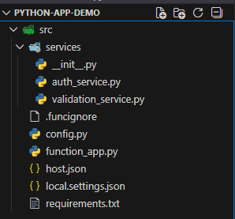
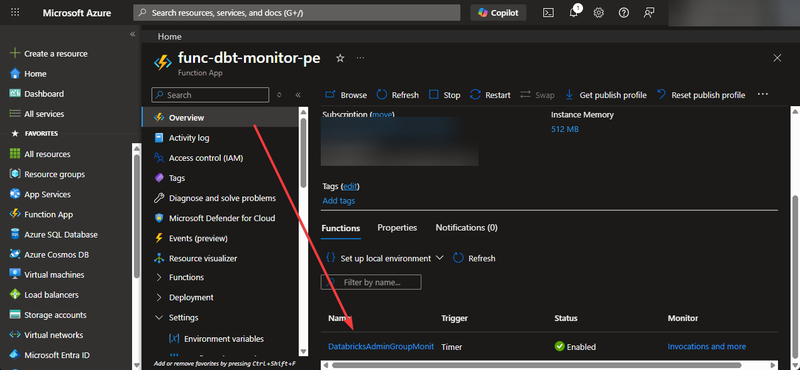
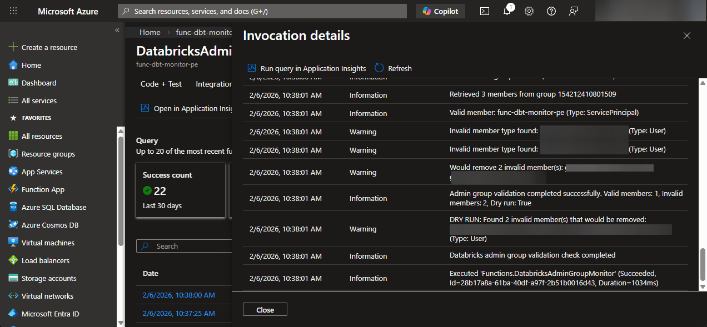

You activated Privileged Identity Management (PIM) to do some legimatement troubleshooting in your Azure Databricks instance. After you're done with the troubleshooting, PIM expired, and yet...

... your still able to login to your instance.

So, why is that? Didn't the instance get the memo? Well, whenever you're a contributor (in this case, by PIM), and you log in to your Azure Databricks instance, your user is added to the <em>admins group<strong>. </strong></em>But PIM doesn't know anything about Azure Databricks.

How do you clean this up? Re-activating PIM and removing yourself? Sounds a bit tedious (and weird).  A Function App? Great choice as it is scalable!

In this article, you’ll learn how to deploy a <em>Python Azure Function App</em> that automatically removes elevated Azure Databricks permissions by removing users who shouldn't be in the <em>admins group </em>by looking at the specific <em>types</em>.
<h2 id="prerequisites">Prerequisites</h2>
This article assumes that most of the Azure infrastructure is already in place and focuses on deploying the Python Function App. So, before you begin, make sure you have:
<ul><li>An active Azure subscription</li><li>A running Azure Databricks instance</li><li>Azure CLI v0.283.0 or above</li></ul>
The rest of the infrastructure we will be deploying using the Azure Verified Modules (AVM). Let's get started!
<h2 id="understanding-the-execution-model-and-trigger-choice">Understanding the execution model and trigger choice</h2>
Before writing any code, it's good to decide how and when the function app should run. You can choose between an aggressive Function App that runs every 5 minutes, or you're comfortable that it runs in the night. The most common trigger options that are available are:
<ul><li>A timer trigger that runs at a fixed interval</li><li>An event-driven trigger based on PIM-related signals</li><li>A manual HTTP trigger for testing and validation</li></ul>
For simplicity, this blog post uses the <strong>timer-trigger function</strong> as it's a good starting point. It allows the function to run based on what we will be configuring later and evaluate Databricks admin assignments. 
<h2 id="create-the-python-function-app-structure">Create the Python Function App structure</h2>
Azure Functions for Python follow a <a href="https://learn.microsoft.com/en-us/azure/azure-functions/functions-reference-python?pivots=python-mode-decorators">well-defined project layout</a>. If this layout isn't followed, you're going to run into weird errors later that are hard to diagnose. But how does such a layout typically look? Take a look at the image below:
<figure class="kg-card kg-image-card"></figure>
The <code>src</code> directory is a typical name used to store all your <em>source code</em> in, especially if there are more files planned to come. Then, the most important files are:
<ul><li><code>function_app.py</code> - the main entry point and logic</li><li><code>requirements.txt</code> - lists the Python dependencies</li><li><code>host.json</code> - configures runtime behavior</li><li><code>local.settings.json</code> - local-only configuration for your development</li></ul>
Other <code>.py</code> files are for modularity and are a personal preference. When you're planning to create more Functions, they all will be added to the main entry point file (<code>function_app.py</code>). Storing all the logic inside this file isn't always convenient.
<blockquote>You also see the <code>.funcignore</code> file. This file is used to determine what files should be ignored when publishing the Function App.</blockquote>
In the <code>requirements.txt</code>, you can already define the dependencies we'll be using later:
<pre><code class="language-plaintext">azure-functions&gt;=1.24.0
databricks-sdk&gt;=0.85.0
azure-identity&gt;=1.25.1
azure-mgmt-databricks&gt;=2.0.0
azure-mgmt-resource&gt;=25.0.0
azure-mgmt-subscription&gt;=3.1.1
</code></pre>
For the <code>host.json</code>:
<pre><code class="language-json">{
  "version": "2.0",
  "logging": {
    "logLevel": {
      "default": "Information",
      "Function": "Information"
    },
    "applicationInsights": {
      "samplingSettings": {
        "isEnabled": true,
        "maxTelemetryItemsPerSecond": 20
      }
    }
  },
  "extensionBundle": {
    "id": "Microsoft.Azure.Functions.ExtensionBundle",
    "version": "[4.*, 5.0.0)"
  }
}</code></pre>
The rest of the files can be left empty for now. We'll work on them later. It's time for the infrastructure first.
<h2 id="deploying-the-infrastructure">Deploying the infrastructure</h2>
To deploy the Function App, you're going to need some infrastructure to play with. This blog post uses the <em>Azure Functions Flex Consumption plan</em>, which provides easy support for Python workloads. We're going to use Bicep with Azure Verified Modules (AVM):
<ol><li>Create the <code>main.bicep</code> file</li><li>Define the following parameters at the top:</li></ol><pre><code class="language-bicep">param pythonRuntimeVersion string = '3.13'
param location string = resourceGroup().location
param storageAccountSku string = 'Standard_LRS'
param storageAccountName string = toLower('stdbtmonitor')
param appservicePlanName string = 'asp-dbt-monitor-${substring(location, length(location) - 2, 2)}'
param functionAppName string = 'func-dbt-monitor-${substring(location, length(location) - 2, 2)}'
param logAnalyticsName string = 'log-dbt-monitor-${substring(location, length(location) - 2, 2)}'
param appInsightsName string = 'appi-dbt-monitor-${substring(location, length(location) - 2, 2)}'</code></pre><ol start="3"><li>Add both <code>insights</code> and <code>workspace</code> modules:</li></ol><pre><code class="language-bicep">module logAnalytics 'br/public:avm/res/operational-insights/workspace:0.15.0' = {
  params: {
    name: logAnalyticsName
    location: location
    managedIdentities: {systemAssigned: true}
  }
}&#10;
module appInsights 'br/public:avm/res/insights/component:0.7.1' = {
  params: {
    name: appInsightsName
    location: location
    applicationType: 'web'
    workspaceResourceId: logAnalytics.outputs.resourceId
    kind: 'web'
  }
}</code></pre><ol start="4"><li>Add the <code>storageAccount</code> module to store the deployable <code>.zip</code> file:</li></ol><pre><code class="language-bicep">module st 'br/public:avm/res/storage/storage-account:0.31.0' = {
  name: '${uniqueString(deployment().name, location)}st'
  params: {
    name: storageAccountName
    location: location
    kind: 'StorageV2'
    skuName: storageAccountSku
    publicNetworkAccess: 'Enabled'
    allowBlobPublicAccess: true
    allowSharedKeyAccess: false&#10;    
    minimumTlsVersion: 'TLS1_2'
    blobServices: {
      containers: [
        {
          name: 'azure-webapp-release'
          publicAccess: 'Blob'
        }
      ]
    }
  }
}</code></pre><blockquote>This is for illustrative purposes. Don't use the properties above in production!</blockquote><ol start="5"><li>Add both the <code>serverFarm</code> and <code>site</code> modules with diagnostics settings enabled:</li></ol><pre><code class="language-bicep">module appServicePlan 'br/public:avm/res/web/serverfarm:0.6.0' = {
  params: {
    name: appservicePlanName
    location: location 
    skuName: 'FC1'
    kind: 'functionapp'
    reserved: true // Linux
  }
}&#10;&#10;
module functionApp 'br/public:avm/res/web/site:0.21.0' = {
  params: {
    name: functionAppName
    location: location
    kind: 'functionapp,linux'
    serverFarmResourceId: appServicePlan.outputs.resourceId
    httpsOnly: true
    clientAffinityEnabled: false&#10;
    // Enable System-Assigned Managed Identity
    managedIdentities: {
      systemAssigned: true
    }&#10;&#10;
    functionAppConfig: {
      deployment: {
        storage: {
          type: 'blobContainer'
          authentication: {
            type: 'SystemAssignedIdentity'
          }
          value: '${st.?outputs.primaryBlobEndpoint}azure-webapp-release'
        }
      }
      runtime: {
        name: 'python'
        version: pythonRuntimeVersion
      }
      scaleAndConcurrency: {
        instanceMemoryMB: 512
        maximumInstanceCount: 5
      }
    }&#10;
    configs: [
      {
        applicationInsightResourceId: appInsights.outputs.resourceId
        name: 'appsettings'
        storageAccountResourceId: st.?outputs.resourceId
        storageAccountUseIdentityAuthentication: true
        properties: {
          APPLICATIONINSIGHTS_CONNECTION_STRING: appInsights.outputs.connectionString
          ApplicationInsightsAgent_EXTENSION_VERSION: '~3'
          DRY_RUN: 'true'
        }
      }
    ]&#10;
    siteConfig: {
      pythonVersion: pythonRuntimeVersion
      ftpsState: 'Disabled'
      minTlsVersion: '1.2'
      scmMinTlsVersion: '1.2'
      http20Enabled: true
    }&#10;
    diagnosticSettings: [
      {
        workspaceResourceId: logAnalytics.outputs.resourceId
        logCategoriesAndGroups: [
          {
            categoryGroup: 'allLogs'
          }
        ]
        metricCategories: [
          {
            category: 'AllMetrics'
          }
        ]
      }
    ]
  }
}</code></pre><ol start="6"><li>Lastly, make sure the System-Assigned Managed Identity is <em>Contributor </em>on the Resource Group:</li></ol><pre><code class="language-bicep">module assignFunctionAppStorageAccountRole 'br/public:avm/res/authorization/role-assignment/rg-scope:0.1.1' = {
  params: {
    principalId: functionApp.outputs.systemAssignedMIPrincipalId!
    roleDefinitionIdOrName: subscriptionResourceId(
      'Microsoft.Authorization/roleDefinitions',
      'b24988ac-6180-42a0-ab88-20f7382dd24c' // Contributor role
    )
  }
}</code></pre>
To deploy the solution, use the <code>az group deployment create</code> command:
<pre><code class="language-bash">az deployment group create \
  --resource-group &lt;resourceGroupName&gt; \
  --name deployment \
  --template-file main.bicep</code></pre>
There's already an environment variable declared, which is <code>DRY_RUN</code>. We are going to use this as a switch to see the actual behavior before removing users from the <em>Admins </em>group. Time to build the application code.
<h2 id="building-authentication-service">Building authentication service</h2>
We've already laid out the project structure. It's time to start with the authentication service (<code>auth_service.py</code>). This is the foundation of the Function App as it's responsible for two tasks. The first task should discover the available Databricks instance in the Azure subscription. We can use the Managed Identity for that. That instantly brings it to the second point: the authentication.

Since we've added the Managed Identity as Contributor on the Resource Group, it should be able to list out resources (in this case, the Databricks instance). We can label this as <em>auto-discovery</em>, preventing us from defining hardcoded values. It makes the solution portable to other environments. Add the following code to the file, which is responsible for:
<ol><li>Going through all Azure subscriptions that the Managed Identity can read</li><li>Search for the Databricks instance using the Azure Databricks Management API</li><li>When one is found, it'll construct the host URL<ol><li>If none are found, the fallback can be set using <code>DATABRICKS_HOST</code></li></ol></li></ol><pre><code class="language-python">"""
Authentication service for Databricks using System-Assigned Managed Identity.
Handles workspace discovery and client initialization.
"""&#10;
import logging
from typing import Optional
from databricks.sdk import WorkspaceClient
from azure.identity import DefaultAzureCredential
from azure.mgmt.databricks import AzureDatabricksManagementClient
from azure.mgmt.subscription import SubscriptionClient
from config import DATABRICKS_HOST&#10;&#10;
def _discover_databricks_workspace() -&gt; Optional[str]:
    """
    Discover the first Databricks workspace accessible to the managed identity.
    Searches across all subscriptions and resource groups the identity has access to.&#10;    
    Returns:
        Optional[str]: Databricks workspace URL or None if not found
    """
    try:
        logging.info("Discovering Databricks workspaces using managed identity")
        credential = DefaultAzureCredential()&#10;    
        subscription_client = SubscriptionClient(credential)
        subscriptions = list(subscription_client.subscriptions.list())&#10;        
        if not subscriptions:
            logging.warning("No accessible subscriptions found for managed identity")
            return None&#10;        
        logging.info(f"Searching for Databricks workspaces across {len(subscriptions)} subscription(s)")&#10;        
        for subscription in subscriptions:
            try:
                mgmt_client = AzureDatabricksManagementClient(
                    credential=credential,
                    subscription_id=subscription.subscription_id
                )&#10;                
                workspaces = list(mgmt_client.workspaces.list_by_subscription())&#10;                
                if workspaces:
                    workspace = workspaces[0]
                    workspace_url = workspace.workspace_url&#10;                    
                    logging.info(
                        f"Found Databricks workspace: {workspace.name} "
                        f"in subscription: {subscription.display_name}"
                    )&#10;                    
                    if len(workspaces) &gt; 1:
                        logging.info(f"Multiple workspaces found. Using first: {workspace.name}")&#10;                    
                    # Construct full URL
                    full_url = f"https://{workspace_url}" if not workspace_url.startswith("https://") else workspace_url
                    logging.info(f"Discovered Databricks workspace URL: {full_url}")&#10;                    
                    return full_url&#10;                    
            except Exception as e:
                logging.debug(f"Error checking subscription {subscription.display_name}: {str(e)}")
                continue&#10;        
        logging.warning("No Databricks workspaces found in any accessible subscription")
        return None&#10;        
    except Exception as e:
        logging.warning(f"Failed to auto-discover Databricks workspace: {str(e)}")
        return None&#10;&#10;
def get_databricks_client() -&gt; WorkspaceClient:
    """
    Create and return an authenticated Databricks WorkspaceClient using System-Assigned Managed Identity.&#10;    
    The function automatically discovers the first Databricks workspace accessible to the managed identity.
    If auto-discovery fails, it falls back to the DATABRICKS_HOST environment variable.&#10;    
    Returns:
        WorkspaceClient: Authenticated Databricks client&#10;        
    Raises:
        ValueError: If workspace cannot be discovered and no fallback is configured
        Exception: If authentication fails
    """
    # Try auto-discovery first
    databricks_host = _discover_databricks_workspace()&#10;    
    # Fallback to environment variable
    if not databricks_host:
        logging.info("Using fallback DATABRICKS_HOST from environment variable")
        databricks_host = DATABRICKS_HOST&#10;    
    if not databricks_host:
        raise ValueError(
            "Unable to determine Databricks workspace. "
            "Ensure the managed identity has access to at least one Databricks workspace, "
            "or provide DATABRICKS_HOST as fallback."
        )&#10;    
    try:
        logging.info(f"Initializing Databricks client for host: {databricks_host}")&#10;        
        # Use system-assigned managed identity
        credential = DefaultAzureCredential()
        token_result = credential.get_token("2ff814a6-3304-4ab8-85cb-cd0e6f879c1d/.default")&#10;        
        client = WorkspaceClient(
            host=databricks_host,
            token=token_result.token
        )&#10;        
        current_user = client.current_user.me()
        logging.info(f"Successfully authenticated to Databricks as: {current_user.user_name}")&#10;        
        return client&#10;        
    except Exception as e:
        logging.error(f"Failed to create Databricks client: {str(e)}", exc_info=True)
        raise
</code></pre><h2 id="set-up-the-validation-service">Set up the validation service</h2>
With authentication in place, we need to validate the memberships in the built-in admins group. That's where the validation service (<code>validation_service.py</code>). This service should check:
<ol><li>Get all members of the admins group</li><li>Validate member types, excluding groups and service principals</li><li>Depending on the <code>DRY_RUN</code> variable, take appropriate action by removing users</li></ol>
The following code snippet uses the Databricks SDK to perform these actions:
<pre><code class="language-python">"""
Validation service for checking Databricks admin group membership.
Ensures only service principals and groups are allowed.
"""&#10;
import logging
from typing import Dict, List
from services.auth_service import get_databricks_client
from config import ADMIN_GROUP_NAME, DRY_RUN, EXCLUSIONS&#10;&#10;
def check_admin_group_members() -&gt; Dict:
    """
    Check the Databricks admin group for invalid member types.
    Only service principals and groups are allowed.&#10;    
    Returns:
        Dict containing validation results with keys:
        - status: "success" or "error"
        - valid_count: number of valid members
        - invalid_count: number of invalid members
        - invalid_members: list of invalid member identifiers
        - error: error message (if status is "error")
    """
    try:
        client = get_databricks_client()&#10;        
        # Get the admin group
        admin_group = _get_admin_group(client)
        if not admin_group:
            return {
                "status": "error",
                "error": f"Admin group '{ADMIN_GROUP_NAME}' not found"
            }&#10;        
        members = _get_group_members(client, admin_group["id"])
        validation_result = _validate_members(members)
        removed_members = []
        if validation_result["invalid_count"] &gt; 0:
            if DRY_RUN:
                logging.warning(
                    f"Would remove {validation_result['invalid_count']} invalid member(s): "
                    f"{', '.join([m['display'] for m in validation_result['all_members'] if not m['valid']])}"
                )
            else:
                logging.info(f"Removing {validation_result['invalid_count']} invalid member(s) from admin group")
                removed_members = _remove_invalid_members(client, admin_group["id"], validation_result["all_members"])&#10;        
        return {
            "status": "success",
            "valid_count": validation_result["valid_count"],
            "invalid_count": validation_result["invalid_count"],
            "invalid_members": validation_result["invalid_members"],
            "all_members": validation_result["all_members"],
            "removed_members": removed_members,
            "dry_run": DRY_RUN
        }&#10;        
    except Exception as e:
        logging.error(f"Error checking admin group members: {str(e)}", exc_info=True)
        return {
            "status": "error",
            "error": str(e)
        }&#10;&#10;
def _get_admin_group(client, group_name: str = None) -&gt; Dict:
    """
    Retrieve the admin group by name.&#10;    
    Args:
        client: Databricks WorkspaceClient
        group_name: Name of the admin group (defaults to config value)&#10;    
    Returns:
        Dict containing group information or None if not found
    """
    group_name = group_name or ADMIN_GROUP_NAME&#10;    
    try:
        # List all groups and find the admin group
        groups = client.groups.list()
        for group in groups:
            if group.display_name == group_name:
                logging.info(f"Found admin group: {group_name} (ID: {group.id})")
                return {
                    "id": group.id,
                    "display_name": group.display_name
                }&#10;        
        logging.warning(f"Admin group '{group_name}' not found")
        return None&#10;        
    except Exception as e:
        logging.error(f"Error retrieving admin group: {str(e)}", exc_info=True)
        raise&#10;&#10;
def _get_group_members(client, group_id: str) -&gt; List[Dict]:
    """
    Get all members of a specific group.&#10;    
    Args:
        client: Databricks WorkspaceClient
        group_id: ID of the group&#10;    
    Returns:
        List of member dictionaries
    """
    try:
        group = client.groups.get(group_id)
        members = []&#10;        
        if hasattr(group, 'members') and group.members:
            for member in group.members:
                # Extract member type - Databricks SDK uses $ref to indicate type
                member_type = getattr(member, 'type', None)&#10;                
                # If type is None, try to infer from $ref attribute
                if not member_type:
                    ref = getattr(member, 'ref', '') or getattr(member, '$ref', '')
                    if ref:
                        # $ref format is typically like "Users/id" or "ServicePrincipals/id" or "Groups/id"
                        if 'ServicePrincipal' in ref:
                            member_type = 'ServicePrincipal'
                        elif 'Group' in ref:
                            member_type = 'Group'
                        elif 'User' in ref:
                            member_type = 'User'
                        else:
                            member_type = 'unknown'
                            logging.debug(f"Unknown member type from ref: {ref}")
                    else:
                        member_type = 'unknown'
                        logging.debug(f"Member has no type or ref: {member}")&#10;                
                member_info = {
                    "value": member.value,
                    "display": getattr(member, 'display', member.value),
                    "type": member_type,
                    "ref": getattr(member, 'ref', None) or getattr(member, '$ref', None)
                }
                members.append(member_info)
                logging.debug(f"Member extracted: display={member_info['display']}, type={member_type}, ref={member_info['ref']}")&#10;        
        logging.info(f"Retrieved {len(members)} members from group {group_id}")
        return members&#10;        
    except Exception as e:
        logging.error(f"Error retrieving group members: {str(e)}", exc_info=True)
        raise&#10;&#10;
def _validate_members(members: List[Dict]) -&gt; Dict:
    """
    Validate that members are only service principals or groups.
    Members in the exclusions list are always considered valid.&#10;    
    Args:
        members: List of member dictionaries&#10;    
    Returns:
        Dict with validation results
    """
    valid_types = {"ServicePrincipal", "Group"}
    invalid_members = []
    valid_count = 0
    all_members = []&#10;    
    for member in members:
        member_type = member.get("type", "unknown")
        member_display = member.get("display", member.get("value", "unknown"))
        member_value = member.get("value", "")&#10;        
        # Check if member is in exclusions list (match against display name or value)
        is_excluded = member_display in EXCLUSIONS or member_value in EXCLUSIONS
        is_valid = member_type in valid_types or is_excluded&#10;        
        member_summary = {
            "display": member_display,
            "type": member_type,
            "valid": is_valid,
            "excluded": is_excluded
        }
        all_members.append(member_summary)&#10;        
        if is_valid:
            valid_count += 1
            if is_excluded:
                logging.info(f"Valid member (excluded): {member_display} (Type: {member_type})")
            else:
                logging.info(f"Valid member: {member_display} (Type: {member_type})")
        else:
            invalid_members.append(f"{member_display} (Type: {member_type})")
            logging.warning(f"Invalid member type found: {member_display} (Type: {member_type})")&#10;    
    return {
        "valid_count": valid_count,
        "invalid_count": len(invalid_members),
        "invalid_members": invalid_members,
        "all_members": all_members
    }&#10;&#10;
def _remove_invalid_members(client, group_id: str, all_members: List[Dict]) -&gt; List[str]:
    """
    Remove invalid members (non-ServicePrincipal, non-Group) from the admin group.&#10;    
    Args:
        client: Databricks WorkspaceClient
        group_id: ID of the admin group
        all_members: List of all members with validation info&#10;    
    Returns:
        List of removed member display names
    """
    removed = []&#10;    
    for member in all_members:
        if not member["valid"]:
            try:
                # Remove the member from the group
                # Note: The SDK uses the member value (ID) to remove
                member_value = next((m.get("value") for m in all_members if m.get("display") == member["display"]), None)&#10;                
                if member_value:
                    client.groups.delete(id=group_id, members=[{"value": member_value}])
                    removed.append(member["display"])
                    logging.info(f"Removed invalid member: {member['display']} (Type: {member['type']})")
                else:
                    logging.error(f"Could not find member value for: {member['display']}")&#10;                    
            except Exception as e:
                logging.error(f"Failed to remove member {member['display']}: {str(e)}", exc_info=True)&#10;    
    return removed
</code></pre><h2 id="configuration-and-the-main-entry-point">Configuration and the main entry point</h2>
Both services are now defined and separated into their own <code>.py</code> files. Tieing everything together becomes easy now. The <code>config.py</code> is responsible for centralizing environment-based settings. Its principle is just simple: only <strong>configure </strong>what is needed between environments.
<pre><code class="language-python">"""
Configuration module for the Databricks Admin Group Monitor Function App.
All configuration values should be set via environment variables.
"""&#10;
import os&#10;
# Monitor the built-in admins group
ADMIN_GROUP_NAME = "admins"&#10;
DRY_RUN = os.getenv("DRY_RUN", "true").lower() in ("true", "1", "yes")
EXCLUSIONS_RAW = os.getenv("EXCLUSIONS", "")
EXCLUSIONS = [e.strip() for e in EXCLUSIONS_RAW.split(",") if e.strip()] if EXCLUSIONS_RAW else []
DATABRICKS_HOST = os.getenv("DATABRICKS_HOST", "")&#10;
# Logging Configuration
LOG_LEVEL = os.getenv("LOG_LEVEL", "INFO")&#10;&#10;
def validate_configuration() -&gt; bool:
    """
    Validate that all required configuration values are set.&#10;    
    Returns:
        bool: True if configuration is valid, False otherwise
    """
    return True&#10;&#10;
def get_config_summary() -&gt; dict:
    """
    Get a summary of the current configuration (without sensitive values).&#10;    
    Returns:
        dict: Configuration summary
    """
    return {
        "admin_group_name": ADMIN_GROUP_NAME,
        "dry_run": DRY_RUN,
        "exclusions_count": len(EXCLUSIONS),
        "has_fallback_host": bool(DATABRICKS_HOST),
        "log_level": LOG_LEVEL,
    }
</code></pre>
There's one more variable that can be used to make <code>EXCLUSIONS</code>. Here, you can always specify a list of users (or other types) that always should have access.

In the main entry point (<code>function_app.py)</code>, all the services can be imported and called:
<pre><code class="language-python">"""
Azure Function App for monitoring Databricks Admin Groups
Triggers every 5 minutes to validate admin group membership
"""&#10;
import azure.functions as func
import logging
from services.validation_service import check_admin_group_members&#10;
app = func.FunctionApp()&#10;
@app.function_name(name="DatabricksAdminGroupMonitor")
@app.timer_trigger(
    arg_name="mytimer",
    schedule="0 */5 * * * *",
    run_on_startup=False,
    use_monitor=True
)
def admin_group_monitor(mytimer: func.TimerRequest) -&gt; None:
    """
    Timer-triggered function that monitors Databricks admin group membership.
    Validates that only service principals and groups are in the admin group.
    """
    if mytimer.past_due:
        logging.warning("Timer is past due!")&#10;
    logging.info("Starting Databricks admin group validation check")&#10;    
    try:
        result = check_admin_group_members()&#10;        
        if result["status"] == "success":
            logging.info(
                f"Admin group validation completed successfully. "
                f"Valid members: {result['valid_count']}, "
                f"Invalid members: {result['invalid_count']}, "
                f"Dry run: {result.get('dry_run', False)}"
            )&#10;            
            if result.get("removed_members"):
                logging.warning(
                    f"REMOVED {len(result['removed_members'])} invalid member(s): "
                    f"{', '.join(result['removed_members'])}"
                )&#10;            
            if result["invalid_members"]:
                if result.get("dry_run"):
                    logging.warning(
                        f"DRY RUN: Found {result['invalid_count']} invalid member(s) that would be removed: "
                        f"{', '.join(result['invalid_members'])}"
                    )
                else:
                    logging.error(
                        f"ALERT: Found {result['invalid_count']} invalid members in admin group: "
                        f"{', '.join(result['invalid_members'])}"
                    )
        else:
            logging.error(f"Admin group validation failed: {result.get('error', 'Unknown error')}")&#10;            
    except Exception as e:
        logging.error(f"Unexpected error during admin group validation: {str(e)}", exc_info=True)&#10;    
    logging.info("Databricks admin group validation check completed")
</code></pre>
For demonstration purposes, the timer is set every 5 minutes. But if you're using it in production, you can schedule it to run, for example, every day.
<h2 id="seeing-the-action">Seeing the action</h2>
Everything is in place; it's time to deploy the Function App. Because a Flex Consumption Plan only supports <a href="https://learn.microsoft.com/en-us/azure/azure-functions/functions-deployment-technologies?tabs=linux#deployment-technology-availability">OneDeploy</a>, we can use the Azure CLI to deploy the App.

Before you can deploy, make sure that you create a <code>.zip</code> file from the <code>src</code> folder:
<pre><code class="language-powershell">cd C:\source\python-app-demo\src # Change to your directory
Compress-Archive -Path * -DestinationPath function_app.zip -Force</code></pre>
Now you can publish the <code>.zip</code> package to your Function App using the Azure CLI:
<pre><code class="language-bash ">az functionapp deployment source config-zip \
  --resource-group &lt;resourceGroupName&gt; \
  --name func-dbt-monitor-pe \
  --src function_app.zip \
  --build-remote true</code></pre>
It's important to know the <code>--build-remote</code> switch flag. It tells Azure to build your Python dependencies on the server side. This avoids issues with platform-specific packages. After a couple of minutes, navigate to the Azure Portal and locate your Function App -&gt; DatabricksAdminGroupMonitor:
<figure class="kg-card kg-image-card kg-card-hascaption"><figcaption>Figure 1: Databricks admin group monitor function</figcaption></figure>
Go to one of the invocations and look at the dry-run results:
<figure class="kg-card kg-image-card kg-card-hascaption"><figcaption>Figure 2: Dry-run results </figcaption></figure>
If you actually want to remove the users, you can set the <code>DRY_RUN</code> variable to <code>false</code>.
<h2 id="summary">Summary</h2>
In this blog post, you learned that you can enforce the least-privileged principle on your Databricks instance with an Azure Function App. The use case was mainly whenever you use Privileged Identity Management (PIM) in production, but you can also use the solution for other cases.

If you're not going to use the resources for now, don't forget to clean up the resources.

