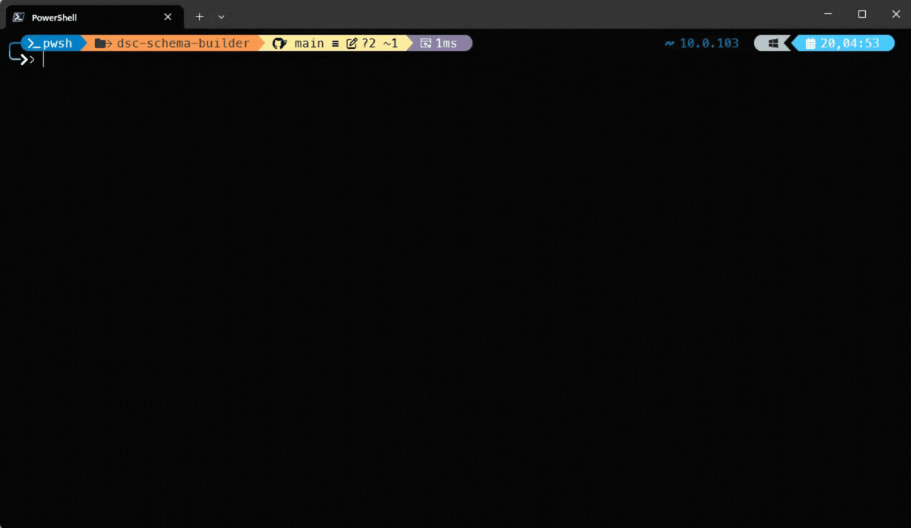
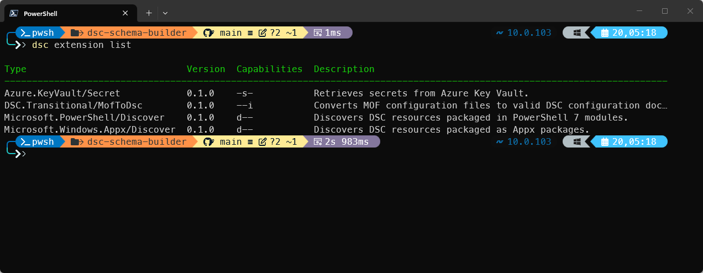
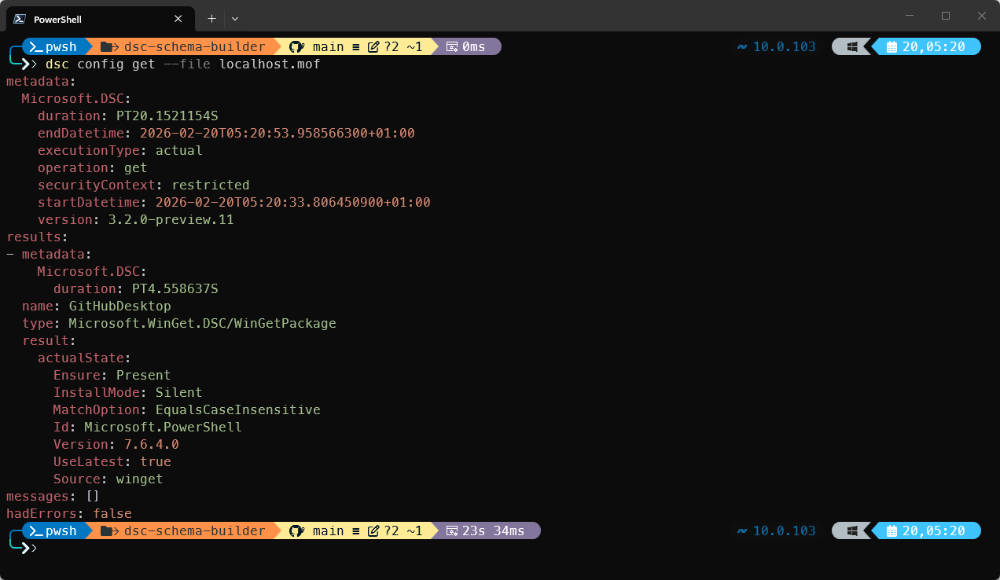

Still shipping MOF files around like it’s 2016? You’re not alone.

PowerShell's DSC configuration documents are still widely used today. You write up your <code>Configuration</code> block in your <code>.ps</code> file, define your resources, and feel pretty good about your declarative piece. But then you hit that familiar miserable step.

Compile it to <code>.mof</code>.

That compilation step has always felt slightly awkward to me. You wouldn't typically hand-edit <code>.mof</code> file. Let alone that you're going to stuff it into version control and think, this is a <em>pretty clean</em> file.

Still, it's a necessary artifact that gets generated and consumed. Many environments still rely heavily on those MOF files. They're inevitably going to be pushed to nodes. But what if you want that format to play with Microsoft's DSC engine? 

In this blog post, I will show you a simple command I developed to convert your existing <code>.mof</code> files to the new format, which is JSON. At the end of the blog post, you'll also learn about Microsoft's DSC extensibility model and directly execute it against the engine.
<h2 id="the-problem-mof-isnt-dead">The Problem: MOF isn't dead</h2>
Before we take a look at the command, let's look at the current problem. In classic PowerShell DSC, everything today still becomes a <code>.mof</code> file. You still author your configuration documents in PowerShell, and that gets compiled to this Managed Object Format (MOF). Those <code>mof</code> files are well understood by the Local Configuration Manager (LCM)

Now, to be fair, I mentioned "miserable" in the intro, but MOF isn't that "bad."

It still does what it does today, but it was just designed in a different time.

They weren't very developer-friendly artifacts. At this time, they will be pretty noisy in pull requests to be reviewed (nor should they be). Let alone that you're going to manually modify them. 

Moving on to Microsoft DSC. Microsoft DSC's engine expects something totally different. Under the cover, it works with the JSON format. JSON fits in many ecosystems these days, and making Git diffs compared to MOF will be a bit better, let's say.

But it isn't completely "dead" yet. Microsoft DSC doesn't have an LCM as of today. If you're relying on the LCM functionality today, you would still need MOF. That's for now. However, it doesn't mean your configurations can't evolve towards the newer JSON-based model.
<h2 id="convert-mof-to-json">Convert MOF to JSON</h2>
So instead of rewriting the compiled configurations from scratch, I took a different path.

What if you could just take the raw <code>.mof</code> file and transform it into JSON, including the nitty-gritty things Microsoft DSC expects? 

If you look at the core of an MOF file, it contains all the elements you're going to need for transformation:
<pre><code class="language-plaintext">instance of WinGetPackage as $WinGetPackage1ref
{
ModuleVersion = "1.12.440";
 Ensure = "Present";
 Source = "winget";
 ModuleName = "Microsoft.WinGet.DSC";
 ResourceID = "[WinGetPackage]GitHubDesktop";
 SourceInfo = "::4::5::WinGetPackage";
 Id = "Microsoft.PowerShell";&#10;
 ConfigurationName = "Package";&#10;
};
instance of OMI_ConfigurationDocument&#10;&#10;
                    {
 Version="2.0.0";&#10;&#10;
                        MinimumCompatibleVersion = "1.0.0";&#10;&#10;
                        CompatibleVersionAdditionalProperties= {"Omi_BaseResource:ConfigurationName"};&#10;&#10;
                        Author="Admin";&#10;&#10;
                        GenerationDate="02/19/2026 04:05:09";&#10;&#10;
                        GenerationHost="DEVBOX";&#10;&#10;
                        Name="Package";&#10;&#10;
                    };</code></pre>
This raw example shows the module name (<code>Microsoft.WinGet.DSC</code>), the resource name (<code>GitHubDestkop</code>), and the relevant properties. There's some additional data that isn't going to be relevant for Microsoft DSC (<code>OMI_ConfigurationDocument</code>).

So my idea became simple. 
<ol><li>Parse the MOF</li><li>Get the resource definitions</li><li>Transform it into Microsoft's DSC format</li></ol>
That's where <code>Convert-MofToDsc</code> command was born. It leverages an open-source library (<a href="https://github.com/mikeclayton/Kingsland.MofParser">Kingsland.MofParser</a>) that handles the heavy-lifting. The only thing I had to do was get it into the right format.
<figure class="kg-card kg-image-card kg-card-hascaption"><figcaption>Figure 1: Converting MOF to Microsoft DSC config document</figcaption></figure>
As you can see, it clearly maps all the resource definitions (and properties) directly to Microsoft's DSC format. It even includes the stable <code>$schema</code> element in there. You can pick this up into a variable or output it to a file and give it to <code>dsc config &lt;operation&gt;</code> command.
<h2 id="when-should-you-use-this">When should you use this?</h2>
Before you think, let's use this tool "into production." But hold it right there. This tool isn't a replacement for MOF. It acts more as a bridge between old and new.

You would use this command when you're probably operating in an environment where classic PowerShell DSC exists, but you're starting to experiment with Microsoft DSC. Here are also some other realistic scenarios:
<h3 id="you-have-an-existing-mof-repository"><strong>You have an existing MOF repository</strong></h3>
There are many out there that have huge chunks of MOF files still in their estate. You want to see if a migration is possible and what that would look like if an LCM becomes available (in Microsoft DSC).

Rewriting all those MOF files is going to be a burden. That's where you can use this command for, so it becomes:
<ul><li>You still compile your MOF files as usual</li><li>You gradually use <code>Convert-MofToDsc</code> to see the new document format</li><li>You test it against <code>dsc config</code></li></ul><h3 id="youre-modernizing-dsc">You're modernizing DSC</h3>
If you still depend on the fully fletched LCM enforcement, MOF stays in the picture. But if you don't rely on it and want to create your own orchestrator, this command lets you run both worlds side-by-side.
<h3 id="you-simply-want-the-output">You simply want the output</h3>
Maybe you're just curious how the new format looks. Without fiddling too much, you can just run this command and instantly start to understand what the output would look like.
<h2 id="bonus-tip-extensibility-model">Bonus tip: extensibility model</h2>
Before closing the blog post, here's one more interesting part about Microsoft DSC that classic PowerShell DSC doesn't have: the <em>extensibility model.</em>

This extensibility model allows you to run a <code>.mof</code> file against <code>dsc config &lt;operation&gt; --file &lt;<em>.mof&gt;</em><em>. See it as a sort of plugging for custom handlers. You can see this by introducing an extension file (*.dsc.extension.json</em><em>)</em></code> with a small wrapper script (<code>convert-mof.ps1</code>):
<pre><code class="language-json">{
  "$schema": "https://aka.ms/dsc/schemas/v3/bundled/extension/manifest.json",
  "type": "DSC.Transitional/MofToDsc",
  "version": "0.1.0",
  "description": "Converts MOF configuration files to valid DSC configuration documents.",
  "import": {
    "fileExtensions": ["mof"],
    "executable": "pwsh",
    "args": [
      "-NoLogo",
      "-NonInteractive",
      "-NoProfile",
      "-Command",
      "./convert-mof.ps1",
      {
        "fileArg": "-Path"
      }
    ]
  }
}
</code></pre>
Inside the wrapper script, you can use the same command to transform the output:
<pre><code class="language-powershell">[CmdletBinding()]
param(
    [Parameter(Mandatory)]
    [string]$Path
)&#10;
$ErrorActionPreference = 'Stop'&#10;
Convert-MofToDsc -Path $Path
</code></pre>
If you add this to your <code>PATH</code> environment variable, you can list it out using <code>dsc extension list</code>:
<figure class="kg-card kg-image-card kg-card-hascaption"><figcaption>Figure 2: Transitional MOF to DSC extension</figcaption></figure>
When I'm running <code>dsc config get --file localhost.mof</code>, it perfectly accepts the file and runs the underlying resource:
<figure class="kg-card kg-image-card kg-card-hascaption"><figcaption>Figure 3: DSC runs MOF file</figcaption></figure><h2 id="wrap-up">Wrap up</h2>
The module is available in the PowerShell Gallery and can be installed using:
<pre><code class="language-powershell">Install-PSResource -Name DscSchemaBuilder</code></pre>
Once you install it, you can start converting existing <code>.mof</code> files and experimenting with the extensibility model. There's no additional setup needed. 

This module doesn't replace <code>.mof</code> files, it just gives you other options. If you're still relying on LCM, nothing changes. You can keep going. But if you're exploring the new Microsoft DSC executable, this will give you that easy bridge. 

If you want to explore deeper into Microsoft DSC, I'm covering everything in my book "<a href="https://leanpub.com/thedscv3handbook?ref=idontlikeai.dev">The DSC V3 Handbook</a>."

