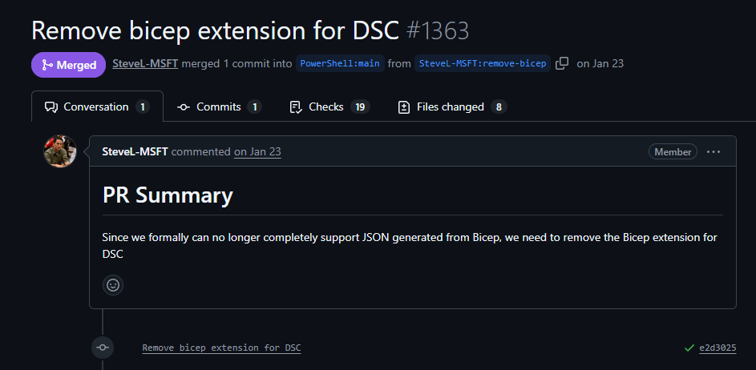
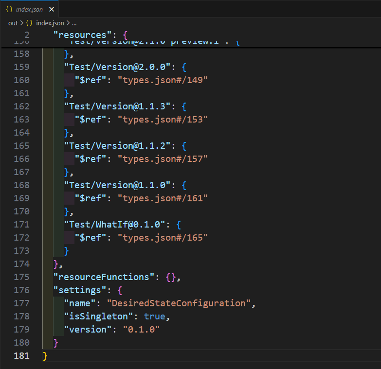
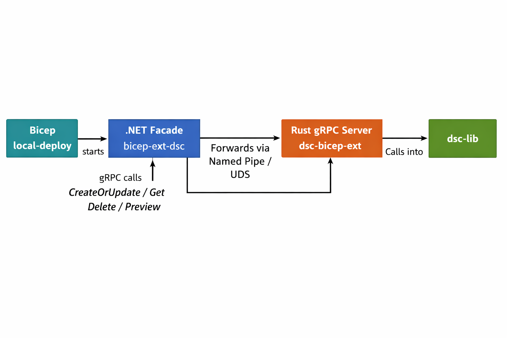

Many were shocked to see Steve Lee drop the support for Bicep in Microsoft DSC in his pull request on <a href="https://github.com/PowerShell/DSC/pull/1363">GitHub</a>:
<figure class="kg-card kg-image-card kg-card-hascaption"><figcaption>Figure 1: Screenshot from GitHub</figcaption></figure>
But was it actually fully gone? 

Looking at the details of the pull request, both the extension manifests (<code>bicep.dsc.extension.json</code> and <code>bicepparams.dsc.extension.json</code>) that shipped with <code>dsc.exe</code> got deleted from the packaging. These were mainly responsible for compiling Bicep using the extensibility model of DSC to JSON that was consumable by DSC's engine.

But it couldn't cope for long. Bicep features evolved faster than DSC could, so there was a good reason why it was removed. 

That said, the removal wasn't an actual rejection of Bicep. Better yet, it was an acknowledgement that the architecture no longer fit. So, while the extension was removed from the shipping itself, work behind the scenes was still going on. And that work came in the form of gRPC.

In this blog post, we'll look at what was actually removed and why it hit the limit. Then, we take a look at how a new gRPC-based JSON-RPC approach keeps Bicep support alive in Microsoft DSC today.
<h2 id="the-origin-of-dscs-bicep-extension">The origin of DSC's Bicep extension</h2>
Microsoft DSC got a pretty neat extensibility model that PowerShell DSC didn't have. It allows you to hook in three types: <code>discover</code>, <code>import</code>, and <code>secret</code>.

The Bicep's part fell under the <code>import</code> one, allowing you as a user to directly feed a <code>.bicep</code> or <code>.bicepparam</code> to <code>dsc.exe</code> without actually doing anything. DSC's engine would notice this file extension and call all extension manifests to see if it can do something with it. In this case, behind the scenes, it was calling <code>bicep build</code> with the stdout option to get raw JSON. Precisely what the DSC's engine could handle.

To give it a bit more context, this is the old <code>bicep.dsc.extension.json</code> manifest content:
<pre><code class="language-json">{
    "$schema": "https://aka.ms/dsc/schemas/v3/bundled/extension/manifest.json",
    "type": "Microsoft.DSC.Extension/Bicep",
    "version": "0.1.0",
    "description": "Enable passing Bicep file directly to DSC, but requires bicep executable to be available.",
    "condition": "[not(equals(tryWhich('bicep'), null()))]",
    "import": {
        "fileExtensions": ["bicep"],
        "executable": "bicep",
        "args": [
            "build",
            {
                "fileArg": ""
            },
            "--stdout"
        ]
    }
}</code></pre>
If the Bicep executable wasn't installed on your system, it wasn't able to do it. That's what the <code>condition</code> part is telling.

But here you can already see the limitations. This tight coupling of Bicep to DSC. Any features that Bicep developed, whether it was just the output or changes in the language, could break the extension.

This growing mismatch between both velocities and release cadencies exposed these limitations of an extension-based approach (from the DSC side). It started to set the stage for something different.
<h2 id="bicep-dsc-via-json-rpc-and-grpc">Bicep DSC via JSON-RPC and gRPC</h2>
The replacement approach lives in the <a href="https://github.com/microsoft/bicep-types-dsc"><code>bicep-types-dsc</code> repository</a> In this repository, the focus area centres around Bicep's experimental <code>localDeploy</code> feature. Instead of shelling out directly through Bicep's CLI and piping the raw JSON to DSC's engine, Bicep now acts as a <em>higher-order tool (HOT)</em>. All of this is done through a gRPC contract.

The architecture, therefore, has two moving parts (currently). The first one is the type generation. It's a small TypeScript CLI that collects every available DSC resource and its embedded JSON Schema. It converts those schemas into Bicep's type format and emits an <code>index.json</code> file:
<figure class="kg-card kg-image-card kg-card-hascaption"><figcaption>Figure 2: Index.json created form TypeScript CLI</figcaption></figure>
With the <code>index.json</code> together with a compiled binary, can be packaged into a so-called OCI artifact via Bicep's <code>publish-extension</code> command. The result is a Bicep extension hosted on a demo Azure Container Registry (<code>bicepconfig.json</code>):
<pre><code class="language-json">{
  "experimentalFeaturesEnabled": {
    "localDeploy": true
  },
  "extensions": {
    "dsc": "br:contosobicepdsc1.azurecr.io/extensions/dsc:latest"
  }
}
</code></pre>
Its second part sits in a gRPC proxy. Whenever <code>bicep local-deploy</code> runs, it starts a .NET facade binary (<code>bicep-ext-dsc</code>). That facade hosts a hosted gRPC service, immediately spawning the real Rust gRPC server. This gRPC server is built inside the DSC repository. To better illustrate it, check out the following image:
<figure class="kg-card kg-image-card kg-card-hascaption"><figcaption>Figure 3: Process flow</figcaption></figure>
The outcome is that the coupling that existed in the old manifest approach is totally gone. In this manner, Bicep can evolve at its own pace, and so does DSC. The gRPC contact is the only shared boundary between them. 
<h2 id="why-this-architecture-change-matters">Why this architecture change matters</h2>
Originally, Bicep was never intended to be a HOT in this story. With the extension-based approach, users weren't really using Bicep at all. Yes, it had to be installed on the system, but they were invoked directly to the engine with Bicep acting behind the scenes. From the user's perspective, DSC was still the main entry point.

That distinction now clearly matters. The model is flipped around, and so is the flow. Bicep becomes the orchestrator. DSC is just the capability that's been called into. This means that users who want to take advantage of Bicep-driven DSC scenarios must now explicitly install Bicep as well (even though they had to with the extension-based model). But this is an intentional shift that reflects Bicep's new role: <strong>a HOT in the pipeline</strong>.

So, compared to the extension-based model, what are the benefits of this clear shift? Here are some key points:
<ul><li><strong>Full access to Bicep's language features</strong> By making Bicep the HOT, DSC scenarios can now take advantage of newer language features such as strong typing, rich expressions, loops, and more. </li><li><strong>Clear separation of concerns</strong> Microsed Desired State Configuration will still focus on enforcing state, whereas Bicep owns authoring, validation, and now acts as an <em>orchestrator.</em></li><li><strong>Explicit and predictable user experience</strong> Bicep is now the entry point, and there aren't any hidden compilation steps anymore</li><li><strong>Future-proof foundation</strong> As long as the gRPC contracts stay stable, internal changes on either side remain isolated. This reduces the risk of breaking changes compared to the old approach.</li></ul><h2 id="summary">Summary</h2>
A big relief on what initially looked like that Bicep support was totally gone, has now become an <em>architectural correction</em>. The old extension-based model is gone after the 3.2.0-preview.11 release. 

By repositioning Bicep as a HOT and introducing a gRPC-based JSON-RPC boundary, the integration becomes more explicit. Users gain the richness of Bicep's language features, while DSC always does what it does best: <strong><em>enforcing the desired state</em></strong>.

If you want to see a cool demo, Andy Lee Jordan demoed it during the DSC community call and it is available on <a href="https://youtu.be/Vbs2LK6oo-Q?si=8gxRGYodVQlwQikL&amp;t=597">YouTube</a>!

