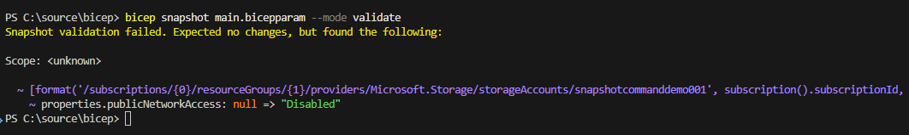

It’s been a while since I last published an Azure Bicep updates edition. But both the Bicep team and community certainly haven't been standing still. In this edition, we're going to catch up with two releases (v0.41.2 and v0.40.2) by looking at some of their highlights:
<ul><li>The <code>bicep snapshot</code> command</li><li>New experimental decorators and functions</li><li>Added namespace functions </li><li>Multi-line interpolated strings</li><li>And more..</li></ul>
Hold on to this one. This blog post is going to be a big one!
<h2 id="bicep-snapshot-command">Bicep snapshot command</h2>
The <code>bicep snapshot</code> command started to surface in v0.36.2 as an experimental feature. Now, in v0.41.2, the command reached GA status. In short, this command allows you to generate a "normalized" snapshot of the resource defined in a Bicep file. The snapshot can then be stored in a file and used to visually compare changes between deployments.

This makes it easier to review how your infrastructure evolves over time, but also to better understand how expressions are evaluated in more complex deployments. Let's take a look at how this works in practice. Imagine you have the following Bicep file:
<pre><code class="language-bicep">param location string&#10;
module storageAccount 'br/public:avm/res/storage/storage-account:0.32.0' = {
  params: {
    name: 'snapshotcommanddemo001'
    location: location
  }
}
</code></pre>
Pretty simple. From this point, you create a snapshot: <code>bicep snapshot main.bicepparam</code>.

Of course, over time, this is going to be expanded with additional properties. Maybe for a security requirement, it's good to disable the <code>publicNetworkAccess</code> property:
<pre><code class="language-bicep">param location string&#10;
module storageAccount 'br/public:avm/res/storage/storage-account:0.32.0' = {
  params: {
    name: 'snapshotcommanddemo001'
    location: location
    publicNetworkAccess: 'Disabled'
  }
}
</code></pre>
Now, running it once again, but this time with the <code>--mode validate</code> added, we can see the property being changed:
<figure class="kg-card kg-image-card kg-card-hascaption"><figcaption>Image 1: Property change</figcaption></figure>
Whilst this is visual, you can capture the snapshot by <code>--mode overwrite</code> and included it in your pull request for easier readability, as it is JSON. To have an even better explanation and demo, check out the <a href="https://www.youtube.com/watch?v=84jVnQI-0Ak">YouTube video</a> created by Anthony Martin.
<h2 id="null-if-not-found-experimental">Null if not found (experimental)</h2>
The new ARM infrastructure backend changes now allow resources to define a <code>nullIfNotFound</code> decorator. This is literally stated in the decorator: if a resource is not found, return null. The feature is behind an experimental feature flag, and to enable it, set the following in your <code>bicepconfig.json</code>:
<pre><code class="language-json">{
    "experimentalFeaturesEnabled": {"existingNullIfNotFound": true}
}</code></pre>
A perfect example to use such a decorator is whenever you have a governance template. The governance templates configure diagnostic settings. But diagnostic settings require a Log Analytics workspace. It can happen that not all subscriptions have the workspace (yet), and adding the <code>@nullIfNotFound()</code> decorator to the template skips the diagnostic settings if so. Here's an example:
<pre><code class="language-bicep">param location string = resourceGroup().location&#10;
@nullIfNotFound()
resource centralWorkspace 'Microsoft.OperationalInsights/workspaces@2023-09-01' existing = {
  name: 'law-central-governance'
}&#10;
var workspaceResourceId = centralWorkspace.?id&#10;
module storageAccount 'br/public:avm/res/storage/storage-account:0.32.0' = {
  name: 'storageAccountDeployment'
  params: {
    name: 'mygovernancestorage001'
    location: location
    // diagnosticSettings is omitted entirely when the workspace isn't present,
    // and populated with the workspace ID when it is – no branching templates needed.
    diagnosticSettings: workspaceResourceId != null
      ? [
          {
            workspaceResourceId: workspaceResourceId!
          }
        ]
      : null
  }
}&#10;
output diagnosticsEnabled bool = workspaceResourceId != null
</code></pre><h2 id="support-for-extension-namespace-functions">Support for extension namespace functions</h2>
In v0.41.2, another feature was added to support extension namespaces for functions. Basically, for extension authors, this provides a cleaner and type-safe function that <code>.bicepparam</code> files can call at deploy time. Depending on the extension, it can fetch secrets and configurations from external systems.

There are no hardcoded values needed anymore, nor do you have to use the <code>externalInput()</code> function. Let's break it down in more detail what this means.

First of all, a Bicep extension is a package that someone builds and then pushes to a registry. When you load one in a <code>.bicepparam</code> file using the <code>extension</code> keyword, it gives you access to a <strong>named namespace</strong>. Through this namespace, you can call functions that the extension author has defined for you.

Before this feature actually existed, fetching a value from an external config store required writing a raw <code>externalInput()</code> call where you had to know the exact internal expression format. There wasn't really any type checking or IntelliSense available.
<pre><code class="language-bicep">param environment = externalInput('configStore.expression', '$config(deployment/environment)')
</code></pre>
Here's the difference. Extension authors define proper typed functions with named parameters and descriptions. Then, as a user, you just call them through the extension's namespace:
<pre><code class="language-bicep">using 'main.bicep'&#10;
extension 'br:myregistry.azurecr.io/bicep/extensions/configstore:1.0.0' as configStore&#10;
param environment  = configStore.config('deployment/environment')
param skuName      = configStore.config('appservice/sku-name')
param replicaCount = int(configStore.config('appservice/replica-count'))</code></pre>
You can see in the above example that the <code>main.bicep</code> stays clean (because we only defined the <code>.bicepparam</code> file). It only has plain parameters and doesn't have knowledge of where the values come from. The <code>.bicepparam</code> file is the one responsible for loading the extension and where the functions get called from.

When you have such an extension available, your VS Code editor can now suggest functions and their names. If you call a function with the wrong type or a missing argument, you get a proper error before the deployment even starts.
<h2 id="do-this-exist-functions">Do this exist functions?</h2>
The heading wasn't really a spelling mistake, but a play on words. Bicep v0.40.2 brought in two new functions in the <code>this</code> namespace. 

Inside a <code>resource</code> body, you can now use two new functions. One returns a boolean telling whether a resource already exists in Azure at the moment of deployment (<code>this.Exists()</code>) and the other goes a little step further. This lets you read the live property values of that resource if it <em>exists </em>(<code>this.existingResource()</code>). The <code>this</code> part mainly focuses on the scoped locality of the resource body they're used in. So <code>this</code> always refers to the resource being declared, nothing more.

One of the reasons this is useful is that Bicep deployments often run more than once. Without <code>this.exists()</code>, you'd have to choose between always applying your desired state or using a separate <code>existing</code> declaration when you deploy it through a pipeline, for example. Take, for example, the following pattern:
<pre><code class="language-bicep">// Requires bicepconfig.json: { "experimentalFeaturesEnabled": { "thisNamespace": true } }&#10;
param location string = resourceGroup().location
param environment string = 'prod'&#10;
resource storageAccount 'Microsoft.Storage/storageAccounts@2025-06-01' = {
  name: 'myappstorage${environment}001'
  location: location
  sku: { name: 'Standard_LRS' }
  kind: 'StorageV2'
  properties: {
    minimumTlsVersion: 'TLS1_2'
    allowBlobPublicAccess: false&#10;
    networkAcls: {
      // First deploy: lock down by default (secure by default).
      // Re-deploy: carry forward whatever the team has already configured so a
      // pipeline re-run never accidentally changes the network policy.
      defaultAction: this.exists()
        ? this.existingResource().properties.networkAcls.defaultAction
        : 'Deny'&#10;
      // Same pattern for bypass: preserve existing value or set a safe default.
      bypass: this.exists()
        ? this.existingResource().properties.networkAcls.bypass
        : 'AzureServices'
    }
  }
}</code></pre>
The pattern above shows this because, on first deployment, it locks down public access. But when you re-deploy it, it carries forward the existing <code>defaultAction</code> and <code>bypass</code> values so the pipeline never accidentally undoes something the platform security team might have configured.
<h2 id="multi-line-interpolated-string">Multi-line interpolated string</h2>
Bicep already had multi-line strings for a while using the <code>'''</code> triple-quote syntax, but v0.41.2 brought the multi-line interpolated strings to GA status. I mentioned the triple-quote syntax because they couldn't contain dynamic values. When you used this syntax, you'd have to break out of the string and concatenate everything together.

Now with interpolated syntax inside a multi-line string, it becomes way easier, for example, when you have an embedded script. A deployment script resource is a perfect candidate to look at. Now you can write out something like this:
<pre><code class="language-bicep">param location string = resourceGroup().location
param storageAccountName string
param containerName string&#10;
resource deploymentScript 'Microsoft.Resources/deploymentScripts@2023-08-01' = {
  name: 'createBlobContainer'
  location: location
  kind: 'AzurePowerShell'
  properties: {
    azPowerShellVersion: '12.0'
    retentionInterval: 'PT1H'
    scriptContent: $'''
      $context = New-AzStorageContext -StorageAccountName '${storageAccountName}' -UseConnectedAccount
      $exists = Get-AzStorageContainer -Name '${containerName}' -Context $context -ErrorAction SilentlyContinue
      if (-not $exists) {
        New-AzStorageContainer -Name '${containerName}' -Context $context -Permission Off
        Write-Output "Container '${containerName}' created."
      } else {
        Write-Output "Container '${containerName}' already exists, skipping."
      }
    '''
  }
}</code></pre>
Here you can see that additional <code>$'''</code> added at the beginning, indicating an <em>interpolated </em>multi-line string.
<h2 id="other-notable-improvements">Other notable improvements</h2>
Each release also brings other improvements, and the following bullet points are my list of notable ones:
<ul><li>New MCP Server tools have been added (<code>decompile_arm_parameters_file</code>, <code>decompile_arm_template_file</code>, <code>format_bicep_file</code>, <code>get_bicep_file_diagnostics</code>, <code>get_file_references</code>, and <code>get_deployment_snapshot</code>).</li><li>Combine the new MCP Server tools with the Bicep MCP server as a <a href="https://www.nuget.org/packages/Azure.Bicep.McpServer">NuGet package</a>.</li><li>Visualizer V2 designer is coming.</li><li>Extendable parameter improvements and fixes</li><li>Disable diagnostic for a whole file (<code>#disable-diagnostics &lt;bicepNumber&gt;</code>)</li></ul><h2 id="conclusion">Conclusion</h2>
That's a wrap for this March 2026 edition of Azure Bicep updates. As you can see, a lot of new features and improvements across both versions. It's good to see that several features came out of experimental state and became stable (GA). 

It's great again to be writing something around Bicep. Keep an eye out for the next edition, which might come sooner than you think!

