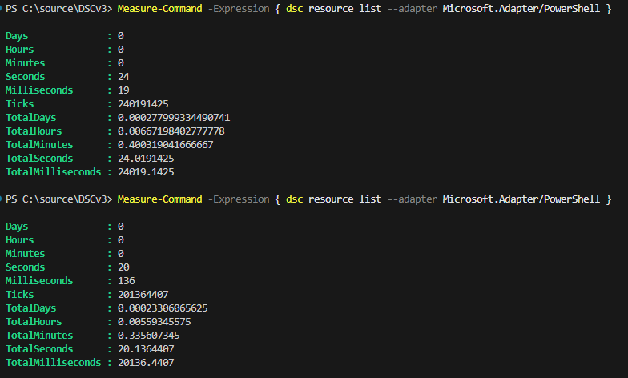
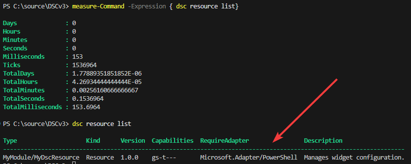
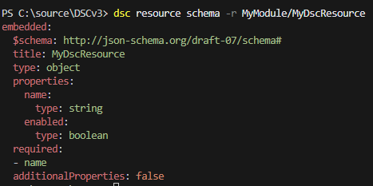

If you ever waited for <code>dsc resource list --adapter Microsoft.Adapter/PowerShell</code> to finish, you might think that the problem is DSC's engine itself. But that's not completely true. 

DSC's engine (<code>dsc.exe</code>) bridges PowerShell resources using an <em>adapter</em>. That adapter just knows about PowerShell's subsystem and does the translation to the engine. But when the adapter does <em>discovery </em>of PowerShell resources, it uses either the old PowerShell DSC module (<code>PSDesiredStateConfiguratiron</code>), or scans through all PowerShell module paths using the <code>$env:PSModulePath</code> environment variable.

Even though the DSC team implemented some caching mechanisms to speed up this process, each discovery that happens whenever you try to invoke a PowerShell DSC resource just takes time.

That's changing.

Two recent pull requests have been officially merged and released in v3.2.0-preview.13. Those pull requests introduce <strong>adapted resource manifests </strong>for the PowerShell 7 adapter (<code>Microsoft.Adapter/PowerShell</code>). An adapted resource manifest is a small JSON file that tells DSC's engine exactly what it needs to know. No scanning, no cache warming, no more waiting. Let me walk you through what's different, how it works, and what you still need to be aware of.
<h2 id="the-current-behavior">The current behavior</h2>
I've already mentioned it a bit in the introduction, but DSC discovers resources by scanning <code>PATH</code> (or <code>DSC_RESOURCE_PATH</code>) environment variable for <code>*.dsc.resource.json</code> files (or <code>.yaml</code>/<code>.yml</code>). If a resource manifest is found on the <code>PATH</code>, DSC finds it instantly. Just simple and fast.

But PowerShell modules with their DSC resources don't live in <code>PATH</code>. They live in <code>$env:PSModulePath</code>. Think of places like <code>~/Documents/PowerShell/Modules</code>, <code>/usr/local/share/powershell/Modules</code> or <code>C:\Program Files\PowerShell\Modules</code>.  And those paths don't contain <code>*.dsc.resource.json</code> files either, so DSC can't see them. At least not without the help of the adapter.

So, that's where the adapter acts as this kind of bridge. When you run <code>dsc resource list --adapter Microsoft.Adapter/PowerShell</code>, the adapter executes a PowerShell function called <code>Invoke-DscCacheRefresh</code>. This function does a lot of heavy lifting like:
<ol><li>It splits all the paths in <code>$env:PSModulePath</code> and walks through every directory.</li><li>It loads the module manifest for each module, looking for <code>DscResourcesToExport</code>.</li><li>It parses the AST of <code>.psm1</code> files to find <code>[DscResource()]</code> attributes.</li><li>It builds a JSON cache file (<code>PSAdapterCache.json</code>)</li></ol>
Even with caching, it can take time to find the right resource. That, of course, depends on some factors if the adapter isn't specified in a configuration document or if a system has many PowerShell modules installed.

We can see with those points that the tension is clear. While DSC's model is <code>PATH</code>-based and snappy, so is the opposite of PowerShell's module system. They don't fit together naturally.

To top it all off, you can't perform a <code>dsc resource schema</code> on a PowerShell DSC resource. The adapter always just returned true, and you had to guess the properties that you specified when invoking a resource. 

Now that we know the current behavior, let's look at how it changes with adapted resource manifests.
<h2 id="with-adapted-resource-manifests">With adapted resource manifests</h2>
The actual fix is actually surprisingly straightforward. Instead of making <code>dsc.exe</code> discover PowerShell resources at runtime, you declare them upfront.

Sounds vague, I know. 

An adapted resource manifest in the Microsoft DSC landscape is a totally new file type: <code>*.dsc.adaptedResource.json</code>. It's a very lightweight JSON file that tells the engine everything about a PowerShell resource without launching PowerShell at all. Here's what one looks like:
<pre><code class="language-json">{
    "$schema": "https://aka.ms/dsc/schemas/v3/bundled/adaptedresource/manifest.json",
    "type": "MyModule/MyDscResource",
    "kind": "resource",
    "version": "1.0.0",
    "capabilities": ["get", "set", "test"],
    "description": "Manages widget configuration.",
    "author": "Gijs Reijn",
    "requireAdapter": "Microsoft.Adapter/PowerShell",
    "path": "MyModule.psd1",
    "schema": {
        "embedded": {
            "$schema": "http://json-schema.org/draft-07/schema#",
            "title": "MyDscResource",
            "type": "object",
            "properties": {
                "name": { "type": "string" },
                "enabled": { "type": "boolean" }
            },
            "required": ["name"],
            "additionalProperties": false
        }
    }
}</code></pre>
For users who already know the resource manifest, this should look very similar. But for the ones not, let's break it down:
<ul><li>The <code>type</code>property is the fully-qualified resource type name; in this example, it represents the <code>&lt;ModuleName/ResourceName</code>.</li><li>The <code>requireAdapter</code> property tells DSC's engine which adapter handles this resource.</li><li>The <code>path</code> is the relative path to the PowerShell module manifest. This is the key to the magic.</li><li>The <code>schema</code> property is an embedded JSON schema that DSC can validate input on.</li><li>The <code>capabilities</code> property says what capabilities the DSC resource supports.</li></ul>
In this case, when I'm talking about a DSC resource, I'm talking about a class-based one. 

When DSC finds this file on the <code>PATH</code>, it reads it and registers the resource. This happens with <code>dsc resource list</code> and not <code>dsc resource list --adapter Microsoft.Adapter/PowerShell</code>. So that means it doesn't spawn a PowerShell process, nor does it scan through <code>$env:PSModulePath</code>. 

Okay, we have the theory, what about the performance and improvements? 
<h2 id="benefits-using-adapted-resource-manifests">Benefits using adapted resource manifests</h2>
To look at the benefits, we can do a short exercise by creating a class-based DSC resource, running it through the adapter, and then through the adapted resource manifest approach:
<pre><code class="language-powershell"># MyModule.psd1
@{
    ModuleVersion        = '1.0.0'
    GUID                 = 'a1b2c3d4-e5f6-7890-abcd-ef1234567890'
    Author               = 'Gijs Reijn'
    Description          = 'Manages widget configuration.'
    PowerShellVersion    = '7.0'
    RootModule           = 'MyModule.psm1'
    DscResourcesToExport = @('MyDscResource')
}&#10;
# MyModule.psm1
[DscResource()]
class MyDscResource {
    [DscProperty(Key)]
    [string] $Name&#10;
    [DscProperty()]
    [bool] $Enabled&#10;
    [MyDscResource] Get() {
        $currentState = [MyDscResource]::new()
        $currentState.Name = $this.Name
        $currentState.Enabled = $false&#10;
        return $currentState
    }&#10;
    [void] Set() {
        if ($this.Enabled) {
            Write-Verbose "Enabling $($this.Name)"
        } else {
            Write-Verbose "Disabling $($this.Name)"
        }
    }&#10;
    [bool] Test() {
        $currentState = $this.Get()
        return $currentState.Enabled -eq $this.Enabled
    }
}</code></pre>
Honestly, the above example doesn't represent a production-ready module, but it illustrates the purpose. Let's measure the first and second times when running through the <code>dsc resource list</code> command:
<figure class="kg-card kg-image-card kg-card-hascaption"><figcaption>Figure 1: Measuring through dsc resource list</figcaption></figure>
You can see that there's a small difference in there, but still not significant in speed. Now, time to use the adapted resource manifest:
<pre><code class="language-json ">{
    "$schema": "https://aka.ms/dsc/schemas/v3/bundled/adaptedresource/manifest.json",
    "type": "MyModule/MyDscResource",
    "kind": "resource",
    "version": "1.0.0",
    "capabilities": ["get", "set", "test"],
    "description": "Manages widget configuration.",
    "author": "Gijs Reijn",
    "requireAdapter": "Microsoft.Adapter/PowerShell",
    "path": "MyModule/1.0.0/MyModule.psd1",
    "schema": {
        "embedded": {
            "$schema": "http://json-schema.org/draft-07/schema#",
            "title": "MyDscResource",
            "type": "object",
            "properties": {
                "name": { "type": "string" },
                "enabled": { "type": "boolean" }
            },
            "required": ["name"],
            "additionalProperties": false
        }
    }
}
</code></pre><figure class="kg-card kg-image-card kg-card-hascaption"><figcaption>Figure 2: Running dsc resource list to discover PowerShell resource</figcaption></figure>
That's pretty fast! And what it even brings more is that you can see the schema of the resource because we added the JSON embedded schema in the resource manifest:
<figure class="kg-card kg-image-card kg-card-hascaption"><figcaption>Figure 3: Get resource schema</figcaption></figure>
Clearly, you can see the differences between using an adapted resource manifest versus running it <em>directly </em>through the adapter for discovery (the same will be for other operations like <code>get</code> or <code>set</code>).
<h2 id="the-one-limitation">The one "limitation"</h2>
Here's the part that I left behind and you need to pay attention to.

In figure 2, you probably only noticed that <em>one </em>resource was returned. That was because I explicitly defined the path where the PowerShell module lived using <code>DSC_RESOURCE_PATH</code>. But that instantly brings me to the start of the story.

Adapted resource manifests are discovered the same way as any other DSC manifest file. It knows about it when it is either in the <code>PATH</code> or <code>DSC_RESOURCE_PATH</code>. But PowerShell modules typically aren't located in these environment variables. 

The <code>Invoke-DscCacheRefresh</code> doesn't resolve the <code>path</code> field in the adapted resource manifest, either. It's just not built for it. So, even if you ship an adapted resource manifest for your DSC resources, DSC won't find them when you either use <code>Install-Module</code> or <code>Install-PSResource</code>. 

Is there a way to solve this? 

Well, luckily, yes. DSC has an extensible model allowing you to discover resources outside its boundary of <code>PATH</code> or <code>DSC_RESOURCE_PATH</code>. This can be done through a <strong>discovery extension</strong>. Discovery extensions have a file extension of <code>*.dsc.extension.json</code> with a <code>discover</code> command that knows where PowerShell modules live. And if it knows where they live, it can load the relevant <em>manifest files</em>. 

Now, I can paste up the code, but I've taken the initiative to have this extension built in when you install DSC. The pull request is merged and can be found at <a href="https://github.com/PowerShell/DSC/tree/main/extensions/powershell" rel="noreferrer">GitHub</a> (and will become available in the next versions of Microsoft DSC). It's worth noting that this is a feature only for PowerShell 7. The <code>WindowsPowerShell</code> adapter isn't supported. 
<h2 id="conclusion">Conclusion</h2>
You've just learned that an adapted resource manifest brings a change in how PowerShell DSC resources show up in DSC. It definitely speeds up the process of discovering, but also gives you the capability to list out the schema. For other operations, it's good to know that it skips the full cache refresh, even making it faster and more predictable.

But... 

It still needs a discovery extension. Hopefully, the pull request linked will be included in the next releases. 

If you maintain PowerShell DSC resources, especially class-based ones, you can start creating adapted resource manifests for them and then ship them alongside your module packaging. Your users are going to notice the 

