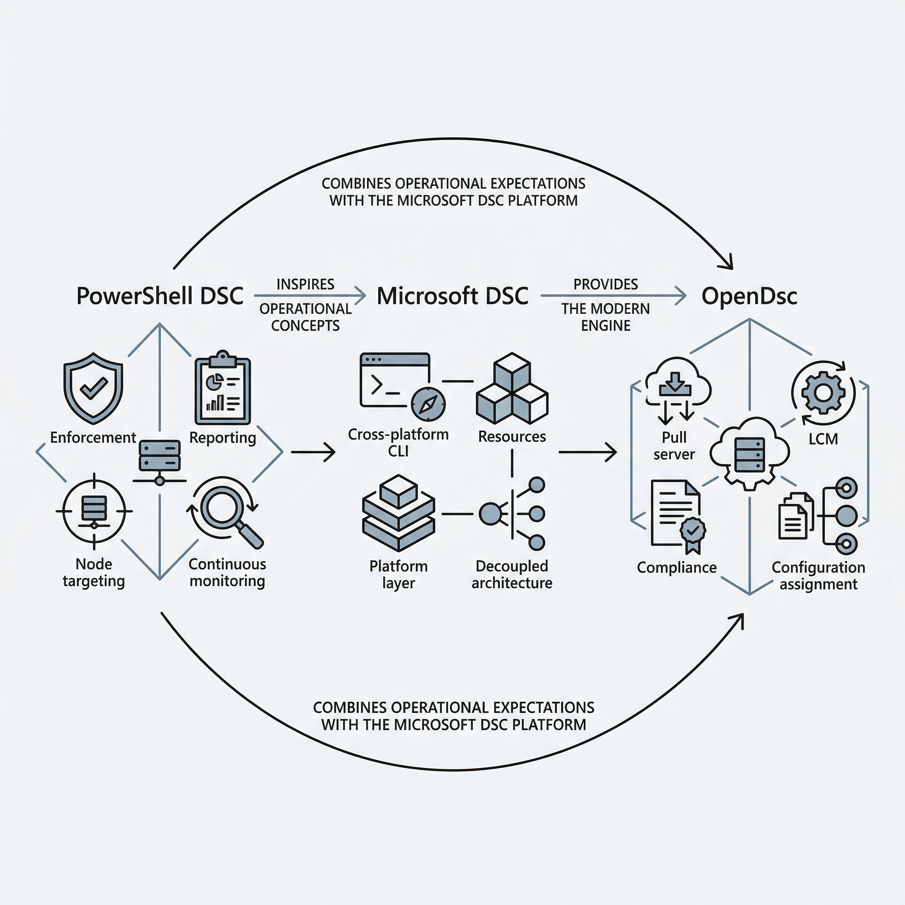
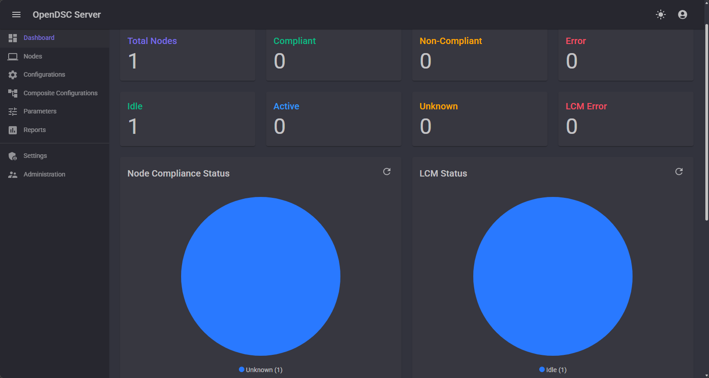
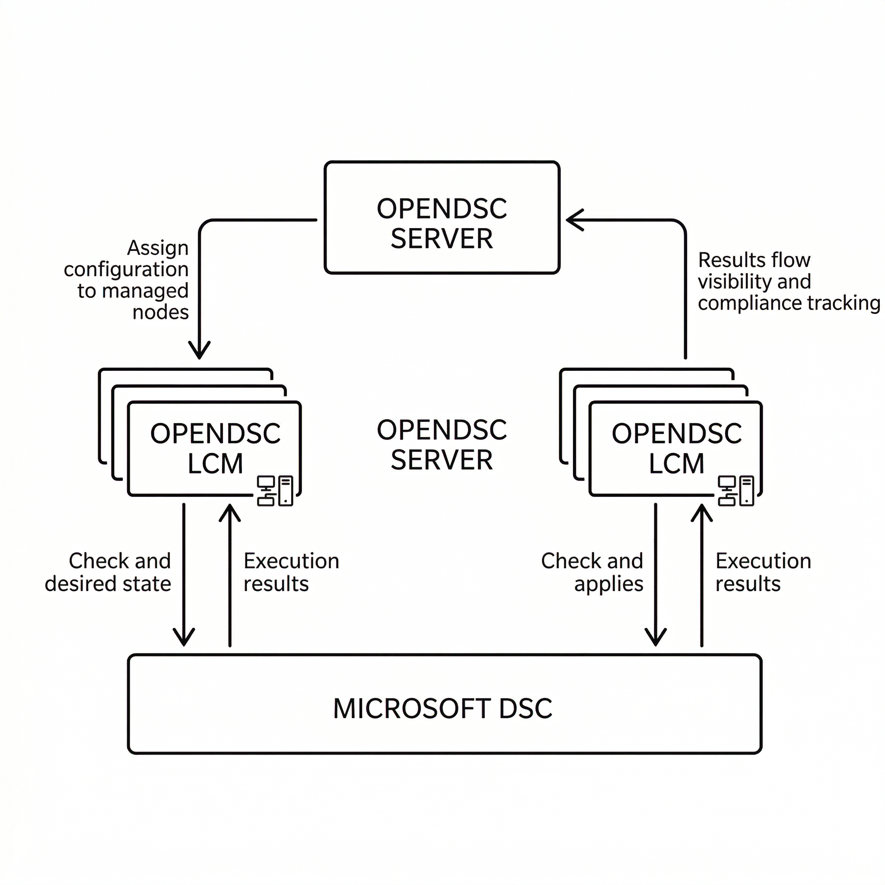

The DSC team changed direction when development started for DSC v3. The full decoupling of a "Local Configuration Manager". A bet was made that other tooling would invoke the underlying CLI, also known as higher-order tools.  Whilst this keeps the CLI lean, it also leaves the enforcement functionality behind that enterprises and DSC fans use today. Not to mention "the need." It also means that there's no reporting, nor assigning to nodes, or any operation loop that the traditional IT admin depends on.  This is where OpenDsc attempts to make a difference. OpenDSC is not trying to replace Microsoft DSC. It's trying to build that missing layer by hooking into Microsoft DSC. And by looking at the current progression, it's coming to a phase where it steps out of the realm of "proof of concept."  What makes this so interesting is that OpenDsc is not just revisiting old ideas, but rethinking what an enforcement and operation layer should look like with the new DSC version (Microsoft DSC). And that is exactly the point where the conversation needs to shift from the "engine" versus the "operation gap." Let's take a look.
<h2 id="dont-confuse-opendsc-with-powershell-dsc">Don't confuse OpenDSC with PowerShell DSC</h2>
Before going any further, there's a clear distinction that needs to be made. Many people confuse when they hear DSC today, that it refers to PowerShell DSC. Or the <a href="https://www.powershellgallery.com/packages/PSDesiredStateConfiguration/2.0.8">PSDesiredStateConfiguration</a> module that actually powers <em>DSC functionality</em>. 

But OpenDsc doesn't work with PowerShell DSC. The <strong>history</strong> does.

See, PowerShell DSC brought many ideas into OpenDSC. Think about things like continuous enforcement, reporting, assigning configuration to nodes, and the biggest one: that the desired state is monitored and applied over time. 

That's the history that many administrators came to expect from a configuration platform. But that implementation is totally different from Microsoft DSC.

OpenDsc is built around Microsoft DSC, not the older PowerShell DSC. OpenDsc only took that inspiration and revived most of the ideas by applying them to the Microsoft DSC world. 

Here's a picture representing the DSC worlds together:
<figure class="kg-card kg-image-card kg-card-hascaption"><figcaption>Figure 1: The relationship between PowerShell DSC, Microsoft DSC, and OpenDsc</figcaption></figure><h2 id="why-an-engine-alone-is-not-enough">Why an engine alone is not enough</h2>
Microsoft DSC changed the game. The CLI is a powerful cross-platform engine for declarative configuration. A CLI that can be called by other tooling and a flexible model for resources that doesn't force authors to implement all capabilities at once.

That foundation makes it strong. But that foundation is not enough. 

For a user like me, I can easily make a configuration document. I'll probably store it in version control and tell my coworkers to install Microsoft DSC and then run it to apply the same configuration I have on my machine.

In large regulatory enterprises, that doesn't work. They need some way to enforce it. Some orchestrator that does the work. And that orchestrator needs to send back a report so the visibility becomes clear.

That's why only an engine is enough. Yes, an engine can execute. It can validate resources. It exposes a clean interface and contract. But on its own, it's just a simple engine. 

It's not going to decide which nodes get what. It's not going to provide persistence over time. Let alone that it's going to give an administrator a pull model.

So, yes, the engine is essential. But that's one part. OpenDsc provides the missing piece. It perfectly accepts Microsoft DSC as the engine, and at the same time, recognizes that an engine without the earlier points mentioned is just execution. Not <strong><em>operations </em></strong>or<em><strong> enforcement</strong>.</em>

That's what OpenDSC is trying to close by taking the strengths of Microsoft DSC as a (platform) engine, and building that layer around it. 
<h2 id="the-missing-layer-opendsc-built">The missing layer OpenDsc built</h2>
In Figure 1, you already saw the distinction between the ideas and the functionality OpenDsc is now built upon. OpenDsc built the layer that sits between Microsoft's DSC engine and the day-to-day operational needs administrators want.
<figure class="kg-card kg-image-card kg-card-hascaption"><figcaption>Figure 2: The OpenDsc dashboard</figcaption></figure>
This is the missing layer today. And better yet, it's not just one feature. It provides a set of capabilities that, when brought together, make the desired state with Microsoft DSC practical in real environments. That's a big statement, but there's a truth in it.

The OpenDsc server includes:
<ul><li>Assigning configurations to nodes.</li><li>Tracking compliance.</li><li>Monitoring drift.</li><li>Pulling updated configuration bundles.</li><li>Custom roles.</li><li>Provide visibility for administrators on what is happening in their environment.</li></ul>
Azure Machine Configuration is also a tool that already provides this. It delivers the points above after the decoupling from the LCM in PowerShell DSC. But that's PowerShell DSC, and Azure Machine Configuration still works only with PowerShell DSC today. Plus, there's one more thing, which you already see in the naming: <strong>Azure</strong>. 

Even though Azure Machine Configuration can be brought to an on-premises server using Azure Arc, Azure is still needed. And that's where OpenDsc comes back into focus. 

OpenDsc doesn't rely on Azure. Nor again does it on PowerShell DSC. It built those capabilities around Microsoft DSC in an open way. Not bound to Azure as the control plane, but also for teams that want to run their own control plane, or keep their configuration story closer to the infrastructure they already manage.

And that's really the value OpenDsc brings today. It took many of the lessons learned and implemented them in a "brand new jacket" without requiring a dependency on any sort (except DSC's engine, of course). That brings us to the final question: what does OpenDsc actually look like in practice, and how do you get started?
<h2 id="getting-started-with-opendsc">Getting started with OpenDsc</h2>
To get started with OpenDsc, it helps to first look at the bigger picture.
<figure class="kg-card kg-image-card kg-card-hascaption"><figcaption>Figure 3: The core components</figcaption></figure>
As you can see, OpenDsc is not just one service. A small set of components works together. The Microsoft DSC is the engine, the OpenDSC server is the control plane, and the OpenDSC Local Configuration Manager (LCM) is the agent that enforces the desired state on each node.

The easiest way to begin is to install and start with the OpenDSC server. To install the server, you can use WinGet:
<pre><code class="language-powershell">winget install --id OpenDsc.Server --source winget</code></pre>
When the installation finishes, you can browse to <code>http://localhost:5000</code>. This will prompt you to fill in the username (<code>admin</code>) and password (<code>admin</code>). After you've logged in, change the password.

The next step is to prepare a node by installing Microsoft DSC together with the OpenDSC LCM:
<pre><code class="language-powershell"># Install Microsoft DSC
winget install --id Microsoft.DSC.Preview --source winget&#10;
# Install OpenDsc.LCM
winget install --id OpenDsc.LCM --source winget</code></pre>
Now I can provide more instructions on how to register the node with the pull server, but I've already got you covered with an <a href="https://github.com/Gijsreyn/opendsc/blob/0a7b11addfd109af66d3314a054670044ac275fa/docs/get-started/pull-server-setup.md">in-depth guide</a> on the repository. You can skip the installation parts.
<h2 id="conclusion">Conclusion</h2>
OpenDsc is an interesting project, as it's one of the first that brought back many ideas from PowerShell DSC, but threw them around Microsoft DSC as being the operational and enforcement layer that's missing today.

However, let's come back to the distinction before misconfusion or assumptions are made.  OpenDSC doesn't fight Microsoft DSC. Microsoft DSC obviously made a choice to be that lower-level piece. That lower-level piece is the engine I've been talking about. 

OpenDSC brings in the value of being a higher-order tool and invoking the engine. Plus all the beautiful features you've just learned about. 

