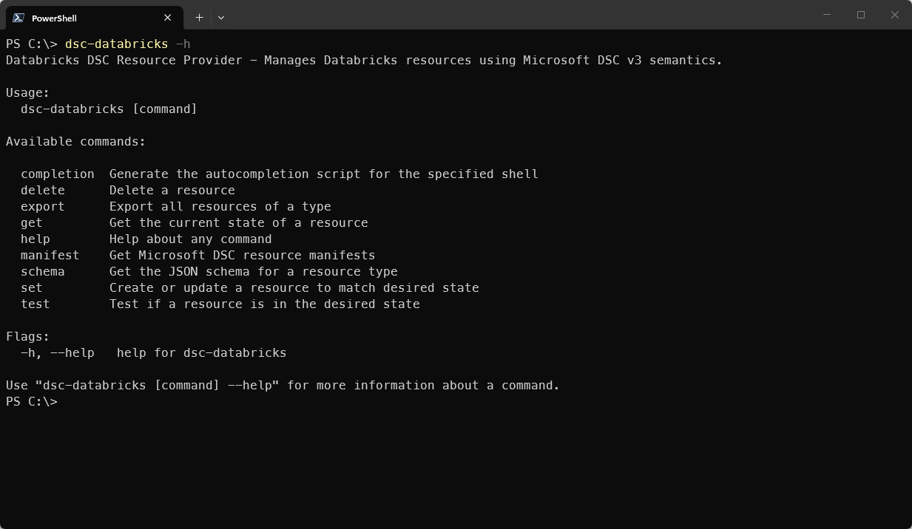

The <a href="https://github.com/databricks/cli/pull/4349">pull request</a> was closed.

Not merged, not abandoned, just straight up closed. With a short explanation from the maintainers. The Databricks CLI wasn't the right home for <a href="/i-rewrote-my-own-dsc-module-on-purpose-a-story-of-open-source-courage-in-databricks/">Microsoft DSC integration</a>. That was their call to make and complete fair.

Quite honestly, I sat with that for a moment when spend such effort in creating <em>something</em>. But I guess I did something that probably most stubborn open source contributors would do: just keep going.

This post is what came after the pull request was closed. The lesson I should have taken before ever opening a pull request. Why I still decided to build a standalone CLI and how a GitHub organization was born out of that stubbornness. And how you can now still benefit from that result today using WinGet.
<h2 id="the-lesson-i-should-have-learned-from-the-start"><strong>The lesson I should have learned from the start</strong></h2>
Looking back after that moment of silence, there's one thing I would do differently. It will save you the same <strong>pain</strong> if you take an open-source project seriously and you want to contribute.

Before spending weeks implementing DSC resources inside the Databricks CLI, I should have opened a discussion or a GitHub issue first. 

Yes, it's that simple to get it going. That doesn't have to be a big wall of text. Hell, you don't even have to make a proof of concept. It's just going to be a question: 
<blockquote>"Hey, would you be interested in DSC support for the CLI? Here's the rough idea..."</blockquote>
That starting conversation would have saved me a little bummer and waiting. The maintainers could have said no up front. Or they could have said yes, and it would have shaped the direction early on. Either way, I would have known where I stood before writing that very first piece of Go code.

I always get excited about an idea. But that simple lesson is an easy one to implement. Excitement is good in a way, but risky when you want to work with people together. That's just the open source world. 
<h2 id="but-the-pull-request-being-closed-didnt-close-the-idea">But the pull request being closed didn't close the idea</h2>
Here's the thing about that pull request and ideas. Pull requests get closed, but ideas don't matter where they live.

The DSC integration I had designed still made sense (in a way, at least to me). Its architecture was built on the same principles as the <code>databricks</code> CLI. And of course, the resources still worked. However, the only thing that changed was the address.

So that's what happened. I took everything I had built, renamed a couple of things, and started to extract it into a standalone CLI. The new home? <a href="https://github.com/LibreDsc/dsc-databricks">dsc-databricks</a>.

Its purpose never changed. It still speaks the same JSON contract Microsoft DSC's engine expects. It still lets you manage Databricks resources in a declarative way and through <code>dsc.exe</code> itself without the need for a PowerShell adapter. It just does it on its own terms now.
<figure class="kg-card kg-image-card kg-card-hascaption"><figcaption>Figure 1: The <code spellcheck="false" style="white-space: pre-wrap;">dsc-databricks</code> CLI</figcaption></figure><h2 id="why-change-to-go-and-not-stay-with-powershell">Why change to Go and not stay with PowerShell?</h2>
That's a fair question, and if you've followed the first article, you know that the project still lives on as well.

But the honest answer is that, regardless of how well I know PowerShell, I would have missed the point.

First of all, the whole reason is that I wanted to start a path in the first place to challenge the assumption that DSC resources have to be written in PowerShell. For years, this has been the mental model for most folks who search for Desired State Configuration these days. A DSC resource is shipped in a module. That module meant PowerShell. 
<blockquote>Microsoft DSC allows you to write it in any language. The only thing that remains is to produce a program (or executable) that <code>dsc.exe</code> can talk to. </blockquote>
Whilst the Databricks CLI was already written in Go, that was not the second reason. When I was doing research, I noticed that Go has an SDK for Databricks. And that in itself reduced the learning barrier for me to get started with Go. I didn't have to construct these manual API calls the same way I already did in the PowerShell variant. Plus, it compiled easily to a single binary for multiple platforms (yes, that's something I borrowed from the Databricks CLI project).

Then, there was also a personal reason that I can finally talk about. I needed a real experience that demonstrated DSC resource development whilst I was writing my new edition, "<a href="https://leanpub.com/themicrosoftdschandbook">The Microsoft DSC Handbook</a>."

The <code>dsc-databricks</code> project became that experience. How was I going to teach other people if I hadn't performed such an exercise and experience in itself? I needed a real thing, and so I did. I'm not going to lie that I leaned into AI tools to help me with Go parts I didn't know; that's also part of the story.

Now, this tool isn't a toy. It really works against a real Databricks workspace or can even perform Unity operations. In today's world, you don't have to master a language before you can build something meaningful. 
<h2 id="creating-a-place-to-store-the-project">Creating a place to store the project</h2>
If you have already pressed the hyperlink to the <code>dsc-databricks</code> project, you can already see something that has become clear. This wasn't going to be the only project like this.

When you look at the project, there's a pattern created. A pattern that was not only for me, but also for contributors. And patterns deserve a home.

That's why I created the <a href="https://github.com/LibreDsc">LibreDsc organization</a> on GitHub. This organization is dedicated to building and hosting open-source command-based DSC resources, but also other helpful tools you can use with Microsoft DSC.

<code>dsc-databricks</code> is the first project under that umbrella, but it won't be the last.
<h2 id="installing-it">Installing it</h2>
If you want to try <code>dsc-databricks</code> yourself, you can install it through WinGet on a Windows machine:
<pre><code class="language-powershell">winget install LibreDsc.Databricks --source winget</code></pre>
Once WinGet finishes the installation, the binary will be available in your <code>PATH</code>. If it can't be discovered through <code>dsc.exe</code>, run the following commands:
<pre><code class="language-powershell">dsc-databricks manifest | 
  Set-Content -Path `
  (Join-Path (Split-Path (Get-Command dsc).Source -Parent) -ChildPath 'LibreDsc.Databricks.dsc.manifests.json') `
  -Encoding utf8</code></pre>
From here onwards, you can start managing your Databricks workspace through DSC configurations like any other resources.

For further reference on how to get started, check out the amazing wiki available on <a href="https://github.com/LibreDsc/dsc-databricks/wiki">GitHub</a>.
<h2 id="a-closed-door-is-still-a-door">A closed door is still a door</h2>
The pull request being closed felt like a setback. But that was in that moment. Maintainers of the project also need to maintain it, so in the end, it was just a redirect.

The idea was always going to find its way one way or the other. It turned out that I had to build it myself and ended up with a more valuable lesson than I could imagine. It's now its own CLI utility with its own organization. And that organization is only growing.

