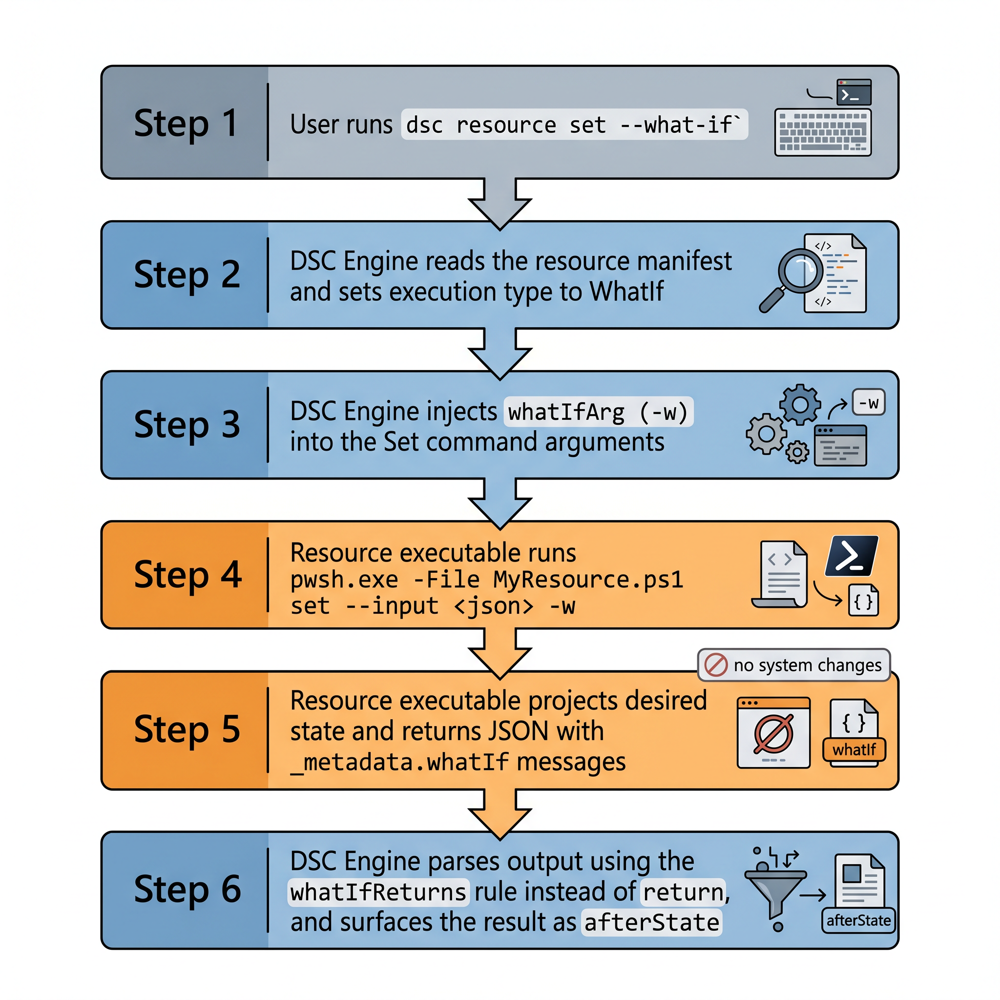
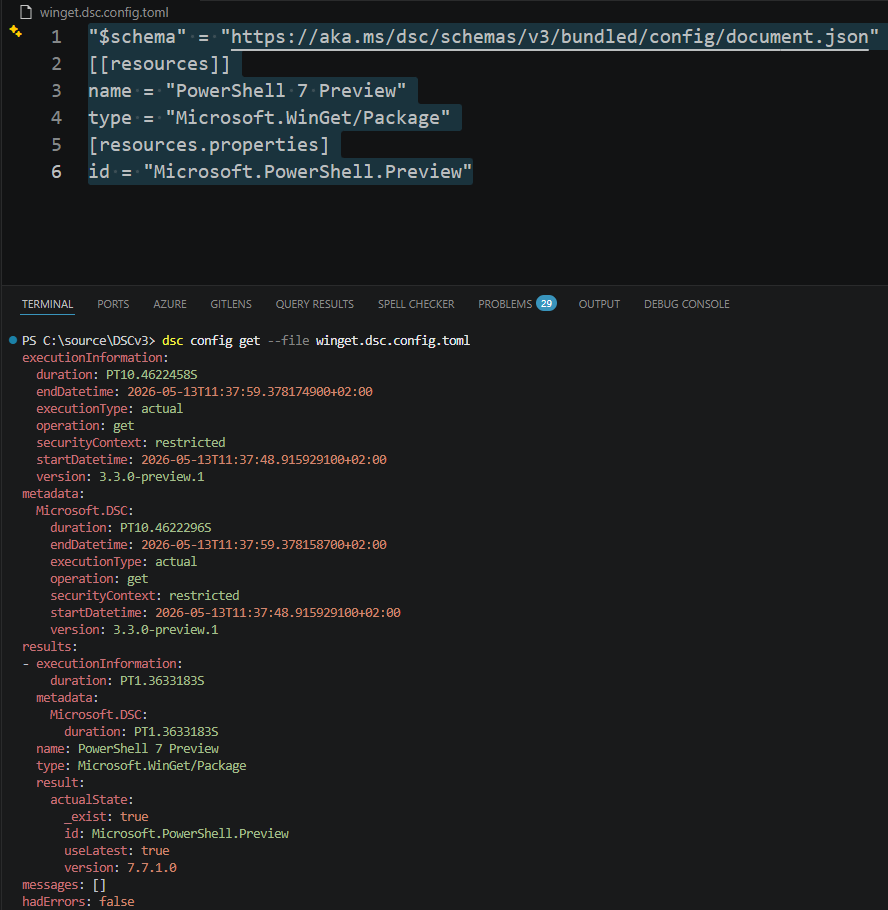

Microsoft's DSC v3.2 <a href="https://devblogs.microsoft.com/powershell/announcing-dsc-v3-2-0/">announcement and release</a> were published on the 29th of April. Looking at the table of contents (TOC), a lot has changed since v3.1.

But behind TOC, there are a number of small (to big) changes that aren't obvious directly from the surface. Take the hypothetical TOML example, for instance. How does that actually work in practice? And what about the PowerShell discovery extension? 

In this post, we'll digest the Microsoft DSC 3.2 release a bit further. Not by repeating the announcement. Instead, by looking at some of the parts that require a second look, and looking at what they actually do when you work with them. 
<h2 id="wasnt-whatif-not-already-there">Wasn't WhatIf not "already" there?</h2>
Besides the Bicep support and new built-in resources, there was a section named "Extended WhatIf support." But wasn't that already there? 

Well, partially true, as also stated in the article. However, there are two interesting aspects when looking in more depth. The first one is obvious and stated in the article, DSC's subcommand <code>config set</code> already had the <code>--what-if</code> mode, but now it can also be applied on <code>dsc resource set</code>.

💡

The current code snippet on <code spellcheck="false" style="white-space: pre-wrap;">Microsoft.Windows/Service</code> doesn't work. In one of the next preview releases, hopefully, the following <a href="https://github.com/PowerShell/DSC/pull/1507">pull request</a> will be merged in.

But the resource manifest can now declare <code>whatIfReturns</code> field in the resource manifest. This is helpful for resource authors, enabling a richer preview output for resources they develop.

So, how does this work in-depth? Whenever you run <code>dsc config set -w</code> or <code>dsc resource set -w</code>, DSC invokes the resource's <code>set</code> command with an extra flag specified by this <code>whatIfArg</code> manifest field. After the command finishes, DSC interprets the output according to the <code>whatIfReturns</code> manifest field instead of the normal <code>return field</code>.  
<figure class="kg-card kg-image-card kg-card-hascaption"><figcaption>Figure 1: WhatIf execution flow</figcaption></figure>
To take it one step further and make it a complete example, let's illustrate it with a PowerShell DSC resource managing a Windows environment variable. This would be the <code>MyEnvVar.dsc.resource.json</code> file:
<pre><code class="language-json">{
  "$schema": "https://aka.ms/dsc/schemas/v3/bundled/resource/manifest.json",
  "type": "MyCompany/EnvVar",
  "version": "0.1.0",
  "description": "Manages a Windows user-scope environment variable.",
  "get": {
    "executable": "pwsh",
    "args": [
      "-NonInteractive", "-NoProfile", "-ExecutionPolicy", "Bypass",
      "-File", "MyEnvVar.ps1",
      "get",
      { "jsonInputArg": "--input", "mandatory": true }
    ]
  },
  "set": {
    "executable": "pwsh",
    "args": [
      "-NonInteractive", "-NoProfile", "-ExecutionPolicy", "Bypass",
      "-File", "MyEnvVar.ps1",
      "set",
      { "jsonInputArg": "--input", "mandatory": true },
      { "whatIfArg": "-w" }
    ],
    "return": "state",
    "whatIfReturns": "state"
  },
  "schema": {
    "embedded": {
      "$schema": "https://json-schema.org/draft/2020-12/schema",
      "type": "object",
      "required": ["name"],
      "properties": {
        "name":  { "type": "string", "description": "The environment variable name." },
        "value": { "type": ["string", "null"], "description": "The value to set." },
        "_exist": {
          "type": "boolean",
          "default": true,
          "description": "Whether the variable should exist."
        },
        "_metadata": {
          "type": "object",
          "properties": {
            "whatIf": { "type": "array", "items": { "type": "string" } }
          }
        }
      }
    }
  }
}</code></pre>
In the resource script (<code>MyEnvVar.ps</code>), it looks something like:
<pre><code class="language-powershell">[CmdletBinding()]
param(
    [Parameter(Mandatory, Position = 0)]
    [ValidateSet('get', 'set')]
    [string] $Operation,&#10;
    [Parameter(Mandatory)]
    [string] $Input,&#10;
    # DSC injects -w automatically when running in what-if mode (whatIfArg: "-w")
    [Alias('WhatIf')]
    [switch] $w
)&#10;
Set-StrictMode -Version Latest
$ErrorActionPreference = 'Stop'&#10;
class EnvVarState {
    [string] $name
    [string] $value
    [bool]   $_exist&#10;
    EnvVarState([string]$name, [string]$value, [bool]$exist) {
        $this.name   = $name
        $this.value  = $value
        $this._exist = $exist
    }
}&#10;
function Get-CurrentState {
    param([string] $Name)&#10;
    $current = [System.Environment]::GetEnvironmentVariable($Name, 'User')
    if ($null -ne $current) {
        return [EnvVarState]::new($Name, $current, $true)
    }
    return [EnvVarState]::new($Name, $null, $false)
}&#10;
function Invoke-Get {
    param([pscustomobject] $Desired)&#10;
    $state = Get-CurrentState -Name $Desired.name
    [ordered]@{
        name   = $state.name
        value  = $state.value
        _exist = $state._exist
    } | ConvertTo-Json -Compress -Depth 5
}&#10;
# ---------------------------------------------------------------------------
# Set operation (also handles what-if when $WhatIf is $true)
# ---------------------------------------------------------------------------&#10;
function Invoke-Set {
    param(
        [pscustomobject] $Desired,
        [bool]           $WhatIf
    )&#10;
    $name         = $Desired.name
    $desiredValue = $Desired.value
    $shouldExist  = if ($null -ne $Desired._exist) { [bool]$Desired._exist } else { $true }
    $current      = Get-CurrentState -Name $name&#10;
    $messages = [System.Collections.Generic.List[string]]::new()
    if (-not $shouldExist) {
        if ($current._exist) {
            $messages.Add("Would delete environment variable '$name'")
        }&#10;
        if ($WhatIf) {
            $projected = [ordered]@{ name = $name; _exist = $false }
            if ($messages.Count -gt 0) {
                $projected['_metadata'] = @{ whatIf = $messages.ToArray() }
            }
            return ($projected | ConvertTo-Json -Compress -Depth 5)
        }&#10;
        # Actual deletion: pass $null to remove the variable
        [System.Environment]::SetEnvironmentVariable($name, $null, 'User')
        return ([ordered]@{ name = $name; _exist = $false } | ConvertTo-Json -Compress -Depth 5)
    }&#10;
    if (-not $current._exist) {
        $messages.Add("Would create environment variable '$name' with value '$desiredValue'")
    } elseif ($null -ne $desiredValue -and $current.value -ne $desiredValue) {
        $messages.Add("Would change value from '$($current.value)' to '$desiredValue'")
    }&#10;
    if ($WhatIf) {
        $projected = [ordered]@{
            name   = $name
            value  = if ($null -ne $desiredValue) { $desiredValue } else { $current.value }
            _exist = $true
        }
        if ($messages.Count -gt 0) {
            $projected['_metadata'] = @{ whatIf = $messages.ToArray() }
        }
        return ($projected | ConvertTo-Json -Compress -Depth 5)
    }&#10;
    # Actual set
    if ($null -ne $desiredValue) {
        [System.Environment]::SetEnvironmentVariable($name, $desiredValue, 'User')
    }&#10;
    # Return final state after applying changes
    $final = Get-CurrentState -Name $name
    [ordered]@{
        name   = $final.name
        value  = $final.value
        _exist = $final._exist
    } | ConvertTo-Json -Compress -Depth 5
}&#10;
# ---------------------------------------------------------------------------
# Entry point
# ---------------------------------------------------------------------------&#10;
$desired = $Input | ConvertFrom-Json&#10;
switch ($Operation) {
    'get' { Invoke-Get -Desired $desired }
    'set' { Invoke-Set -Desired $desired -WhatIf $w.IsPresent }
}</code></pre>
If the user now runs <code>dsc resource set --what-if -r MyCompany/EnvVar --input '{"name":"MY_VAR","value":"hello"}'</code>, DSC is going to read the manifest. It will find the <code>{ "whatIfArg": "-w" }</code> in <code>set.args</code>. The <code>-w</code> is inserted because the execution type is <code>WhatIf</code> ending in something like:
<pre><code class="language-powershell">pwsh -NonInteractive -NoProfile -ExecutionPolicy Bypass -File MyEnvVar.ps1 set --input '...' -w</code></pre>
The resource script itself receives the <code>-w</code>, so it passes by <code>$w.IsPresent</code>. The script is going to grab what would change, and return the projected JSON without actually calling <code>SetEnvironmentVariable</code>. The returned output would look something like this:
<pre><code class="language-json">{
  "name": "MY_VAR",
  "value": "hello",
  "_exist": true,
  "_metadata": {
    "whatIf": [
      "Would create environment variable 'MY_VAR' with value 'hello'"
    ]
  }
}</code></pre>
There are more rules when you define <code>stateAndDiff</code> in the resource manifest, but this is roughly the idea about <code>whatIfReturns</code> field. 
<h2 id="code-gremlins-with-arrows">Code gremlins with arrows</h2>
DSC already supports defining ARM functions in configuration documents. They borrowed them and implemented them in the engine. What's new is that there have been two functions introduced that have these weird arrows in them. These are known as <em>lambda expressions.</em>

The first one will be <code>map()</code>, which takes two arguments (<code>inputArray</code>, <code>lambda function</code>). This function can be helpful where you have, for example, a list of short usernames and need to produce the matching corporate email address for each one of them:
<pre><code class="language-yaml">$schema: https://aka.ms/dsc/schemas/v3/bundled/config/document.json
parameters:
  usernames:
    type: array
    description: Short usernames to convert into corporate email addresses.
    defaultValue:
      - Gael
      - Thomas
      - Gijs
resources:
  - name: 
    type: Microsoft.DSC.Debug/Echo
    properties:
      output: &gt;-
        [map(
          parameters('usernames'),
          lambda('name',
            concat(lambdaVariables('name'), '@themembersofdscworkinggroup.com')
          )
        )]</code></pre>
The expected output is an array outputting: <code>["Gael@themembersofdscworkinggroup.com", "Thomas@themembersofdscworkinggroup.com", "Gijs@themembersofdscworkinggroup.com"]</code>.

The second one is an interesting one: <code>filter()</code>. It's already in the wording, but filters an array with a custom filtering function. It accepts the same number of arguments as <code>map()</code> does. 

Imagine that you've got a bunch of well-known system ports, say under 1024. Those are all managed by the operating system, but you also have application ports (greater than 1024) that DSC should configure. The <code>filter()</code> function trims the list down to only the ports that DSC owns in the following example:
<pre><code class="language-yaml">$schema: https://aka.ms/dsc/schemas/v3/bundled/config/document.json
parameters:
  allPorts:
    type: array
    description: &gt;-
      All TCP ports referenced in this deployment. Includes both well-known
      system ports managed by the OS and application ports managed by DSC.
    defaultValue:
      - 22     # SSH  — system-managed
      - 80     # HTTP — system-managed
      - 443    # HTTPS — system-managed
      - 3000   # Node.js dev server — DSC-managed
      - 8080   # Application HTTP — DSC-managed
      - 8443   # Application HTTPS — DSC-managed
resources:
  - name: Show only application tier ports
    type: Microsoft.DSC.Debug/Echo
    properties:
      output:
        appPorts: &gt;-
          [filter(
            parameters('allPorts'),
            lambda('port',
              greaterOrEquals(lambdaVariables('port'), 1024)
            )
          )]</code></pre>
Use those functions wisely.
<h2 id="dsc-speaks-more-languages-than-most-developers">DSC speaks more languages than most developers</h2>
And I wasn't talking about the DSC resources themselves. No, we know that DSC configuration documents can be created in Bicep, YAML, and JSON. So why was that <em>hypothetical </em>TOML configuration added in the announcement?

DSC's engine is extensible. And with extensible, I mean that you can extend DSC beyond its original borders as far as it originally speaks the language it needs to (which, spoiler alert, is JSON). To bring that hypothetical example alive, it's possible to create an <code>import</code> extension manifest that performs this transformation. The only problem is: how can it properly read TOML to JSON?

Luckily, there's already a PowerShell module (<a href="https://www.powershellgallery.com/packages/PSToml/0.5.0">PSToml</a>) available on the PowerShell Gallery that does such a trick. This module contains a command called <code>ConvertFrom-Toml</code>. Combine this with the <code>ConvertTo-Json</code> and it's possible to create two files:
<pre><code class="language-powershell"># convert-toml.ps1
[CmdletBinding()]
param(
    [Parameter(Mandatory)]
    [string]$Path
)&#10;
$ErrorActionPreference = 'Stop'&#10;
Import-Module PSToml -ErrorAction Stop&#10;
ConvertFrom-Toml -InputObject (Get-Content -Path $Path -Raw) | ConvertTo-Json -Depth 10 -Compress
</code></pre>
With the relevant extension manifest:
<pre><code class="language-json">// tomltodsc.dsc.extension.json
{
  "$schema": "https://aka.ms/dsc/schemas/v3/bundled/extension/manifest.json",
  "type": "DSC.Community/TomlDocument",
  "version": "0.1.0",
  "description": "Converts TOML configuration files to valid DSC configuration documents.",
  "import": {
    "fileExtensions": ["toml"],
    "executable": "pwsh",
    "args": [
      "-NoLogo",
      "-NonInteractive",
      "-NoProfile",
      "-Command",
      "./convert-toml.ps1",
      {
        "fileArg": "-Path"
      }
    ]
  }
}</code></pre>
You can now run the following <code>winget.dsc.config.toml</code> perfectly fine against DSC's engine:
<pre><code class="language-toml">"$schema" = "https://aka.ms/dsc/schemas/v3/bundled/config/document.json"
[[resources]]
name = "PowerShell 7 Preview"
type = "Microsoft.WinGet/Package"
[resources.properties]
id = "Microsoft.PowerShell.Preview"</code></pre><figure class="kg-card kg-image-card kg-card-hascaption"><figcaption>Figure 2: Run <code spellcheck="false" style="white-space: pre-wrap;">toml</code> file against DSC engine</figcaption></figure>
From hypothetical to real. You can insert any format into DSC if it <em>speaks the language</em>.

ℹ️

If you want to learn more about how this works in depth, check out my "The Microsoft DSC Handbook" on <a href="https://leanpub.com/themicrosoftdschandbook">Leanpub</a>.

<h2 id="conclusion">Conclusion</h2>
The list was big. Big enough to cover another article on it. But I wanted to take a couple out, as I thought they were worth more time and a closer look. The hypothetical example was taken and brought to life with the help of PSToml and the extensibility model of DSC's engine.

For other features that haven't been covered, you're in luck! Some of them I already covered here on my blog:
<ul><li><a href="/how-adapted-resource-manifests-bridge-powershell-resources-in-microsoft-desired-state-configuration-dsc/">The PowerShell discovery extension and adapted resource manifest</a></li><li><a href="/bicep-never-left-the-peaceful-return-of-microsoft-dsc-support/">Bicep integration via gRPC</a></li></ul>
