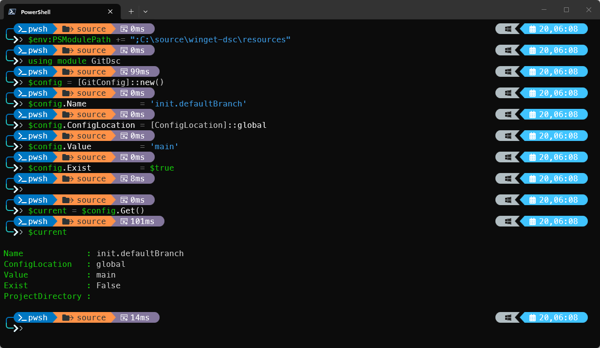
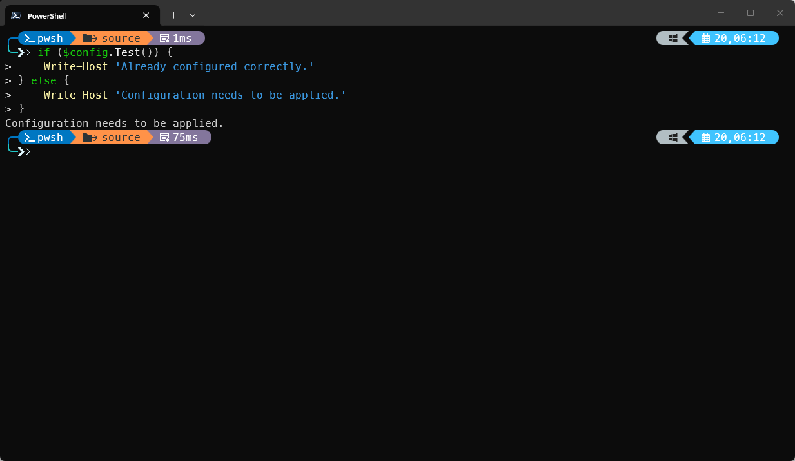
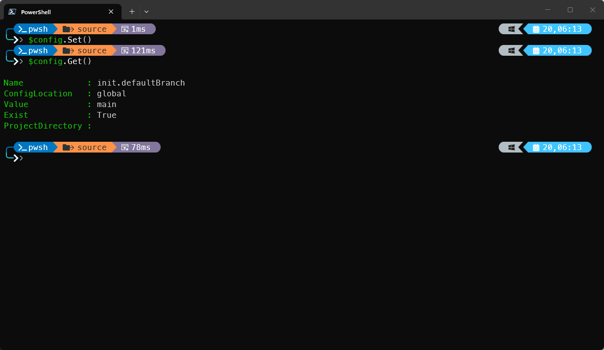

What if the first thing you did on every machine was to guarantee that Git was configured exactly the same way you did for the first time? Even without writing a single line of code?

I think one of the most overlooked and part of the last checklist is the <code>git config</code> commands. You probably recognize getting a dusty notes file somewhere to type them in (or you go to the git-scm.com book section). 

Are these potentially common issues you've faced:
<ol><li>A teammate onboards and ends up with CRLF line endings that pollute every diff for a week?</li><li>A build agent gets provisioned without <code>core.longpaths</code> and starts failing on Windows?</li></ol>
The problem is not that Git configuration is hard. It's just that it's so invisible that it gets written once by hand and forgotten until it starts breaking things.

In this blog post, you will learn how to use the new <code>GitConfig</code> class-based DSC resource to manage any Git configuration setting. By using this class, it's going to be repeatable, and you can enforce it even more.

By the end, your Git configuration will be something you describe once, and you don't have to store it in your brain anymore.
<h2 id="what-makes-gitconfig-different">What makes GitConfig different</h2>
If you know the <a href="https://github.com/microsoft/winget-dsc">winget-dsc</a> repository, you know that the <a href="https://www.powershellgallery.com/packages/GitDsc/0.1.6-alpha">GitDsc</a> module ships individual resources. Each resource can configure specific settings, such as setting the username or email. But even that it works, Git has many more useful configuration keys

The <code>GitConfig</code> resource is a bit different. It takes a setting name as a data property. That makes it not part of a resource name. For example, if you want to set the default branch, that would be:
<pre><code class="language-powershell">Name  = 'init.defaultBranch'
Value = 'main'</code></pre>
The same resource can handle any Git setting that was just mentioned, and anything else <code>git config</code> supports. One resource, all settings basically. It's class exposes five properties:
<table>
<thead>
<tr>
<th>Property</th>
<th>Purpose</th>
</tr>
</thead>
<tbody>
<tr>
<td><code>Name</code></td>
<td>The Git config key, e.g. <code>core.longpaths</code></td>
</tr>
<tr>
<td><code>ConfigLocation</code></td>
<td>Scope: <code>global</code>, <code>system</code>, <code>local</code>, <code>worktree</code>, or <code>none</code></td>
</tr>
<tr>
<td><code>Value</code></td>
<td>The desired value. Required when <code>Exist</code> is <code>$true</code></td>
</tr>
<tr>
<td><code>Exist</code></td>
<td>Whether the setting should exist. Defaults to <code>$true</code></td>
</tr>
<tr>
<td><code>ProjectDirectory</code></td>
<td>Required for <code>local</code> and <code>worktree</code> scopes</td>
</tr>
</tbody>
</table>
<h2 id="using-the-module">Using the module</h2>
Class-based DSC resources can be instantiated to see what happens on each method. But before doing so, you need to module available in your session. If you are working from the source code directly, use:
<pre><code class="language-powershell">git clone --branch gh-244/main/add-gitconfig-resource https://github.com/Gijsreyn/winget-dsc.git C:\source&#10;
$env:PSModulePath += ";C:\source\winget-dsc\resources\GitDsc"&#10;
using module GitDsc</code></pre>

⚠️

The module hasn't officially released to the PowerShell Gallery (yet). If it does, you can use <code spellcheck="false" style="white-space: pre-wrap;">Install-PSResource -Name GitDsc</code>.

<h2 id="discover-your-current-configuration">Discover your current configuration</h2>
Before you start modifying your existing system, what better way is there to extract your current system using <code>Export()</code>. This is a new method added to <code>GitConfig</code> that reads all settings at a given scope and returns them as a list of <code>GitConfig</code> objects.

To grab all settings from the global scope, you can run:
<pre><code class="language-powershell">$resource = [GitConfig]::new()
$globalSettings = $resource.Export([ConfigLocation]::global)&#10;
$globalSettings | Format-Table Name, Value</code></pre>
A sample output looks like:
<pre><code class="language-plaintext">Name                   Value
----                   -----
user.name              Your Name
user.email             you@example.com
init.defaultBranch     main
core.longpaths         true</code></pre>
You can save these results to a JSON file, so you have an audit of your existing machine. If you want to do it for a specific repository, you can use the <code>local</code> config location with a path:
<pre><code class="language-powershell">$localSettings = $resource.Export([ConfigLocation]::local, 'C:\repos\MyProject')
$localSettings | Format-Table Name, Value</code></pre>

💡

Don't worry about calling <code spellcheck="false" style="white-space: pre-wrap;">Export()</code>, it doesn't modify anything.

<h2 id="using-the-class-directly-get-test-set">Using the class directly: Get, Test, Set</h2>
Each class-based DSC resource in PowerShell exposes three standard methods. You can call them directly on an instance, ideal when you want to explore the resource. Let's take a look at when you want to see if your default branch is <code>main</code>:
<pre><code class="language-powershell">using module GitDsc&#10;
$config = [GitConfig]::new()
$config.Name           = 'init.defaultBranch'
$config.ConfigLocation = [ConfigLocation]::global
$config.Value          = 'main'
$config.Exist          = $true&#10;
$current = $config.Get()
$current</code></pre><figure class="kg-card kg-image-card kg-card-hascaption"><figcaption>Figure 1: Get the current default branch from global scope</figcaption></figure>
In the above image, you can see the default branch isn't main as <code>Exist</code> is <code>False</code>. 

💡

<code spellcheck="false" style="white-space: pre-wrap;">Exist</code> is the new canonical property in Microsoft DSC (or to be more precise <code spellcheck="false" style="white-space: pre-wrap;">_exist</code>).

Whilst <code>Get()</code> shows you the current state, <code>Test()</code> verifies if it is in the <em>desired state</em>:
<pre><code class="language-powershell">if ($config.Test()) {
    Write-Host 'Already configured correctly.'
} else {
    Write-Host 'Configuration needs to be applied.'
}</code></pre><figure class="kg-card kg-image-card kg-card-hascaption"><figcaption>Figure 2: Not in the desired state</figcaption></figure>
Now, say that you want to set it as the <code>main</code> branch by default, you simply call the <code>Set()</code> method:
<pre><code class="language-powershell">$config.Set()</code></pre><figure class="kg-card kg-image-card kg-card-hascaption"><figcaption>Figure 3: Set the default branch to main</figcaption></figure>
The <code>Get()</code> method now returns <code>True</code>, indicating that the setting has been set on global scope. Under the hood, this constructs the equivalent of <code>git config --global init.defaultBranch main</code>. If the setting is already correct, <code>Set()</code> does basically nothing (as it performs <code>Test()</code> inside <code>Set()</code>).
<h2 id="a-practical-example-configuring-a-new-machine">A practical example: Configuring a new machine</h2>
There are plenty of settings that Git has, but here's a common sequence that covers what most developers use globally. You can save this file and store it in a Git repository to easily apply:
<pre><code class="language-powershell"># GitConfigure.ps1
using module GitDsc&#10;
$settings = @(
    @{ Name = 'user.name';          Value = 'Your Name';  ConfigLocation = [ConfigLocation]::global },
    @{ Name = 'user.email';         Value = 'you@example.com'; ConfigLocation = [ConfigLocation]::global },
    @{ Name = 'init.defaultBranch'; Value = 'main';       ConfigLocation = [ConfigLocation]::global },
    @{ Name = 'core.longpaths';     Value = 'true';       ConfigLocation = [ConfigLocation]::global },
    @{ Name = 'core.autocrlf';      Value = 'input';      ConfigLocation = [ConfigLocation]::global }
)&#10;
foreach ($setting in $settings) {
    $config = [GitConfig]::new()
    $config.Name           = $setting.Name
    $config.ConfigLocation = $setting.ConfigLocation
    $config.Value          = $setting.Value
    $config.Exist          = $true&#10;
    if (-not $config.Test()) {
        Write-Host "Applying: $($config.Name) = $($config.Value)"
        $config.Set()
    } else {
        Write-Host "Already set: $($config.Name)"
    }
}</code></pre>
You can run this script every time without worrying. This script runs in an <a href="https://en.wikipedia.org/wiki/Idempotence">idempotent</a> way.
<h2 id="removing-a-setting">Removing a setting</h2>
What if you want to remove a setting? Maybe you want to temporarily disable a proxy that was set by your organization. To make a setting <em>absent</em>, you can set the <code>Exist</code> to <code>False</code>, which in turn constructs the git command as such: <code>git config --global --unset http.proxy</code>:
<pre><code class="language-powershell">using module GitDsc&#10;
$config = [GitConfig]::new()
$config.Name           = 'http.proxy'
$config.ConfigLocation = [ConfigLocation]::global
$config.Exist          = $false&#10;
$config.Set()</code></pre>
If the setting didn't exist at all, again, it would do nothing.
<h2 id="using-microsoft-dsc">Using Microsoft DSC</h2>
Instantiating classes is a bit tedious to do. Especially if you have to constantly use that <code>using module</code> statement for each session.

Microsoft DSC is a command-line utility that can invoke PSDSC resources through an adapter. If you want to try out the following example, the <code>GitDsc</code> module should be discoverable through the <code>$PSModulePath</code>:
<pre><code class="language-powershell"># Install module to install dsc.exe
Install-PSResource -Name PSDSC -Repository PSGallery&#10;
# Use the install command
Install-DscExe&#10;
# Save the following file
# git-global.dsc.yaml
$schema: https://aka.ms/dsc/schemas/v3/bundled/config/document.json
resources:
  - name: Set default branch name
    type: GitDsc/GitConfig
    directives:
      requireAdapter: Microsoft.Adapter/PowerShell
    properties:
      Name: init.defaultBranch
      ConfigLocation: global
      Value: main
      Exist: true&#10;
dsc config set --file git-global.dsc.yaml</code></pre>
This is way easier, and you can declare more resources for each setting in a declarative YAML file. If you want to extract an existing system, you would run <code>dsc resource export --resource GitDsc/GitConfig</code>.
<h2 id="wrap-up">Wrap up</h2>
One thing that is still a bit ugly is typing the Git setting name like <code>init.defaultBranch</code>. That still requires you to have some Git familiarity. That's a rough edge of using the module. But it is on the roadmap to address this in future releases to have a sort of key translation happening inside the class and allowing you to tab-complete between the available options.

Regardless, that's how Git configuration looks like for every machine you start working on. It doesn't become a mental checklist; the configuration document is.

