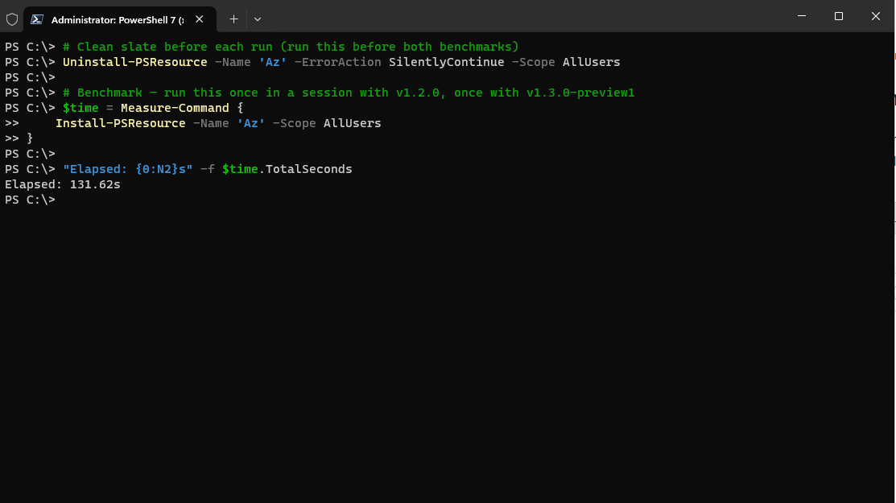
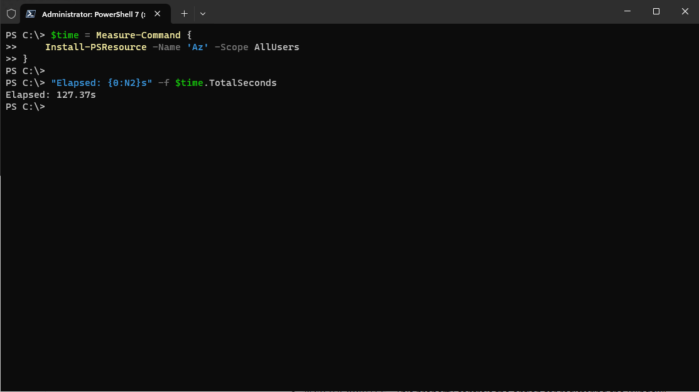
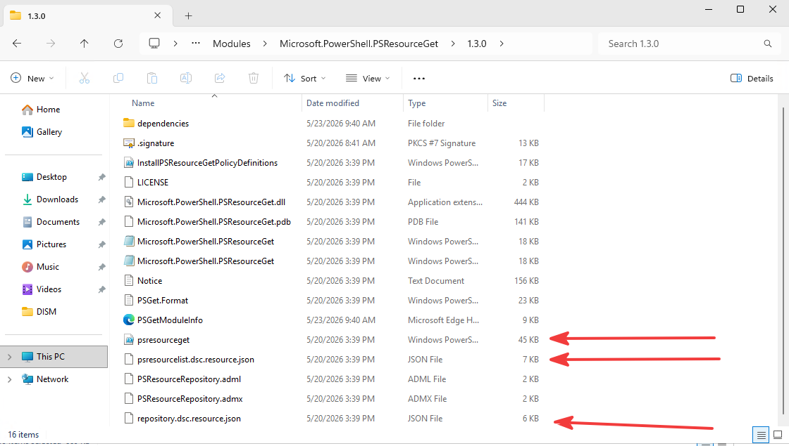
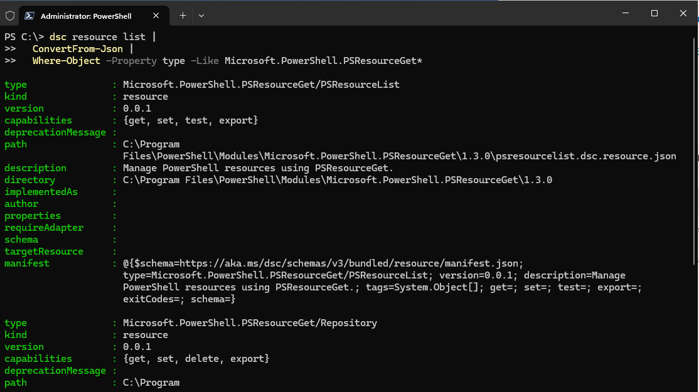
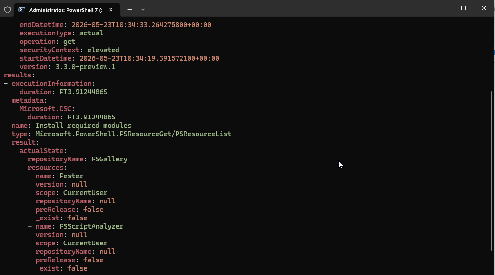
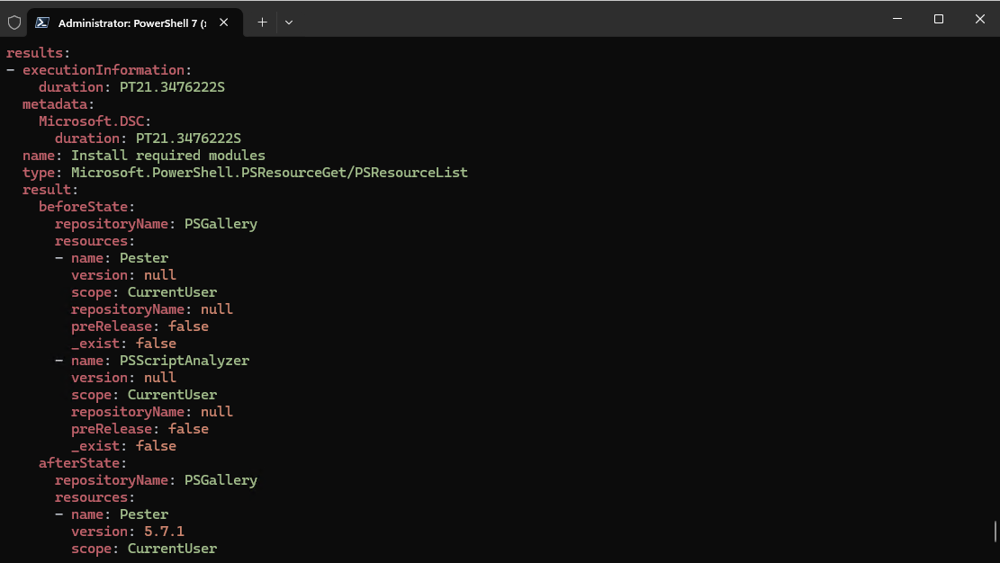
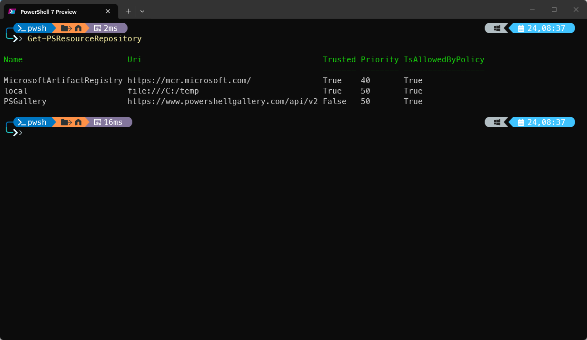

If you have ever waited for <code>Install-PSResource</code> to trudge through a long list of modules, for example, the <code>Az</code> one, and thought it felt no faster than the <code>Install-Module</code> days it was meant to replace, in the new preview release something <em>changed</em>.

But there are two other features that also change how the future of PSResourceGet is going to look.

The release dropped last week, including a post from Sydney Smith. With a couple of bug fixes included, three features stood out both in the release and the blog post.  PSResourceGet is maturing and focusing more on becoming an enterprise tool.

In this blog post, we'll take a further look at how parallel execution makes bulk installation faster. How Microsoft Artifact Registry (MAR) becomes the default trusted repository. And how a Microsoft DSC resource is shipped with PSResourceGet.
<h2 id="installing-the-preview">Installing the preview</h2>
Each section of this post will contain code snippets that you can follow along with. If you want to test them out yourself, you can use the following command if you're running PowerShell 7.6+:
<pre><code class="language-powershell">Install-PSResource -Name Microsoft.PowerShell.PSResourceGet `
  -Version '1.3.0-preview1' `
  -Prerelease</code></pre>

ℹ️

This preview drops Windows PowerShell support.

<h2 id="execute-module-installation-in-parallel">Execute module installation in parallel</h2>
I'm not going to lie, as I was already (pretty) satisfied with the result of <code>Install-PSResource</code> vs <code>Install-Module</code> on performance. But with the ever-growing number of modules being published to the gallery, there are scenarios in which it is still labeled as <em>slow</em>. One of those scenarios is whenever <code>Install-PSResource</code> needs to resolve ten or twenty dependencies. 

Each dependency has to go through finding, then downloading, and after all, installing it. In DevOps pipelines or if you want to install them on a bunch of servers at a time, this can come at a cost. So what has changed in the preview release?

In the following <a href="https://github.com/PowerShell/PSResourceGet/pull/1950">PR</a>, a rewrite happened on the internals of finding and installing packages. Both use async and concurrent execution. What this means is that instead of waiting for each package to finish before starting the next one, PSResourceGet now kicks off multiple find and install operations at the same time.

So, if we look at it in practice, we can do a measuring exercise even though the <code>Install-PSResource</code> command doesn't need any additional parameters or switches added. The following script was used to measure the performance:
<pre><code class="language-powershell"># Clean slate before each run (run this before both benchmarks)
Uninstall-PSResource -Name 'Az' -ErrorAction SilentlyContinue -Scope AllUsers&#10;
# Benchmark — run this once in a session with v1.2.0, once with v1.3.0-preview1
$time = Measure-Command {
    Install-PSResource -Name 'Az' -Scope AllUsers
}&#10;
"Elapsed: {0:N2}s" -f $time.TotalSeconds</code></pre>
The first run when running <code>Microsoft.PowerShell.PSResourceGet</code> v1.2.0:
<figure class="kg-card kg-image-card kg-card-hascaption"><figcaption>Figure 1: First run on v1.2.0</figcaption></figure>
Second run for the preview version:
<figure class="kg-card kg-image-card kg-card-hascaption"><figcaption>Figure 2: Second run v1.3.0-preview1</figcaption></figure>
You can see there's a slight difference there, but the work is still in progress. Expect future updates that will further improve the performance.
<h2 id="the-native-microsoft-dsc-resource-for-psresourceget">The native Microsoft DSC resource for PSResourceGet</h2>
It gets easier and easier to declaratively define your system out of the box.  That's because, before this release, you still would have required some external system to download and install either a native command-based DSC resource, or use <code>Install-PSResource</code> for it. 

With the preview release, this resource is natively baked in. Yes, you heard that right. If you inspect the contents that get shipped with, you notice three files have been silently added:
<figure class="kg-card kg-image-card kg-card-hascaption"><figcaption>Figure 3: Microsoft DSC files for PSResourceGet</figcaption></figure>
These files combined make a DSC resource natively discoverable through DSC's engine. And with natively, I mean the following. Even that the <code>psresourceget.ps1</code> is a PowerShell script, the engine sees it as a command-based resource because of the shipped resource manifest + logic inside the script. This resource basically doesn't have to go through an adapter. 

Take a look when you run the following command:
<pre><code class="language-powershell"># Install community module
Install-PSResource -Name PSDSC&#10;
# Install the latest stable version of dsc.exe
Install-DscExe&#10;
dsc resource list | 
  ConvertFrom-Json | 
  Where-Object -Property type -Like Microsoft.PowerShell.PSResourceGet*</code></pre><figure class="kg-card kg-image-card kg-card-hascaption"><figcaption>Figure 4: Microsoft DSC PSResourceGet resource</figcaption></figure>
You can see in the above image that there's nothing set for <code>requireAdapter</code>, thus meaning it doesn't have to go through it. 

Let's see an example and add two modules from the previous section declaratively:
<pre><code class="language-yaml"># psresourceList.dsc.config.yaml
$schema: https://aka.ms/dsc/schemas/v3/bundled/config/document.json
resources:
  - name: Install required modules
    type: Microsoft.PowerShell.PSResourceGet/PSResourceList
    properties:
      repositoryName: PSGallery
      trustedRepository: true
      resources:
        - name: Pester
          version: 5.7.1
        - name: PSScriptAnalyzer
          version: 1.25.0</code></pre>
First, let's run a <code>get</code> to see if they're installed:
<pre><code class="language-bash">dsc config get --file psresourceList.dsc.config.yaml</code></pre><figure class="kg-card kg-image-card kg-card-hascaption"><figcaption>Figure 5: Check current state</figcaption></figure>
The modules have not been installed. Time to run <code>set</code>:
<pre><code class="language-bash">dsc config set --file psresourceList.dsc.config.yaml</code></pre><figure class="kg-card kg-image-card kg-card-hascaption"><figcaption>Figure 6: Set the state</figcaption></figure>

ℹ️

Because <code spellcheck="false" style="white-space: pre-wrap;">scope</code> wasn't declared in the document, the default will be <code spellcheck="false" style="white-space: pre-wrap;">CurrentUser</code>.

If you want to trust the PowerShell Gallery by default (which you shouldn't), you can use the <code>Repository</code> resource and remove the <code>trustedRepository: true</code> property:
<pre><code class="language-yaml">$schema: https://aka.ms/dsc/schemas/v3/bundled/config/document.json
resources:
  - name: Ensure PSGallery is registered
    type: Microsoft.PowerShell.PSResourceGet/Repository
    properties:
      name: PSGallery
      uri: https://www.powershellgallery.com/api/v2
      trusted: true
      priority: 50</code></pre>
Those are the current DSC resources that got shipped. That brings us to the latest feature added: the <strong>default MAR repository</strong>.
<h2 id="safety-by-default-with-microsoft-artifact-registry">Safety by default with Microsoft Artifact Registry</h2>
Slowly, behind the scenes, Microsoft has already started migrating a bunch of its own PowerShell modules to MAR. But why is this an important feature?

Well, I have already mentioned it, and Sydney Smith also did in the blog post. <strong>You shouldn't be trusting the PowerShell Gallery by default</strong><em>. </em>Whereas MAR can be trusted:
<blockquote class="kg-blockquote-alt">Microsoft Artifact Registry (also known as Microsoft Container Registry or MCR) is the primary registry for all Microsoft published artifacts (such as container images) that offers a reliable and trustworthy delivery of artifacts with a syndicated catalog, while maintaining the quality that customers expect from a Microsoft product offering.</blockquote>
MAR also offers a Service Level Agreement (SLA). And with the latest issues happening on the Gallery, you can be certain that you can install your PowerShell modules that you need. 

Now, because it's a Microsoft offering, you will not find all the community-based PowerShell modules, but only those that are officially published by Microsoft itself. And with the preview release, MAR is the default trusted repository.
<figure class="kg-card kg-image-card kg-card-hascaption"><figcaption>Figure 7: Default trusted repository (MAR)</figcaption></figure>
So, what does this, in essence, mean in practice? If you now install PowerShell modules that come from Microsoft, say <code>Az.Accounts</code>, it will automatically resolve from MAR first (as it is a higher priority) if the module is published there. It's not going to the PowerShell Gallery untrusted repository (unless <em>you </em>trusted it). For enterprises, this can become useful.
<h2 id="how-the-three-features-connect">How the three features connect</h2>
On the surface, these three features look like separate improvements. Faster installs, a DSC resource, and a new default repository. But if you step back, they all pull in the same direction.

Parallel execution matters more as organizations adopt stricter intake workflows. From private feeds, pinned versions, to audited dependencies, the numbers keep increasing. That's where the performance improvement becomes relevant at exactly the point where PSResourceGet is getting serious.

Then, the Microsoft DSC resource makes scenarios more declarative. Even better is the fact that during the community call, it was announced that Windows Server vNext is going to ship PowerShell 7 by default, removing one step further into bootstrapping it from the ground up. You don't need to call <code>Install-PSResource</code> anymore. Instead, you can <em>orchestrate </em>it with the <em>declarativeness </em>you need.

And MAR being the default for trusted Microsoft PowerShell modules brings in another layer of trust. That's important for enterprises. Plus, the fact that it has an SLA, and now PSResourceGet points to it automatically, is definitely a good bonus.

These three features together push PSResourceGet from being a package management tool to something that an enterprise can automate on. Faster, declarative, and with a clearer trust model built in.
<h2 id="wrapping-up">Wrapping up</h2>
It looked like PSResourceGet's preview version was a short changelog. But it represented a meaningful shift happening underneath. Each of the three features resolves a friction point. 

Sydney's roadmap post draws the bigger picture. PSResourceGet is molded towards an enterprise-grade tool. Not just something that replaced PowerShellGet.  This preview is the first concrete delivery against that roadmap. And it landed quite well.

