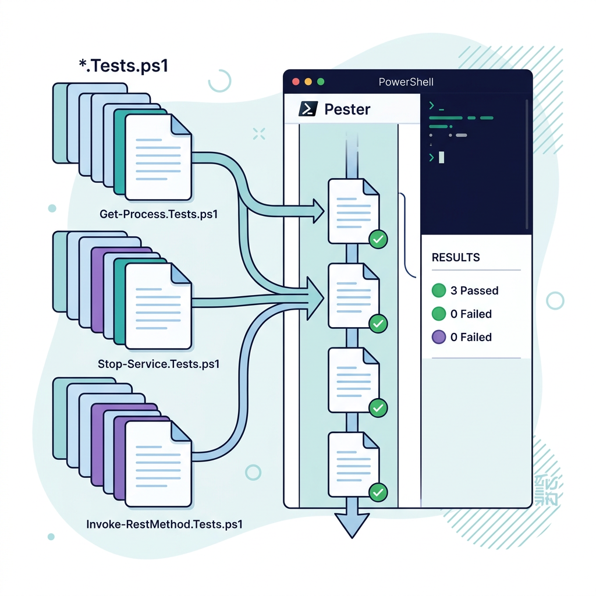
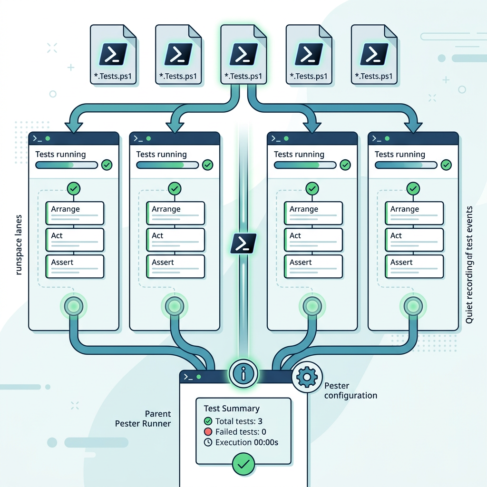
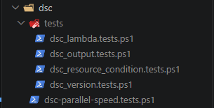
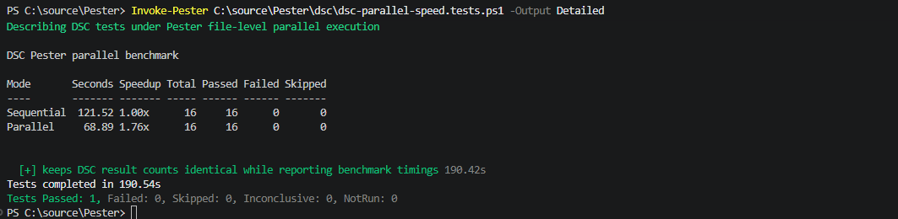

Pester v6.0.0-rc.1 includes one of the most requested test-runner features: an experimental file-level parallel execution. 

The work itself was landed by the maintainer Jakub Jareš himself, and the shape of the feature is simple from the user's point of view. If you just have a folder full of independent <code>*.Tests.ps1</code> files and you run on PowerShell 7 or newer, you can enable <code>Run.Parallel</code> and let Pester run those files in separate runspaces.

That last part of the sentence contains the most important detail. <strong>Parallelism </strong>happens at the file level. Pester doesn't really split individual <code>It</code> blocks across workers. Instead, each test file becomes the unit of work. That's why this feature is a strong fit for test suites that already have many focused files, such as in my case, command-line integration tests, where each file exercises a separate command area.

For this blog post walkthrough, I used a small slice of the copied Microsoft DSC tests. They are a useful real-world example because many of them spend time outside Pester itself, invoking <code>dsc.exe</code> executable and parsing JSON output. But they add up when running one file after another. That is exactly where file-level parallel execution can help.

Let's take a look at this new experimental feature.
<h2 id="what-has-changed">What has changed</h2>
Prior to v6.0.0, a Pester run effectively discovered a batch of files and then ran them sequentially in one flow. 
<figure class="kg-card kg-image-card kg-card-hascaption"><figcaption>Figure 1: Pester test run in one flow</figcaption></figure>
The pull request that has been merged in v6.0.0-rc.1 changes how Pester works through test files. Instead of treating discovery and execution as two separate phases for the whole run, Pester now works file by file: it discovers one file, runs it, and then moves to the next. Sequential and parallel runs both use this same flow, so the console output and IDE integrations can behave the same way in both modes.

When you build up a configuration object, the <code>Run.Parallel = $true</code> can be set and Pester uses PowerShell 7's <code>Foreach-Object -Parallel</code> behind the scenes. Each file runs in its own runspace. The worker runspace stays quiet and records the per-container and per-test events. The parent runspace then replays those events in discovery order so the final result object, console summary, and adapter events still look like one normal Pester run.
<figure class="kg-card kg-image-card kg-card-hascaption"><figcaption>Figure 2: Pester test run in multiple parallel flows</figcaption></figure>
The first configuration flag is the one you will use most often when you want parallelization:
<pre><code class="language-powershell">$configuration = [PesterConfiguration]::Default
$configuration.Run.Path = './dsc/tests'
$configuration.Run.Parallel = $true
$configuration.Run.PassThru = $true&#10;
$result = Invoke-Pester -Configuration $configuration</code></pre>
But there are two <em>companion </em>settings worth knowing early:
<pre><code class="language-powershell">$configuration.Run.ParallelThrottleLimit = 4
$configuration.Run.BeforeContainer = { . ./test-setup.ps1 }</code></pre>
If you already know <code>Foreach-Object -Parallel</code>, you'll know that <code>ParallelThrottleLimit</code> caps how many files to run at once. The default value just means how many processor counts you have available (<code>0</code>). It's a good starting point for CPU-bound tests, but command-line integration tests sometimes need a lower number because of other hardware-related bottlenecks (think about disk, process startup, network, etc).

The other setting, <code>BeforeContainer</code> is another setting you can use for running a setup before each file is discovered and run. This matters more in parallel mode because each worker starts from a clean runspace. If your current suite relies on functions imported into the parent session before calling <code>Invoke-Pester</code>, move that setup into <code>Run.BeforeContainer</code> or a <code>Pester.BeforeContainer.ps1</code> file in the repository root.
<h2 id="benchmarking-parallel-execution">Benchmarking parallel execution</h2>
To make the feature easy to evaluate, I used a small benchmark test that runs the same set of files twice. Once sequentailly and once with the <code>Parallel = $true</code> set. For me, the goal wasn't to make a <em>universal </em>speed number when this was turned on. Instead, I wanted to answer two practical questions:
<ol><li>Do the results count the same?</li><li>Does the shape of the test suite benefit from parallel workers?</li></ol>
The benchmark I took was a small slice of Microsoft's DSC test suite:
<figure class="kg-card kg-image-card kg-card-hascaption"><figcaption>Figure 3: Small slice of Microsoft DSC tests</figcaption></figure>
Most of these tests are self-contained and used inline YAML configuration, so I added them in an array to test out:
<pre><code class="language-powershell">$DscParallelBenchmarkFiles = @(
    'dsc_version.tests.ps1',
    'dsc_output.tests.ps1',
    'dsc_lambda.tests.ps1',
    'dsc_resource_condition.tests.ps1'
)</code></pre>
The benchmark script (which you'll see in a second) keeps it simple. It just compares sequential versus parallel and counts the results. That was also a safety check: a faster run isn't useful if it changes the meaning of the suite. 

I called the script <code>dsc-parallel-speed.tests.ps1</code> and run it as followed:
<pre><code class="language-powershell">Invoke-Pester C:\source\Pester\dsc\dsc-parallel-speed.tests.ps1 -Output Detailed</code></pre>
The script itself contained the following code, with the important difference between the two runs is the <code>Run.Parallel</code> value:
<pre><code class="language-powershell">Describe 'DSC tests under Pester file-level parallel execution' -Skip:($PSVersionTable.PSVersion.Major -lt 7 -or $null -eq (Get-Command dsc -ErrorAction SilentlyContinue)) {
    BeforeAll {
        $dscParallelBenchmarkFiles = @(
            'dsc_version.tests.ps1',
            'dsc_output.tests.ps1',
            'dsc_lambda.tests.ps1',
            'dsc_resource_condition.tests.ps1'
        )&#10;
        $testRoot = Join-Path $PSScriptRoot 'tests'
        $script:DscBenchmarkPaths = foreach ($fileName in $dscParallelBenchmarkFiles) {
            $path = Join-Path $testRoot $fileName
            if (-not (Test-Path -LiteralPath $path -PathType Leaf)) {
                throw "Benchmark file was not found: $path"
            }&#10;
            $path
        }&#10;
        function Invoke-DscPesterBenchmark {
            [CmdletBinding()]
            param(
                [switch] $Parallel
            )&#10;
            $configuration = [PesterConfiguration]::Default
            $configuration.Run.Path = $script:DscBenchmarkPaths
            $configuration.Run.PassThru = $true
            $configuration.Run.Parallel = [bool] $Parallel
            $configuration.Run.ParallelThrottleLimit = [Math]::Min([Environment]::ProcessorCount, 8)
            $configuration.Output.Verbosity = 'None'&#10;
            $watch = [System.Diagnostics.Stopwatch]::StartNew()
            $result = Invoke-Pester -Configuration $configuration
            $watch.Stop()&#10;
            [pscustomobject]@{
                Mode    = if ($Parallel) { 'Parallel' } else { 'Sequential' }
                Seconds = [Math]::Round($watch.Elapsed.TotalSeconds, 2)
                Total   = $result.TotalCount
                Passed  = $result.PassedCount
                Failed  = $result.FailedCount
                Skipped = $result.SkippedCount
                Result  = $result
            }
        }
    }&#10;
    It 'keeps DSC result counts identical while reporting benchmark timings' {
        $sequential = Invoke-DscPesterBenchmark
        $parallel = Invoke-DscPesterBenchmark -Parallel&#10;
        $parallel.Total | Should -Be $sequential.Total
        $parallel.Passed | Should -Be $sequential.Passed
        $parallel.Failed | Should -Be $sequential.Failed
        $parallel.Skipped | Should -Be $sequential.Skipped&#10;
        $speedup = if ($parallel.Seconds -gt 0) {
            '{0:n2}x' -f ($sequential.Seconds / $parallel.Seconds)
        }
        else {
            'n/a'
        }&#10;
        $summary = @(
            [pscustomobject]@{
                Mode    = $sequential.Mode
                Seconds = $sequential.Seconds
                Speedup = '1.00x'
                Total   = $sequential.Total
                Passed  = $sequential.Passed
                Failed  = $sequential.Failed
                Skipped = $sequential.Skipped
            }
            [pscustomobject]@{
                Mode    = $parallel.Mode
                Seconds = $parallel.Seconds
                Speedup = $speedup
                Total   = $parallel.Total
                Passed  = $parallel.Passed
                Failed  = $parallel.Failed
                Skipped = $parallel.Skipped
            }
        )&#10;
        Write-Host ''
        Write-Host 'DSC Pester parallel benchmark'
        Write-Host ($summary | Format-Table -AutoSize | Out-String)
    }
}</code></pre>
After the run, the timing table is displayed in the console:
<figure class="kg-card kg-image-card kg-card-hascaption"><figcaption>Figure 4: Timing table sequential vs parallel</figcaption></figure>
I think the best way to treat these numbers is as a <em>local signal</em>, not as a promise that it will always be <em>faster</em>. A suite with ten very short files usually benefits less than a suite with fifty medium-cost files.
<h2 id="making-a-suite-parallel-friendly">Making a suite parallel-friendly</h2>
Each new feature has its caveats, and that was revealed while I was running those DSC files. First of all, the <code>TestDrive</code> is a perfect fit for parallel mode because Pester creates isolated test-drive state for the file that is running. Local variables, <code>BeforeAll</code>, and <code>AfterAll</code> inside a file also stay with that file's worker.

But having things process-wide is different. Environment variables, the current process, external services, shared (temp) paths, and global settings can easily collide. Before enabling parallel execution on those, look for tests that modify this kind of thing. A rough shape of a test file that should make you pause before putting it in the parallel batch:
<pre><code class="language-powershell">Describe 'My command-line tool' {
    BeforeAll {
        $script:OriginalPath = $env:PATH
        $env:PATH = "$PSScriptRoot/tools;$env:PATH"
    }&#10;
    AfterAll {
        $env:PATH = $script:OriginalPath
    }&#10;
    It 'finds the tool on PATH' {
        my-tool --version | Should -Match '1.2.3'
    }
}</code></pre>
That test may be reasonable on its own, but in a parallel run, another file can observe the modified <code>PATH</code> while this file is still running.  Prefer just passing explicit paths or use isolated temp folders and output files. Or keep tests like this out of the parallel set until the shared state is removed:
<pre><code class="language-powershell">#pester:no-parallel</code></pre>
The above is a directive that can appear as a comment anywhere in a test file. Pester will detect it with the PowerShell tokenizer, so a string containing the same text does not opt the file out. Other fallbacks around parallel execution are:
<ul><li>It requires PowerShell 7 or newer</li><li>Only applies to file-based runs through <code>Run.Path</code></li><li>Scriptblock containers fall back to sequential</li><li>Code coverage falls back to sequential (for now)</li></ul>
And lastly, the <code>Run.SkipRemainingOnFailure = 'Run'</code> is also sequential because stopping the entire run after the first failure cannot be coordinated across isolated workers yet.
<h2 id="takeaway">Takeaway</h2>
Testing out this feature myself already gave me a glimpse of the nice part of this experimental change; you don't have to rewrite your tests to use this. You can start with an independent folder containing <code>*.Tests.ps1</code> files, run it sequentially, and then turn on <code>Run.Parallel</code> to compare the results. If the results are different in the timing table, you know you can switch.

However, if a file depends on shared process state, you can either fix the isolation or just opt the file out. For suites that already have clean (file) boundaries, the payoff can be immediate: the <strong>same tests</strong>, the <strong>same result object</strong>, and <strong>less time waiting for the final summary</strong>.

