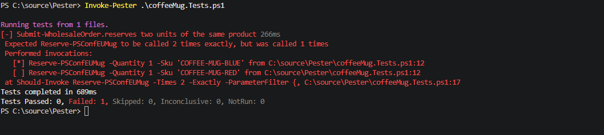
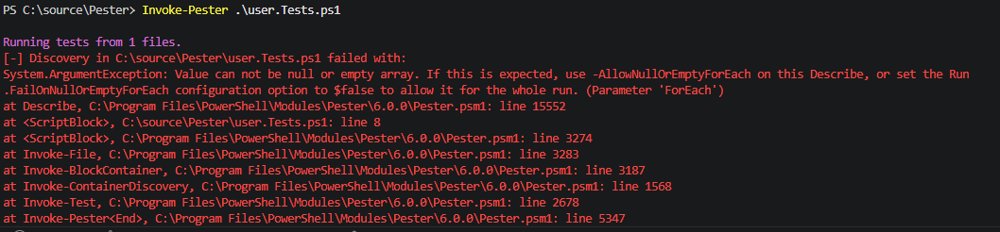

Recently, the Pester repository has seen a good amount of pull requests by the core maintainer. And after those PRs, 4 release candidates were created.

Whilst there isn't any official GA for v6 yet, the release candidates already give a glimpse of what is changing. Thus, in this article, we'll be looking at the already available release candidates and looking at how you can migrate from v5 to v6. 

Don't worry if your test suite is on Pester 5. The core shapes still look familiar with the famous syntaxes like <code>Describe</code>, <code>Context</code>, <code>It</code>, and others.
<h2 id="what-changed-in-pester-6">What changed in Pester 6?</h2>
Pester 6 still builds on top of Pester's 5 runtime, but it focuses on three key improvement areas:
<ul><li>A new family of <code>Should-*</code> assertions.</li><li>Faster code coverage, using profiler-based coverage by default.</li><li>An experimental parallel runner that runs test files concurrently.</li></ul>
The good news is that classic Pester 5 assertions still work. You don't need to convert every <code>Should -Be</code> into <code>Should-Be</code> on day one. The new assertions look like the following (which makes migration much less risky):
<pre><code class="language-powershell"># Pester 5 style: still works in Pester 6
$result | Should -Be 'ok'&#10;
# Pester 6 style: new assertion command
$result | Should-Be 'ok'</code></pre>
This new assertion family gives you an easy compatibility migration first, as you can modernize it over time. Or you can create a <code>copilot-instructions.md</code> file to help you out if you're using AI.
<blockquote>

[!NOTE] 
Want to see the experimental parallel runner in action? I created a dedicated post on this <a href="/how-to-execute-pester-tests-in-parallel-with-pester-6-0/">link</a>.

</blockquote>
<h2 id="runtime-support-changed">Runtime support changed</h2>
Still using older versions of PowerShell? Bad luck. Pester 6 supports Windows PowerShell 5.1 and PowerShell 7.4+. 

That makes the runtime version the first compatibility boundary to know about. Your local shell and CI agents need to be on a supported version:
<pre><code class="language-powershell">$PSVersionTable.PSVersion</code></pre><h2 id="mock-verification-moved-to-should-invoke">Mock verification moved to <code>Should-Invoke</code></h2>
Pester 6 removes <code>Assert-MockCalled</code> and <code>Assert-VerifiableMock</code>. Use <code>Should -Invoke</code>, <code>Should -InvokeVerifiable</code>, or the new command-style assertions.
<table>
<thead>
<tr>
<th>Pester 5</th>
<th>Pester 6 with classic <code>Should</code> syntax</th>
<th>Pester 6 new style</th>
</tr>
</thead>
<tbody>
<tr>
<td><code>Assert-MockCalled Get-Thing</code></td>
<td><code>Should -Invoke Get-Thing</code></td>
<td><code>Should-Invoke Get-Thing</code></td>
</tr>
<tr>
<td><code>Assert-MockCalled Get-Thing -Times 1 -Exactly</code></td>
<td><code>Should -Invoke Get-Thing -Times 1 -Exactly</code></td>
<td><code>Should-Invoke Get-Thing -Times 1 -Exactly</code></td>
</tr>
<tr>
<td><code>Assert-MockCalled Get-Thing -ParameterFilter { $Id -eq 1 }</code></td>
<td><code>Should -Invoke Get-Thing -ParameterFilter { $Id -eq 1 }</code></td>
<td><code>Should-Invoke Get-Thing -ParameterFilter { $Id -eq 1 }</code></td>
</tr>
<tr>
<td><code>Assert-VerifiableMock</code></td>
<td><code>Should -InvokeVerifiable</code></td>
<td><code>Should-Invoke -Verifiable</code></td>
</tr>
</tbody>
</table>

Pester 6 also improves failed mock assertion output. When `Should-Invoke` fails, it can print mock invocation history and show which calls matched the parameter filter.
<figure class="kg-card kg-image-card kg-card-hascaption"><figcaption>Figure 1: Improved assertion output</figcaption></figure><h2 id="dedidcated-shouldassertion-commands">Dedidcated <code>Should-*</code> assertion commands</h2>
The introduction already mentioned it, but the headline feature in Pester 6 is the new <code>Should-*</code> assertion family. The difference is literally tiny but important to know:
<pre><code class="language-powershell"># Pester 5 style
$value | Should -Be 42&#10;
# Pester 6 style
$value | Should-Be 42</code></pre>
Its change mainly sits within the codebase. The old <code>Should</code> command had many operators behind one entry point. The new commands are specialized and type-aware, which gives Pester better failure messages. It also has a clearer behavior to deal with strings, arrays, <code>$null</code> , and typed values.

Here's a full list of how common Pester 5 assertions map to the new commands:
<table>
<thead>
<tr>
<th>Pester 5 assertion</th>
<th>Pester 6 assertion</th>
<th>Notes</th>
</tr>
</thead>
<tbody>
<tr>
<td><code>Should -Be</code></td>
<td><code>Should-Be</code></td>
<td>Generic value equality, similar to PowerShell <code>-eq</code>.</td>
</tr>
<tr>
<td><code>Should -Not -Be</code></td>
<td><code>Should-NotBe</code></td>
<td>Generic inequality.</td>
</tr>
<tr>
<td><code>Should -BeExactly</code></td>
<td><code>Should-BeString -CaseSensitive</code></td>
<td>Prefer this for exact string comparison.</td>
</tr>
<tr>
<td><code>Should -Match</code></td>
<td><code>Should-MatchString</code></td>
<td>Regex string match.</td>
</tr>
<tr>
<td><code>Should -BeLike</code></td>
<td><code>Should-BeLikeString</code></td>
<td>Wildcard string match.</td>
</tr>
<tr>
<td><code>Should -BeTrue</code></td>
<td><code>Should-BeTrue</code> or <code>Should-BeTruthy</code></td>
<td>Choose strict boolean vs. truthy behavior deliberately.</td>
</tr>
<tr>
<td><code>Should -BeFalse</code></td>
<td><code>Should-BeFalse</code> or <code>Should-BeFalsy</code></td>
<td>Choose strict boolean vs. falsy behavior deliberately.</td>
</tr>
<tr>
<td><code>Should -BeNullOrEmpty</code></td>
<td><code>Should-BeNull</code> or a collection assertion</td>
<td>Be explicit about whether you expect <code>$null</code> or an empty collection.</td>
</tr>
<tr>
<td><code>Should -HaveCount</code></td>
<td><code>Should-BeCollection -Count</code></td>
<td>Use collection assertions for collection shape.</td>
</tr>
<tr>
<td><code>Should -Contain</code></td>
<td><code>Should-ContainCollection</code></td>
<td>Checks collection contents.</td>
</tr>
<tr>
<td><code>Should -Throw</code></td>
<td><code>Should-Throw</code></td>
<td>New command-style assertion.</td>
</tr>
<tr>
<td><code>Should -HaveParameter</code></td>
<td><code>Should-HaveParameter</code></td>
<td>Command metadata assertion.</td>
</tr>
<tr>
<td><code>Should -BeOfType</code> / <code>Should -HaveType</code></td>
<td><code>Should-HaveType</code></td>
<td>Type assertion.</td>
</tr>
<tr>
<td>Deep object comparison patterns</td>
<td><code>Should-BeEquivalent</code></td>
<td>Best for rich objects, hashtables, API responses, and nested data.</td>
</tr>
</tbody>
</table>
<h2 id="pipeline-input-andactual-are-more-explicit"><strong>Pipeline input and <code>-Actual</code> are more explicit</strong></h2>
PowerShell unwraps pipeline input. That means a typed array or single-item array can arrive differently than you expect.
<pre><code class="language-powershell"># These are treated the same by value assertions
1    | Should-Be 1
@(1) | Should-Be 1</code></pre>
If you want to be more specific about it, you can use collection-specific commands as such:
<pre><code class="language-powershell">1, 2, 3 | Should-BeCollection @(1, 2, 3)
1, 2, 3 | Should-BeCollection -Count 3</code></pre>
Now, if you want to take it one step further and want to preserve the exact object or collection type, use the <code>-Actual</code>:
<pre><code class="language-powershell">Should-HaveType -Actual ([int[]](1, 2)) -Expected ([int[]])</code></pre>
The following three bullet points are a small, simple mental model when you're writing a test:
<ul><li>Use the pipeline for simple scalar values.</li><li>Use collection assertions for arrays and lists.</li><li>Use `-Actual` when the exact collection object or type matters.</li></ul><h2 id="emptyforeach-data-now-fails-discovery">Empty <code>-Foreach</code> data now fails discovery</h2>
Pester 6 now introduces an early failure when discovery on <code>-Foreach</code> receives a <code>$null</code> or an empty collection. This behavior is controlled by the <code>Run.FailOnNullOrEmptyForeach</code>, which by default is on.

The following test will succeed, as the data is already fed during <code>BeforeDiscovery</code> phase:
<pre><code class="language-powershell">BeforeDiscovery {
    $users = @(
        @{ Name = 'Gijs'; Role = 'Admin' }
        # Other users
    )
}&#10;
Describe 'users' -ForEach $users {
    It '&lt;Name&gt; has a name' {
        $_.Name | Should-NotBeNull
    }
}</code></pre>
Change the <code>BeforeDiscovery</code> to <code>BeforeAll</code>, and the test will fail:
<figure class="kg-card kg-image-card kg-card-hascaption"><figcaption>Figure 2: Test fail because collection is empty</figcaption></figure>
You can already see from the above image that if you want to relax the behavior, you can change it as such:
<pre><code class="language-powershell">BeforeDiscovery {
    $users = Get-Users
}&#10;
Describe 'users' -ForEach $users -AllowNullOrEmptyForEach {
    It '&lt;Name&gt; has a name' {
        $_.Name | Should-NotBeNull
    }
}</code></pre>
Or when you want to have it turned off globally:
<pre><code class="language-powershell">$config = New-PesterConfiguration
$config.Run.FailOnNullOrEmptyForEach = $false
Invoke-Pester -Configuration $config</code></pre>
Just keep in mind that the local option is more precise when an empty data set is meaningful for a certain code block. 
<h2 id="discovery-and-run-happen-per-file">Discovery and run happen per file</h2>
This is probably the biggest "wait, why did my suite change" item in Pester 6.

Many suites can depend on discovery happening across the whole suite before anything actually runs. That's because many suites already set everything up. Sounds vague? Let's take a look.

In Pester 5, discovery happened globally: Pester discovered every file first, then ran tests.

Pester 6 does it differently. Discovery and run happen <em>per file</em>. Pester discovers one file, runs it, then moves to the next. This enables parallel execution, but it also means discovery-time side effects from one file should not be relied on by another file.

This can simply break suites that accidentally depend on the file order you might have:
<pre><code class="language-powershell"># File A
Import-Module ./TestHelpers.psm1&#10;
# File B
Describe 'something' {
    It 'uses helper from File A' {
        Get-TestData | Should-NotBeNull
    }
}</code></pre>
The better <em>durable </em>shape is for each file to import what it needs:
<pre><code class="language-powershell">BeforeAll {
    Import-Module "$PSScriptRoot/TestHelpers.psm1" -Force
}</code></pre>
But there's also a more global option if many files need the same bootstrapping:
<pre><code class="language-powershell">$config = New-PesterConfiguration
$config.Run.Path = './tests'
$config.Run.BeforeContainer = {
    . './tests/setup.ps1'
}
Invoke-Pester -Configuration $config</code></pre>
It's even possible to use a repository-level convention file, which is <code>Pester.BeforeContainer.ps1</code>.
<h2 id="code-coverage-is-profiler-based-by-default"><strong>Code coverage is profiler-based by default</strong></h2>
Pester 6 uses profiler-based coverage. But what is it actually?

In Pester 5, coverage was collected by placing these breakpoints on commands. When breakpoints were hit, it got recorded. While this works, it can be expensive in larger codebases because the test run has to manage a lot of instrumentation.

Profiler-based coverage uses the same tracing mechanism PowerShell uses for profiling. Pester now observes command execution through that tracer and records which lines or commands were visited. The result should be much faster for large suites, while still producing the coverage reports you expect.

Now, this is mostly internal changes, but if you need the older breakpoint-based behavior, you can configure it explicitly by:
<pre><code class="language-powershell">$config = New-PesterConfiguration
$config.CodeCoverage.Enabled = $true
$config.CodeCoverage.UseBreakpoints = $true
Invoke-Pester -Configuration $config</code></pre>
Pester 6 removes <code>CoverageGutters</code>, so you should use <code>JaCoCo</code> or <code>Cobertura</code>.
<h2 id="disable-pester-5-assertion-syntax">Disable Pester 5 assertion syntax</h2>
Is your suite adopted with the new assertion style? Perfect, you can know for sure by intentionally setting <code>Should.DisableV5</code>:
<pre><code class="language-powershell">$config = New-PesterConfiguration
$config.Should.DisableV5 = $true
Invoke-Pester -Configuration $config</code></pre>
With this enabled, <code>Should -Be</code> throws. That makes it useful to know for certain.
<h2 id="the-short-version">The short version</h2>
Here's a short version if you already use Pester 5: most of the test authoring model carries forward, but these are the changes to look for.
<ol><li>Classic <code>Should -Be</code> assertions still work, but Pester 6 adds dedicated <code>Should-*</code> commands.</li><li><code>Assert-MockCalled</code> and <code>Assert-VerifiableMock</code> are gone; mock verification now lives under <code>Should -Invoke</code>, <code>Should -InvokeVerifiable</code> and <code>Should-Invoke</code>.</li><li><code>-ForEach $null</code> and <code>-ForEach @()</code> now fail discovery by default.</li><li>Discovery and run now happen per file, so test files need to carry their own discovery-time setup.</li><li>Code coverage is profiler-based by default, and `CoverageGutters` output was removed.</li><li>Pester 6 runs on Windows PowerShell 5.1 and PowerShell 7.4+.</li></ol>
