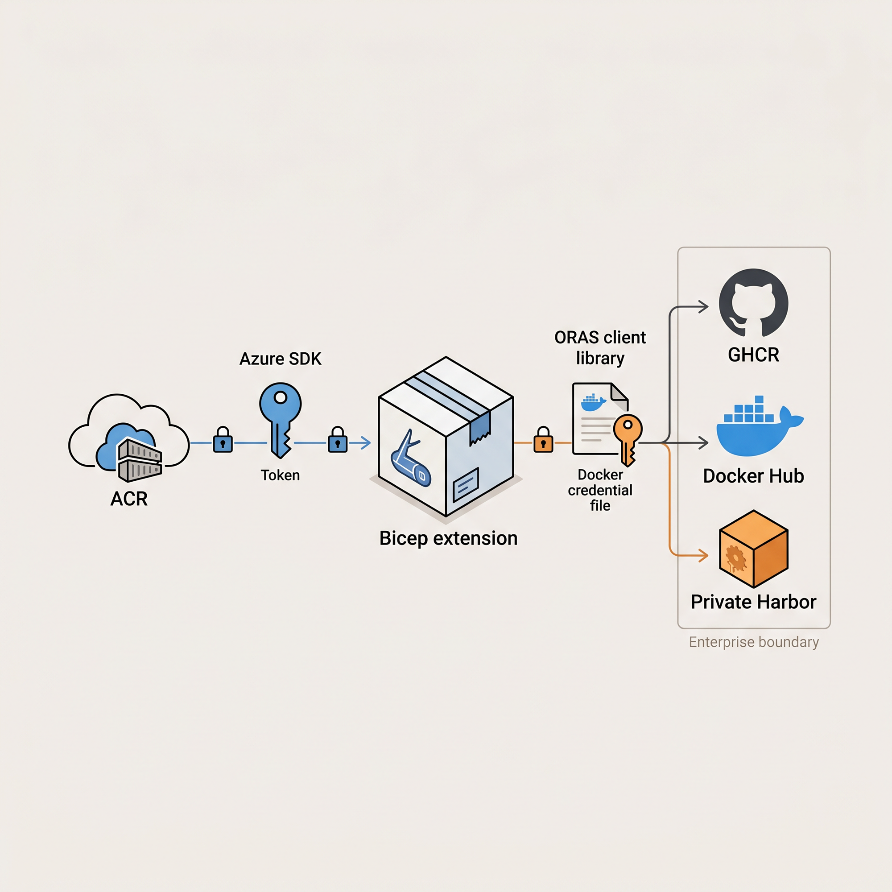
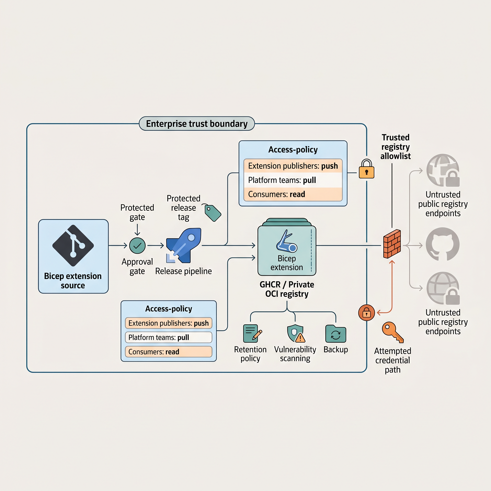

Bicep v0.45.6 just launched a couple of days ago, and there's an interesting new experimental feature added: OCI registry support for publishing and restoring Bicep artifacts.

To get right off the bat, in practical terms, authors are no longer limited to Azure Container Registry (ACR) for publishing/restoring. You can now store any private extension in an OCI-compliant registry that your organization might already operate. That includes GitHub Container Registry, Docker Hub, or a self-hosted registry such as <a href="https://goharbor.io/">Harbor</a>.

But this isn't just a simple change. It's more than that. That's because it lets teams distribute Bicep extensions through the same registry platform and DevOps processes that they use for other internal artifacts. 
<blockquote>

[!NOTE] 
As mentioned, the feature is experimental. Treat it as such when you're evaluating it before it becomes a production dependency.

</blockquote>

This article goes through an end-to-end flow by enabling the feature, authenticating, and publishing an existing extension so it makes it available to template authors. At the end, it also explains what the change means for organizations that need to govern (private) extensions.
<h2 id="what-oci-registry-support-changes">What OCI registry support changes</h2>
An OCI registry is a server that stores artifacts using the <a href="https://opencontainers.org/">Open Container Initiative</a> distribution specification. Interestingly enough, container is in that name, and it's commonly used for container images. But they can also store other versioned artifacts.

Bicep extensions are precisely that type of artifact because they're packaged as OCI artifacts. That means that the familiar registry reference format still applies:
<pre><code class="language-bicep">br:registry.github.com/organization/bicep-extensions/myextension:v1.0.0</code></pre>
Before v0.45.6, Bicep used the Azure Container Registry SDK for registry operations. That limitation didn't allow for publishing and restoring to ACR-compatible workflows. Now, if you place the <code>ociEnabled</code> feature flag in your Bicep configuration file, Bicep is going to use the ORAS transport for non-Azure OCI registries. 
<blockquote>

[!NOTE] 
ORAS is a client library for moving OCI artifacts without treating them as <em>container images</em>.

</blockquote>

With this change, existing ACR workflows don't have to change. Bicep continues to use the Azure SDK and Azure credentials for ACR endpoints. Non-Azure registries use Docker-compatible credentials. The extension reference syntax and Bicep's local artifact cache stay the same, so template authors do not need to learn a second reference format.
<figure class="kg-card kg-image-card kg-card-hascaption"><figcaption>Figure 1: Bicep extension publishing using Azure SDK or ORAS client library</figcaption></figure><h2 id="prerequisites">Prerequisites</h2>
To fully use this functionality, there are a couple of prerequisites. Of course, you're going to need the latest Bicep release (<a href="https://github.com/Azure/bicep/releases/tag/v0.45.6">v0.45.6</a>) or later. Then, you should add the following flags in your <code>bicepconfig.json</code>:
<pre><code class="language-json">{
  "experimentalFeaturesEnabled": {
    "ociEnabled": true,
    "localDeploy": true,
    "extensibility": true
  }
}</code></pre>
This article uses GHCR, which Bicep trusts by default. This is important to know. Any other registry is rejected by Bicep as it isn't listed in the trusted registries before connecting (or sending credentials). Follow the official <a href="https://github.com/Azure/bicep/blob/main/docs/experimental/oci-registries.md#trusted-registries">using OCI registries documentation</a>.
<h2 id="keeping-my-databricks-extension-private-on-github">Keeping my Databricks extension private on GitHub</h2>
Back in the days, I had written a <a href="https://github.com/Gijsreyn/bicep-ext-databricks">Bicep Databricks extension</a>, which is open-sourced on GitHub. This extension showcased an ACR-based workflow.

But let's imagine that we want to keep it private through GitHub. I would move this repository to an enterprise organization, such as <code>mycompany-bicep-extensions/bicep-ext-databricks</code>, mark it as private repository, and publish the extension package to GHCR.

When that happens, the installable artifacts lives in GitHub Container Registry, at a <code>ghcr.io</code> address. After publishing, I would configure the package as private and grant the platform team read access to those who want to use it. GitHub can inherit package access from the linked private repository, or the package can have its own granular permissions.

So, what does that look like from the existing extension? The repository already contains a build script, creating platform-specific binaries. From the repository root, I would build them, sign in to GHCR with an identity that has package write permissions, and then publish the extension:
<pre><code class="language-powershell">./build.ps1 -Clean -Configuration Release&#10;
$env:DOCKER_REGISTRY = 'ghcr.io'
$env:DOCKER_USERNAME = 'mycompany-bicep-extensions-release-bot'
$env:DOCKER_PASSWORD = $env:GHCR_WRITE_TOKEN&#10;
bicep publish-extension `
  --bin-win-x64 ./output/win-x64/databricks-extension.exe `
  --bin-linux-x64 ./output/linux-x64/databricks-extension `
  --bin-osx-x64 ./output/osx-x64/databricks-extension `
  --target br:ghcr.io/mycompany-bicep-extensions/bicep-ext-databricks:v1.0.0</code></pre>
The first command builds those platform-specific binaries. The environment variables scope the Docker credentials to <code>ghcr.io</code>. Bicep uses them only for that matching registry in this example.

The final command uploads the binaries as one Bicep extension artifact. <code>v1.0.0</code> is an example release, marking most (software) extension releases as GA.

For a GitHub Actions release workflow, grant the job packages: <code>write</code> permission and publish with <code>GITHUB_TOKEN</code>. When the workflow publishes from the source repository, GitHub associates the package with that repository and can apply its package-access model:
<pre><code class="language-yaml">permissions:
  contents: read
  packages: write&#10;
steps:
  - uses: actions/checkout@v4
  - uses: azure/setup-bicep@v2
    with:
      version: v0.45.6
  - name: Sign in to GitHub Container Registry
    run: echo "${{ github.token }}" | docker login ghcr.io -u "${{ github.actor }}" --password-stdin
  - name: Build and publish the extension
    shell: pwsh
    run: |
      ./build.ps1 -Clean -Configuration Release
      bicep publish-extension --bin-win-x64 ./output/win-x64/databricks-extension.exe --bin-linux-x64 ./output/linux-x64/databricks-extension --bin-osx-x64 ./output/osx-x64/databricks-extension --target br:ghcr.io/mycompany-bicep-extensions/bicep-ext-databricks:v1.0.0 # Increment this automatically</code></pre><h2 id="configure-consumers-for-restoration">Configure consumers for restoration</h2>
The process for configuring consumers is basically the same as ACR-enabled workflows. But in this case, you'll use <code>docker login ghcr.io</code> locally. Or you can use other <a href="https://docs.docker.com/reference/cli/docker/login/#examples">examples</a> from the official documentation.
<pre><code class="language-jsonc">// bicepconfig.json
{
  "experimentalFeaturesEnabled": {
    "ociEnabled": true,
    "localDeploy": true,
    "extensibility": true
  },
  "extensions": {
    "databricksExtension": "br:ghcr.io/mycompany-bicep-extensions/bicep-ext-databricks:v1.0.0"
  },
  "implicitExtensions": []
}</code></pre>
The configuration key matches the extension's name. Bicep restores the artifact into its local cache when the extension is used:
<pre><code class="language-bicep">targetScope = 'local'&#10;
param workspaceUrl string&#10;
extension databricksExtension with {
  workspaceUrl: workspaceUrl
}</code></pre>
Developers don't need to download the extension binaries. It's all handled behind the scenes.
<h2 id="why-oci-publishing-matters-to-enterprises">Why OCI publishing matters to enterprises</h2>
While enterprises already could leverage ACR-enabled workflows, often organizational standards are broader. That could mean that there's already an approved way to publish artifacts in a certain way. And that way could be OCI. 

With this expansion, distribution can become part of the software supply chain. OCI support gives technical leaders an option to place those extensions where governance already exists. Whether that's a regional Harbor instance, an enterprise GitHub organization (seen in this article), or another approved registry instead of requiring a separate ACR just for Bicep. Existing vulnerability scanning, audit logs, retention policies, replication, and backup processes may apply as well, depending on the registry.

The fact that there's now a trusted registry allowlist is also an important part of a governance model. You should prefer an exact hostname such as <code>harbor.mycompany.com</code> over a broad wildcard (unless registry hosts need to share the trust boundary). In CI pipelines, you can scope a pull token to consumer repositories and a separate push token to the publishing pipeline.
<figure class="kg-card kg-image-card kg-card-hascaption"><figcaption>Figure 2: Private Bicep extension lifecycle</figcaption></figure>
Lastly, because the capability is experimental, I encourage you to test it out, but also plan for this change. Start with a small extension and a small group of consumers. Validate it on each type of developer workstation and confirm that everything can be pulled in smoothly. 
<h2 id="next-steps">Next steps</h2>
OCI registry support lets Bicep extensions live alongside the rest of an organization's private artifacts without changing how authors reference an extension. Make the following part of the extension's release process:
<ul><li>Enable <code>ociEnabled</code> for publishers and consumers.</li><li>Authenticate with a registry-specific identity.</li><li>Publish versioned extension packages (preferably immutable).</li><li>Declare the extension reference in the consumer configuration.</li><li>Manage the trusted-registry list, package permissions, and CI validation centrally.</li></ul>
For more information, check out the following articles:
<ul><li><a href="https://github.com/Azure/bicep/blob/main/docs/experimental/oci-registries.md">Using OCI Registries (Experimental!)</a></li><li><a href="https://github.com/Azure/bicep/blob/main/docs/experimental/publish-extension-command.md">Using the `publish-extension` command</a></li></ul>

