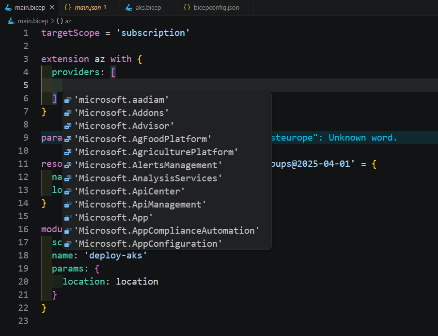

Every platform team that delivers Azure subscriptions to teams encounters the reported issue at least once in their lifetime:
<pre><code class="language-plaintext">Code: MissingSubscriptionRegistration
Message: The subscription is not registered to use namespace 'Microsoft.ContainerService'.</code></pre>
The template is fine by the teams that created it. But the subscription hasn't been told that it needs the resource provider. So somebody adds a fix in the pipeline by using <code>az provider register</code> or <code>Register-AzResourceProvider</code>, or they simply make a wiki page titled: "things to do before you deploy."

That above-mentioned error has changed with a new experimental feature and keeping everything in a single template. Your <em>Bicep </em>template. Let me show you in this blog post about the experimental feature <code>azExtensionConfig</code> with providers.
<h2 id="what-will-be-shipped">What will be shipped</h2>
Bicep hasn't officially released a version with this experimental feature in it. But as you'll see in the next section, you can already use it with the nightly builds.

The <code>azExtensionConfig</code> lets a template pass configuration to the built-in <code>az</code> extension using the <code>extension ... with { ... }</code> syntax you already use for third-party extensions:
<pre><code class="language-bicep">extension az with {
  providers: [
    'Microsoft.Compute'
    'Microsoft.Storage'
  ]
}</code></pre>
The one property the configuration type declares today is <code>providers</code>. Here you declare a list of Azure resource provider namespaces to register at the beginning of your deployment. This differentiates the pre-step that most do as an extra step in their pipeline and instead, now sits within the template. 
<h2 id="testing-it-out">Testing it out</h2>
Bicep's team provides a nightly build of both the CLI and VS Code extension. To install the nightly CLI:
<pre><code class="language-powershell">iex "&amp; { $(irm https://aka.ms/bicep/nightly-cli.ps1) }"</code></pre>
For the VS Code extension, it would be:
<pre><code class="language-powershell">iex "&amp; { $(irm https://aka.ms/bicep/nightly-vsix.ps1) }"</code></pre>
You can now turn on the experimental feature in your <code>bicepconfig.json</code>:
<pre><code class="language-json">{
  "experimentalFeaturesEnabled": {
    "azExtensionConfig": true
  }
}</code></pre>
That's the only flag that's required. You don't need the <code>moduleExtensionConfigs</code> for authoring or type checking. So, whilst the backend service is still pending, it's still possible to take a quick peek at what is happening already. Take, for example, the scenario from the top of the post, written as a template. 

A subscription-scoped deployment creates a resource group and hands off to an AKS module. AKS needs <code>Microsoft.ContainerService</code>, its monitoring add-on needs <code>Microsoft.OperationalInsights</code>, and the node subnet needs <code>Microsoft.Network</code>:
<pre><code class="language-bicep">targetScope = 'subscription'&#10;
extension az with {
  providers: [
    'Microsoft.ContainerService'
    'Microsoft.OperationalInsights'
    'Microsoft.Network'
  ]
}&#10;
param location string = 'westeurope'&#10;
resource rg 'Microsoft.Resources/resourceGroups@2025-04-01' = {
  name: 'rg-platform-aks'
  location: location
}&#10;
module aks 'modules/aks.bicep' = {
  scope: rg
  name: 'deploy-aks'
  params: {
    location: location
  }
}</code></pre>
In the first lines, you can exactly tell what this deployment is assuming, especially at the subscription level. That's worth something even before the backend catches up. When you compile the above template to ARM, you notice that the config rides along the class imports path:
<pre><code class="language-json">"imports": {
    "az": {
      "provider": "AzureResourceManager",
      "version": "0.2.891",
      "config": {
        "providers": [
          "Microsoft.ContainerService",
          "Microsoft.OperationalInsights",
          "Microsoft.Network"
        ]
      }
    }
  },</code></pre><h2 id="intellisense-in-the-editor">IntelliSense in the editor</h2>
This is the part that I like and works right now when you go through the provider(s): IntelliSense.

Bicep has always been profound with IntelliSense. So, Inside the <code>with {}</code> block, property-key completion suggest <code>providers</code> pop up that you want to enable.
<figure class="kg-card kg-image-card kg-card-hascaption"><figcaption>Figure 1: Value completion for providers</figcaption></figure>
All of these members are sourced and shipped in the <code>bicep-typez-az</code>, so that's why when you type in <code>Micro</code>, you'll find all the providers from Microsoft. Those are roughly 280 namespaces, and you can pick from the list you need.

Array-item completions also got fixed for three cursor positions that previously stayed silent: an empty array (<code>providers: []</code>), an empty string literal (<code>providers: ['']</code>, which is the shape VS Code auto-inserts the moment you type a quote), and an unterminated string. Small fix, but it removes the "why isn't IntelliSense firing" moment.
<h2 id="wrapping-up">Wrapping up</h2>
It's great to see that <code>azExtensionConfig</code> moves a piece of the deployment prerequisite, and you're able to just configure it in a Bicep template. The headline only at this time: <strong>the deployment engine does not act on this configuration yet.</strong>

You can compile it, check it out, commit it behind the flag if you liked it, but keep your existing registration step until backend support ships. You have to keep an eye out for the official Bicep release.

For more information, the feature is documented under the <a href="https://github.com/Azure/bicep/blob/main/docs/experimental-features.md">experimental-features.md</a> file in the repository.

