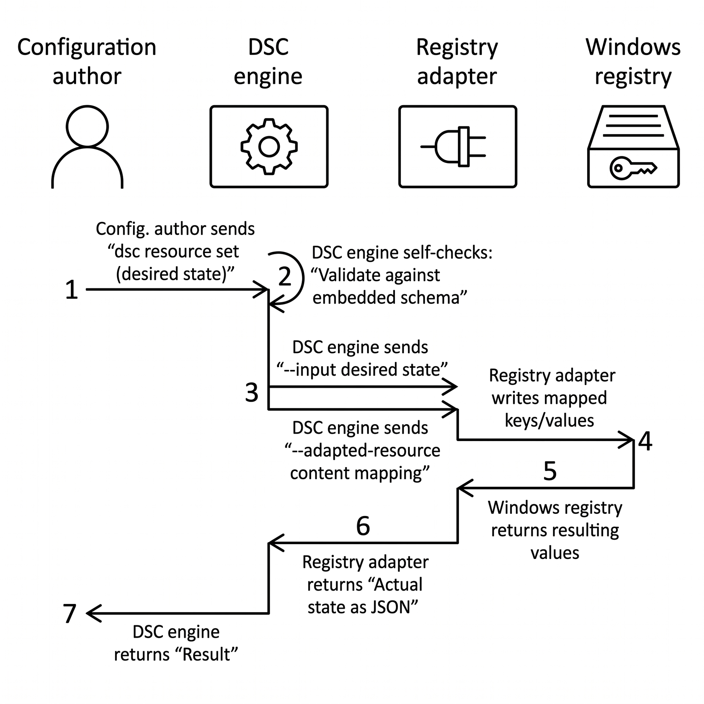

<em>What if you could ship a new DSC resource without writing a single line of code?</em>

From the early days, Microsoft DSC bridged the gap between the new engine and everything that isn't a native command-based DSC resource. Think about the PowerShell DSC resources that have existed in the DSC community for a long time or WMI classes (the <code>Microsoft.Windows/WMI</code> adapter).

They made the ecosystem usable and, on some level, understandable to each other. But as we learned over time, they carried a lot of internal logic to:
<ul><li>Discover resources from the subsystem.</li><li>Get the descriptions from each of them.</li><li>Validate the resources that got surfaced.</li></ul>
Yet, with time, a new PR quietly redefined what that bridge is. On the surface, it adds a new registry adapter and a new <code>Microsoft.Windows/Personalization</code> resource. But underneath, it moves the authority over an adapted resource away from the adapter and into the resource's own manifest. And the better part? DSC's engine now does the heavy lifting. 

This article looks at what actually changed in more detail, and why it matters for anyone who wants to author resources.
<h2 id="the-adapter-model-until-now">The adapter model until now</h2>
To understand the shift, we've to take a step back and look at how the classic adapters work. An adapter is a command resource with <code>kind: adapter</code> in its resource manifest. Its dominant feature is the <code>list</code> operation: when DSC needs to know which adapted resources exist, it runs the adapter, and the adapter enumerates a subsystem at runtime.
<figure class="kg-card kg-image-card kg-card-hascaption"><figcaption>Figure 1: DSC's engine discovering subsystems (WMI, PowerShell, ...)</figcaption></figure>
For example, PowerShell's adapter walks the <code>$env:PSModulePath</code> looking for modules with DSC resources, whereas the WMI adapter just queries for the available classes on the system.

So, here's the thing. Because historically, <em>adapted resources </em>did not have manifests of their own (they were discovered through the <code>list</code> operation), the adapter is the single source of truth for everything about them. Think about the DSC resource name (and the module), their capabilities (get, set, test, ...), their property schemas, and whether a given configuration is actually even valid.

Validation sort of happens through the adapter, if the <code>validate</code> capability does a <em>thing</em>. 
<blockquote>

[!NOTE] 
The <code>validate</code> capability was never officially implemented in PowerShell's adapter, nor in the WMI one. <code>validate</code> is a deprecated feature.

</blockquote>

As you can see, this design works, but it has a real cost. Discovery means starting that strange runtime just to find what exists. So some of the adapters grew caching layers and lookup tables to stay fast. Validation errors became tough, as they're surfaced directly through the adapter rather than the engine. So they vary in quality from one adapter to the next. And there's no way to know a resource's shape without invoking its adapter first.

The adapter, <em>in short</em>, is a <strong>discovery engine</strong>. It's powerful, but heavy.
<h2 id="what-has-been-introduced">What has been introduced</h2>
The earlier-mentioned pull request builds on a newer idea in the DSC codebase: the <em>adapted resource manifest</em>. Instead of only existing once an adapter discovers it at runtime, an adapted resource is now a standalone YAML or JSON file with <code>kind: resource</code>, its own <code>type</code>, <code>version</code>, and <code>capabilities</code>, plus a<code>requireAdapter</code> property naming the adapter that executes it. DSC discovers these manifests through its normal discovery pipeline, exactly like native command resources.
<pre><code class="language-json">{
  "$schema": "https://aka.ms/dsc/schemas/v3/bundled/adaptedresource/manifest.json",
  "type": "DatabricksDsc/AdaptedResource",
  "kind": "resource",
  "version": "1.0.0",
  "capabilities": ["get", "set"],
  "requireAdapter": "Microsoft.Windows/WindowsPowerShell",
  "content": {
    "exampleSetting": "data the adapter knows how to interpret"
  },
  "schema": {
    "embedded": {
      "type": "object",
      "properties": {
        "exampleSetting": { "type": "string" }
      }
    }
  }
}</code></pre>
The three engine changes in the PR make this model click into place:
<ol><li><strong>The engine owns validation</strong>: DSC now validates an instance against the JSON Schema embedded in the adapted resource's manifest, instead of calling the adapter's <code>validate</code> capability.</li><li><strong>Manifests can carry inline content</strong>: Alongside the existing <code>path</code> property, an adapted resource manifest can now define <code>content</code>. This is an arbitrary block of structured data that the adapter interprets, meaning that the manifest no longer just points at the resource - it can <strong>be the resource</strong>.</li><li><strong>The adapter receives that content at invocation time</strong>: A new <code>adaptedContentArg</code> argument type lets an adapter's manifest declare how the engine should pass that <code>content</code> along for the specific adapter. More on this later.</li></ol>
Putting those 3 bullet points in simple words: the adapter stops being a <strong>discovery engine </strong>and becomes a <strong>translation engine</strong><em>. </em>
<figure class="kg-card kg-image-card kg-card-hascaption"><figcaption>Figure 2: From chaos to order with adapted resource manifests</figcaption></figure><h2 id="registry-adapter-in-practice">Registry adapter in practice</h2>
To put the proof in the pudding, we can take a look at the <code>Microsoft.Windows/Personalization</code> resource. This resource speaks the words already based on the naming: it's a resource for Windows personalization settings.

It contains light/dark mode, transparency,  and accent color. The new <code>Microsoft.Windows.Adapter/Registry</code> is built on top of it, which contains roughly 260 lines of YAML and contains no code at all. Each property in its <code>content</code> block maps one JSON property to one registry value:
<pre><code class="language-yaml">type: Microsoft.Windows/Personalization
kind: resource
requireAdapter: Microsoft.Windows.Adapter/Registry
content:
  appsUseLightTheme:
    keyPath: HKCU\SOFTWARE\Microsoft\Windows\CurrentVersion\Themes\Personalize
    valueName: AppsUseLightTheme
    valueType: REG_DWORD
    jsonType: boolean
    defaultValueIfNotFound: 0
    mapJsonToRegistry:
      'false': 0
      'true': 1
schema:
  embedded:
    # JSON Schema defining appsUseLightTheme as a boolean</code></pre>
The mapping vocabulary is small but expressive:
<table>
<thead>
<tr>
<th>Property</th>
<th>What it does</th>
</tr>
</thead>
<tbody>
<tr>
<td><code>keyPath</code></td>
<td>Locates the registry key that holds the value</td>
</tr>
<tr>
<td><code>valueName</code></td>
<td>Names the specific registry value under that key</td>
</tr>
<tr>
<td><code>valueType</code></td>
<td>Declares the registry data type, such as <code>REG_DWORD</code></td>
</tr>
<tr>
<td><code>jsonType</code></td>
<td>Declares the user-facing type, such as <code>boolean</code> or <code>stringArray</code></td>
</tr>
<tr>
<td><code>mapJsonToRegistry</code></td>
<td>Translates each JSON value to its registry equivalent</td>
</tr>
<tr>
<td><code>defaultValueIfNotFound</code></td>
<td>Provides a fallback when the key or value is absent, which often has a well-known meaning in the registry</td>
</tr>
</tbody>
</table>

That last value, <code>defaultValueIfNotFound</code> matters because an absent registry value has a well-known meaning of its own. Of course, the above scales beyond booleans. For example, the manifest maps the Start menu's folder list, stored as <code>REG_BINARY</code> GUIDs, onto a friendly string array of names like <code>Documents</code> and <code>Downloads</code>.

Here's the nice part about such a model. Users get a typed, discoverable API over raw registry plumbing:
<pre><code class="language-yaml">resources:
- name: Dark mode everywhere
  type: Microsoft.Windows/Personalization
  properties:
    appsUseLightTheme: false
    systemUsesLightTheme: false</code></pre>
You declare <code>appsUseLightTheme: false</code>; the adapter writes a <code>REG_DWORD</code> of <code>0</code> to the right key. Nobody has to remember that path, and the embedded schema rejects a typo'd property before anything touches the registry.
<h2 id="comparing-the-two-models">Comparing the two models</h2>
With both models mentioned in this article, it's best to see the differences side by side. The short version: work that used to happen inside the adapter at runtime now happens in the engine, or doesn't need to happen at all.
<table>
<thead>
<tr>
<th></th>
<th>Classic adapters (PowerShell, WMI)</th>
<th>New model (registry adapter)</th>
</tr>
</thead>
<tbody>
<tr>
<td>Resource discovery</td>
<td>Runtime enumeration via <code>list</code></td>
<td>Static manifest, engine discovery</td>
</tr>
<tr>
<td>Schema &amp; validation</td>
<td>Adapter's <code>validate</code> function</td>
<td>JSON Schema in the manifest, enforced by the engine</td>
</tr>
<tr>
<td>Resource definition</td>
<td>Code (PowerShell module, WMI class)</td>
<td>Declarative YAML (<code>content</code> mapping)</td>
</tr>
<tr>
<td>Invocation</td>
<td>Nested <code>resources</code> array, adapter fans out</td>
<td>Per instance, content passed via <code>--adapted-resource</code></td>
</tr>
<tr>
<td>Performance profile</td>
<td>Caches plus foreign runtime startup</td>
<td>No cache needed; a single binary call</td>
</tr>
<tr>
<td>Who can author one</td>
<td>Developers</td>
<td>Anyone comfortable writing YAML</td>
</tr>
</tbody>
</table>

Knowing about the two models, two things are worth stating plainly. Firstly, the classic adapters aren't going anywhere. They remain the right design for surfacing <em>existing </em>subsystems, where the resources live elsewhere (and must be discovered). The new model shines when you're <em>authoring new</em> resources over a generic engine like the registry. 

Secondly, the two models share one contract: from a configuration author's point of view, an adapted resource looks and behaves like any other resource. But the change in itself is in <em>who</em> does the work underneath.

Okay, there's a third one on an earlier promise mentioned about <code>adaptedContentArg</code>. Instead of receiving a batch of nested instances to fan out itself, the adapter declares an argument in its manifest, <code>--adapted-resource</code> in the registry adapter's case, and the engine uses it to hand over the manifest's <code>content</code> block together with the instance's desired state, one instance at a time.
<figure class="kg-card kg-image-card kg-card-hascaption"><figcaption>Figure 3: Process flow of adapted resource with Registry adapter</figcaption></figure><h2 id="closing-thoughts">Closing thoughts</h2>
The registry adapter is deliberately minimal. It implements only the type conversions the Personalization resource needs, with more promised as real use cases appear. But the pattern generalizes, and that's where it gets interesting:
<ul><li>The same shape can apply to INI, XML, files, to WMI, or to any settings stored with a regular structure.</li><li>One adapter binary can carry an open-ended family of zero-code resources, defined by the community as shareable manifests.</li><li>Because each manifest embeds its schema, tooling such as editors, linters, and documentation generators can understand these resources without executing anything.</li></ul>
If you want to give it a try, grab a recent DSC release and run <code>dsc resource get -r Microsoft.WIndows/Personalization</code>, then read through the Personalization manifest in the repo. It's the best documentation of the model today. 

