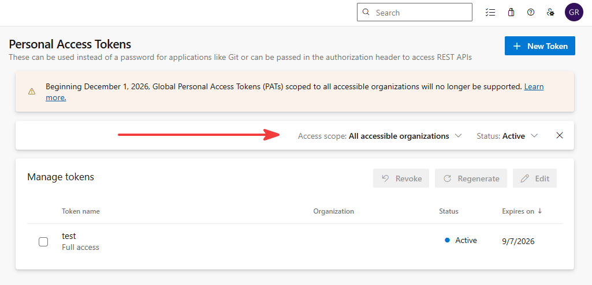

Microsoft shipped the Azure DevOps service connection last week, and the announcement immediately makes the case you'd expect from a modern platform: no more tokens to create, store, and rotate. And better yet, the service connection gives per-pipeline permissions instead of a shared build account, including an audit trail.

But what the post doesn't mention is the date.

A date that was shared the previous year in December, when every global personal access token in Azure DevOps Services is going to get decommissioned. 

That's sixteen weeks from today. And a global PAT exists for exactly one reason: <em>reaching across organization boundaries</em>. And that makes this news so interesting. The global PAT (or credential) and what seems to be the answer have never been put in the same sentence.

Here's a quick migration guide for one pipeline, and four traps that can cost you an afternoon scratching your head.
<h3 id="step-1-check-whether-this-is-actually-your-problem">Step 1: Check whether this is <em>actually your problem</em></h3>
Half of the anxiety about the deadline back in December belongs to people who actually don't even have the problem. Why do I say this?

A PAT is <em>global </em>if it reaches multiple organizations rather than a single named one. You can see that when you open your own under <em>User settings -&gt; Personal access tokens</em>. 
<figure class="kg-card kg-image-card kg-card-hascaption"><figcaption>Figure 1: Global PATs</figcaption></figure>
Admins who create it under <em>Organization Settings -&gt; Security -&gt; Personal access tokens -&gt; All PATs</em>, is where Microsoft's own guidance says to go hunting for. You can use the PAT Lifecycle Management API that returns <code>targetAccounts</code> per token:
<pre><code class="language-bash">curl -H "Authorization: Bearer &lt;entra-token&gt;" \
  "https://dev.azure.com/&lt;org&gt;/_apis/tokens/pats?api-version=7.1-preview.1"</code></pre>
And that's where the anxiety can be lifted. Anything scoped to one organization keeps working on 2 December exactly as it does today. This retirement covers global PATs only, and it is also only for Azure DevOps Services, not Azure DevOps Server.

Now that you know about the token, you need to find where it actually lives. A rough list that people often forget:
<ul><li>Variable groups and secret pipeline variables</li><li>Key Vault-linked variable groups</li><li>Git remotes with credentials baked into the URL</li><li>Config files like <code>.npmrc</code> and <code>nuget.config</code> committed in the repo (bad, bad, bad)</li><li>The <a href="https://learn.microsoft.com/en-us/azure/devops/cli/log-in-via-pat?view=azure-devops&amp;tabs=windows#authenticate-with-the-azure_devops_ext_pat-environment-variable"><code>AZURE_DEVOPS_EXT_PAT</code></a> environment variable</li></ul>
So a small triage rule: if a token only ever touches one organization, just re-scope it to an organization and stop reading. If it crosses organizations, read on. The service connection just might be the answer for you.
<h3 id="step-2-let-the-build-length-decide-the-identity">Step 2: Let the build length decide the identity</h3>
Okay, the service connection that is in preview is going to need a Microsoft Entra identity. But when you create one, it isn't going to make you one. It also won't add it for you in Azure DevOps.

Both have to exist before you start, which is something that wasn't included in the announcement's screenshots. That begs the question: which type do <em>I </em>need? A service principal or managed identity?

Most are going to say that it's a style preference, but it actually isn't. It's a token-lifetime decision. You're going to find it out when you got it wrong somewhere around minute sixty-one of a long build:
<pre><code class="language-plaintext">AADSTS700024: Client assertion is not within its valid time range</code></pre>
<a href="https://learn.microsoft.com/en-us/azure/devops/pipelines/library/add-devops-entra-service-connection?view=azure-devops#microsoft-entra-id-error-messages">Entra tokens for a service principal expire hourly</a>. For managed identities, they last for 24 hours. If your builds run long, that's the whole decision, and it's the only difference most teams will ever feel.

The rule here: builds under an hour either work (service principal or managed identity). For builds over an hour, use managed identity. If you're running agents in Azure, just use managed identity regardless, because you skip credential handling entirely. 

There are also two blockers to check now rather than in November, which can potentially require someone else's approval:
<ul><li>AADSTS70052: multitenant app registrations (<code>signInAudience: AzureADMultipleOrgs</code>) aren't supported by the Entra issuer. Use <code>AzureADMyOrg</code> and one connection per tenant.</li><li>AADSTS700223 / AADSTS700238: workload identity federation is constrained or disabled at the tenant level. Only an Entra admin can lift that.</li></ul><h3 id="step-3-add-it-to-azure-devops-without-tripping">Step 3: Add it to Azure DevOps without tripping</h3>
Four clicks, three ways to get it wrong.

The <a href="https://learn.microsoft.com/en-us/azure/devops/integrate/get-started/authentication/service-principal-managed-identity?view=azure-devops#implementation-guide">tutorial on Microsoft Learn</a> describes perfectly how to add a service principal or managed identity. But there can be three traps:
<ol><li>The wrong object ID. For service principals, grab the object ID  from the Enterprise applications, not the app registration one. The app registration ID is the easier one to find, which is why everyone grabs it in the first place.</li><li>Stakeholder. Stakeholder licenses don't grant repository access, and nothing in the error says so:</li></ol><pre><code class="language-plaintext">The Git repository with name or identifier &lt;name&gt; does not exist or you do not have permissions</code></pre><ol start="3"><li>Licensing arithmetic. Or better yet: calculation. Each identity consumes a license in every organization it joins. There's no discount for multi-org, and group licensing rules don't apply. Microsoft's guidance is to use separate service connections per project or organization, which is fine, because many connections can share one identity. The billable unit is <em>identity × organization</em>, not connection. Don't mint an identity per pipeline.</li></ol>
Then permissions. Make it easy for yourself and assign the least-privilege (<code>Readers</code>) on the project, plus whatever specific feed or repo permissions the identity needs. 
<h3 id="step-4-swap-the-yaml-pipeline-code">Step 4: Swap the YAML pipeline code</h3>
The fun part for the developers, DevOps engineers, or others who create the DevOps pipelines. Every place the PAT appeared becomes a named connection, and the token handling easily disappears. For example, before:
<pre><code class="language-yaml">variables:
  - group: shared-secrets      # holds GLOBAL_PAT&#10;
steps:
  - script: |
      dotnet nuget add source https://pkgs.dev.azure.com/platform-engineering/_packaging/shared/nuget/v3/index.json \
        --name shared --username az --password $(GLOBAL_PAT) --store-password-in-clear-text
      dotnet restore</code></pre>
And after:
<pre><code class="language-yaml">resources:
  repositories:
    - repository: platform-templates
      type: git
      endpoint: platform-connection
      name: 'platform/build-templates'
      ref: refs/heads/main&#10;
steps:
  - task: NuGetAuthenticate@1
    inputs:
      nuGetServiceConnections: 'platform-connection'&#10;
  - task: DotNetCoreCLI@2
    inputs:
      command: 'restore'
      projects: '**/*.csproj'</code></pre>
Here's a short list of where the connection name goes for each task:
<table>
<thead>
<tr>
<th>Task</th>
<th>Input</th>
</tr>
</thead>
<tbody>
<tr>
<td><code>NuGetAuthenticate@1</code></td>
<td><code>nuGetServiceConnections</code></td>
</tr>
<tr>
<td><code>npmAuthenticate@0</code>, <code>PipAuthenticate@1</code>, <code>MavenAuthenticate@0</code></td>
<td><code>azureDevOpsServiceConnection</code> (alias: <code>workloadIdentityServiceConnection</code>)</td>
</tr>
<tr>
<td><code>AzureCLI@3</code></td>
<td><code>connectionType: 'azureDevOps'</code> + <code>azureDevOpsServiceConnection</code></td>
</tr>
<tr>
<td><code>InvokeRESTAPI@1</code></td>
<td><code>connectionType: 'connectedServiceNameAzureDevOps'</code> + <code>serviceConnection</code></td>
</tr>
<tr>
<td>repository resource</td>
<td><code>endpoint:</code></td>
</tr>
</tbody>
</table>

<blockquote>

[!IMPORTANT] 
One small catch on the npm, pip and Maven task. In the announcement it isn't covered that when you use the service connection, the <code>feedUrl</code> is going to be required! It overrides the other feed inputs.

</blockquote>

For simple REST calls (<code>AzureCLI@3</code>) with <code>connectionType: azureDevOps</code>, modify the <code>Authorization: Basic &lt;base64 PAT&gt;</code> header. Inside the script, the <code>az account get-access-token --resource 499b84ac-1321-427f-aa17-267ca6975798</code> gets you that token. That GUID is Azure DevOps, and it's worth memorizing. 
<h2 id="what-doesnt-move-yet">What doesn't move yet</h2>
You've gone through the steps, am <em>I </em>there? Well, not fully. This won't get you to zero PATs.

The feature is still in preview, meaning that changes can be expected. Don't start building irreversible tooling on it. Service principals cannot create PATs or SSH keys, cannot sign in interactively, cannot own a whole organization, and don't support Azure DevOps OAuth flows. 

Anything depending on those still needs a different plan, which isn't covered in this article. There are also some sovereign clouds blocking workload identity federation (<code>AADSTS900382</code>).

Then one more thing. Put one more date on the same calendar, but read the caveat before you start worrying. The Azure DevOps issuer (<code>https://vstoken.dev.azure.com</code>) was deprecated on 1 July 2026 and reaches end of life on 1 July 2027. This does not affect the service connection you just built. 

The Azure DevOps service connection always uses the Entra issuer. What it does affect are your older workload identity federation service connections, the ones created before the issuer switch. A conversion CLI is expected in autumn 2026, but it converts one service connection at a time, so bulk migration means scripting a loop around it. Budget for that, not for a button. (Thanks to Eric van Wijk for clarifying both points.)

December is the deadline for the global PAT specifically. Treat it as the forcing function for the wider mode.

