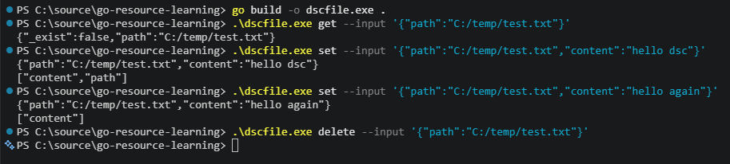
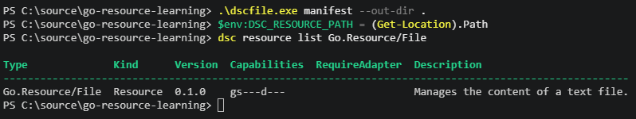

There is something interesting happening around Microsoft's DSC landscape. Within the last few months, communities started to reach the same conclusion: writing a Microsoft DSC resource involves too much protocol plumbing, and that plumbing can easily be moved to a <em>library</em>.

OpenDSC was the first one that built a .NET library for rapid custom resource creation in .NET. Over in the PowerShell world, I created a pull request to add the same type of support for class-based DSC resources (completely with runtime JSON schema generation and the <code>_exist</code> canonical property).

And in Go, there's the <code>dsc-go-rdk</code>. The RDK part stands for Resource Development Kit, and this RDK was written in Go just because the command-based resource contract has finally stabilized enough that the boilerplate around it is worth abstracting.

That boilerplate is the least interesting part of writing a DSC resource. But you still need to learn about it to understand what's happening behind the scenes. So, in this blog post, you will learn about the protocol and then build a simple DSC resource in under 100 lines.
<h2 id="what-the-protocol-actually-asks-of-you">What the protocol actually asks of you</h2>
A DSC command-based DSC resource is just an executable (or an entry point). The engine runs it, hands it JSON, and reads JSON back. 

That sounds pretty simple, right? But at some point, you discover the contract has <em>certain </em>opinions:
<ul><li><code>get</code> writes one compact JSON object to stdout.</li><li><code>set</code> writes either nothing, or the after-state, or the after-state + a second line listing the properties that changed.</li><li><code>test</code> injects an <code>_inDesiredState</code> flag into the state it returns.</li><li><code>export</code> writes JSON Lines.</li><li><code>delete</code> writes nothing at all.</li></ul>
And there are more opinions, but you get the point. Before the engine will even look at your binary, it needs a manifest file describing every one of those methods and an embedded JSON Schema for your instance.

None of this is difficult, actually. But they are "chores."

Input arrives via a flag or piped through stdin, so you're parsing arguments. Traces go to stderr in a specific JSON shape, gated by an environment variable, so you're writing a logger. Failures map to a documented table of exit codes, so you're maintaining an error-to-exit-code map. And on and on. What you're actually doing is plumbing, even though you haven't written any domain logic to get your resource live.

That's the gap an RDK fills. You only implement typed <code>Get</code>, <code>Set,</code> and <code>Test</code> methods over your own state type, and the library speaks the wire protocol on your behalf. Here's the whole thing: first a short setup, then a complete, working resource in sixty-three lines. After that, we'll take it apart.
<h2 id="setup-what-you-need">Setup: what you need</h2>
You need less than you'd think. First of all, <a href="https://go.dev/doc/install">Go 1.26 or later</a>, then one <code>go get</code>, and the build side is done:
<pre><code class="language-bash">go mod init go.resource/dscfile
go get github.com/LibreDsc/dsc-go-rdk@latest</code></pre>
That second command is the only dependency you'll take on. <code>dsc-go-rdk</code> itself has zero dependencies beyond the obvious Go standard library, so nothing else lands in your <code>go.sum</code>.

But what about Microsoft's DSC engine itself? Well, that's only needed to <em>run </em>your finished resource, not to test it. The binary you're about to write speaks the protocol on its own, which means you can develop and debug the whole thing on a machine that has never seen <code>dsc.exe</code>.
<blockquote>

[!NOTE] 
If you want to follow along to the end where you want the engine to discover and drive your resource, install <a href="https://github.com/PowerShell/DSC">Microsoft DSC</a>.

</blockquote>

Everything below is going to live in a single file: <code>main.go</code>.
<h2 id="step-1model-the-state-as-a-struct">Step 1 - Model the state as a struct</h2>
What does one instance of this <em>thing </em>look like?

For a file, that's going to be a <code>path</code> and some <code>content</code>. In Go, it will be a struct, and you're done. This struct <em>is </em>the resource's contract. The RDK generates the JSON Schema for it, parses incoming instances into it, and serializes every operation's result from it.
<pre><code class="language-go">type File struct {
	dsc.ExistProperty
	Path    string `json:"path" description:"Absolute path of the file to manage."`
	Content string `json:"content,omitempty" description:"The text the file should contain."`
}</code></pre>
Three things in those four lines are doing work here:
<ol><li>The JSON tags decide more than field names. A property without <code>omitempty</code>, like <code>path</code>, comes out <em>required</em> in the generated schema. Add the <code>omitempty</code> and it becomes optional.</li><li>The <code>description</code> tag becomes the property's description in the schema.</li><li>Lastly, the <code>dsc.ExistProperty</code> opts the resource into create/delete semantics. It becomes that canonical <code>_exist</code> boolean, defaulting to <code>true</code>. </li></ol>
Now, build the binary and ask it for its schema by running <code>dscfile schema</code>. The following result should return to your console:
<pre><code class="language-json">{
  "$schema": "https://json-schema.org/draft/2020-12/schema",
  "type": "object",
  "additionalProperties": false,
  "required": ["path"],
  "properties": {
    "_exist":  { "type": "boolean", "default": true, "description": "Indicates whether the instance should exist." },
    "path":    { "type": "string", "description": "Absolute path of the file to manage." },
    "content": { "type": "string", "description": "The text the file should contain." }
  }
}</code></pre>
You just wrote four lines of struct. This document is generated, so you don't have to maintain it. 
<h2 id="step-2implement-the-operations-you-care-about">Step 2 - Implement the operations you care about</h2>
In this part, you can decide what you genuinely want to expose and care about. A handler is any type that implements one or more capability interfaces over your state struct.

<code>Gettable</code> is the only one that's mandatory. The others can be created on an opt-in basis, allowing those to be discovered by the interface assertion when you construct the resource.

You declare capabilities by writing methods, not by filling in a table.
<pre><code class="language-go">type Handler struct{}&#10;
func (Handler) Get(_ context.Context, in File) (File, error) {
	if in.Path == "" {
		return in, dsc.NewExitCodeErrorf(dsc.ExitInvalidInput, "path is required")
	}
	data, err := os.ReadFile(in.Path)
	if errors.Is(err, fs.ErrNotExist) {
		return dsc.NotFound(in, "Go.Resource/File", in.Path)
	}
	if err != nil {
		return in, err
	}
	return File{Path: in.Path, Content: string(data)}, nil
}&#10;
func (Handler) Set(_ context.Context, desired File) (File, error) {
	if err := os.WriteFile(desired.Path, []byte(desired.Content), 0o644); err != nil {
		return desired, err
	}
	return File{Path: desired.Path, Content: desired.Content}, nil
}&#10;
func (Handler) Delete(_ context.Context, in File) error {
	if err := os.Remove(in.Path); err != nil &amp;&amp; !errors.Is(err, fs.ErrNotExist) {
		return err
	}
	return nil
}</code></pre>
Here, three methods have been implemented. <code>Get</code> returns the current state. <code>Set</code> enforces state. And <code>Delete</code> removes the instances that are passed in.

Three details in those methods are worth slowing down for, because they're exactly where hand-written resources tend to go wrong.

Firstly, <em>absence is not an error</em>. A missing file is a legitimate state and, arguably, the most important one since it's where every configuration that creates the file starts from. So when <code>os.ReadFile</code> says the file isn't there, <code>Get</code> doesn't fail. It returns <code>dsc.NotFound(...)</code>. That helper hands back the input instance with <code>_exist</code> set to <code>false</code> and a nil error. In DSC land, this says "this isn't here."
<blockquote>

[!NOTE] 
Get this wrong and the engine sees a broken resource instead of an absent instance, and every run that should <em>create</em> the file fails before it starts. This is the most common mistake in a resource.

</blockquote>

Second, <em>delete is idempotent</em>. Deleting something that's already gone must succeed. That's what the <code>fs.ErrNotExist</code> check is for.

And thirdly, <em>errors become exit codes</em>. Return any <code>error</code> and the library maps it to what the protocol expects: a <code>*NotFoundError</code> becomes exit code 6, a JSON decoding failure becomes 3, anything else becomes 2. If you want to choose the code yourself, wrap the error and use <code>dsc.NewExitCodeErrorf(dsc.ExitInvalidInput, ...).</code>

But notice something that was missing: there is no <code>Test</code> method, and that's deliberately done. Without a <code>Testable</code> implementation, the manifest advertises no test method, and the engine falls back to its own synthetic test. A synthetic test in the engine calls <code>get</code> and compares the result against the desired state, property by property. So that means you get <code>test</code> for free, unless you need control over it.

Here's the full set that can be implemented to memorize:
<pre><code class="language-markdown">| Interface                | Manifest capability |
|--------------------------|---------------------|
| `Gettable` (required)    | `get`               |
| `Settable`               | `set`               |
| `Testable`               | `test`              |
| `Deletable`              | `delete`            |
| `Exportable`             | `export`            |</code></pre>
Write the method, and the capability appears the next time the manifest is generated. When you remove it, it disappears. 
<h2 id="step-3declare-the-resource">Step 3 - Declare the resource</h2>
Two things are left to do: tell the library who this resource is, and hand it over <code>main</code>. Identity, version, and the few behavioral switches the manifest needs to advertise all live in one place, <code>ResourceConfig</code>:
<pre><code class="language-go">func main() {
	r := dsc.MustResource[File](Handler{}, dsc.ResourceConfig{
		Type:        "Go.Resource/File",
		Version:     "0.1.0",
		Description: "Manages the content of a text file.",
		Tags:        []string{"file", "demo"},
		SetReturn:   dsc.SetReturnStateAndDiff,
	})
	r.Main("dscfile")
}</code></pre>
<code>Type</code> and <code>Version</code> are not free-form strings. The type name must match <code>&lt;owner&gt;[.&lt;group&gt;][.&lt;area&gt;]/&lt;name&gt;</code> and the version must be a semantic version. Both are validated when the resource is constructed. That's why <code>MustResource</code> panics on a bad config instead of returning an error: a failure here can only be a typo, and a typo should stop you the first time you run the binary. 

The one genuinely interesting choice in the <code>ResourceConfig</code> is the <code>SetReturn: dsc.SetReturnStateAndDiff</code>. It promises the engine that <code>set</code> will report the resulting state and the list of properties it changed. The library will keep that promise on your behalf: it calls your <code>Get</code> before your <code>Set</code>, diffs the before-state against the after-state, and emits the changed-property array itself. You'll see that in action in a moment.

And the last part, the <code>r.Main("dscfile")</code> is the entire CLI. Subcommand dispatch, <code>--input</code> and stdin handling, per-operation output framing, exit codes, and the <code>schema</code> and <code>manifest</code> subcommands you'll use shortly — all behind one call.

Now count what you've written: sixty-three lines, imports included. That's the promise from the title delivered straight to your code editor. Let's drive the CLI.
<h2 id="step-4drive-the-protocol-by-hand">Step 4 - Drive the protocol by hand</h2>
As mentioned in the introduction, you can build your CLI, and you have a working DSC resource. You don't need DSC's engine to prove that. The binary is the protocol, so you can exercise every operation from your shell and read exactly what the engine would read. This is the fastest debugging loop you'll get, and it's worth trying it out before you run it through <code>dsc.exe</code>.
<pre><code class="language-powershell">go build -o dscfile.exe .&#10;
# File doesn't exist yet
.\dscfile.exe get --input '{"path":"C:/temp/test.txt"}'
# {"_exist":false,"path":"C:/temp/test.txt"}&#10;
# set prints two lines: the after-state, then what changed
.\dscfile.exe set --input '{"path":"C:/temp/tst.txt","content":"hello dsc"}'
# {"path":"C:/temp/test.txt","content":"hello dsc"}
# ["content","path"]&#10;
# change one property and the diff narrows
.\dscfile.exe set --input '{"path":"C:/temp/test.txt","content":"hello again"}'
# {"path":"C:/temp/test.txt","content":"hello again"}
# ["content"]&#10;
.\dscfile.exe delete --input '{"path":"C:/temp/test.txt"}'   # prints nothing, by contract</code></pre><figure class="kg-card kg-image-card kg-card-hascaption"><figcaption>Figure 1: Debugging dscfile.exe directly</figcaption></figure>
It's interesting to look at the two diff arrays. First time creating the file reported every property has changed, but the second <code>set</code>, which only altered the text, reports only <code>content</code>. You wrote none of that logic. That's the <code>SetReturn: SetReturnStateAndDiff</code> in play from the previous section. The library ran your <code>Get</code> before your <code>Set</code> and compared the states.
<blockquote>

[!NOTE] 
Two more things to mention. Input doesn't have to arrive through the flag. You can also use STDIN (<code>'{"path":"C:/temp/test.txt"}' | .\dscfile.exe get</code>). And if you want to see what the resource is doing internally, set <code>$env:DSC_TRACE_LEVEL = 'debug'</code>.

</blockquote>
<h2 id="step-5generate-the-manifest">Step 5 - Generate the manifest</h2>
The manifest is the file that hooks your executable into DSC's engine. It names every method, the arguments to invoke it with, the exit code table, and it embeds your instance schema. For your own sanity, you don't want to hand-write this file because it's the one that's likely to drift out of sync with your code.

So, don't do it, but let the binary do it, as it already knows everything it contains.
<pre><code class="language-powershell">.\dscfile.exe manifest --out-dir .
# writes go.resource.file.dsc.resource.json</code></pre>
If you've installed the engine during the setup, you can add it to the <code>$env:DSC_RESOURCE_PATH</code> environment variable:
<pre><code class="language-powershell">$env:DSC_RESOURCE_PATH = (Get-Location).Path
dsc resource list Go.Resource/File</code></pre><figure class="kg-card kg-image-card kg-card-hascaption"><figcaption>Figure 2: Discovering executable through DSC's engine</figcaption></figure>
Now you can nearly run the identical commands with the input, but this time through <code>dsc.exe</code>:
<pre><code class="language-powershell">dsc resource test -r Go.Resource/File --input '{"path":"C:/temp/dsc.txt","content":"managed by dsc"}'
# "inDesiredState":false,"differingProperties":["_exist"]&#10;
dsc resource set -r Go.Resource/File --input '{"path":"C:/temp/dsc.txt","content":"managed by dsc"}'
# "changedProperties":["content","path"]&#10;
dsc resource test -r Go.Resource/File --input '{"path":"C:/temp/dsc.txt","content":"managed by dsc"}'
# "inDesiredState":true,"differingProperties":[]</code></pre>
Stepping a bit back to look at what has happened here. First, <code>capabilities</code> list exactly what the handler implements (<code>get</code>, <code>set</code>, and <code>delete</code>), and nothing else. There's no <code>export</code>, because you never wrote one. 

Then, if you ran the first command through DSC's engine (<code>dsc resource test</code>), it reported <code>_exist</code> as the single differing property. That's the engine's <em>synthetic </em>test we talked about. The manifest advertises no <code>test</code> method, so the engine ran <code>get</code> itself, received the input echoed back with <code>_exist: false</code>, compared it against the desired state, and drew the right conclusion: the file doesn't exist.

All of it was without having to write the manifest yourself. That's a point to take away: regenerating the manifest is a build step, not a maintenance task for <em>you</em>.
<h2 id="where-this-leaves-you">Where this leaves you</h2>
Roughly seventy lines of Go, and every one of them is about a <em>file. </em>The RDK plumbs all the other things for you. No file parse arguments, output, changed properties, or a written manifest. That's the whole purpose of an RDK, and it's the argument why OpenDSC already has one in .NET, and that DscResource.Base is in the making for PowerShell at the same time.

Honestly, this is the simplest possible resource you can make. Real ones grow if you get a more complex result back than the <em>synthetic test</em> can't check, or if you want to implement <code>Export</code>, maybe several resources in one binary via <code>Manager</code>). If you want to learn more, here are a couple of pointers:
<ul><li><a href="https://github.com/PowerShell/DSC-Samples/pull/40">The unofficial Go tutorial using the same RDK</a></li><li><a href="https://github.com/opendsc/opendsc">OpenDSC if you want to do this exercise in .NET</a></li><li>Look at the <code>DscResource.Base</code> pull request for a <a href="https://github.com/dsccommunity/DscResource.Base/pull/54">PowerShell variant</a></li></ul>
Pick the language you already write, as the contract is the same underneath!

