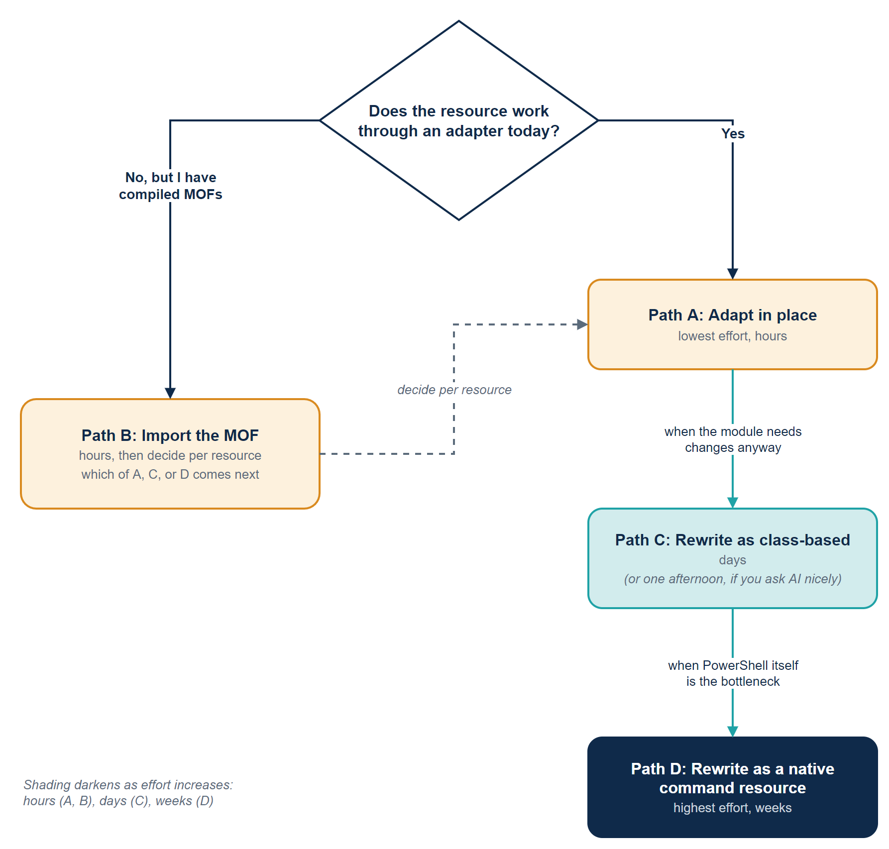
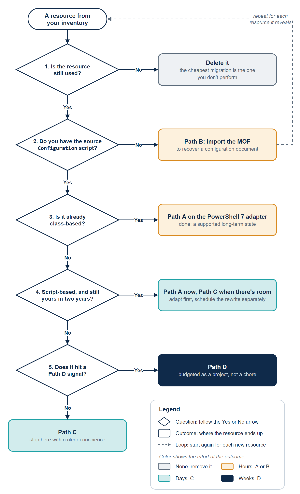

With the inventory in hand, every configuration and resource in your estate lands in one of four buckets. Think of them as increasing levels of effort and increasing levels of payoff.

<h2 id="the-four-paths">The four paths</h2>

<strong>Path A — Adapt in place.</strong>

Keep the module exactly as it is. Reference it through an adapter in a Microsoft DSC configuration document. Zero changes to resource code; the only thing that changes is the envelope around it.

<strong>Path B — Import compiled MOFs.</strong>

Use an import extension to translate MOF files into configuration documents, either on the fly at invocation time or as a one-time conversion you commit.

<strong>Path C — Rewrite script-based resources as class-based.</strong>

A moderate rewrite that unlocks the PowerShell 7+ adapter and sheds the Windows PowerShell dependency. The three functions become three methods.

<strong>Path D — Rewrite as a native command resource.</strong>

Full modernization: a resource with its own manifest, invoked directly by the engine with no PowerShell host in the middle. Worth it for resources that need speed, cross-platform reach, or freedom from PowerShell hosting entirely.

<blockquote>

[!NOTE] 
"Native" describes how the engine invokes the resource, not the language you write it in. Technically, a command resource can still be PowerShell: the resource manifest calls <code>pwsh</code> and hands it a PowerShell script as the entry point. <a href="https://github.com/PowerShell/PSResourceGet/tree/master/src/dsc">PSResourceGet</a> ships its DSC resources this way.

<pre><code class="language-json">"get": {
  "executable": "pwsh",
  "args": ["-NoLogo", "-NonInteractive", "-NoProfile", "-Command", "./appenvironment.ps1 get"],
  "input": "stdin"
}
</code></pre>

You gain the manifest's full capability surface without leaving PowerShell. You don't gain the near-instant startup, because every invocation still starts <code>pwsh</code>.

</blockquote>
<h2 id="compare-them-honestly">Compare them honestly</h2>
<table>
<thead>
<tr>
<th></th>
<th>Path A</th>
<th>Path B</th>
<th>Path C</th>
<th>Path D</th>
</tr>
</thead>
<tbody>
<tr>
<td><strong>Effort</strong></td>
<td>Hours</td>
<td>Hours</td>
<td>Days</td>
<td>Weeks</td>
</tr>
<tr>
<td><strong>Resource code changes</strong></td>
<td>None</td>
<td>None</td>
<td>Rewrite</td>
<td>Rewrite in another language</td>
</tr>
<tr>
<td><strong>Requires 5.1 at runtime</strong></td>
<td>Yes</td>
<td>Yes</td>
<td>No</td>
<td>No</td>
</tr>
<tr>
<td><strong>Works cross-platform</strong></td>
<td>No</td>
<td>No</td>
<td>Yes (PowerShell 7)</td>
<td>Yes (native binary)</td>
</tr>
<tr>
<td><strong>Startup cost per invocation</strong></td>
<td>PowerShell host</td>
<td>PowerShell host</td>
<td>PowerShell host</td>
<td>Near-instant</td>
</tr>
<tr>
<td><strong>Full capability surface</strong></td>
<td>No</td>
<td>No</td>
<td>Partial</td>
<td>Yes</td>
</tr>
<tr>
<td><strong>Best for</strong></td>
<td>Everything, as a first move</td>
<td>MOFs with no surviving source</td>
<td>Resources you'll keep for years</td>
<td>Resources invoked constantly, or shipped as products</td>
</tr>
</tbody>
</table>
<blockquote>

[!NOTE] 
The effort estimates assume a person doing the work by hand, without AI assistance. AI tools can shorten the typing, but they don't shorten the review, the testing, or the edge cases you still have to verify on a real machine. Apart from the aside in Figure 1, this course leaves AI out of every estimate.

</blockquote>
<h2 id="a-decision-flow-you-can-defend">A decision flow you can defend</h2>

Work down this list per resource. The first match wins:

<blockquote>

[!IMPORTANT] 
Paths A and B are not failures of ambition. They move the <em>orchestration layer</em> to Microsoft DSC while leaving resource code alone, which is exactly the decoupling that makes Paths C and D safe to do later, one resource at a time, with a working system between every step.

</blockquote>
<h2 id="when-path-d-earns-its-cost">When Path D earns its cost</h2>

Rewriting working PowerShell into another language is a real cost that needs a real payoff. Four signals tell you a resource has outgrown the adapter:

<ul>
<li><strong>Startup cost dominates.</strong> Every adapted invocation pays for a PowerShell host. For a resource invoked constantly — by a scheduler, a pipeline, or an AI agent — a native binary's near-instant startup changes the economics entirely.</li>
<li><strong>You need platforms that PowerShell modules serve poorly.</strong> A native resource compiled for Linux and macOS beats "install PowerShell 7 everywhere first" as a deployment story.</li>
<li><strong>You want the full capability surface.</strong> Native what-if support via <code>whatIfArg</code>, <code>implementsPretest</code>, <code>handlesExist</code>, and fine-grained capability declarations belong to resource manifests, not to adapted resources.</li>
<li><strong>The resource is a product, not a script.</strong> If other teams or customers consume it, the single-binary distribution model and the language-agnostic contract are worth the rewrite on their own.</li>
</ul>

If none of those apply, a class-based resource running on PowerShell 7 through the adapter is a fully supported, long-term-viable end state.

<h2 id="apply-it-to-bindery">Apply it to Bindery</h2>

Run the decision flow against the estate you built in unit 4:

<table>
<thead>
<tr>
<th>Artifact</th>
<th>Decision flow result</th>
<th>Path</th>
</tr>
</thead>
<tbody>
<tr>
<td><code>LegacyWebServer.ps1</code></td>
<td>Source script exists, resources are script-based</td>
<td>A</td>
</tr>
<tr>
<td><code>output\localhost.mof</code></td>
<td>Source exists, so the MOF is redundant — but you'll convert it anyway to learn the tool</td>
<td>B (as a drill)</td>
</tr>
<tr>
<td><code>BinderyOps/AppEnvironment</code></td>
<td>Script-based, still owned, no Path D signals</td>
<td>A now, C next</td>
</tr>
<tr>
<td><code>PSDesiredStateConfiguration/File</code></td>
<td>Built-in, script/binary-based, owned by Microsoft</td>
<td>A (or replace with a native file resource later)</td>
</tr>
</tbody>
</table>

That last row is worth pausing on. Some of your estate isn't yours to rewrite. Built-in <code>PSDesiredStateConfiguration</code> resources migrate via Path A by definition — the question is whether a native Microsoft DSC equivalent exists that you'd rather use instead. Check before you adapt.

<blockquote>

[!TIP] 
Record the chosen path in the inventory itself, next to the owner. When someone asks in six months why <code>AppEnvironment</code> is still on the 5.1 adapter, the answer should be a row in a file, not a memory.

</blockquote>
