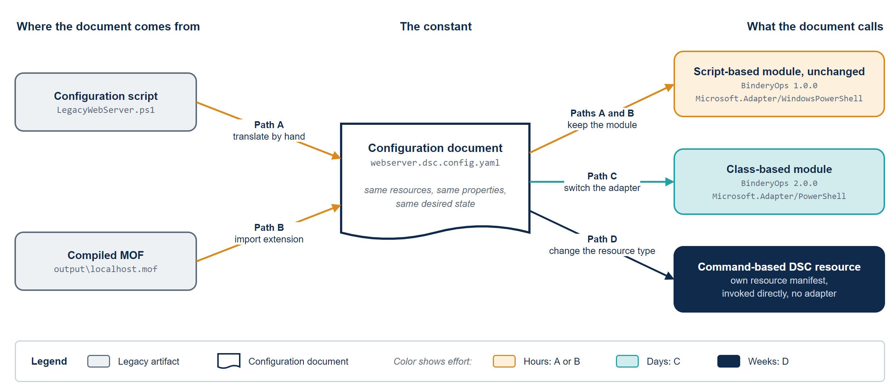

Module 1 ended with an inventory and a path assigned to every row. This module walks all four paths against the same small estate, so that by the end you've felt the cost and the payoff of each one rather than reading about them.

The order matters. You'll go <strong>A → B → C → D</strong>, which is increasing effort, but it's also the order in which the paths depend on each other:

<ul>
<li><strong>Path A</strong> teaches the translation vocabulary — what each legacy construct becomes in a configuration document.</li>
<li><strong>Path B</strong> produces a document automatically, which you then read <em>using</em> the vocabulary from Path A.</li>
<li><strong>Path C</strong> changes what's underneath the document, and you verify it by re-running the Path A document with one property changed.</li>
<li><strong>Path D</strong> is the decision of <em>when</em> the rewrite is worth it, framed against everything you learned in A through C.</li>
</ul>

<h2 id="learning-objectives">Learning objectives</h2>

By the end of this module, you'll be able to:

<ul>
<li>Translate a <code>Configuration</code> script into a configuration document and map every legacy construct to its equivalent.</li>
<li>Convert a compiled MOF file into a configuration document, and review the result against the four known blind spots of mechanical conversion.</li>
<li>Rewrite a script-based resource as a class-based resource, including the design decisions that are cheap now and expensive later.</li>
<li>Decide when a native command resource is worth the rewrite, and defend the decision either way.</li>
</ul>
<h2 id="before-you-start">Before you start</h2>

You need the Bindery estate from <a href="/courses/migrating-from-powershell-dsc/build-and-inventory-the-bindery-estate">Module 1, unit 4</a>, in its fabricated state:

<ul>
<li><code>BinderyOps</code> module installed with the script-based <code>AppEnvironment</code> resource</li>
<li><code>LegacyWebServer.ps1</code> compiled to <code>output\localhost.mof</code></li>
<li>The MOF applied, <code>BINDERY_API_URL</code> set at machine scope</li>
<li>An import extension installed for Path B (unit 4 explains the requirement)</li>
</ul>
<blockquote>

[!TIP] 
Every path in this module is verified with <code>dsc config test</code>, and the pass criterion is always the same: <code>inDesiredState: true</code> on a machine that the LCM already converged. If a path can't reproduce the LCM's result, the translation is wrong — and that's exactly what you want the test to tell you.

</blockquote>
