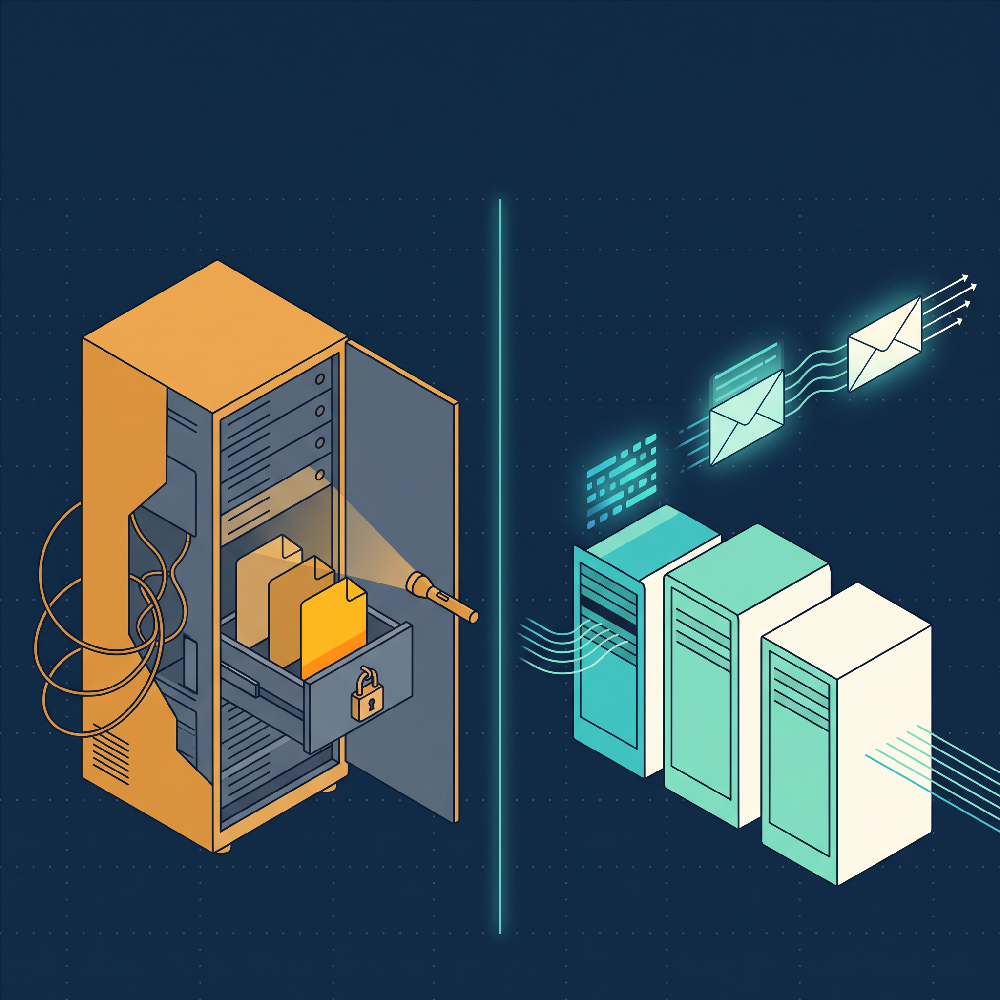

Before touching a single file, it's worth being honest about the motivation. PowerShell DSC still works. Windows PowerShell 5.1 ships with Windows, the LCM still enforces configurations, and <code>Start-DscConfiguration</code> still does what it always did. Nobody is going to reach into your servers and delete it.

A migration you can't justify is a migration that stalls halfway, which is the worst possible place to stop. So start with the trajectory.

<h2 id="the-case-for-migrating">The case for migrating</h2>
<h3 id="windows-powershell-51-is-in-maintenance-mode">Windows PowerShell 5.1 is in maintenance mode</h3>

Windows PowerShell 5.1 receives security fixes, not features. The <code>PSDesiredStateConfiguration</code> module that ships with it, version 1.1, is frozen in time. The resources in it today are the resources it will have forever.

Microsoft may drop the Windows PowerShell 5.1 adapter in a future release, which would complete the move away from script-based resources. Microsoft hasn't announced this, so don't base a migration schedule on it. The direction is clear, though, and it should decide whether you treat "adapt in place" as a waypoint or a destination.

<h3 id="the-lcm-is-not-coming-to-powershell-7">The LCM is not coming to PowerShell 7</h3>

The DSC platform in PowerShell 7 (the <code>PSDesiredStateConfiguration</code> v2 module) dropped the LCM, and Microsoft DSC kept that decision. This is the biggest architectural change in the migration, and Module 3 of this course covers it.

If your estate genuinely depends on LCM-style behavior (pull mode, scheduled enforcement, central reporting), the project positioned to take over that role today is <a href="https://github.com/OpenDSC">OpenDSC</a>, acting as the enforcement and orchestration layer above the new engine.

<blockquote>

[!IMPORTANT] 
OpenDSC is community-driven open source. It's not officially supported by Microsoft. If your organization requires vendor support for the enforcement layer, factor that into the plan before you decommission a pull server.

</blockquote>
<h3 id="new-investment-happens-in-microsoft-dsc">New investment happens in Microsoft DSC</h3>

New resources, the extension model, what-if support, and the MCP server that lets AI agents drive configuration: all of it lands in the new engine. Every quarter you stay on PowerShell DSC is a quarter of new capability you can't reach.

<h3 id="cross-platform-is-table-stakes">Cross-platform is table stakes</h3>

If any part of your estate runs Linux or macOS, PowerShell DSC was always an awkward fit — you needed the Linux OMI-based agent, a different resource ecosystem, and a different mental model. Microsoft DSC treats those platforms as first-class citizens running the same engine and the same documents.

<h3 id="state-is-no-longer-hidden">State is no longer hidden</h3>

There's a subtler reason that doesn't fit on a slide. PowerShell DSC's architecture hid state inside the LCM: pending MOFs, current MOFs, backup MOFs, all in <code>C:\Windows\System32\Configuration</code>. Troubleshooting meant spelunking through that hidden state and hoping <code>Get-DscConfigurationStatus</code> told you the truth.

Microsoft DSC is stateless. A document goes in, a result comes out. That's easier to reason about, easier to log, and dramatically easier to automate around, as you'll see when you build the equivalence check in Module 3.

<h2 id="the-case-for-waiting">The case for waiting</h2>

An honest planning unit names the reasons to hold off, too:

<table>
<thead>
<tr>
<th>Situation</th>
<th>Why waiting is reasonable</th>
</tr>
</thead>
<tbody>
<tr>
<td>Your estate is entirely Windows, entirely stable, and rarely changes</td>
<td>The payoff of a migration is proportional to how often you touch the thing. A frozen estate earns little.</td>
</tr>
<tr>
<td>You depend on pull mode with vendor support</td>
<td>Microsoft DSC has no in-box pull server. Until your organization accepts a community-supported layer or an orchestrator you build, part of the story is missing.</td>
</tr>
<tr>
<td>Your team has no PowerShell 7 footprint at all</td>
<td>Path C and Path D both assume PowerShell 7+ is deployable. If it isn't, you're limited to Path A and B, which is fine — but plan for that ceiling deliberately.</td>
</tr>
<tr>
<td>A compliance audit is in flight</td>
<td>Changing the enforcement engine mid-audit invites questions you don't want to answer twice. Migrate after.</td>
</tr>
</tbody>
</table>
<blockquote>

[!TIP] 
Migration isn't all-or-nothing. The adapters exist precisely so that you can move the orchestration layer first and leave the resources alone. Many organizations run in this hybrid state for years, and that's a valid end state, not a failure.

</blockquote>
<h2 id="frame-the-decision-for-your-stakeholders">Frame the decision for your stakeholders</h2>

When leadership asks "why now?", "because 5.1 is in maintenance mode" won't convince them. Translate the technical trajectory into operational terms:

<ul>
<li><strong>Risk:</strong> Every script-based resource depends on a runtime that gets security fixes and nothing else.</li>
<li><strong>Reach:</strong> Today a separate toolchain manages your Linux and macOS workloads. One engine replaces both.</li>
<li><strong>Speed:</strong> Drift detection that returns structured results becomes a pipeline gate. Drift detection that returns a MOF status object becomes a support ticket.</li>
<li><strong>Cost of delay:</strong> The inventory you're about to build grows every quarter you put it off.</li>
</ul>
