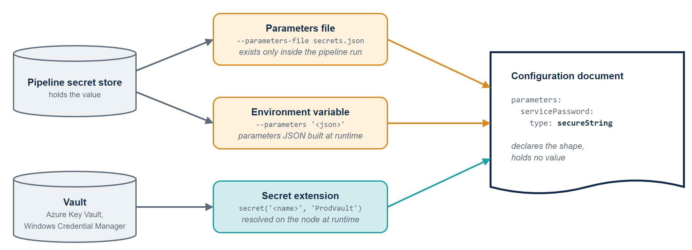

Credentials deserve their own unit because they're the one place where "translate it mechanically" is the wrong answer.

<h2 id="what-youre-migrating-away-from">What you're migrating away from</h2>

In PowerShell DSC, a <code>PSCredential</code> property left you two options, both bad:

<strong>Option 1: plaintext.</strong> Set <code>PSDscAllowPlainTextPassword = $true</code> in the configuration data, and the password is written into the MOF file in the clear. That MOF then sat on a pull server, in a build artifact, in a backup, and in whatever folder someone copied it to while troubleshooting.

<strong>Option 2: certificate encryption.</strong> Generate a certificate per node, distribute the public key to the build machine, encrypt the credential at compile time, and make sure the private key is on the target node before the MOF arrives. It works. It also means certificate lifecycle management, renewal, and a class of failures where a MOF can't be decrypted and nobody remembers why.

Both options share one flaw: the secret's <em>value</em> was baked into the artifact at compile time. The artifact was the secret.

<h2 id="what-youre-migrating-to">What you're migrating to</h2>

Microsoft DSC separates the <strong>shape</strong> from the <strong>source</strong>.

The document declares that a value is sensitive using a <code>secureString</code> parameter:

<pre><code class="language-yaml">parameters:
  servicePassword:
    type: secureString
resources:
  - name: AppService
    type: BinderyOps/ManagedService
    directives:
      requireAdapter: Microsoft.Adapter/PowerShell
    properties:
      Name: BinderySync
      Credential:
        UserName: svc-bindery
        Password: "[parameters('servicePassword')]"
</code></pre>

The document contains no secret. It contains the <em>statement</em> that a secret goes here.

Where the value comes from is a separate decision made at invocation time:

<table>
<thead>
<tr>
<th>Source</th>
<th>How</th>
<th>Fits</th>
</tr>
</thead>
<tbody>
<tr>
<td>A parameters file that exists only inside a pipeline run</td>
<td><code>--parameters-file secrets.json</code>, generated from the pipeline's secret store</td>
<td>CI/CD-driven estates</td>
</tr>
<tr>
<td>A DevOps secret store, injected as an environment variable</td>
<td>Build the parameters JSON at runtime</td>
<td>Teams already using pipeline secrets</td>
</tr>
<tr>
<td>A secret extension</td>
<td><code>secret()</code> resolving from Azure Key Vault or Windows Credential Manager</td>
<td>Node-local enforcement, scheduled runs</td>
</tr>
</tbody>
</table>

<h2 id="what-secure-types-do-and-dont-do">What secure types do and don't do</h2>

When a value is typed secure, DSC redacts it wherever the engine controls the output: results show <code>&lt;secureValue&gt;</code> instead of the value, and trace messages redact it the same way.

<blockquote>

[!WARNING] 
Secure types <strong>redact; they don't encrypt</strong>. A <code>secureString</code> travels to the resource as JSON over the process boundary. The protection is against casual and systemic exposure in outputs, logs, and artifacts — not against an attacker who can already read the memory or stderr of your elevated DSC process.

</blockquote>

That's still a improvement over a plaintext MOF on a file share, but state it accurately when someone asks whether the migration "encrypts credentials." It doesn't. It stops writing them down.

<h2 id="resolving-from-a-vault">Resolving from a vault</h2>

Secret extensions let the document resolve values at runtime rather than receiving them:

<pre><code class="language-yaml">parameters:
  servicePassword:
    type: secureString
    defaultValue: "[secret('BinderyServicePassword', 'ProdVault')]"
</code></pre>

Two details matter here, and both catch people:

<strong>Always name the vault.</strong> <code>secret('Name')</code> queries <em>every</em> registered extension with the secret capability, on every use. <code>secret('Name', 'ProdVault')</code> queries only that one. On any machine with more than one secret extension installed, treat the two-argument form as mandatory style — it avoids ambiguity errors, and it documents the secret's origin in the configuration where a reviewer can see it.

<strong><code>secret()</code> returns a plain string, not a <code>secureString</code>.</strong> Use it directly in a resource property and the resolved value flows through results unredacted:

<pre><code class="language-yaml"># Wrong: the resolved value appears in results and traces
properties:
  Password: "[secret('BinderyServicePassword', 'ProdVault')]"
</code></pre>
<pre><code class="language-yaml"># Right: the secret is routed through a secure-typed parameter
parameters:
  servicePassword:
    type: secureString
    defaultValue: "[secret('BinderyServicePassword', 'ProdVault')]"
resources:
  - name: AppService
    properties:
      Password: "[parameters('servicePassword')]"
</code></pre>

The parameter is what makes the value secure. The function is only what fetches it.

<h2 id="the-migration-rule-of-thumb">The migration rule of thumb</h2>

Two mechanical rules cover most of an estate:

<ol>
<li>

<strong>Every <code>PSDscAllowPlainTextPassword</code> you find becomes a <code>secureString</code> parameter.</strong> Search for it and treat each hit as a required change, not a candidate:

<pre><code class="language-powershell">Get-ChildItem -Path .\ -Filter *.ps1 -Recurse |
    Select-String -Pattern 'PSDscAllowPlainTextPassword'
</code></pre>
</li>
<li>

<strong>Every certificate-encryption setup becomes a conversation about which secret source replaces it.</strong> Nodes with a <code>CertificateID</code> in their meta-configuration (unit 2) are the list to work through.

</li>
</ol>

And one rule that isn't mechanical at all:

<ol start="3">
<li><strong>Assume every secret in a legacy MOF is burned.</strong> A password that sat in a plaintext MOF on a pull server, or in a build artifact, or in a repository, should be rotated during migration rather than carried across. The migration is the cheapest opportunity you'll ever have to rotate them, because you're touching every configuration anyway.</li>
</ol>
<blockquote>

[!IMPORTANT] 
Path B drops credentials on purpose when it converts a MOF. The importer can't translate them, and it shouldn't try. If a converted document is missing a credential property, the conversion didn't fail. It left you the one decision a person has to make: where that secret comes from now.

</blockquote>
<h2 id="review-a-migrated-document-for-leaks">Review a migrated document for leaks</h2>

Before committing any migrated document, check three things:

<ul>
<li>[ ] No <code>defaultValue</code> in the repository holds a real secret. If it does, that secret is burned the moment the file is committed.</li>
<li>[ ] No <code>Microsoft.DSC/Echo</code> resource reflects a credential property.</li>
<li>[ ] Running with <code>--trace-level debug --trace-format json</code> shows <code>&lt;secureValue&gt;</code> where the secret should be, not the value.</li>
</ul>

That third check takes thirty seconds and is the only one that tests what actually happens rather than what you intended.

