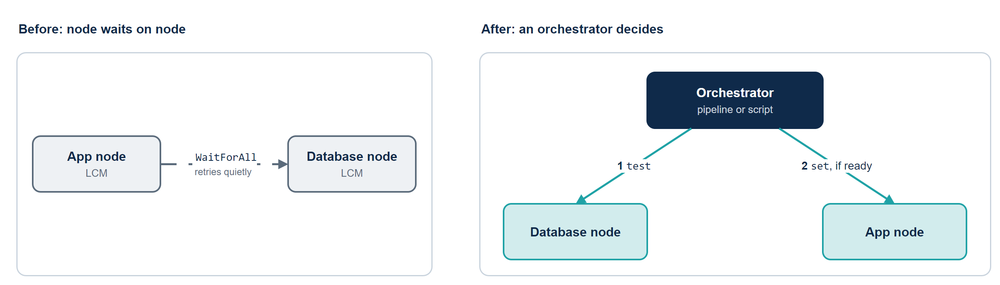

Two LCM behaviors change <em>who</em> is responsible rather than <em>how</em> something is done. Both need a decision from you before cutover.

<h2 id="reboots-became-explicit">Reboots became explicit</h2>

The LCM would reboot a node mid-run when a resource requested it and <code>RebootNodeIfNeeded</code> was set. Microsoft DSC will <strong>never</strong> reboot anything on its own.

Instead, resources report restart requirements, and the document can surface that state:

<pre><code class="language-yaml">  - name: rebootStatus
    type: Microsoft.DSC/Echo
    properties:
      output: "[restartRequired('system')]"
</code></pre>

The result tells the caller whether a restart is pending. What the caller does with that information is a policy decision that now lives where it always should have: <strong>outside the enforcement engine.</strong>

<h3 id="three-policies-all-legitimate">Three policies, all legitimate</h3>
<table>
<thead>
<tr>
<th>Policy</th>
<th>Implementation</th>
<th>Fits</th>
</tr>
</thead>
<tbody>
<tr>
<td>Reboot immediately</td>
<td>The invoking script reads the result and calls <code>Restart-Computer</code></td>
<td>Build agents, immutable images, dev environments</td>
</tr>
<tr>
<td>Queue for a maintenance window</td>
<td>Write the pending-restart state to a queue or tag the node</td>
<td>Production servers with change windows</td>
</tr>
<tr>
<td>Raise a ticket</td>
<td>Post the result to your ITSM tool</td>
<td>Estates where reboots need human approval</td>
</tr>
</tbody>
</table>

The LCM only ever offered the first one, and only as a boolean. A migration is the right moment to ask which of the three your estate actually wants, because the answer is usually not "reboot production immediately," which is what <code>RebootNodeIfNeeded = $true</code> meant.

A caller implementing the queue policy looks like this:

<pre><code class="language-powershell">$result = dsc config set --file .\webserver-adapted.dsc.config.yaml --output-format json |
    ConvertFrom-Json&#10;
$needsRestart = $result.results |
    Where-Object { $_.result._metadata.restartRequired } |
    Select-Object -ExpandProperty name&#10;
if ($needsRestart) {
    # Don't reboot. Record it, and let the maintenance window handle it.
    [PSCustomObject]@{
        Node      = $env:COMPUTERNAME
        Resources = $needsRestart -join ', '
        DetectedAt = (Get-Date).ToString('o')
    } | Export-Csv -Path \\bindery-ops\pending-restarts.csv -Append -NoTypeInformation
}
</code></pre>
<blockquote>

[!NOTE] 
The story may not end at surfacing state. There's an open proposal on the DSC repository to <a href="https://github.com/PowerShell/DSC/issues/450">implement generic restart resources</a>, such as <code>Microsoft.DSC/RestartService</code> or <code>Microsoft.DSC/RestartMachine</code>. These would evaluate restart requirements reported by earlier resources in the run and perform the restart themselves, with properties for additional control.

If that lands, declaring reboot policy <em>inside</em> the document becomes an option again. This time it would be an explicit resource you place and review, rather than an LCM setting that surprises you.

</blockquote>
<h2 id="cross-node-coordination-was-cut-not-misplaced">Cross-node coordination was cut, not misplaced</h2>

<code>WaitForAll</code>, <code>WaitForAny</code>, and <code>WaitForSome</code> let one node's LCM block on another node's state. Nothing in Microsoft DSC replaces this, <strong>deliberately</strong>.

The reasoning is sound, even if the result is inconvenient. A node-local enforcement engine is a poor place to implement distributed coordination. It needs to reach across the network, it needs credentials to do so, it blocks a local run on a remote condition, and it has no visibility into the overall workflow it's participating in.

<h3 id="find-the-dependencies-first">Find the dependencies first</h3>

You searched for these in Module 1. Now do something with the results:

<pre><code class="language-powershell">Get-ChildItem -Path .\ -Filter *.ps1 -Recurse |
    Select-String -Pattern 'WaitFor(All|Any|Some)' -Context 2,6
</code></pre>

For each hit, write down three things:

<ol>
<li><strong>What is the waiting node waiting for?</strong> A service running, a file existing, a configuration completing.</li>
<li><strong>How long does it wait?</strong> <code>RetryCount</code> and <code>RetryIntervalSec</code> encode an assumption about timing.</li>
<li><strong>What happens if it never arrives?</strong> Usually: the run fails and the LCM tries again in 15 minutes, silently.</li>
</ol>

That third answer is the one worth examining. A lot of <code>WaitFor*</code> usage is an implicit retry loop that nobody designed and nobody monitors.

<h3 id="move-it-to-the-orchestration-layer">Move it to the orchestration layer</h3>

Cross-node ordering becomes the job of whatever orchestrates the nodes:

<strong>A pipeline that runs nodes in dependency order:</strong>

<pre><code class="language-yaml"># Conceptual pipeline stages
stages:
  - stage: Database
    jobs:
      - job: ApplyDatabaseConfig    # dsc config set on db nodes
  - stage: Application
    dependsOn: Database             # gate: stage two waits for stage one
    jobs:
      - job: ApplyAppConfig         # dsc config set on app nodes
</code></pre>

<strong>A script that gates on structured results:</strong>

<pre><code class="language-powershell">$dbResult = Invoke-Command -ComputerName 'bindery-db01' -ScriptBlock {
    dsc config test --file C:\BinderyOps\database.dsc.config.yaml --output-format json
} | ConvertFrom-Json&#10;
$dbReady = -not ($dbResult.results.result.inDesiredState -contains $false)&#10;
if (-not $dbReady) {
    throw 'Database tier is not in desired state. Halting application tier.'
}&#10;
Invoke-Command -ComputerName 'bindery-app01' -ScriptBlock {
    dsc config set --file C:\BinderyOps\webserver-adapted.dsc.config.yaml
}
</code></pre>

This is more code than <code>WaitForAll</code> was. It's also visible, testable, and it fails loudly with a message instead of quietly retrying forever.

<blockquote>

[!IMPORTANT] 
The migration task is to <strong>find</strong> those hidden dependencies and make them explicit in the orchestration layer. A <code>WaitFor*</code> resource you didn't notice becomes a race condition after cutover. In configuration management, race conditions show up as "it worked in test."

</blockquote>
<h2 id="what-about-lcm-state">What about LCM state?</h2>

<code>Get-DscConfigurationStatus</code>, pending MOFs, previous MOFs, and the whole of <code>C:\Windows\System32\Configuration</code> have no equivalent. The engine is stateless and returns its results to the caller.

If your operations depend on querying node state after the fact, that capability now comes from <strong>whatever you do with the results</strong>, which is why unit 3 insisted on capturing them. A folder of timestamped JSON files is a more useful history than the LCM's three-deep MOF stack ever was, but only if something writes it.

